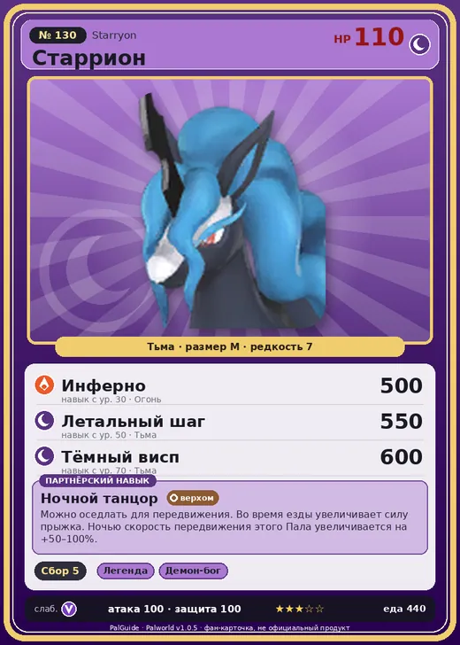

# #130 Старрион (Starryon)

#130 · Starryon

Тьма

Слабость: Дракон

🌾 Сбор <b>5</b>

<b>Ночной танцор</b> 🐾 выпущен 🐎 верхом

❤️ 110 · ⚔️ 100 · 🛡 100

| Поле | Значение |
|---|---|
| Стихия | Тьма |
| Слабость (кто бьёт сильнее) | Дракон |
| Редкость | 7 |
| Размер | M |
| HP / Атака / Защита (база вида) | 110 / 100 / 100 |
| Сколько ест | 440 |
| Цена продажи | 2014 |
| Множитель поимки | ×1 |
| Скорость рывка верхом | 1250 |

## Работа на базе
- Сбор — ур. 5

## Партнёрский навык: Ночной танцор
Можно оседлать для передвижения. Во время езды увеличивает силу прыжка. Ночью скорость передвижения этого Пала увеличивается на +(50~100)% . Технологии 57 level value 1 MoveSpeed_Night_01 50 JumpPower_Increase_Ride_PartnerSkill 25 2 MoveSpeed_Night_02 62 JumpPower_Increase_Ride_PartnerSkill 25 3 MoveSpeed_Night_03 74 JumpPower_Increase_Ride_PartnerSkill 25 4 MoveSpeed_Night_04 86 JumpPower_Increase_Ride_PartnerSkill 25 5 MoveSpeed_Night_05 100 JumpPower_Increase_Ride_PartnerSkill 25

## Атаки по уровням
- ур. 1: Грязевой выстрел (Земля, сила 40)
- ур. 7: Тёмный шар (Тьма, сила 50)
- ур. 15: Духовное пламя (Тьма, сила 200)
- ур. 22: Кошмарная сфера (Тьма, сила 300)
- ур. 30: Инферно (Огонь, сила 500)
- ур. 40: Апокалипсис (Тьма, сила 400)
- ур. 45: Рывок призрачного скакуна (Тьма, сила 450)
- ур. 50: Летальный шаг (Тьма, сила 550)
- ур. 70: Тёмный висп (Тьма, сила 600)

## Где водится
- В дикой природе: да; точек появления днём: 3, ночью: 185; уровни в первых точках: 50–52
- Подземелья: Пещера Тэнраку
- Яйцо: Большое яйцо тьмы

## Дроп
- Кожа — 2–3 шт., 100%
- Осколок тьмы — 1–2 шт., 100%

**Дроп альфы:**
- Деталь древней цивилизации — 6–8 шт., 100%
- Ценный мех — 2–3 шт., 100%

## Разведение
- Ранг разведения (CombiRank): 1150
- Участвует в особых парах: Селесдир → Старрион Примо

## Лучшие пассивки по роли
- боец: Легенда, Демон-бог, Хладнокровный, Бессмертие, Король тьмы (вместо Бессмертия, если нет мутации)
- рабочий: Дьявольские руки, Виртуоз, Мастеровитый, Небожитель/Трудоголик
- ездовой: Божественная скорость, Легенда, Вечный двигатель, Небесное скольжение

## Чем хорош / чем плох
- ✅ хорошая атака (100); отличный рабочий (пригодность 5); можно оседлать
- ❌ явных минусов нет

> Безмерно гордится своей красивой, струящейся гривой. Стоит заметить секущийся волос — от стыда не может сосредоточиться на беге. От статического электричества шерсть портится, поэтому к Азурмейн лучше не приближаться.

См. также: [Стихии](../../2_mehaniki/stihii.md) · [Разведение](../../2_mehaniki/razvedenie.md) · [Все палы](README.md)
