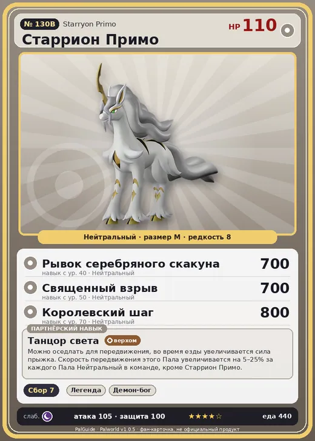

# #130B Старрион Примо (Starryon Primo)

№ 130B

Нейтральный

Слабость: Тьма

🌾 Сбор <b>7</b>

<b>Танцор света</b> 🐾 выпущен 🐎 верхом

❤️ 110 · ⚔️ 105 · 🛡 100

| Поле | Значение |
|---|---|
| Стихия | Нейтральный |
| Слабость (кто бьёт сильнее) | Тьма |
| Редкость | 8 |
| Размер | M |
| HP / Атака / Защита (база вида) | 110 / 105 / 100 |
| Сколько ест | 440 |
| Цена продажи | 2514 |
| Множитель поимки | ×1 |
| Скорость рывка верхом | 1250 |

=== "Обзор"

    #### Работа на базе
    - Сбор — ур. 7

    #### Партнёрский навык: Танцор света
    Можно оседлать для передвижения, во время езды увеличивается сила прыжка. Скорость передвижения этого Пала увеличивается на (5~25)% за каждого Пала Нейтральный в команде, кроме Старрион Примо . Технологии 77 level value 1 MoveSpeed_PartnerSkill_SpecificElement 5 JumpPower_Increase_Ride_PartnerSkill 25 2 MoveSpeed_PartnerSkill_SpecificElement 9 JumpPower_Increase_Ride_PartnerSkill 25 3 MoveSpeed_PartnerSkill_SpecificElement 13 JumpPower_Increase_Ride_PartnerSkill 25 4 MoveSpeed_PartnerSkill_SpecificElement 18 JumpPower_Increase_Ride_PartnerSkill 25 5 MoveSpeed_PartnerSkill_SpecificElement 25 JumpPower_Increase_Ride_PartnerSkill 25

    #### Чем хорош / чем плох
    - ✅ хорошая атака (105); отличный рабочий (пригодность 7); можно оседлать
    - ❌ разводится только особой парой

    > Безмерно гордится своей красивой, сияющей гривой. Стоит ей хоть немного испачкаться — от стыда не может сосредоточиться на беге. Кожный жир оставляет следы, поэтому даже любимому хозяину не стоит слишком часто трогать.

    См. также: [Стихии](../../guide/06_stihii.md) · [Разведение](../../guide/07_razvedenie.md) · [Все палы](README.md)

=== "Атаки"

    #### Атаки по уровням
    - ур. 1: Грязевой выстрел (Земля, сила 40)
    - ур. 7: Силовой выстрел (Нейтральный, сила 80)
    - ур. 15: Силовая бомба (Нейтральный, сила 120)
    - ур. 22: Воздушные клинки (Нейтральный, сила 160)
    - ур. 30: Палобласт (Нейтральный, сила 450)
    - ур. 40: Рывок серебряного скакуна (Нейтральный, сила 700)
    - ур. 50: Священный взрыв (Нейтральный, сила 700)
    - ур. 70: Королевский шаг (Нейтральный, сила 800)

=== "Где живёт"

    #### Где водится
    - В дикой природе: нет/особый способ; точек появления днём: 0, ночью: 0
    - Яйцо: Огромное обычное яйцо

=== "Дроп"

    #### Дроп
    - Кожа — 2–3 шт., 100%
    - Ночная звёздная пыль — 1–2 шт., 100%

    **Дроп альфы:**
    - Деталь древней цивилизации — 6–8 шт., 100%
    - Ценный мех — 2–3 шт., 100%

=== "Разведение"

    #### Разведение
    - Ранг разведения (CombiRank): 430
    - **Особая пара:** [Старрион](../../4_spravochniki/paly/starryon.md) + [Селесдир](../../4_spravochniki/paly/celesdir.md)

=== "Пассивки"

    #### Лучшие пассивки по роли
    - боец: Легенда, Демон-бог, Хладнокровный, Бессмертие, Святое небо (вместо Бессмертия, если нет мутации)
    - рабочий: Дьявольские руки, Виртуоз, Мастеровитый, Небожитель/Трудоголик
    - ездовой: Божественная скорость, Легенда, Вечный двигатель, Небесное скольжение

<a class="card-link" href="../starryon/">← Старрион</a><a class="card-link" href="../pierdon/">Пиродон →</a>

