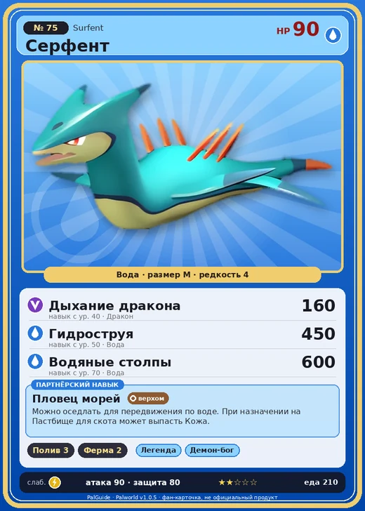

# #75 Серфент (Surfent)

№ 75

Вода

Слабость: Молния

💧 Полив <b>3</b>🐑 Фермерство <b>2</b>

<b>Пловец морей</b> 🐎 верхом 🏠 на базе

❤️ 90 · ⚔️ 90 · 🛡 80

| Поле | Значение |
|---|---|
| Стихия | Вода |
| Слабость (кто бьёт сильнее) | Молния |
| Редкость | 4 |
| Размер | M |
| HP / Атака / Защита (база вида) | 90 / 90 / 80 |
| Сколько ест | 210 |
| Цена продажи | 968 |
| Множитель поимки | ×1 |
| Скорость рывка верхом | 800 |

=== "Обзор"

    #### Работа на базе
    - Полив — ур. 3
    - Фермерство — ур. 2

    #### Партнёрский навык: Пловец морей
    Можно оседлать для передвижения по воде. При назначении на Пастбище для скота может выпасть Кожа . Технологии 16 level value 2 MoveSpeed_up_PartnerSkill_Ride_1 10 Пробуждение : (Скорость передвижения верхом: +10% ) 3 MoveSpeed_up_PartnerSkill_Ride_2 12 Пробуждение : (Скорость передвижения верхом: +12% ) 4 MoveSpeed_up_PartnerSkill_Ride_3 15 Пробуждение : (Скорость передвижения верхом: +15% ) 5 MoveSpeed_up_PartnerSkill_Ride_4 20 Пробуждение : (Скорость передвижения верхом: +20% ) 1 Пробуждение :

    #### Чем хорош / чем плох
    - ✅ можно оседлать
    - ❌ явных минусов нет

    > Обтекаемая форма этого Пала позволяет ему быстро передвигаться по воде. Из-за этого браконьеры нередко ловят его — и катаются на нём, как на серфе.

    См. также: [Стихии](../../guide/06_stihii.md) · [Разведение](../../guide/07_razvedenie.md) · [Все палы](README.md)

=== "Атаки"

    #### Атаки по уровням
    - ур. 1: Акваджет (Вода, сила 40)
    - ур. 7: Драконья пушка (Дракон, сила 40)
    - ур. 15: Водяной выстрел (Вода, сила 50)
    - ур. 22: Пузырьковый выстрел (Вода, сила 80)
    - ур. 30: Драконий взрыв (Дракон, сила 80)
    - ур. 40: Дыхание дракона (Дракон, сила 160)
    - ур. 50: Гидроструя (Вода, сила 450)
    - ур. 70: Водяные столпы (Вода, сила 600)

=== "Где живёт"

    #### Где водится
    - В дикой природе: да; точек появления днём: 273, ночью: 301; уровни в первых точках: 12–16
    - Подземелья: Пещера Ущелья
    - Яйцо: Яйцо воды

=== "Дроп"

    #### Дроп
    - Жидкость водного Пала — 1–2 шт., 100%

    **Дроп альфы:**
    - Деталь древней цивилизации — 1–2 шт., 100%
    - Ценные внутренности — 1–2 шт., 100%

=== "Разведение"

    #### Разведение
    - Ранг разведения (CombiRank): 2440
    - Участвует в особых парах: Элфидран → Элфидран Аква; Думад → Серфент Терра

=== "Пассивки"

    #### Лучшие пассивки по роли
    - боец: Легенда, Демон-бог, Хладнокровный, Бессмертие, Владыка морей (вместо Бессмертия, если нет мутации)
    - рабочий: Дьявольские руки, Виртуоз, Мастеровитый, Небожитель/Трудоголик
    - ездовой: Божественная скорость, Легенда, Вечный двигатель, Небесное скольжение

<a class="card-link" href="../gorirat_terra/">← Горират Терра</a><a class="card-link" href="../surfent_terra/">Серфент Терра →</a>

