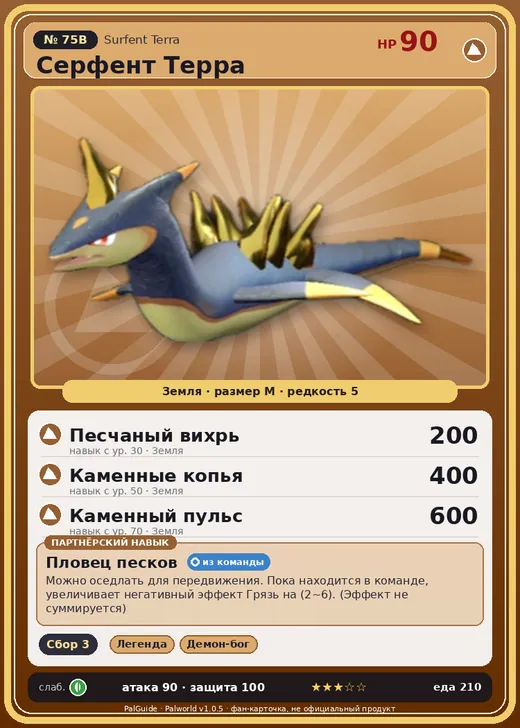

# #75B Серфент Терра (Surfent Terra)

№ 75B

Земля

Слабость: Трава

🌾 Сбор <b>3</b>

<b>Пловец песков</b> 🎒 из команды 🐎 верхом

❤️ 90 · ⚔️ 90 · 🛡 100

| Поле | Значение |
|---|---|
| Стихия | Земля |
| Слабость (кто бьёт сильнее) | Трава |
| Редкость | 5 |
| Размер | M |
| HP / Атака / Защита (база вида) | 90 / 90 / 100 |
| Сколько ест | 210 |
| Цена продажи | 1205 |
| Множитель поимки | ×1 |
| Скорость рывка верхом | 800 |

=== "Обзор"

    #### Работа на базе
    - Сбор — ур. 3

    #### Партнёрский навык: Пловец песков
    Можно оседлать для передвижения. Пока находится в команде, увеличивает негативный эффект Грязь на 2–6. (Эффект не суммируется) Технологии 25.

    #### Чем хорош / чем плох
    - ✅ можно оседлать
    - ❌ разводится только особой парой

    > Обтекаемая форма этого Пала позволяет ему быстро передвигаться по песку. Из-за этого браконьеры нередко ловят его — и катаются на нём, как на серфе.

    См. также: [Стихии](../../guide/06_stihii.md) · [Разведение](../../guide/07_razvedenie.md) · [Все палы](README.md)

=== "Атаки"

    #### Атаки по уровням
    - ур. 1: Грязевой выстрел (Земля, сила 40)
    - ур. 7: Драконья пушка (Дракон, сила 40)
    - ур. 15: Каменный залп (Земля, сила 80)
    - ур. 22: Камнемёт (Земля, сила 120)
    - ур. 30: Песчаный вихрь (Земля, сила 200)
    - ур. 40: Дыхание дракона (Дракон, сила 160)
    - ур. 50: Каменные копья (Земля, сила 400)
    - ур. 70: Каменный пульс (Земля, сила 600)

=== "Где живёт"

    #### Где водится
    - В дикой природе: да; точек появления днём: 591, ночью: 591; уровни в первых точках: 26–30
    - Подземелья: Пещера Песчаных Дюн
    - Может продаваться у торговца/рекрутера
    - Яйцо: Большое яйцо земли

=== "Дроп"

    #### Дроп
    - Жидкость водного Пала — 1–2 шт., 100%
    - Металлическая руда — 2–3 шт., 100%

    **Дроп альфы:**
    - Деталь древней цивилизации — 2–3 шт., 100%
    - Металлическая руда — 2–3 шт., 100%
    - Ценные внутренности — 2–3 шт., 100%

=== "Разведение"

    #### Разведение
    - Ранг разведения (CombiRank): 1840
    - **Особая пара:** [Серфент](../../4_spravochniki/paly/surfent.md) + [Думад](../../4_spravochniki/paly/dumud.md)
    - Участвует в особых парах: Полапап → Полапап Терра

=== "Пассивки"

    #### Лучшие пассивки по роли

    

⚔️ Боец

максимум урона и живучести в бою

<a class="psv r-4" data-psv="Легенда" href="../../../passivki/legend/">Легенда</a><a class="psv r-4" data-psv="Демон-бог" href="../../../passivki/demon_god/">Демон-бог</a><a class="psv r-3" data-psv="Император земли" href="../../../passivki/earth_emperor/">Император земли</a><a class="psv r-3" data-psv="Хладнокровный" href="../../../passivki/serenity/">Хладнокровный</a>

🛠 Рабочий

работает быстрее и меньше устаёт на базе

<a class="psv r-5" data-psv="Дьявольские руки" href="../../../passivki/demons_hand/">Дьявольские руки</a><a class="psv r-4" data-psv="Виртуоз" href="../../../passivki/remarkable_craftsmanship/">Виртуоз</a><a class="psv r-3" data-psv="Мастеровитый" href="../../../passivki/artisan/">Мастеровитый</a><a class="psv r-3" data-psv="Трудоголик" href="../../../passivki/workaholic/">Трудоголик</a>

🐎 Ездовой

быстрее бегает или летает с тобой верхом

<a class="psv r-4" data-psv="Божественная скорость" href="../../../passivki/swift/">Божественная скорость</a><a class="psv r-4" data-psv="Легенда" href="../../../passivki/legend/">Легенда</a><a class="psv r-4" data-psv="Вечный двигатель" href="../../../passivki/eternal_engine/">Вечный двигатель</a><a class="psv r-4" data-psv="Небесное скольжение" href="../../../passivki/sky_strider/">Небесное скольжение</a>

    <small>Нажми на пассивку, чтобы узнать, что она даёт и где её взять.</small>

<a class="card-link" href="../surfent/">← Серфент</a><a class="card-link" href="../robinquill/">Робинквилл →</a>

