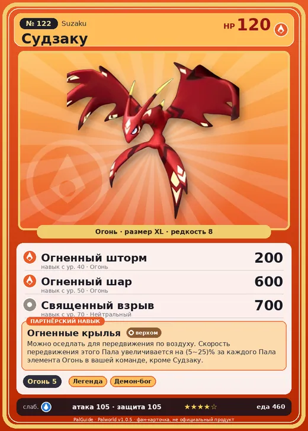

# #122 Судзаку (Suzaku)

#122 · Suzaku

Огонь

Слабость: Вода

🔥 Разжигание огня <b>5</b>

<b>Огненные крылья</b> 🐾 выпущен 🐎 верхом

❤️ 120 · ⚔️ 105 · 🛡 105

| Поле | Значение |
|---|---|
| Стихия | Огонь |
| Слабость (кто бьёт сильнее) | Вода |
| Редкость | 8 |
| Размер | XL |
| HP / Атака / Защита (база вида) | 120 / 105 / 105 |
| Сколько ест | 460 |
| Цена продажи | 2409 |
| Множитель поимки | ×1 |
| Скорость рывка верхом | 1100 |

## Работа на базе
- Разжигание огня — ур. 5

## Партнёрский навык: Огненные крылья
Можно оседлать для передвижения по воздуху. Скорость передвижения этого Пала увеличивается на (5~25)% за каждого Пала элемента Огонь в вашей команде, кроме Судзаку . Технологии 43 level value 1 MoveSpeed_PartnerSkill_SpecificElement 5 2 MoveSpeed_PartnerSkill_SpecificElement 9 3 MoveSpeed_PartnerSkill_SpecificElement 13 4 MoveSpeed_PartnerSkill_SpecificElement 18 5 MoveSpeed_PartnerSkill_SpecificElement 25

## Атаки по уровням
- ур. 1: Воздушная пушка (Нейтральный, сила 40)
- ур. 7: Огненный выстрел (Огонь, сила 40)
- ур. 15: Расщеплённый огонь (Огонь, сила 80)
- ур. 22: Огненная стрела (Огонь, сила 120)
- ур. 30: Огненное дыхание (Огонь, сила 160)
- ур. 40: Огненный шторм (Огонь, сила 200)
- ур. 50: Огненный шар (Огонь, сила 600)
- ур. 70: Священный взрыв (Нейтральный, сила 700)

## Где водится
- В дикой природе: да; точек появления днём: 14, ночью: 14
- Яйцо: Огромное раскалённое яйцо

## Дроп
- Огненный орган — 5–10 шт., 100%

**Дроп альфы:**
- Деталь древней цивилизации — 5–7 шт., 100%
- Ценное перо — 5–7 шт., 100%

## Разведение
- Ранг разведения (CombiRank): 1200
- Участвует в особых парах: Йормунтайд → Судзаку Аква; Айдролон → Айдролон Игнис

## Лучшие пассивки по роли
- по обзору: Легенда, Демон-бог, Хладнокровный, Император огня
- боец: Легенда, Демон-бог, Хладнокровный, Бессмертие, Император огня (вместо Бессмертия, если нет мутации)
- рабочий: Дьявольские руки, Виртуоз, Мастеровитый, Небожитель/Трудоголик
- ездовой: Божественная скорость, Легенда, Вечный двигатель, Небесное скольжение

## Чем хорош / чем плох
- ✅ Огненный летун; хорошая атака (105); много здоровья (120); отличный рабочий (пригодность 5); можно оседлать; летает (ездовой)
- ❌ явных минусов нет

> В древности его считали вестником засухи. Когда один год был неурожайным, в надежде на следующий, люди безжалостно истребляли этих Палов.

См. также: [Стихии](../../2_mehaniki/stihii.md) · [Разведение](../../2_mehaniki/razvedenie.md) · [Все палы](README.md)
