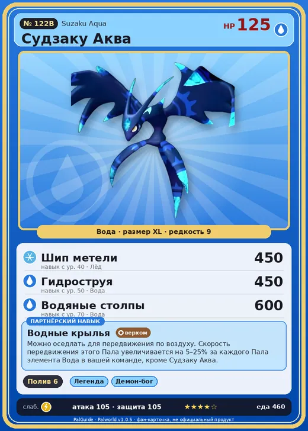

# Судзаку Аква

<canvas id="fx"></canvas>

№ 122B · Suzaku Aqua

Вода

Слабость: Молния

💧 Полив <b>6</b>

<b>Водные крылья</b> 🐾 выпущен 🐎 верхом

❤️ 125 · ⚔️ 105 · 🛡 105

| Поле | Значение |
|---|---|
| Стихия | Вода |
| Слабость (кто бьёт сильнее) | Молния |
| Редкость | 9 |
| Размер | XL |
| HP / Атака / Защита (база вида) | 125 / 105 / 105 |
| Сколько ест | 460 |
| Цена продажи | 2732 |
| Множитель поимки | ×1 |
| Скорость рывка верхом | 1100 |

=== "Обзор"

    #### Работа на базе
    - Полив — ур. 6

    #### Партнёрский навык: Водные крылья
    Можно оседлать для передвижения по воздуху. Скорость передвижения этого Пала увеличивается на 5–25% за каждого Пала элемента Вода в вашей команде, кроме Судзаку Аква. Технологии 44. По звёздам: 0★ 5 · 1★ 9 · 2★ 13 · 3★ 18 · 4★ 25

    #### Чем хорош / чем плох
    - ✅ хорошая атака (105); много здоровья (125); отличный рабочий (пригодность 6); можно оседлать; летает (ездовой)
    - ❌ разводится только особой парой

    > В древности его считали вестником сезона дождей. Если в предыдущем году случалось наводнение, люди, молясь о будущем спокойствии, настойчиво его истребляли.

    См. также: [Стихии](../../guide/06_stihii.md) · [Разведение](../../guide/07_razvedenie.md) · [Все палы](README.md)

=== "Атаки"

    #### Атаки по уровням
    - ур. 1: Акваджет (Вода, сила 40)
    - ур. 7: Ледяная ракета (Лёд, сила 40)
    - ур. 15: Водяной выстрел (Вода, сила 50)
    - ур. 22: Ледяное дыхание (Лёд, сила 160)
    - ур. 30: Водяная бомба (Вода, сила 200)
    - ур. 40: Шип метели (Лёд, сила 450)
    - ур. 50: Гидроструя (Вода, сила 450)
    - ур. 70: Водяные столпы (Вода, сила 600)

=== "Где живёт"

    #### Где водится
    - В дикой природе: да; точек появления днём: 50, ночью: 50
    - Яйцо: Огромное яйцо воды

=== "Дроп"

    #### Дроп
    - Жидкость водного Пала — 5 шт., 100%

    **Дроп альфы:**
    - Деталь древней цивилизации — 5–7 шт., 100%
    - Ценное перо — 5–7 шт., 100%

=== "Разведение"

    #### Разведение
    - Ранг разведения (CombiRank): 740
    - **Особая пара:** [Судзаку](../../4_spravochniki/paly/suzaku.md) + [Йормунтайд](../../4_spravochniki/paly/jormuntide.md)

=== "Пассивки"

    #### Лучшие пассивки по роли

    

⚔️ Боец

максимум урона и живучести в бою

<a class="psv r-4" data-psv="Легенда" href="../../../passivki/legend/">Легенда</a><a class="psv r-4" data-psv="Демон-бог" href="../../../passivki/demon_god/">Демон-бог</a><a class="psv r-3" data-psv="Владыка морей" href="../../../passivki/lord_of_the_sea/">Владыка морей</a><a class="psv r-3" data-psv="Хладнокровный" href="../../../passivki/serenity/">Хладнокровный</a>

🛠 Рабочий

работает быстрее и меньше устаёт на базе

<a class="psv r-5" data-psv="Дьявольские руки" href="../../../passivki/demons_hand/">Дьявольские руки</a><a class="psv r-4" data-psv="Виртуоз" href="../../../passivki/remarkable_craftsmanship/">Виртуоз</a><a class="psv r-3" data-psv="Мастеровитый" href="../../../passivki/artisan/">Мастеровитый</a><a class="psv r-3" data-psv="Трудоголик" href="../../../passivki/workaholic/">Трудоголик</a>

🐎 Ездовой

быстрее бегает или летает с тобой верхом

<a class="psv r-4" data-psv="Божественная скорость" href="../../../passivki/swift/">Божественная скорость</a><a class="psv r-4" data-psv="Легенда" href="../../../passivki/legend/">Легенда</a><a class="psv r-4" data-psv="Вечный двигатель" href="../../../passivki/eternal_engine/">Вечный двигатель</a><a class="psv r-3" data-psv="Умелый бегун" href="../../../passivki/runner/">Умелый бегун</a>

    <small>Нажми на пассивку, чтобы узнать, что она даёт и где её взять.</small>

<a class="card-link" href="../suzaku/">← Судзаку</a><a class="card-link" href="../dazemu/">Дазему →</a>

