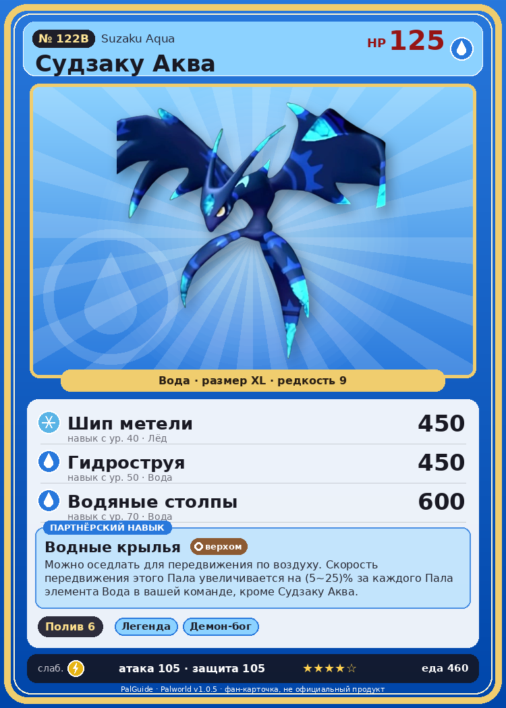

# #122B Судзаку Аква (Suzaku Aqua)

{ width=360 }

| Поле | Значение |
|---|---|
| Стихия | Вода |
| Слабость (кто бьёт сильнее) | Молния |
| Редкость | 9 |
| Размер | XL |
| HP / Атака / Защита (база вида) | 125 / 105 / 105 |
| Сколько ест | 460 |
| Цена продажи | 2732 |
| Множитель поимки | ×1 |
| Скорость рывка верхом | 1100 |

## Работа на базе
- Полив — ур. 6

## Партнёрский навык: Водные крылья
Можно оседлать для передвижения по воздуху. Скорость передвижения этого Пала увеличивается на (5~25)% за каждого Пала элемента Вода в вашей команде, кроме Судзаку Аква . Технологии 44 level value 1 MoveSpeed_PartnerSkill_SpecificElement 5 2 MoveSpeed_PartnerSkill_SpecificElement 9 3 MoveSpeed_PartnerSkill_SpecificElement 13 4 MoveSpeed_PartnerSkill_SpecificElement 18 5 MoveSpeed_PartnerSkill_SpecificElement 25

## Атаки по уровням
- ур. 1: Акваджет (Вода, сила 40)
- ур. 7: Ледяная ракета (Лёд, сила 40)
- ур. 15: Водяной выстрел (Вода, сила 50)
- ур. 22: Ледяное дыхание (Лёд, сила 160)
- ур. 30: Водяная бомба (Вода, сила 200)
- ур. 40: Шип метели (Лёд, сила 450)
- ур. 50: Гидроструя (Вода, сила 450)
- ур. 70: Водяные столпы (Вода, сила 600)

## Где водится
- В дикой природе: да; точек появления днём: 50, ночью: 50
- Яйцо: Огромное яйцо воды

## Дроп
- Жидкость водного Пала — 5 шт., 100%

**Дроп альфы:**
- Деталь древней цивилизации — 5–7 шт., 100%
- Ценное перо — 5–7 шт., 100%

## Разведение
- Ранг разведения (CombiRank): 740
- **Особая пара:** [Судзаку](../../4_spravochniki/paly/suzaku.md) + [Йормунтайд](../../4_spravochniki/paly/jormuntide.md)

## Лучшие пассивки по роли
- боец: Легенда, Демон-бог, Хладнокровный, Бессмертие, Владыка морей (вместо Бессмертия, если нет мутации)
- рабочий: Дьявольские руки, Виртуоз, Мастеровитый, Небожитель/Трудоголик
- ездовой: Божественная скорость, Легенда, Вечный двигатель, Небесное скольжение

## Чем хорош / чем плох
- ✅ хорошая атака (105); много здоровья (125); отличный рабочий (пригодность 6); можно оседлать; летает (ездовой)
- ❌ разводится только особой парой

> В древности его считали вестником сезона дождей. Если в предыдущем году случалось наводнение, люди, молясь о будущем спокойствии, настойчиво его истребляли.

См. также: [Стихии](../../2_mehaniki/stihii.md) · [Разведение](../../2_mehaniki/razvedenie.md) · [Все палы](README.md)
_Источник: paldb.cc v1.0.5_
