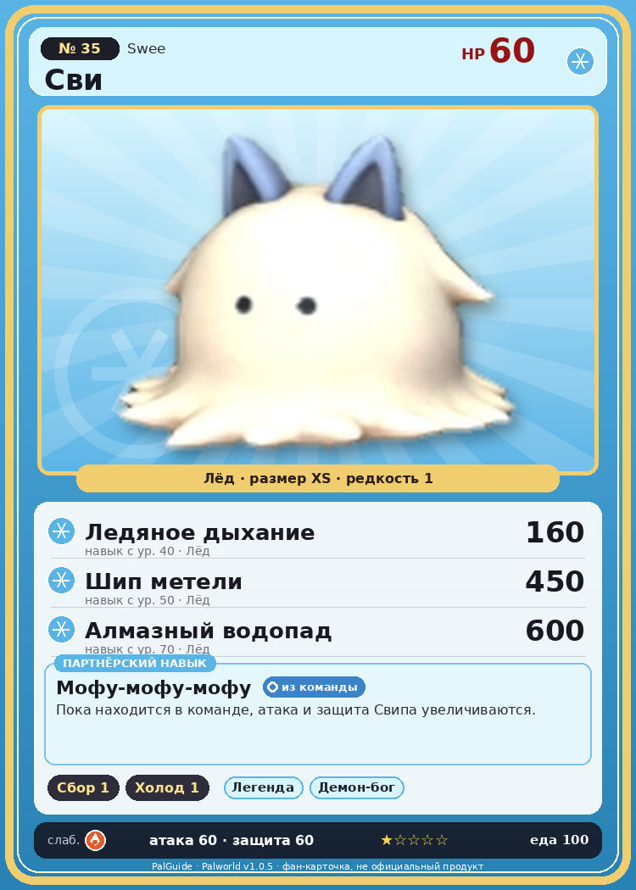

# #35 Сви (Swee)

{ width=360 }

| Поле | Значение |
|---|---|
| Стихия | Лёд |
| Слабость (кто бьёт сильнее) | Огонь |
| Редкость | 1 |
| Размер | XS |
| HP / Атака / Защита (база вида) | 60 / 60 / 60 |
| Сколько ест | 100 |
| Цена продажи | 313 |
| Множитель поимки | ×1.1 |
| Скорость рывка верхом | 400 |

## Работа на базе
- Сбор — ур. 1
- Охлаждение — ур. 1

## Партнёрский навык: Мофу-мофу-мофу
Пока находится в команде, атака и защита Свипа увеличиваются.

## Атаки по уровням
- ур. 1: Воздушная пушка (Нейтральный, сила 40)
- ур. 7: Ледяная ракета (Лёд, сила 40)
- ур. 15: Ледяной резак (Лёд, сила 80)
- ур. 22: Силовая бомба (Нейтральный, сила 120)
- ур. 30: Айсберг (Лёд, сила 120)
- ур. 40: Ледяное дыхание (Лёд, сила 160)
- ур. 50: Шип метели (Лёд, сила 450)
- ур. 70: Алмазный водопад (Лёд, сила 600)

## Где водится
- В дикой природе: да; точек появления днём: 101, ночью: 101; уровни в первых точках: 7–9
- Подземелья: Пещера Ущелья
- Яйцо: Яйцо льда

## Дроп
- Шерсть — 1 шт., 100%
- Волосы Сви — 1 шт., 50%

**Дроп альфы:**
- Деталь древней цивилизации — 5–7 шт., 100%
- Ценный мех — 2–4 шт., 100%

## Разведение
- Ранг разведения (CombiRank): 2840
- Участвует в особых парах: Хангю → Хангю Крист

## Лучшие пассивки по роли
- боец: Легенда, Демон-бог, Хладнокровный, Бессмертие, Император льда (вместо Бессмертия, если нет мутации)
- ездовой: Божественная скорость, Легенда, Вечный двигатель, Небесное скольжение

## Чем хорош / чем плох
- ✅ можно оседлать
- ❌ слабая атака (60); мало здоровья (60)

> Ползает по земле, поедая мельчайшие органические остатки. Всё неперевариваемое со временем выводится наружу. Если использовать его как швабру — выгодно всем.

См. также: [Стихии](../../2_mehaniki/stihii.md) · [Разведение](../../2_mehaniki/razvedenie.md) · [Все палы](README.md)
_Источник: paldb.cc v1.0.5_
