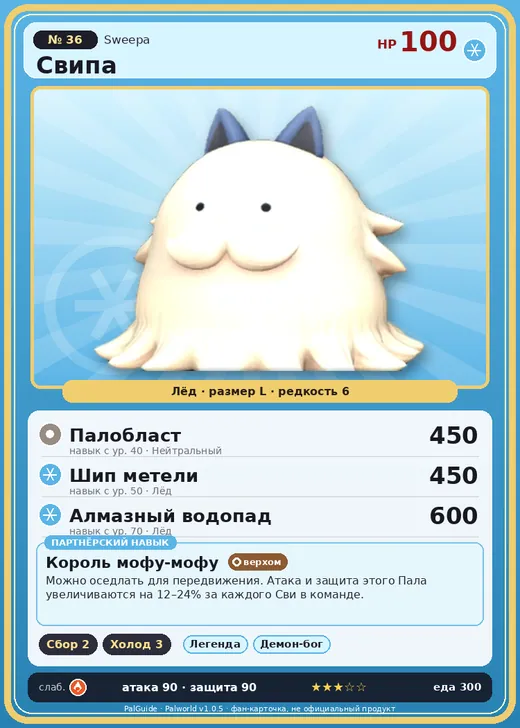

# #36 Свипа (Sweepa)

#36 · Sweepa

Лёд

Слабость: Огонь

🌾 Сбор <b>2</b>❄️ Охлаждение <b>3</b>

<b>Король мофу-мофу</b> 🐾 выпущен 🐎 верхом

❤️ 100 · ⚔️ 90 · 🛡 90

| Поле | Значение |
|---|---|
| Стихия | Лёд |
| Слабость (кто бьёт сильнее) | Огонь |
| Редкость | 6 |
| Размер | L |
| HP / Атака / Защита (база вида) | 100 / 90 / 90 |
| Сколько ест | 300 |
| Цена продажи | 1244 |
| Множитель поимки | ×1 |
| Скорость рывка верхом | 1020 |

## Работа на базе
- Сбор — ур. 2
- Охлаждение — ур. 3

## Партнёрский навык: Король мофу-мофу
Можно оседлать для передвижения. Атака и защита этого Пала увеличиваются на (12~24)% за каждого Сви в команде. Технологии 20 level value 1 Defense_ShotAttack_MopKing_PartnerSkill 12, 12 2 Defense_ShotAttack_MopKing_PartnerSkill 13, 13 3 Defense_ShotAttack_MopKing_PartnerSkill 15, 15 4 Defense_ShotAttack_MopKing_PartnerSkill 19, 19 5 Defense_ShotAttack_MopKing_PartnerSkill 24, 24

## Атаки по уровням
- ур. 1: Силовой выстрел (Нейтральный, сила 80)
- ур. 7: Ледяная ракета (Лёд, сила 40)
- ур. 15: Ледяной резак (Лёд, сила 80)
- ур. 22: Айсберг (Лёд, сила 120)
- ур. 30: Ледяное дыхание (Лёд, сила 160)
- ур. 40: Палобласт (Нейтральный, сила 450)
- ур. 50: Шип метели (Лёд, сила 450)
- ур. 70: Алмазный водопад (Лёд, сила 600)

## Где водится
- В дикой природе: да; точек появления днём: 100, ночью: 100; уровни в первых точках: 25–28
- Подземелья: Пещера Ущелья
- Яйцо: Большое яйцо льда

## Дроп
- Шерсть — 3–5 шт., 100%

**Дроп альфы:**
- Деталь древней цивилизации — 2–4 шт., 100%
- Ценный мех — 5–7 шт., 100%

## Разведение
- Ранг разведения (CombiRank): 2150
- Участвует в особых парах: Лупмун → Лупмун Крист

## Лучшие пассивки по роли
- боец: Легенда, Демон-бог, Хладнокровный, Бессмертие, Император льда (вместо Бессмертия, если нет мутации)
- рабочий: Дьявольские руки, Виртуоз, Мастеровитый, Небожитель/Трудоголик
- ездовой: Божественная скорость, Легенда, Вечный двигатель, Небесное скольжение

## Чем хорош / чем плох
- ✅ можно оседлать
- ❌ явных минусов нет

> Во время зимней спячки под густой шерстью этого Пала прячется множество Сви . По официальному рекорду — целых 101 особь!

См. также: [Стихии](../../2_mehaniki/stihii.md) · [Разведение](../../2_mehaniki/razvedenie.md) · [Все палы](README.md)
