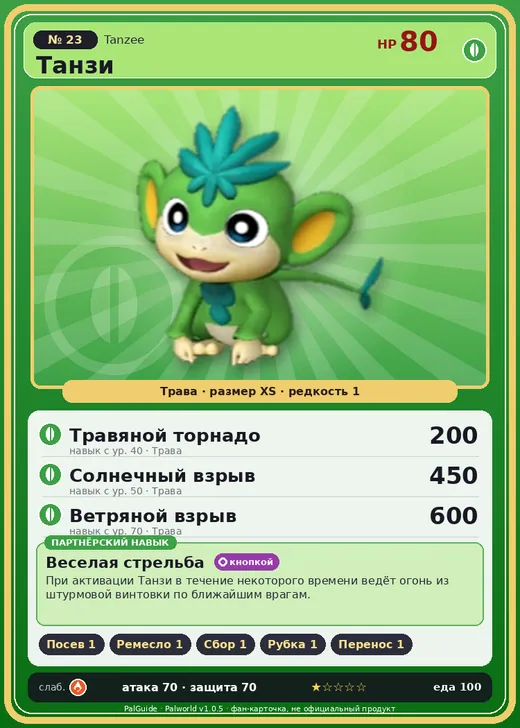

# #23 Танзи (Tanzee)

#23 · Tanzee

Трава

Слабость: Огонь

🌱 Посев семян <b>1</b>🖐️ Ручная работа <b>1</b>🌾 Сбор <b>1</b>🪓 Рубка деревьев <b>1</b>📦 Транспортировка <b>1</b>

<b>Веселая стрельба</b> 🔘 кнопкой

❤️ 80 · ⚔️ 70 · 🛡 70

| Поле | Значение |
|---|---|
| Стихия | Трава |
| Слабость (кто бьёт сильнее) | Огонь |
| Редкость | 1 |
| Размер | XS |
| HP / Атака / Защита (база вида) | 80 / 70 / 70 |
| Сколько ест | 100 |
| Цена продажи | 512 |
| Множитель поимки | ×1.1 |
| Скорость рывка верхом | 400 |

## Работа на базе
- Посев семян — ур. 1
- Ручная работа — ур. 1
- Сбор — ур. 1
- Рубка деревьев — ур. 1
- Транспортировка — ур. 1

## Партнёрский навык: Веселая стрельба
При активации Танзи в течение некоторого времени ведёт огонь из штурмовой винтовки по ближайшим врагам. Технологии 12 level value 1 MainValue 20 Пробуждение : 2 MainValue 22 Пробуждение : (Увеличение урона: Небольшое ) 3 MainValue 26 Пробуждение : (Увеличение урона: Среднее ) 4 MainValue 32 Пробуждение : (Увеличение урона: Большое ) 5 MainValue 40 Пробуждение : (Увеличение урона: Очень большое )

## Атаки по уровням
- ур. 1: Ветряной клинок (Трава, сила 40)
- ур. 7: Грязевой выстрел (Земля, сила 40)
- ур. 15: Семенной пулемёт (Трава, сила 80)
- ур. 22: Семенная мина (Трава, сила 120)
- ур. 30: Камнемёт (Земля, сила 120)
- ур. 40: Травяной торнадо (Трава, сила 200)
- ур. 50: Солнечный взрыв (Трава, сила 450)
- ур. 70: Ветряной взрыв (Трава, сила 600)

## Где водится
- В дикой природе: да; точек появления днём: 74, ночью: 74; уровни в первых точках: 4–6
- Подземелья: Пещера Отдалённого Острова, Пещера Холмов
- Яйцо: Яйцо свежей листвы

## Дроп
- Гриб — 1 шт., 100%

**Дроп альфы:**
- Деталь древней цивилизации — 1–2 шт., 100%
- Ценный коготь — 1–2 шт., 100%

## Разведение
- Ранг разведения (CombiRank): 2900
- Участвует в особых парах: Фламбелль → Танзи Игнис

## Лучшие пассивки по роли
- боец: Легенда, Демон-бог, Хладнокровный, Бессмертие, Король духов (вместо Бессмертия, если нет мутации)
- ездовой: Божественная скорость, Легенда, Вечный двигатель, Небесное скольжение

## Чем хорош / чем плох
- ✅ можно оседлать
- ❌ слабая атака (70)

> Некогда этот Пал использовал в бою продолговатые предметы — вроде веток деревьев. Но, начав общаться с людьми, он нашёл нечто поэффективнее — огнестрельное оружие.

См. также: [Стихии](../../guide/06_stihii.md) · [Разведение](../../guide/07_razvedenie.md) · [Все палы](README.md)
