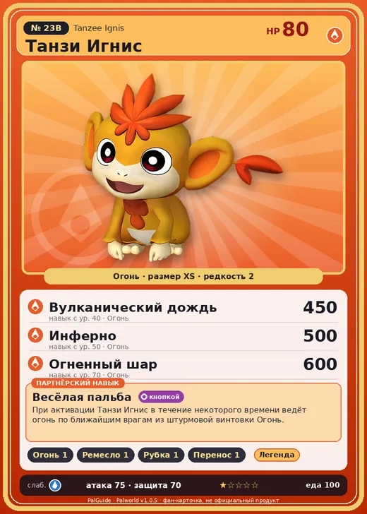

# Танзи Игнис

<canvas id="fx"></canvas>

№ 23B · Tanzee Ignis

Огонь

Слабость: Вода

🔥 Разжигание огня <b>1</b>🖐️ Ручная работа <b>1</b>🪓 Рубка деревьев <b>1</b>📦 Транспортировка <b>1</b>

<b>Весёлая пальба</b> 🔘 кнопкой

❤️ 80 · ⚔️ 75 · 🛡 70

| Поле | Значение |
|---|---|
| Стихия | Огонь |
| Слабость (кто бьёт сильнее) | Вода |
| Редкость | 2 |
| Размер | XS |
| HP / Атака / Защита (база вида) | 80 / 75 / 70 |
| Сколько ест | 100 |
| Цена продажи | 526 |
| Множитель поимки | ×1.1 |
| Скорость рывка верхом | 400 |

=== "Обзор"

    #### Работа на базе
    - Разжигание огня — ур. 1
    - Ручная работа — ур. 1
    - Рубка деревьев — ур. 1
    - Транспортировка — ур. 1

    #### Партнёрский навык: Весёлая пальба
    При активации Танзи Игнис в течение некоторого времени ведёт огонь по ближайшим врагам из штурмовой винтовки Огонь. Технологии 13.

    #### Чем хорош / чем плох
    - ✅
    - ❌ слабая атака (75); разводится только особой парой

    > Ладони эволюционировали так, чтобы можно было хватать раскалённое, не обжигаясь. Если закончатся патроны, можно схватить разогретый ствол и пойти врукопашную.

    См. также: [Стихии](../../guide/06_stihii.md) · [Разведение](../../guide/07_razvedenie.md) · [Все палы](README.md)

=== "Атаки"

    #### Атаки по уровням
    - ур. 1: Огненный выстрел (Огонь, сила 40)
    - ур. 7: Расщеплённый огонь (Огонь, сила 80)
    - ур. 15: Огненная стрела (Огонь, сила 120)
    - ур. 22: Огненная стена (Огонь, сила 250)
    - ур. 30: Огненная воронка (Огонь, сила 300)
    - ур. 40: Вулканический дождь (Огонь, сила 450)
    - ур. 50: Инферно (Огонь, сила 500)
    - ур. 70: Огненный шар (Огонь, сила 600)

=== "Где живёт"

    #### Где водится
    - В дикой природе: да; точек появления днём: 27, ночью: 27; уровни в первых точках: 10–12
    - Яйцо: Раскалённое яйцо

=== "Дроп"

    #### Дроп
    - Гриб — 1 шт., 100%
    - Огненный орган — 1–2 шт., 100%

    **Дроп альфы:**
    - Деталь древней цивилизации — 1–2 шт., 100%
    - Ценные внутренности — 2–3 шт., 100%

=== "Разведение"

    #### Разведение
    - Ранг разведения (CombiRank): 2830
    - **Особая пара:** [Танзи](../../4_spravochniki/paly/tanzee.md) + [Фламбелль](../../4_spravochniki/paly/flambelle.md)

=== "Пассивки"

    #### Лучшие пассивки по роли

    

⚔️ Боец

максимум урона и живучести в бою

<a class="psv r-4" data-psv="Легенда" href="../../../passivki/legend/">Легенда</a><a class="psv r-4" data-psv="Демон-бог" href="../../../passivki/demon_god/">Демон-бог</a><a class="psv r-3" data-psv="Император огня" href="../../../passivki/flame_emperor/">Император огня</a><a class="psv r-3" data-psv="Хладнокровный" href="../../../passivki/serenity/">Хладнокровный</a>

    <small>Нажми на пассивку, чтобы узнать, что она даёт и где её взять.</small>

<a class="card-link" href="../tanzee/">← Танзи</a><a class="card-link" href="../nox/">Нокс →</a>

