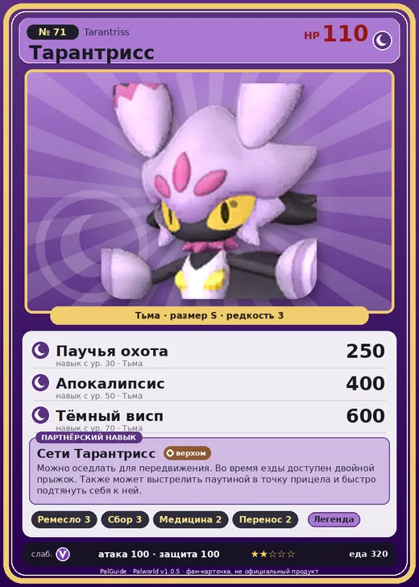

# Тарантрисс

<canvas id="fx"></canvas>

№ 71

Тьма

Слабость: Дракон <b class="mx">×1,5</b> <button class="hlp" data-tip="Множители перемножаются по обеим стихиям: ×1,5 за стихию, которую атака бьёт, ×0,65 за ту, что её держит.">?</button>

Устойчив: Нейтральный <b class="mx">×0,65</b>

🖐️ Ручная работа <b>3</b>🌾 Сбор <b>3</b>💊 Фармацевтика <b>2</b>📦 Транспортировка <b>2</b>

<b>Сети Тарантрисс</b> 🐎 Верхом

❤️ 110 · ⚔️ 100 · 🛡 100

Основное

💎Редкость <button class="hlp" data-tip="Чем выше число, тем реже встречается пал. 1–4 — обычные, 5–7 — редкие, 8+ — легендарные.">?</button><b>3</b>

📏Размер<b>S</b>

💰Цена продажи <button class="hlp" data-tip="Сколько золота даст торговец за пала.">?</button><b>1806</b>

Бой

🎯Множитель поимки <button class="hlp" data-tip="Насколько легче или труднее поймать: ×1 — обычно, меньше — сложнее.">?</button><b>×1</b>

🐎Скорость рывка верхом <button class="hlp" data-tip="Скорость, если сесть на пала и бежать рывком.">?</button><b>1000</b>

Ферма и еда

🍖Сколько ест <button class="hlp" data-tip="Сколько сытости пал тратит — чем больше, тем больше еды нужно на базе.">?</button><b>320</b>

Разведение

🧬Сила разведения <button class="hlp" data-tip="Скрытое число игры: у детёныша оно примерно среднее от родителей. Чем меньше — тем «сильнее» пал.">?</button><b>1730</b>

=== "Обзор"

    #### Работа на базе

    
✋ Ручная работа<i style="--v:30%"></i><b>3</b>🧺 Сбор<i style="--v:30%"></i><b>3</b>💊 Фармацевтика<i style="--v:20%"></i><b>2</b>📦 Транспортировка<i style="--v:20%"></i><b>2</b>

    #### Партнёрский навык: Сети Тарантрисс
    Можно оседлать для передвижения. Во время езды доступен двойной прыжок. Также может выстрелить паутиной в точку прицела и быстро подтянуть себя к ней. Технологии 20.

    #### Чем хорош / чем плох
    - ✅ хорошая атака (100); можно оседлать
    - ❌ явных минусов нет

    > Крайне липкий и навязчивый. Чем сильнее вырывается — тем сильнее прилипает. Таков уж у него… |характер|.

    См. также: [Стихии](../../guide/06_stihii.md) · [Разведение](../../guide/07_razvedenie.md) · [Все палы](README.md)

=== "Атаки"

    #### Атаки по уровням
    - ур. 1: Ядовитый туман (Тьма, сила 0)
    - ур. 7: Ядовитый выстрел (Тьма, сила 30)
    - ур. 15: Распространение тьмы (Тьма, сила 60)
    - ур. 22: Стрелы тьмы (Тьма, сила 120)
    - ур. 30: Паучья охота (Тьма, сила 250)
    - ур. 40: Ядовитый душ (Тьма, сила 160)
    - ур. 50: Апокалипсис (Тьма, сила 400)
    - ур. 70: Тёмный висп (Тьма, сила 600)

=== "Где живёт"

    #### Где водится

    

<button data-k="d" class="on">☀️ День</button><button data-k="n">🌙 Ночь</button>

ур. 30–50<a class="btn hm-full" href="../../../map/?pal=PurpleSpider">Показать на большой карте</a>

Зелёный ручейЛедяная гораИссохшие дюныГлубины бамбуковой рощи

🕳 Подземелье<b>Пещера Горного Потока</b>

🕳 Подземелье<b>Пещера Тэнраку</b>

🥚 Яйцо<b>Яйцо тьмы</b>

=== "Дроп"

    #### Дроп
    - Волокно — 2–5 шт., 100%
    - Ядовитая железа — 2–5 шт., 100%

    **Дроп альфы:**

    - Деталь древней цивилизации — 4–6 шт., 100%
    - Ценные внутренности — 2–3 шт., 100%

=== "Разведение"

    #### Разведение
    - Ранг разведения: 1730
    - Участвует в особых парах: [Каприти](caprity.md) → [Каприти Нокт](caprity_noct.md)

=== "Пассивки"

    #### Лучшие пассивки по роли

    

⚔️ Боец

максимум урона и живучести в бою

<a class="psv r-4" data-psv="Легенда" href="../../../passivki/legend/">Легенда</a><a class="psv r-4" data-psv="Демон-бог" href="../../../passivki/demon_god/">Демон-бог</a><a class="psv r-3" data-psv="Король тьмы" href="../../../passivki/lord_of_the_underworld/">Король тьмы</a><a class="psv r-3" data-psv="Хладнокровный" href="../../../passivki/serenity/">Хладнокровный</a>

🛠 Рабочий

работает быстрее и меньше устаёт на базе

<a class="psv r-5" data-psv="Дьявольские руки" href="../../../passivki/demons_hand/">Дьявольские руки</a><a class="psv r-4" data-psv="Виртуоз" href="../../../passivki/remarkable_craftsmanship/">Виртуоз</a><a class="psv r-3" data-psv="Мастеровитый" href="../../../passivki/artisan/">Мастеровитый</a><a class="psv r-3" data-psv="Трудоголик" href="../../../passivki/workaholic/">Трудоголик</a>

🐎 Ездовой

быстрее бегает или летает с тобой верхом

<a class="psv r-4" data-psv="Божественная скорость" href="../../../passivki/swift/">Божественная скорость</a><a class="psv r-4" data-psv="Легенда" href="../../../passivki/legend/">Легенда</a><a class="psv r-4" data-psv="Вечный двигатель" href="../../../passivki/eternal_engine/">Вечный двигатель</a><a class="psv r-4" data-psv="Небесное скольжение" href="../../../passivki/sky_strider/">Небесное скольжение</a>

    <small>Нажми на пассивку, чтобы узнать, что она даёт и где её взять.</small>

<a class="card-link" href="../grintale/">← Гринтэйл</a><a class="card-link" href="../polapup/">Полапап →</a>

