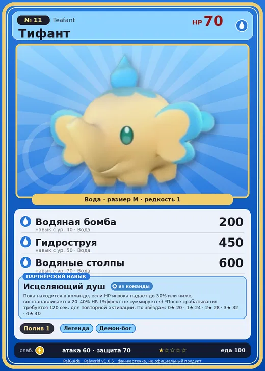

# #11 Тифант (Teafant)

№ 11

Вода

Слабость: Молния

💧 Полив <b>1</b>

<b>Исцеляющий душ</b> 🎒 из команды

❤️ 70 · ⚔️ 60 · 🛡 70

| Поле | Значение |
|---|---|
| Стихия | Вода |
| Слабость (кто бьёт сильнее) | Молния |
| Редкость | 1 |
| Размер | M |
| HP / Атака / Защита (база вида) | 70 / 60 / 70 |
| Сколько ест | 100 |
| Цена продажи | 355 |
| Множитель поимки | ×1.3 |
| Скорость рывка верхом | 400 |

=== "Обзор"

    #### Работа на базе
    - Полив — ур. 1

    #### Партнёрский навык: Исцеляющий душ
    Пока находится в команде, если HP игрока падает до 30% или ниже, восстанавливается 20–40% HP. (Эффект не суммируется) *После срабатывания требуется 120 сек. для повторной активации. По звёздам: 0★ 20 · 1★ 24 · 2★ 28 · 3★ 32 · 4★ 40

    #### Чем хорош / чем плох
    - ✅
    - ❌ слабая атака (60)

    > Из органа, который предположительно является носом, вытекают огромные объёмы воды. Есть мнение, что это всего лишь сопли. В кругах учёных по этому поводу разгорелись жаркие споры.

    См. также: [Стихии](../../guide/06_stihii.md) · [Разведение](../../guide/07_razvedenie.md) · [Все палы](README.md)

=== "Атаки"

    #### Атаки по уровням
    - ур. 1: Водяной выстрел (Вода, сила 50)
    - ур. 7: Акваджет (Вода, сила 40)
    - ур. 15: Грязевой выстрел (Земля, сила 40)
    - ур. 22: Пузырьковый выстрел (Вода, сила 80)
    - ур. 30: Кислотный дождь (Вода, сила 120)
    - ур. 40: Водяная бомба (Вода, сила 200)
    - ур. 50: Гидроструя (Вода, сила 450)
    - ур. 70: Водяные столпы (Вода, сила 600)

=== "Где живёт"

    #### Где водится
    - В дикой природе: да; точек появления днём: 172, ночью: 172; уровни в первых точках: 2–4
    - Подземелья: Пещера Отдалённого Острова, Пещера Холмов
    - Яйцо: Яйцо воды

=== "Дроп"

    #### Дроп
    - Жидкость водного Пала — 1 шт., 100%

    **Дроп альфы:**
    - Деталь древней цивилизации — 1–2 шт., 100%
    - Ценные внутренности — 1–2 шт., 100%

=== "Разведение"

    #### Разведение
    - Ранг разведения (CombiRank): 3070

=== "Пассивки"

    #### Лучшие пассивки по роли

    

⚔️ Боец

максимум урона и живучести в бою

<a class="psv r-4" data-psv="Легенда" href="../../../passivki/legend/">Легенда</a><a class="psv r-4" data-psv="Демон-бог" href="../../../passivki/demon_god/">Демон-бог</a><a class="psv r-3" data-psv="Владыка морей" href="../../../passivki/lord_of_the_sea/">Владыка морей</a><a class="psv r-3" data-psv="Хладнокровный" href="../../../passivki/serenity/">Хладнокровный</a>

    <small>Нажми на пассивку, чтобы узнать, что она даёт и где её взять.</small>

<a class="card-link" href="../herbil/">← Хербил</a><a class="card-link" href="../gumoss/">Гумосс →</a>

