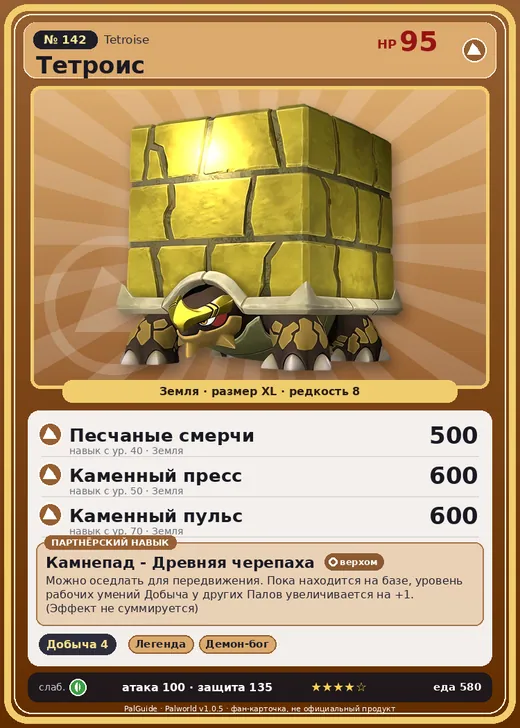

# Тетроис

<canvas id="fx"></canvas>

№ 142 · Tetroise

Земля

Слабость: Трава

⛏️ Добыча <b>4</b>

<b>Камнепад - Древняя черепаха</b> 🐎 верхом 🏠 на базе

❤️ 95 · ⚔️ 100 · 🛡 135

| Поле | Значение |
|---|---|
| Стихия | Земля |
| Слабость (кто бьёт сильнее) | Трава |
| Редкость | 8 |
| Размер | XL |
| HP / Атака / Защита (база вида) | 95 / 100 / 135 |
| Сколько ест | 580 |
| Цена продажи | 2436 |
| Множитель поимки | ×1 |
| Скорость рывка верхом | 540 |

=== "Обзор"

    #### Работа на базе
    - Добыча — ур. 4

    #### Партнёрский навык: Камнепад - Древняя черепаха
    Можно оседлать для передвижения. Пока находится на базе, уровень рабочих умений Добыча у других Палов увеличивается на +1. (Эффект не суммируется) Технологии 48. По звёздам: 0★ 1 · 1★ 1 · 2★ 1 · 3★ 1 · 4★ 1

    #### Чем хорош / чем плох
    - ✅ хорошая атака (100); крепкая защита (135); можно оседлать
    - ❌ много ест (580)

    > Камни на его спине обладают собственной волей. Если снять их и оставить вдалеке, они самостоятельно двинутся обратно на своё место.

    См. также: [Стихии](../../guide/06_stihii.md) · [Разведение](../../guide/07_razvedenie.md) · [Все палы](README.md)

=== "Атаки"

    #### Атаки по уровням
    - ур. 1: Каменный залп (Земля, сила 80)
    - ур. 7: Камнемёт (Земля, сила 120)
    - ур. 15: Песчаный вихрь (Земля, сила 200)
    - ур. 22: Камнепад (Земля, сила 300)
    - ур. 30: Каменные копья (Земля, сила 400)
    - ур. 40: Песчаные смерчи (Земля, сила 500)
    - ур. 50: Каменный пресс (Земля, сила 600)
    - ур. 70: Каменный пульс (Земля, сила 600)

=== "Где живёт"

    #### Где водится
    - В дикой природе: да; точек появления днём: 326, ночью: 326; уровни в первых точках: 48–52
    - Яйцо: Огромное яйцо земли

=== "Дроп"

    #### Дроп
    - Рубин — 1–2 шт., 100%
    - Большая душа Пала — 1 шт., 100%

    **Дроп альфы:**
    - Деталь древней цивилизации — 6–7 шт., 100%
    - Ценные внутренности — 2–3 шт., 100%

=== "Разведение"

    #### Разведение
    - Ранг разведения (CombiRank): 790
    - Участвует в особых парах: Селесдир → Тетроис Примо

=== "Пассивки"

    #### Лучшие пассивки по роли

    

⚔️ Боец

максимум урона и живучести в бою

<a class="psv r-4" data-psv="Легенда" href="../../../passivki/legend/">Легенда</a><a class="psv r-4" data-psv="Демон-бог" href="../../../passivki/demon_god/">Демон-бог</a><a class="psv r-3" data-psv="Император земли" href="../../../passivki/earth_emperor/">Император земли</a><a class="psv r-3" data-psv="Хладнокровный" href="../../../passivki/serenity/">Хладнокровный</a>

🛠 Рабочий

работает быстрее и меньше устаёт на базе

<a class="psv r-5" data-psv="Дьявольские руки" href="../../../passivki/demons_hand/">Дьявольские руки</a><a class="psv r-4" data-psv="Виртуоз" href="../../../passivki/remarkable_craftsmanship/">Виртуоз</a><a class="psv r-3" data-psv="Мастеровитый" href="../../../passivki/artisan/">Мастеровитый</a><a class="psv r-3" data-psv="Трудоголик" href="../../../passivki/workaholic/">Трудоголик</a>

🐎 Ездовой

быстрее бегает или летает с тобой верхом

<a class="psv r-4" data-psv="Божественная скорость" href="../../../passivki/swift/">Божественная скорость</a><a class="psv r-4" data-psv="Легенда" href="../../../passivki/legend/">Легенда</a><a class="psv r-4" data-psv="Вечный двигатель" href="../../../passivki/eternal_engine/">Вечный двигатель</a><a class="psv r-4" data-psv="Небесное скольжение" href="../../../passivki/sky_strider/">Небесное скольжение</a>

    <small>Нажми на пассивку, чтобы узнать, что она даёт и где её взять.</small>

<a class="card-link" href="../prixter_lux/">← Скорпио Лакс</a><a class="card-link" href="../tetroise_primo/">Тетроис Примо →</a>

