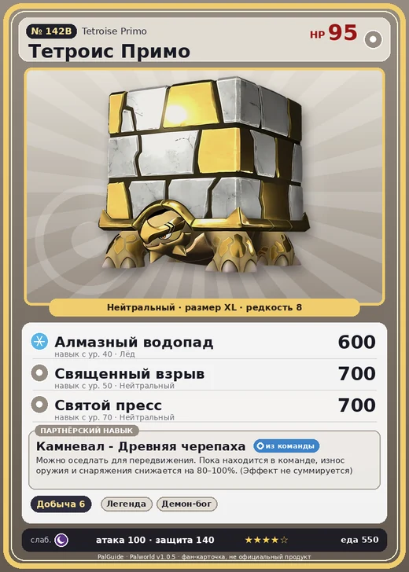

# #142B Тетроис Примо (Tetroise Primo)

#142B · Tetroise Primo

Нейтральный

Слабость: Тьма

⛏️ Добыча <b>6</b>

<b>Камневал - Древняя черепаха</b> 🎒 из команды 🐎 верхом

❤️ 95 · ⚔️ 100 · 🛡 140

| Поле | Значение |
|---|---|
| Стихия | Нейтральный |
| Слабость (кто бьёт сильнее) | Тьма |
| Редкость | 8 |
| Размер | XL |
| HP / Атака / Защита (база вида) | 95 / 100 / 140 |
| Сколько ест | 550 |
| Цена продажи | 2945 |
| Множитель поимки | ×1 |
| Скорость рывка верхом | 540 |

## Работа на базе
- Добыча — ур. 6

## Партнёрский навык: Камневал - Древняя черепаха
Можно оседлать для передвижения. Пока находится в команде, износ оружия и снаряжения снижается на (80~100)% . (Эффект не суммируется) Технологии 75 level value 1 CubeTurtle_Neutral_PartnerSkill 80 CubeTurtle_Neutral_PartnerSkill_1_Armor 80 2 CubeTurtle_Neutral_PartnerSkill 84 CubeTurtle_Neutral_PartnerSkill_2_Armor 84 3 CubeTurtle_Neutral_PartnerSkill 88 CubeTurtle_Neutral_PartnerSkill_3_Armor 88 4 CubeTurtle_Neutral_PartnerSkill 92 CubeTurtle_Neutral_PartnerSkill_4_Armor 92 5 CubeTurtle_Neutral_PartnerSkill 100 CubeTurtle_Neutral_PartnerSkill_5_Armor 100

## Атаки по уровням
- ур. 1: Силовой выстрел (Нейтральный, сила 80)
- ур. 7: Силовая бомба (Нейтральный, сила 120)
- ур. 15: Воздушные клинки (Нейтральный, сила 160)
- ур. 22: Ледяной след (Лёд, сила 300)
- ур. 30: Палобласт (Нейтральный, сила 450)
- ур. 40: Алмазный водопад (Лёд, сила 600)
- ур. 50: Священный взрыв (Нейтральный, сила 700)
- ур. 70: Святой пресс (Нейтральный, сила 700)

## Где водится
- В дикой природе: да; точек появления днём: 1, ночью: 1
- Яйцо: Огромное обычное яйцо

## Дроп
- Изумруд — 1–2 шт., 100%
- Большая душа Пала — 1 шт., 100%

**Дроп альфы:**
- Деталь древней цивилизации — 6–7 шт., 100%
- Ценные внутренности — 2–3 шт., 100%

## Разведение
- Ранг разведения (CombiRank): 200
- **Особая пара:** [Тетроис](../../4_spravochniki/paly/tetroise.md) + [Селесдир](../../4_spravochniki/paly/celesdir.md)

## Лучшие пассивки по роли
- боец: Легенда, Демон-бог, Хладнокровный, Бессмертие, Святое небо (вместо Бессмертия, если нет мутации)
- рабочий: Дьявольские руки, Виртуоз, Мастеровитый, Небожитель/Трудоголик
- ездовой: Божественная скорость, Легенда, Вечный двигатель, Небесное скольжение

## Чем хорош / чем плох
- ✅ хорошая атака (100); крепкая защита (140); отличный рабочий (пригодность 6); можно оседлать
- ❌ много ест (550); разводится только особой парой

> Даже если камень с его спины куда-то унесут, Тетроис Примо знает его местонахождение. И обязательно найдет, как бы далеко это ни было.

См. также: [Стихии](../../guide/06_stihii.md) · [Разведение](../../guide/07_razvedenie.md) · [Все палы](README.md)
