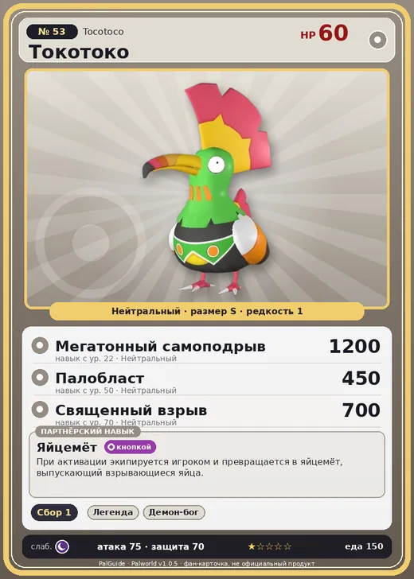

# #53 Токотоко (Tocotoco)

№ 53

Нейтральный

Слабость: Тьма

🌾 Сбор <b>1</b>

<b>Яйцемёт</b> 🔘 кнопкой

❤️ 60 · ⚔️ 75 · 🛡 70

| Поле | Значение |
|---|---|
| Стихия | Нейтральный |
| Слабость (кто бьёт сильнее) | Тьма |
| Редкость | 1 |
| Размер | S |
| HP / Атака / Защита (база вида) | 60 / 75 / 70 |
| Сколько ест | 150 |
| Цена продажи | 373 |
| Множитель поимки | ×1 |
| Скорость рывка верхом | 550 |

=== "Обзор"

    #### Работа на базе
    - Сбор — ур. 1

    #### Партнёрский навык: Яйцемёт
    При активации экипируется игроком и превращается в яйцемёт, выпускающий взрывающиеся яйца. Технологии 18 level value 1 MainValue 100 Пробуждение : 2 MainValue 110 Пробуждение : (Увеличение урона: Небольшое ) 3 MainValue 130 Пробуждение : (Увеличение урона: Среднее ) 4 MainValue 160 Пробуждение : (Увеличение урона: Большое ) 5 MainValue 200 Пробуждение : (Увеличение урона: Очень большое )

    #### Чем хорош / чем плох
    - ✅ можно оседлать
    - ❌ слабая атака (75); мало здоровья (60)

    > Грозный Пал, несущий взрывающиеся яйца. Обычно пускает их из-под хвоста как снаряды, но если совсем прижмёт — с грохотом взрывается сам.

    См. также: [Стихии](../../guide/06_stihii.md) · [Разведение](../../guide/07_razvedenie.md) · [Все палы](README.md)

=== "Атаки"

    #### Атаки по уровням
    - ур. 1: Самоподрыв (Нейтральный, сила 300)
    - ур. 7: Воздушная пушка (Нейтральный, сила 40)
    - ур. 15: Силовой выстрел (Нейтральный, сила 80)
    - ур. 22: Мегатонный самоподрыв (Нейтральный, сила 1200)
    - ур. 30: Песчаный вихрь (Земля, сила 200)
    - ур. 40: Силовая бомба (Нейтральный, сила 120)
    - ур. 50: Палобласт (Нейтральный, сила 450)
    - ур. 70: Священный взрыв (Нейтральный, сила 700)

=== "Где живёт"

    #### Где водится
    - В дикой природе: да; точек появления днём: 921, ночью: 921; уровни в первых точках: 20–22
    - Подземелья: Пещера Песчаных Дюн, Пещера Ущелья
    - Яйцо: Обычное яйцо

=== "Дроп"

    #### Дроп
    - Порох — 1 шт., 100%
    - Перо Токотоко — 1 шт., 50%

    **Дроп альфы:**
    - Деталь древней цивилизации — 1–2 шт., 100%
    - Ценное перо — 1–2 шт., 100%

=== "Разведение"

    #### Разведение
    - Ранг разведения (CombiRank): 2730

=== "Пассивки"

    #### Лучшие пассивки по роли
    - боец: Легенда, Демон-бог, Хладнокровный, Бессмертие, Святое небо (вместо Бессмертия, если нет мутации)
    - ездовой: Божественная скорость, Легенда, Вечный двигатель, Небесное скольжение

<a class="card-link" href="../tombat/">← Томбат</a><a class="card-link" href="../univolt/">Юнивольт →</a>

