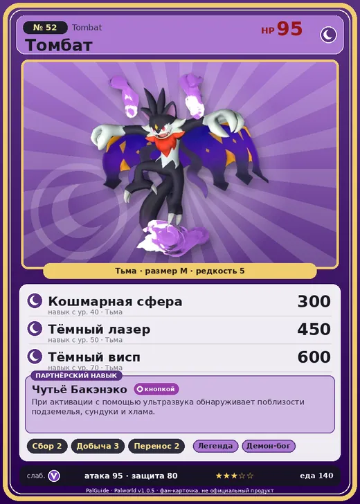

# #52 Томбат (Tombat)

№ 52

Тьма

Слабость: Дракон

🌾 Сбор <b>2</b>⛏️ Добыча <b>3</b>📦 Транспортировка <b>2</b>

<b>Чутьё Бакэнэко</b> 🔘 кнопкой

❤️ 95 · ⚔️ 95 · 🛡 80

| Поле | Значение |
|---|---|
| Стихия | Тьма |
| Слабость (кто бьёт сильнее) | Дракон |
| Редкость | 5 |
| Размер | M |
| HP / Атака / Защита (база вида) | 95 / 95 / 80 |
| Сколько ест | 140 |
| Цена продажи | 1147 |
| Множитель поимки | ×1 |
| Скорость рывка верхом | 550 |

## Работа на базе
- Сбор — ур. 2
- Добыча — ур. 3
- Транспортировка — ур. 2

## Партнёрский навык: Чутьё Бакэнэко
При активации с помощью ультразвука обнаруживает поблизости подземелья, сундуки и хлама . Lv. Range Extend Range per Sec 1 10000 3000 2 11000 3500 3 13000 4000 4 16000 4500 5 20000 5000 level value 1 OverWriteCoolTime 60 Пробуждение : 2 OverWriteCoolTime 50 Пробуждение : (Увеличение радиуса обнаружения и сокращение перезарядки: Небольшое ) 3 OverWriteCoolTime 45 Пробуждение : (Увеличение радиуса обнаружения и сокращение перезарядки: Среднее ) 4 OverWriteCoolTime 40 Пробуждение : (Увеличение радиуса обнаружения и сокращение перезарядки: Большое ) 5 OverWriteCoolTime 30 Пробуждение : (Увеличение радиуса обнаружения и сокращение перезарядки: Очень большое )

## Атаки по уровням
- ур. 1: Воздушная пушка (Нейтральный, сила 40)
- ур. 7: Ядовитый выстрел (Тьма, сила 30)
- ур. 15: Тёмный шар (Тьма, сила 50)
- ур. 22: Теневой взрыв (Тьма, сила 80)
- ур. 30: Духовное пламя (Тьма, сила 200)
- ур. 40: Кошмарная сфера (Тьма, сила 300)
- ур. 50: Тёмный лазер (Тьма, сила 450)
- ур. 70: Тёмный висп (Тьма, сила 600)

## Где водится
- В дикой природе: да; точек появления днём: 1, ночью: 161; уровни в первых точках: 12–14
- Подземелья: Пещера Отдалённого Острова, Пещера Священной Горы, Пещера Холмов
- Может продаваться у торговца/рекрутера
- Яйцо: Большое яйцо тьмы

## Дроп
- Кожа — 1–2 шт., 100%
- Маленькая душа Пала — 1 шт., 1%

**Дроп альфы:**
- Деталь древней цивилизации — 2–3 шт., 100%
- Ценный коготь — 1–2 шт., 100%

## Разведение
- Ранг разведения (CombiRank): 2340

## Лучшие пассивки по роли
- боец: Легенда, Демон-бог, Хладнокровный, Бессмертие, Король тьмы (вместо Бессмертия, если нет мутации)
- рабочий: Дьявольские руки, Виртуоз, Мастеровитый, Небожитель/Трудоголик
- ездовой: Божественная скорость, Легенда, Вечный двигатель, Небесное скольжение

## Чем хорош / чем плох
- ✅ можно оседлать
- ❌ явных минусов нет

> Любит внезапно появиться перед другими Палами и красоваться, самодовольно распахнув свои крылья. Считается, что это один из способов устрашения, но при этом в выражении его лица сквозит восторг.

См. также: [Стихии](../../guide/06_stihii.md) · [Разведение](../../guide/07_razvedenie.md) · [Все палы](README.md)
