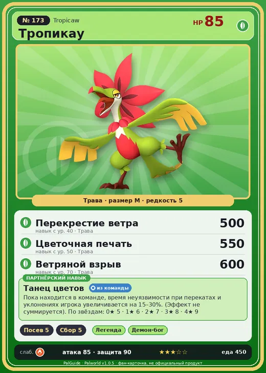

# #173 Тропикау (Tropicaw)

№ 173

Трава

Слабость: Огонь

🌱 Посев семян <b>5</b>🌾 Сбор <b>5</b>

<b>Танец цветов</b> 🎒 из команды

❤️ 85 · ⚔️ 85 · 🛡 90

| Поле | Значение |
|---|---|
| Стихия | Трава |
| Слабость (кто бьёт сильнее) | Огонь |
| Редкость | 5 |
| Размер | M |
| HP / Атака / Защита (база вида) | 85 / 85 / 90 |
| Сколько ест | 450 |
| Цена продажи | 1844 |
| Множитель поимки | ×1 |
| Скорость рывка верхом | 600 |

## Работа на базе
- Посев семян — ур. 5
- Сбор — ур. 5

## Партнёрский навык: Танец цветов
Пока находится в команде, время неуязвимости при перекатах и уклонениях игрока увеличивается на (15~30)% . (Эффект не суммируется) level value 1 AvoidDurationUp_PartnerSkill_RedFlowerBird 5 2 AvoidDurationUp_PartnerSkill_RedFlowerBird 6 3 AvoidDurationUp_PartnerSkill_RedFlowerBird 7 4 AvoidDurationUp_PartnerSkill_RedFlowerBird 8 5 AvoidDurationUp_PartnerSkill_RedFlowerBird 9

## Атаки по уровням
- ур. 1: Ветряной клинок (Трава, сила 40)
- ур. 7: Семенной пулемёт (Трава, сила 80)
- ур. 15: Травяной торнадо (Трава, сила 200)
- ур. 22: Веер клинков (Трава, сила 200)
- ур. 30: Отражающий лист (Трава, сила 400)
- ур. 40: Перекрестие ветра (Трава, сила 500)
- ур. 50: Цветочная печать (Трава, сила 550)
- ур. 70: Ветряной взрыв (Трава, сила 600)

## Где водится
- В дикой природе: да; точек появления днём: 50, ночью: 50
- Яйцо: Большое яйцо свежей листвы

## Дроп
- Красивый цветок — 1–2 шт., 100%
- Волокно — 2–3 шт., 100%

**Дроп альфы:**
- Деталь древней цивилизации — 2–3 шт., 100%
- Ценное перо — 2–3 шт., 100%

## Разведение
- Ранг разведения (CombiRank): 1350

## Лучшие пассивки по роли
- боец: Легенда, Демон-бог, Хладнокровный, Бессмертие, Король духов (вместо Бессмертия, если нет мутации)
- рабочий: Дьявольские руки, Виртуоз, Мастеровитый, Небожитель/Трудоголик
- ездовой: Божественная скорость, Легенда, Вечный двигатель, Небесное скольжение

## Чем хорош / чем плох
- ✅ отличный рабочий (пригодность 5); можно оседлать
- ❌ явных минусов нет

> Яростные размахивания телом якобы служат маскировкой под цветок, колышущийся на ветру, чтобы избегать врагов. Но есть мнение, что быстро мечущийся красный цветок слишком жуток, и потому к нему никто не подходит.

См. также: [Стихии](../../guide/06_stihii.md) · [Разведение](../../guide/07_razvedenie.md) · [Все палы](README.md)
