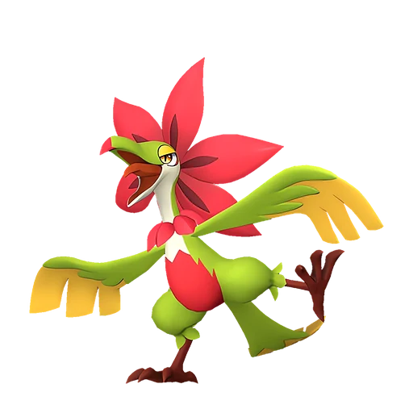
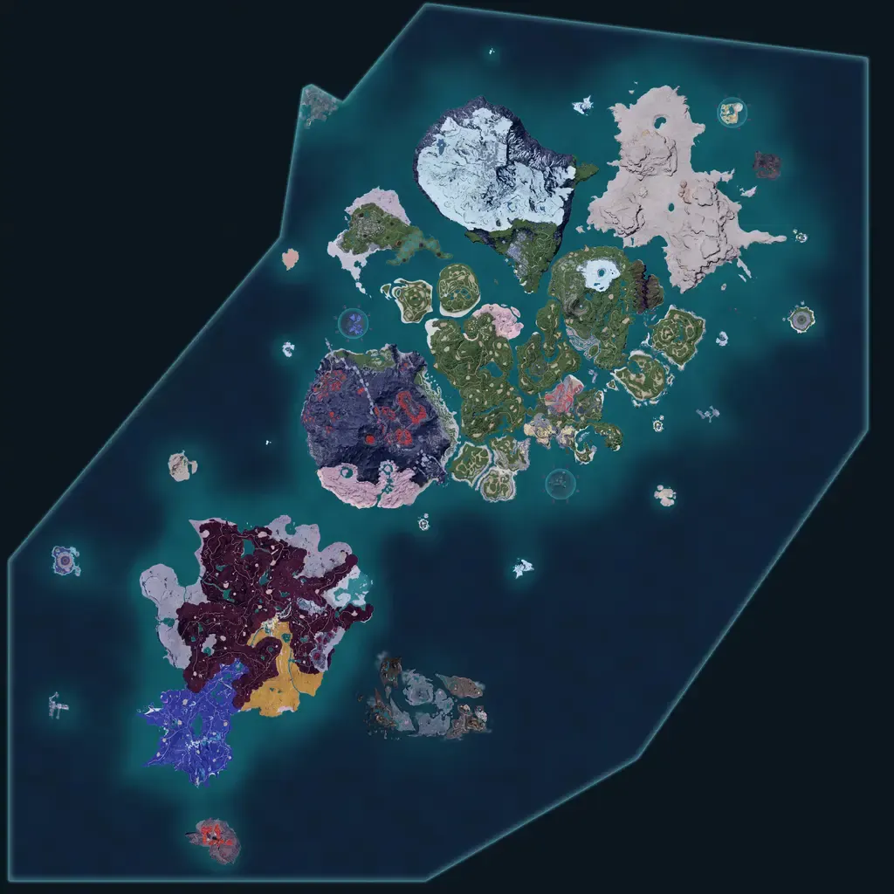

# Тропикау

<canvas id="fx"></canvas>

№ 173

Трава

Слабость: Огонь <b class="mx">×1,5</b> <button class="hlp" data-tip="Множители перемножаются по обеим стихиям: ×1,5 за стихию, которую атака бьёт, ×0,65 за ту, что её держит.">?</button>

Устойчив: Земля <b class="mx">×0,65</b>

🌱 Посев семян <b>5</b>🌾 Сбор <b>5</b>

<b>Танец цветов</b> 🎒 Работает из команды

❤️ 85 · ⚔️ 85 · 🛡 90

Основное

💎Редкость <button class="hlp" data-tip="Чем выше число, тем реже встречается пал. 1–4 — обычные, 5–7 — редкие, 8+ — легендарные.">?</button><b>5</b>

📏Размер<b>M</b>

💰Цена продажи <button class="hlp" data-tip="Сколько золота даст торговец за пала.">?</button><b>1844</b>

Бой

🎯Множитель поимки <button class="hlp" data-tip="Насколько легче или труднее поймать: ×1 — обычно, меньше — сложнее.">?</button><b>×1</b>

🐎Скорость рывка верхом <button class="hlp" data-tip="Скорость, если сесть на пала и бежать рывком.">?</button><b>600</b>

Ферма и еда

🍖Сколько ест <button class="hlp" data-tip="Сколько сытости пал тратит — чем больше, тем больше еды нужно на базе.">?</button><b>450</b>

Разведение

🧬Сила разведения <button class="hlp" data-tip="Скрытое число игры: у детёныша оно примерно среднее от родителей. Чем меньше — тем «сильнее» пал.">?</button><b>1350</b>

=== "Обзор"

    #### Работа на базе

    
<a class="wbar" href="../../../2_mehaniki/rabota/?w=planting&lv=5">🌱 Посев семян<i style="--v:50%"></i><b>5</b></a><a class="wbar" href="../../../2_mehaniki/rabota/?w=gathering&lv=5">🧺 Сбор<i style="--v:50%"></i><b>5</b></a><a class="wb-more" href="../../../2_mehaniki/rabota/">Что значат уровни работы →</a>

    #### Партнёрский навык: Танец цветов
    Пока находится в команде, время неуязвимости при перекатах и уклонениях игрока увеличивается на 15–30%. (Эффект не суммируется). По звёздам: 0★ 5 · 1★ 6 · 2★ 7 · 3★ 8 · 4★ 9

    #### Чем хорош / чем плох
    - ✅ отличный рабочий (пригодность 5)
    - ❌ явных минусов нет

    > Яростные размахивания телом якобы служат маскировкой под цветок, колышущийся на ветру, чтобы избегать врагов. Но есть мнение, что быстро мечущийся красный цветок слишком жуток, и потому к нему никто не подходит.

    См. также: [Стихии](../../guide/06_stihii.md) · [Разведение](../../guide/07_razvedenie.md) · [Все палы](README.md)

=== "Атаки"

    #### Атаки по уровням
    - ур. 1: Ветряной клинок (Трава, сила 40)
    - ур. 7: Семенной пулемёт (Трава, сила 80)
    - ур. 15: Травяной торнадо (Трава, сила 200)
    - ур. 22: Веер клинков (Трава, сила 200)
    - ур. 30: Отражающий лист (Трава, сила 400)
    - ур. 40: Перекрестие ветра (Трава, сила 500)
    - ур. 50: Цветочная печать (Трава, сила 550)
    - ур. 70: Ветряной взрыв (Трава, сила 600)

=== "Где живёт"

    #### Где водится

    

<button data-k="d" class="on">☀️ День</button><button data-k="n">🌙 Ночь</button>

ур. 66–66<a class="btn hm-full" href="../../../map/?pal=RedFlowerBird">Показать на большой карте</a>

Солнечный предел

🥚 Яйцо<b>Большое яйцо свежей листвы</b>

=== "Дроп"

    #### Дроп
    - Красивый цветок — 1–2 шт., 100%
    - Волокно — 2–3 шт., 100%

    **Дроп альфы:**
    - Деталь древней цивилизации — 2–3 шт., 100%
    - Ценное перо — 2–3 шт., 100%

=== "Разведение"

    #### Разведение
    - Ранг разведения: 1350

=== "Пассивки"

    #### Лучшие пассивки по роли

    

⚔️ Боец

максимум урона и живучести в бою

<a class="psv r-4" data-psv="Легенда" href="../../../passivki/legend/">Легенда</a><a class="psv r-4" data-psv="Демон-бог" href="../../../passivki/demon_god/">Демон-бог</a><a class="psv r-3" data-psv="Король духов" href="../../../passivki/spirit_emperor/">Король духов</a><a class="psv r-3" data-psv="Хладнокровный" href="../../../passivki/serenity/">Хладнокровный</a>

🛠 Рабочий

работает быстрее и меньше устаёт на базе

<a class="psv r-5" data-psv="Дьявольские руки" href="../../../passivki/demons_hand/">Дьявольские руки</a><a class="psv r-4" data-psv="Виртуоз" href="../../../passivki/remarkable_craftsmanship/">Виртуоз</a><a class="psv r-3" data-psv="Мастеровитый" href="../../../passivki/artisan/">Мастеровитый</a><a class="psv r-3" data-psv="Трудоголик" href="../../../passivki/workaholic/">Трудоголик</a>

    <small>Нажми на пассивку, чтобы узнать, что она даёт и где её взять.</small>

<a class="card-link" href="../dynamoff/">← Динамофф</a><a class="card-link" href="../flaracle/">Фларакл →</a>

