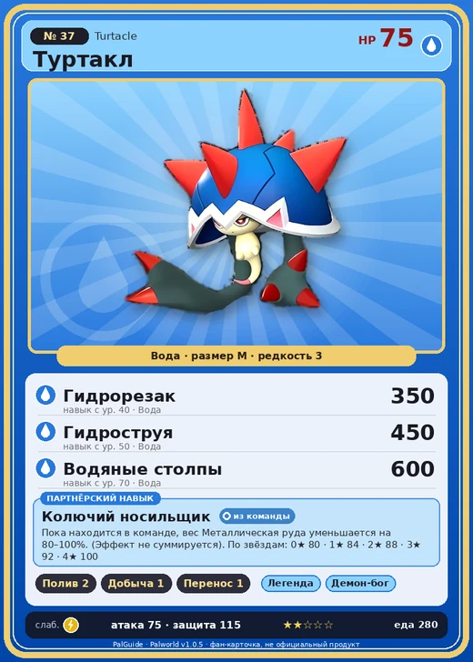

# Туртакл

<canvas id="fx"></canvas>

№ 37 · Turtacle

Вода

Слабость: Молния

💧 Полив <b>2</b>⛏️ Добыча <b>1</b>📦 Транспортировка <b>1</b>

<b>Колючий носильщик</b> 🎒 из команды

❤️ 75 · ⚔️ 75 · 🛡 115

| Поле | Значение |
|---|---|
| Стихия | Вода |
| Слабость (кто бьёт сильнее) | Молния |
| Редкость | 3 |
| Размер | M |
| HP / Атака / Защита (база вида) | 75 / 75 / 115 |
| Сколько ест | 280 |
| Цена продажи | 661 |
| Множитель поимки | ×1 |
| Скорость рывка верхом | 500 |

=== "Обзор"

    #### Работа на базе
    - Полив — ур. 2
    - Добыча — ур. 1
    - Транспортировка — ур. 1

    #### Партнёрский навык: Колючий носильщик
    Пока находится в команде, вес Металлическая руда уменьшается на 80–100%. (Эффект не суммируется). По звёздам: 0★ 80 · 1★ 84 · 2★ 88 · 3★ 92 · 4★ 100

    #### Чем хорош / чем плох
    - ✅
    - ❌ слабая атака (75)

    > Для защиты слабого тела он обзавёлся мощным панцирем. Но теперь его тело настолько уязвимо, что даже от лёгкой щекотки он теряет сознание.

    См. также: [Стихии](../../guide/06_stihii.md) · [Разведение](../../guide/07_razvedenie.md) · [Все палы](README.md)

=== "Атаки"

    #### Атаки по уровням
    - ур. 1: Акваджет (Вода, сила 40)
    - ур. 7: Пузырьковый выстрел (Вода, сила 80)
    - ур. 15: Гидровращение (Вода, сила 160)
    - ур. 22: Водяная бомба (Вода, сила 200)
    - ур. 30: Гидроатака под давлением (Вода, сила 250)
    - ур. 40: Гидрорезак (Вода, сила 350)
    - ур. 50: Гидроструя (Вода, сила 450)
    - ур. 70: Водяные столпы (Вода, сила 600)

=== "Где живёт"

    #### Где водится
    - В дикой природе: да; точек появления днём: 1457, ночью: 1457; уровни в первых точках: 1–10
    - Подземелья: Пещера Горного Потока, Пещера Ущелья, Пещера Холмов
    - Может продаваться у торговца/рекрутера
    - Яйцо: Яйцо воды

=== "Дроп"

    #### Дроп
    - Жидкость водного Пала — 1–2 шт., 100%
    - Кость — 2–3 шт., 100%

    **Дроп альфы:**
    - Деталь древней цивилизации — 2–3 шт., 100%
    - Ценные внутренности — 1–2 шт., 100%

=== "Разведение"

    #### Разведение
    - Ранг разведения (CombiRank): 2410
    - Участвует в особых парах: Дигтос → Туртакл Терра

=== "Пассивки"

    #### Лучшие пассивки по роли

    

⚔️ Боец

максимум урона и живучести в бою

<a class="psv r-4" data-psv="Легенда" href="../../../passivki/legend/">Легенда</a><a class="psv r-4" data-psv="Демон-бог" href="../../../passivki/demon_god/">Демон-бог</a><a class="psv r-3" data-psv="Владыка морей" href="../../../passivki/lord_of_the_sea/">Владыка морей</a><a class="psv r-3" data-psv="Хладнокровный" href="../../../passivki/serenity/">Хладнокровный</a>

    <small>Нажми на пассивку, чтобы узнать, что она даёт и где её взять.</small>

<a class="card-link" href="../sweepa/">← Свипа</a><a class="card-link" href="../turtacle_terra/">Туртакл Терра →</a>

