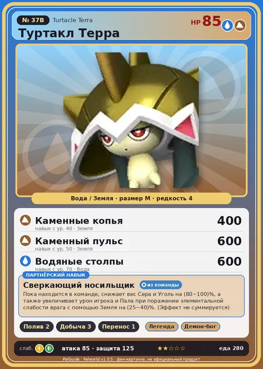

# #37B Туртакл Терра (Turtacle Terra)

#37B · Turtacle Terra

ВодаЗемля

Слабость: МолнияТрава

💧 Полив <b>2</b>⛏️ Добыча <b>3</b>📦 Транспортировка <b>1</b>

<b>Сверкающий носильщик</b> 🎒 из команды

❤️ 85 · ⚔️ 85 · 🛡 125

| Поле | Значение |
|---|---|
| Стихия | Вода, Земля |
| Слабость (кто бьёт сильнее) | Молния, Трава |
| Редкость | 4 |
| Размер | M |
| HP / Атака / Защита (база вида) | 85 / 85 / 125 |
| Сколько ест | 280 |
| Цена продажи | 14950 |
| Множитель поимки | ×1 |
| Скорость рывка верхом | 500 |

## Работа на базе
- Полив — ур. 2
- Добыча — ур. 3
- Транспортировка — ур. 1

## Партнёрский навык: Сверкающий носильщик
Пока находится в команде, снижает вес Сера и Уголь на (80~100)% , а также увеличивает урон игрока и Пала при поражении элементальной слабости врага с помощью Земля на (25~40)% . (Эффект не суммируется) level value 1 ItemWeightReduction_PartnerSkill_TentacleTurtle_Ground 80  2 ItemWeightReduction_PartnerSkill_TentacleTurtle_Ground 84  3 ItemWeightReduction_PartnerSkill_TentacleTurtle_Ground 88  4 ItemWeightReduction_PartnerSkill_TentacleTurtle_Ground 92  5 ItemWeightReduction_PartnerSkill_TentacleTurtle_Ground 100

## Атаки по уровням
- ур. 1: Грязевой выстрел (Земля, сила 40)
- ур. 7: Пузырьковый выстрел (Вода, сила 80)
- ур. 15: Гидровращение (Вода, сила 160)
- ур. 22: Водяная бомба (Вода, сила 200)
- ур. 30: Камнепад (Земля, сила 300)
- ур. 40: Каменные копья (Земля, сила 400)
- ур. 50: Каменный пульс (Земля, сила 600)
- ур. 70: Водяные столпы (Вода, сила 600)

## Где водится
- В дикой природе: да; точек появления днём: 773, ночью: 773; уровни в первых точках: 28–34
- Яйцо: Яйцо воды

## Дроп
- Жидкость водного Пала — 1–2 шт., 100%
- Кость — 1 шт., 100%

**Дроп альфы:**
- Деталь древней цивилизации — 2–3 шт., 100%
- Ценные внутренности — 2–3 шт., 100%

## Разведение
- Ранг разведения (CombiRank): 1330
- **Особая пара:** [Туртакл](../../4_spravochniki/paly/turtacle.md) + [Дигтос](../../4_spravochniki/paly/digtoise.md)
- Участвует в особых парах: Снок → Снок Терра

## Лучшие пассивки по роли
- боец: Легенда, Демон-бог, Хладнокровный, Бессмертие, Владыка морей (вместо Бессмертия, если нет мутации)
- рабочий: Дьявольские руки, Виртуоз, Мастеровитый, Небожитель/Трудоголик
- ездовой: Божественная скорость, Легенда, Вечный двигатель, Небесное скольжение

## Чем хорош / чем плох
- ✅ крепкая защита (125); можно оседлать
- ❌ разводится только особой парой

> Чтобы защитить своё уязвимое тело, он обзавёлся прочным панцирем. Большая часть его осязания сосредоточена в лапах и панцире, и если тайком прикоснуться к самому телу, он этого даже не почувствует.

См. также: [Стихии](../../guide/06_stihii.md) · [Разведение](../../guide/07_razvedenie.md) · [Все палы](README.md)
