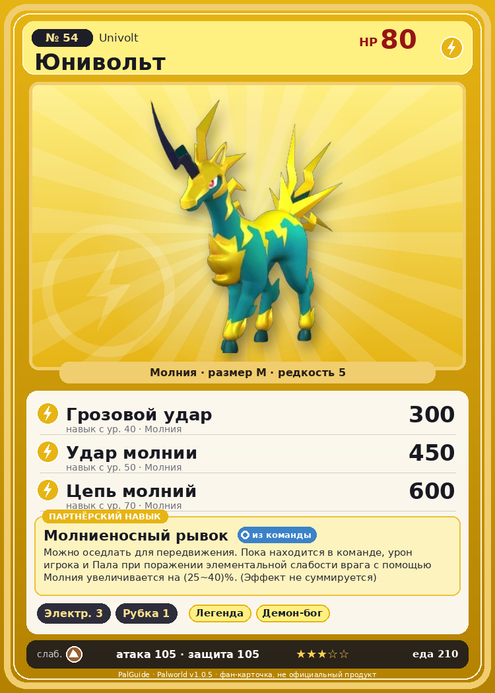

# #54 Юнивольт (Univolt)

{ width=360 }

| Поле | Значение |
|---|---|
| Стихия | Молния |
| Слабость (кто бьёт сильнее) | Земля |
| Редкость | 5 |
| Размер | M |
| HP / Атака / Защита (база вида) | 80 / 105 / 105 |
| Сколько ест | 210 |
| Цена продажи | 1388 |
| Множитель поимки | ×0.9 |
| Скорость рывка верхом | 1100 |

## Работа на базе
- Генерация энергии — ур. 3
- Рубка деревьев — ур. 1

## Партнёрский навык: Молниеносный рывок
Можно оседлать для передвижения. Пока находится в команде, урон игрока и Пала при поражении элементальной слабости врага с помощью Молния увеличивается на (25~40)% . (Эффект не суммируется) Технологии 14 level value 1 ElementBoostWeakness_Electricity_PartnerSkill 25 2 ElementBoostWeakness_Electricity_PartnerSkill 27 3 ElementBoostWeakness_Electricity_PartnerSkill 30 4 ElementBoostWeakness_Electricity_PartnerSkill 34 5 ElementBoostWeakness_Electricity_PartnerSkill 40

## Атаки по уровням
- ур. 1: Искровой выстрел (Молния, сила 50)
- ур. 7: Шоковая волна (Молния, сила 80)
- ур. 11: Электрический вихрь (Молния, сила 120)
- ур. 15: Лазерный захват (Молния, сила 140)
- ур. 22: Грозовая линия (Молния, сила 160)
- ур. 30: Тройная молния (Молния, сила 200)
- ур. 40: Грозовой удар (Молния, сила 300)
- ур. 50: Удар молнии (Молния, сила 450)
- ур. 70: Цепь молний (Молния, сила 600)

## Где водится
- В дикой природе: да; точек появления днём: 55, ночью: 55; уровни в первых точках: 20–24
- Подземелья: Пещера Ущелья
- Яйцо: Большое яйцо молнии

## Дроп
- Кожа — 2 шт., 100%
- Электрический орган — 1 шт., 100%
- Рог — 1 шт., 50%

**Дроп альфы:**
- Деталь древней цивилизации — 4–6 шт., 100%
- Ценный коготь — 4–6 шт., 100%

## Разведение
- Ранг разведения (CombiRank): 2270
- Участвует в особых парах: Селарай → Селарай Лакс; Фростплюм → Юнивольт Крист

## Лучшие пассивки по роли
- боец: Легенда, Демон-бог, Хладнокровный, Бессмертие, Император молнии (вместо Бессмертия, если нет мутации)
- рабочий: Дьявольские руки, Виртуоз, Мастеровитый, Небожитель/Трудоголик
- ездовой: Божественная скорость, Легенда, Вечный двигатель, Небесное скольжение

## Чем хорош / чем плох
- ✅ хорошая атака (105); можно оседлать
- ❌ явных минусов нет

> В древности их считали посланниками бога грома, поэтому люди на них не охотились. Но однажды кто-то стал свидетелем того, как Пала убило молнией — вера угасла, и теперь они буквально стали рабочими лошадками.

См. также: [Стихии](../../2_mehaniki/stihii.md) · [Разведение](../../2_mehaniki/razvedenie.md) · [Все палы](README.md)
_Источник: paldb.cc v1.0.5_
