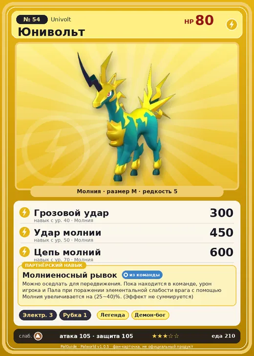

# #54 Юнивольт (Univolt)

№ 54

Молния

Слабость: Земля

⚡ Генерация энергии <b>3</b>🪓 Рубка деревьев <b>1</b>

<b>Молниеносный рывок</b> 🎒 из команды 🐎 верхом

❤️ 80 · ⚔️ 105 · 🛡 105

| Поле | Значение |
|---|---|
| Стихия | Молния |
| Слабость (кто бьёт сильнее) | Земля |
| Редкость | 5 |
| Размер | M |
| HP / Атака / Защита (база вида) | 80 / 105 / 105 |
| Сколько ест | 210 |
| Цена продажи | 1388 |
| Множитель поимки | ×0.9 |
| Скорость рывка верхом | 1100 |

=== "Обзор"

    #### Работа на базе
    - Генерация энергии — ур. 3
    - Рубка деревьев — ур. 1

    #### Партнёрский навык: Молниеносный рывок
    Можно оседлать для передвижения. Пока находится в команде, урон игрока и Пала при поражении элементальной слабости врага с помощью Молния увеличивается на (25~40)% . (Эффект не суммируется) Технологии 14 level value 1  2  3  4  5

    #### Чем хорош / чем плох
    - ✅ хорошая атака (105); можно оседлать
    - ❌ явных минусов нет

    > В древности их считали посланниками бога грома, поэтому люди на них не охотились. Но однажды кто-то стал свидетелем того, как Пала убило молнией — вера угасла, и теперь они буквально стали рабочими лошадками.

    См. также: [Стихии](../../guide/06_stihii.md) · [Разведение](../../guide/07_razvedenie.md) · [Все палы](README.md)

=== "Атаки"

    #### Атаки по уровням
    - ур. 1: Искровой выстрел (Молния, сила 50)
    - ур. 7: Шоковая волна (Молния, сила 80)
    - ур. 11: Электрический вихрь (Молния, сила 120)
    - ур. 15: Лазерный захват (Молния, сила 140)
    - ур. 22: Грозовая линия (Молния, сила 160)
    - ур. 30: Тройная молния (Молния, сила 200)
    - ур. 40: Грозовой удар (Молния, сила 300)
    - ур. 50: Удар молнии (Молния, сила 450)
    - ур. 70: Цепь молний (Молния, сила 600)

=== "Где живёт"

    #### Где водится
    - В дикой природе: да; точек появления днём: 55, ночью: 55; уровни в первых точках: 20–24
    - Подземелья: Пещера Ущелья
    - Яйцо: Большое яйцо молнии

=== "Дроп"

    #### Дроп
    - Кожа — 2 шт., 100%
    - Электрический орган — 1 шт., 100%
    - Рог — 1 шт., 50%

    **Дроп альфы:**
    - Деталь древней цивилизации — 4–6 шт., 100%
    - Ценный коготь — 4–6 шт., 100%

=== "Разведение"

    #### Разведение
    - Ранг разведения (CombiRank): 2270
    - Участвует в особых парах: Селарай → Селарай Лакс; Фростплюм → Юнивольт Крист

=== "Пассивки"

    #### Лучшие пассивки по роли
    - боец: Легенда, Демон-бог, Хладнокровный, Бессмертие, Император молнии (вместо Бессмертия, если нет мутации)
    - рабочий: Дьявольские руки, Виртуоз, Мастеровитый, Небожитель/Трудоголик
    - ездовой: Божественная скорость, Легенда, Вечный двигатель, Небесное скольжение

<a class="card-link" href="../tocotoco/">← Токотоко</a><a class="card-link" href="../univolt_cryst/">Юнивольт Крист →</a>

