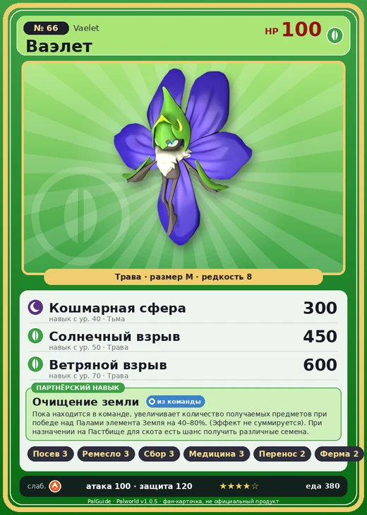

# #66 Ваэлет (Vaelet)

#66 · Vaelet

Трава

Слабость: Огонь

🌱 Посев семян <b>3</b>🖐️ Ручная работа <b>3</b>🌾 Сбор <b>3</b>💊 Фармацевтика <b>3</b>📦 Транспортировка <b>2</b>🐑 Фермерство <b>2</b>

<b>Очищение земли</b> 🎒 из команды 🏠 на базе

❤️ 100 · ⚔️ 100 · 🛡 120

| Поле | Значение |
|---|---|
| Стихия | Трава |
| Слабость (кто бьёт сильнее) | Огонь |
| Редкость | 8 |
| Размер | M |
| HP / Атака / Защита (база вида) | 100 / 100 / 120 |
| Сколько ест | 380 |
| Цена продажи | 2095 |
| Множитель поимки | ×1 |
| Скорость рывка верхом | 550 |

## Работа на базе
- Посев семян — ур. 3
- Ручная работа — ур. 3
- Сбор — ур. 3
- Фармацевтика — ур. 3
- Транспортировка — ур. 2
- Фермерство — ур. 2

## Партнёрский навык: Очищение земли
Пока находится в команде, увеличивает количество получаемых предметов при победе над Палами элемента Земля на (40~80)% . (Эффект не суммируется). При назначении на Пастбище для скота есть шанс получить различные семена . level value 1 , 40 2 , 50 3 , 60 4 , 70 5 , 80

## Атаки по уровням
- ур. 1: Ядовитый туман (Тьма, сила 0)
- ур. 7: Ветряной клинок (Трава, сила 40)
- ур. 15: Ядовитый выстрел (Тьма, сила 30)
- ур. 22: Семенная мина (Трава, сила 120)
- ур. 30: Травяной торнадо (Трава, сила 200)
- ур. 40: Кошмарная сфера (Тьма, сила 300)
- ур. 50: Солнечный взрыв (Трава, сила 450)
- ур. 70: Ветряной взрыв (Трава, сила 600)

## Где водится
- В дикой природе: да; точек появления днём: 13, ночью: 33; уровни в первых точках: 20–23
- Яйцо: Огромное яйцо свежей листвы

## Дроп
- Медикаменты низкого качества — 2 шт., 100%
- Семена помидоров — 1 шт., 50%
- Семена лука — 1 шт., 50%

**Дроп альфы:**
- Деталь древней цивилизации — 4–5 шт., 100%
- Ценные внутренности — 4–5 шт., 100%

## Разведение
- Ранг разведения (CombiRank): 1480

## Лучшие пассивки по роли
- боец: Легенда, Демон-бог, Хладнокровный, Бессмертие, Король духов (вместо Бессмертия, если нет мутации)
- рабочий: Дьявольские руки, Виртуоз, Мастеровитый, Небожитель/Трудоголик
- ездовой: Божественная скорость, Легенда, Вечный двигатель, Небесное скольжение

## Чем хорош / чем плох
- ✅ хорошая атака (100); крепкая защита (120); можно оседлать
- ❌ явных минусов нет

> У замка было много цветов, которые любил король. Разразилась большая битва, и пламя подступило к замку. И тут появилась одна цветочная фея. — Из детской сказки |Цветок короля|

См. также: [Стихии](../../guide/06_stihii.md) · [Разведение](../../guide/07_razvedenie.md) · [Все палы](README.md)
