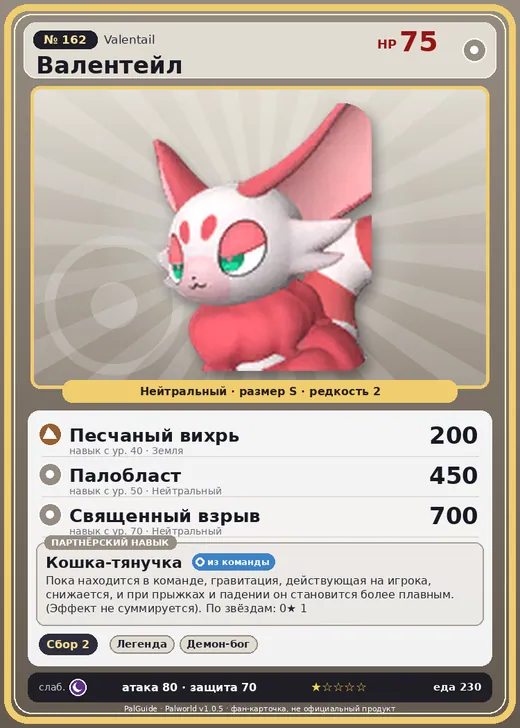

# #162 Валентейл (Valentail)

#162 · Valentail

Нейтральный

Слабость: Тьма

🌾 Сбор <b>2</b>

<b>Кошка-тянучка</b> 🎒 из команды

❤️ 75 · ⚔️ 80 · 🛡 70

| Поле | Значение |
|---|---|
| Стихия | Нейтральный |
| Слабость (кто бьёт сильнее) | Тьма |
| Редкость | 2 |
| Размер | S |
| HP / Атака / Защита (база вида) | 75 / 80 / 70 |
| Сколько ест | 230 |
| Цена продажи | 1684 |
| Множитель поимки | ×1 |
| Скорость рывка верхом | 900 |

## Работа на базе
- Сбор — ур. 2

## Партнёрский навык: Кошка-тянучка
Пока находится в команде, гравитация, действующая на игрока, снижается, и при прыжках и падении он становится более плавным. (Эффект не суммируется) level value 1 LowGravity_PartnerSkill 1

## Атаки по уровням
- ур. 1: Грязевой выстрел (Земля, сила 40)
- ур. 7: Воздушная пушка (Нейтральный, сила 40)
- ур. 15: Силовой выстрел (Нейтральный, сила 80)
- ур. 22: Силовая бомба (Нейтральный, сила 120)
- ур. 30: Воздушные клинки (Нейтральный, сила 160)
- ур. 40: Песчаный вихрь (Земля, сила 200)
- ур. 50: Палобласт (Нейтральный, сила 450)
- ур. 70: Священный взрыв (Нейтральный, сила 700)

## Где водится
- В дикой природе: да; точек появления днём: 32, ночью: 32
- Яйцо: Обычное яйцо

## Дроп
- Кожа — 1–2 шт., 100%

**Дроп альфы:**
- Деталь древней цивилизации — 1–2 шт., 100%
- Ценный мех — 2–3 шт., 100%

## Разведение
- Ранг разведения (CombiRank): 1900
- Участвует в особых парах: Глуппи → Глуппи Примо

## Лучшие пассивки по роли
- боец: Легенда, Демон-бог, Хладнокровный, Бессмертие, Святое небо (вместо Бессмертия, если нет мутации)
- ездовой: Божественная скорость, Легенда, Вечный двигатель, Небесное скольжение

## Чем хорош / чем плох
- ✅ можно оседлать
- ❌ явных минусов нет

> На старых картинах изображён значительно меньше, чем сейчас. В последние годы, по всей видимости, различные части тела стремительно удлиняются. Такими темпами через 100 лет размеры достигнут примерно десятикратного нынешнего размера.

См. также: [Стихии](../../guide/06_stihii.md) · [Разведение](../../guide/07_razvedenie.md) · [Все палы](README.md)
