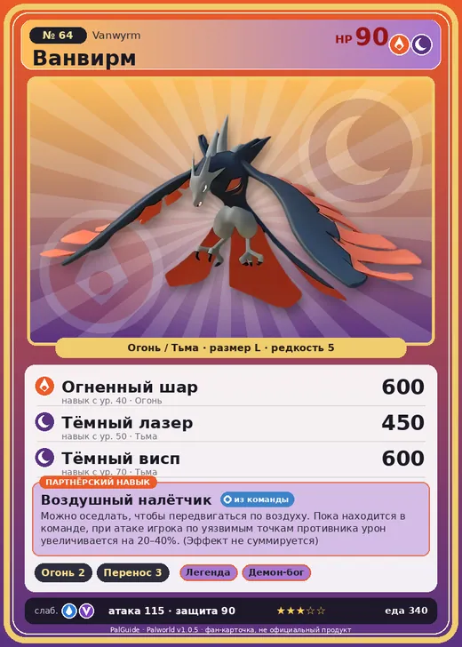

# Ванвирм

<canvas id="fx"></canvas>

№ 64 · Vanwyrm

ОгоньТьма

Слабость: ВодаДракон

🔥 Разжигание огня <b>2</b>📦 Транспортировка <b>3</b>

<b>Воздушный налётчик</b> 🎒 из команды 🐎 верхом

❤️ 90 · ⚔️ 115 · 🛡 90

Основное

💎Редкость <button class="hlp" data-tip="Чем выше число, тем реже встречается пал. 1–4 — обычные, 5–7 — редкие, 8+ — легендарные.">?</button><b>5</b>

📏Размер<b>L</b>

💰Цена продажи <button class="hlp" data-tip="Сколько золота даст торговец за пала.">?</button><b>1464</b>

Бой

🎯Множитель поимки <button class="hlp" data-tip="Насколько легче или труднее поймать: ×1 — обычно, меньше — сложнее.">?</button><b>×1</b>

🐎Скорость рывка верхом <button class="hlp" data-tip="Скорость, если сесть на пала и бежать рывком.">?</button><b>850</b>

Ферма и еда

🍖Сколько ест <button class="hlp" data-tip="Сколько сытости пал тратит — чем больше, тем больше еды нужно на базе.">?</button><b>340</b>

Разведение

🧬Сила разведения <button class="hlp" data-tip="Скрытое число игры: у детёныша оно примерно среднее от родителей. Чем меньше — тем «сильнее» пал.">?</button><b>1650</b>

=== "Обзор"

    #### Работа на базе
    - Разжигание огня — ур. 2
    - Транспортировка — ур. 3

    #### Партнёрский навык: Воздушный налётчик
    Можно оседлать, чтобы передвигаться по воздуху. Пока находится в команде, при атаке игрока по уязвимым точкам противника урон увеличивается на 20–40%. (Эффект не суммируется) Технологии 21. По звёздам: 0★ 20 · 1★ 22 · 2★ 26 · 3★ 32 · 4★ 40

    #### Чем хорош / чем плох
    - ✅ хорошая атака (115); можно оседлать; летает (ездовой)
    - ❌ явных минусов нет

    > Говорят, что звук флейты, сделанной из экзоскелета Ванвирм , слышен за пределами тысячи гор. В древности она использовалась как сигнал к началу атаки во время сражений.

    См. также: [Стихии](../../guide/06_stihii.md) · [Разведение](../../guide/07_razvedenie.md) · [Все палы](README.md)

=== "Атаки"

    #### Атаки по уровням
    - ур. 1: Воздушная пушка (Нейтральный, сила 40)
    - ур. 7: Огненный выстрел (Огонь, сила 40)
    - ур. 15: Расщеплённый огонь (Огонь, сила 80)
    - ур. 22: Огненное дыхание (Огонь, сила 160)
    - ур. 26: Летящее дыхание (Огонь, сила 200)
    - ур. 30: Кошмарная сфера (Тьма, сила 300)
    - ур. 40: Огненный шар (Огонь, сила 600)
    - ур. 50: Тёмный лазер (Тьма, сила 450)
    - ур. 70: Тёмный висп (Тьма, сила 600)

=== "Где живёт"

    #### Где водится
    - В дикой природе: да; точек появления днём: 555, ночью: 555; уровни в первых точках: 20–25
    - Подземелья: Пещера Вулкана
    - Может продаваться у торговца/рекрутера
    - Яйцо: Большое раскалённое яйцо

=== "Дроп"

    #### Дроп
    - Кость — 1–2 шт., 100%
    - Рубин — 1–2 шт., 1%
    - Золотая монета — 10–40 шт., 10%

    **Дроп альфы:**
    - Деталь древней цивилизации — 4–6 шт., 100%
    - Ценное перо — 4–6 шт., 100%

=== "Разведение"

    #### Разведение
    - Ранг разведения (CombiRank): 1650
    - Участвует в особых парах: Фоксайкл → Ванвирм Крист

=== "Пассивки"

    #### Лучшие пассивки по роли

    

⚔️ Боец

максимум урона и живучести в бою

<a class="psv r-4" data-psv="Легенда" href="../../../passivki/legend/">Легенда</a><a class="psv r-4" data-psv="Демон-бог" href="../../../passivki/demon_god/">Демон-бог</a><a class="psv r-3" data-psv="Император огня" href="../../../passivki/flame_emperor/">Император огня</a><a class="psv r-3" data-psv="Хладнокровный" href="../../../passivki/serenity/">Хладнокровный</a>

🛠 Рабочий

работает быстрее и меньше устаёт на базе

<a class="psv r-5" data-psv="Дьявольские руки" href="../../../passivki/demons_hand/">Дьявольские руки</a><a class="psv r-4" data-psv="Виртуоз" href="../../../passivki/remarkable_craftsmanship/">Виртуоз</a><a class="psv r-3" data-psv="Мастеровитый" href="../../../passivki/artisan/">Мастеровитый</a><a class="psv r-3" data-psv="Трудоголик" href="../../../passivki/workaholic/">Трудоголик</a>

🐎 Ездовой

быстрее бегает или летает с тобой верхом

<a class="psv r-4" data-psv="Божественная скорость" href="../../../passivki/swift/">Божественная скорость</a><a class="psv r-4" data-psv="Легенда" href="../../../passivki/legend/">Легенда</a><a class="psv r-4" data-psv="Вечный двигатель" href="../../../passivki/eternal_engine/">Вечный двигатель</a><a class="psv r-3" data-psv="Умелый бегун" href="../../../passivki/runner/">Умелый бегун</a>

    <small>Нажми на пассивку, чтобы узнать, что она даёт и где её взять.</small>

<a class="card-link" href="../elphidran_aqua/">← Элфидран Аква</a><a class="card-link" href="../vanwyrm_cryst/">Ванвирм Крист →</a>

