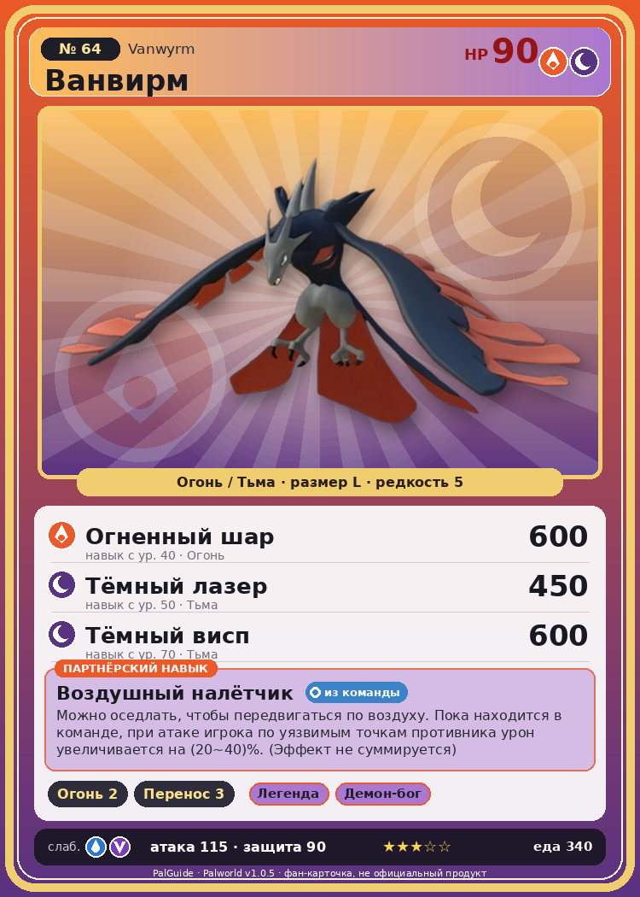

# #64 Ванвирм (Vanwyrm)

{ width=360 }

| Поле | Значение |
|---|---|
| Стихия | Огонь, Тьма |
| Слабость (кто бьёт сильнее) | Вода, Дракон |
| Редкость | 5 |
| Размер | L |
| HP / Атака / Защита (база вида) | 90 / 115 / 90 |
| Сколько ест | 340 |
| Цена продажи | 1464 |
| Множитель поимки | ×1 |
| Скорость рывка верхом | 850 |

## Работа на базе
- Разжигание огня — ур. 2
- Транспортировка — ур. 3

## Партнёрский навык: Воздушный налётчик
Можно оседлать, чтобы передвигаться по воздуху. Пока находится в команде, при атаке игрока по уязвимым точкам противника урон увеличивается на (20~40)% . (Эффект не суммируется) Технологии 21 level value 1 WeakDamage_ActiveOtomo_BirdDragon 20 2 WeakDamage_ActiveOtomo_BirdDragon 22 3 WeakDamage_ActiveOtomo_BirdDragon 26 4 WeakDamage_ActiveOtomo_BirdDragon 32 5 WeakDamage_ActiveOtomo_BirdDragon 40

## Атаки по уровням
- ур. 1: Воздушная пушка (Нейтральный, сила 40)
- ур. 7: Огненный выстрел (Огонь, сила 40)
- ур. 15: Расщеплённый огонь (Огонь, сила 80)
- ур. 22: Огненное дыхание (Огонь, сила 160)
- ур. 26: Летящее дыхание (Огонь, сила 200)
- ур. 30: Кошмарная сфера (Тьма, сила 300)
- ур. 40: Огненный шар (Огонь, сила 600)
- ур. 50: Тёмный лазер (Тьма, сила 450)
- ур. 70: Тёмный висп (Тьма, сила 600)

## Где водится
- В дикой природе: да; точек появления днём: 555, ночью: 555; уровни в первых точках: 20–25
- Подземелья: Пещера Вулкана
- Может продаваться у торговца/рекрутера
- Яйцо: Большое раскалённое яйцо

## Дроп
- Кость — 1–2 шт., 100%
- Рубин — 1–2 шт., 1%
- Золотая монета — 10–40 шт., 10%

**Дроп альфы:**
- Деталь древней цивилизации — 4–6 шт., 100%
- Ценное перо — 4–6 шт., 100%

## Разведение
- Ранг разведения (CombiRank): 1650
- Участвует в особых парах: Фоксайкл → Ванвирм Крист

## Лучшие пассивки по роли
- боец: Легенда, Демон-бог, Хладнокровный, Бессмертие, Император огня (вместо Бессмертия, если нет мутации)
- рабочий: Дьявольские руки, Виртуоз, Мастеровитый, Небожитель/Трудоголик
- ездовой: Божественная скорость, Легенда, Вечный двигатель, Небесное скольжение

## Чем хорош / чем плох
- ✅ хорошая атака (115); можно оседлать; летает (ездовой)
- ❌ явных минусов нет

> Говорят, что звук флейты, сделанной из экзоскелета Ванвирм , слышен за пределами тысячи гор. В древности она использовалась как сигнал к началу атаки во время сражений.

См. также: [Стихии](../../2_mehaniki/stihii.md) · [Разведение](../../2_mehaniki/razvedenie.md) · [Все палы](README.md)
_Источник: paldb.cc v1.0.5_
