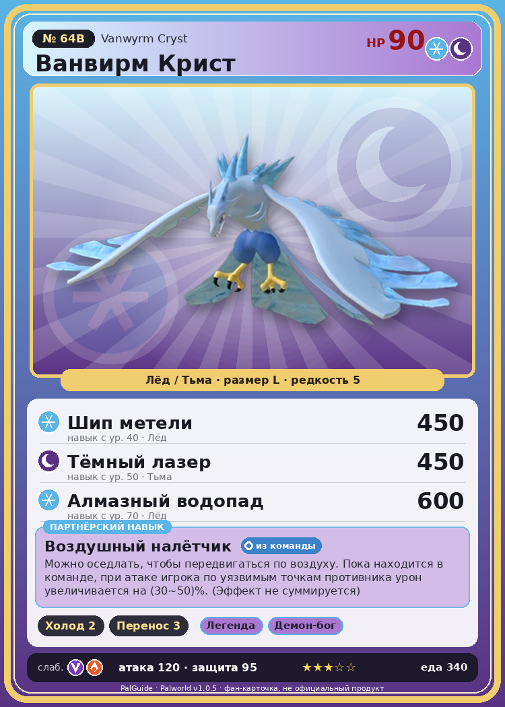

# #64B Ванвирм Крист (Vanwyrm Cryst)

{ width=360 }

| Поле | Значение |
|---|---|
| Стихия | Лёд, Тьма |
| Слабость (кто бьёт сильнее) | Дракон, Огонь |
| Редкость | 5 |
| Размер | L |
| HP / Атака / Защита (база вида) | 90 / 120 / 95 |
| Сколько ест | 340 |
| Цена продажи | 1624 |
| Множитель поимки | ×1 |
| Скорость рывка верхом | 850 |

## Работа на базе
- Охлаждение — ур. 2
- Транспортировка — ур. 3

## Партнёрский навык: Воздушный налётчик
Можно оседлать, чтобы передвигаться по воздуху. Пока находится в команде, при атаке игрока по уязвимым точкам противника урон увеличивается на (30~50)% . (Эффект не суммируется) Технологии 22 level value 1 WeakDamage_ActiveOtomo_BirdDragon_Ice 30 2 WeakDamage_ActiveOtomo_BirdDragon_Ice 32 3 WeakDamage_ActiveOtomo_BirdDragon_Ice 36 4 WeakDamage_ActiveOtomo_BirdDragon_Ice 42 5 WeakDamage_ActiveOtomo_BirdDragon_Ice 50

## Атаки по уровням
- ур. 1: Воздушная пушка (Нейтральный, сила 40)
- ур. 7: Ледяная ракета (Лёд, сила 40)
- ур. 15: Ледяной резак (Лёд, сила 80)
- ур. 22: Ледяное дыхание (Лёд, сила 160)
- ур. 26: Летящая буря (Лёд, сила 200)
- ур. 30: Кошмарная сфера (Тьма, сила 300)
- ур. 40: Шип метели (Лёд, сила 450)
- ур. 50: Тёмный лазер (Тьма, сила 450)
- ур. 70: Алмазный водопад (Лёд, сила 600)

## Где водится
- В дикой природе: да; точек появления днём: 264, ночью: 300; уровни в первых точках: 23–28
- Подземелья: Пещера Священной Горы
- Яйцо: Большое яйцо льда

## Дроп
- Кость — 1–2 шт., 100%
- Ледяной орган — 2–3 шт., 100%
- Сапфир — 1 шт., 2%

**Дроп альфы:**
- Деталь древней цивилизации — 5–7 шт., 100%
- Ценное перо — 5–7 шт., 100%

## Разведение
- Ранг разведения (CombiRank): 1430
- **Особая пара:** [Ванвирм](../../4_spravochniki/paly/vanwyrm.md) + [Фоксайкл](../../4_spravochniki/paly/foxcicle.md)

## Лучшие пассивки по роли
- боец: Легенда, Демон-бог, Хладнокровный, Бессмертие, Император льда (вместо Бессмертия, если нет мутации)
- рабочий: Дьявольские руки, Виртуоз, Мастеровитый, Небожитель/Трудоголик
- ездовой: Божественная скорость, Легенда, Вечный двигатель, Небесное скольжение

## Чем хорош / чем плох
- ✅ очень высокая атака (120); можно оседлать; летает (ездовой)
- ❌ разводится только особой парой

> Говорят, что звук флейты, сделанной из экзоскелета Ванвирм Крист , слышен за пределами тысячи гор. В древности её использовали как победный клич после сражений.

См. также: [Стихии](../../2_mehaniki/stihii.md) · [Разведение](../../2_mehaniki/razvedenie.md) · [Все палы](README.md)
_Источник: paldb.cc v1.0.5_
