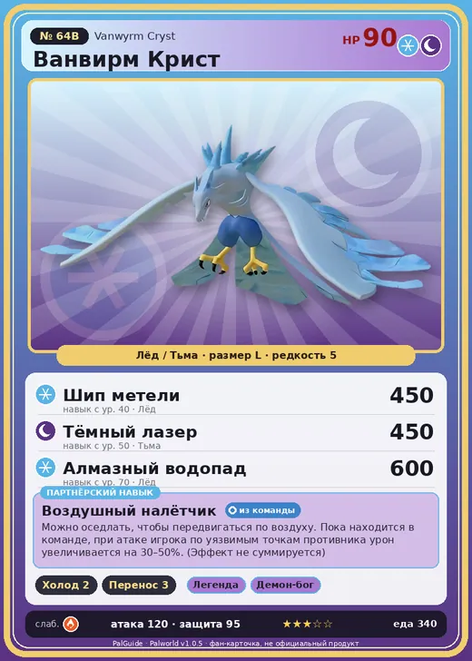

# #64B Ванвирм Крист (Vanwyrm Cryst)

№ 64B

ЛёдТьма

Слабость: ДраконОгонь

❄️ Охлаждение <b>2</b>📦 Транспортировка <b>3</b>

<b>Воздушный налётчик</b> 🎒 из команды 🐎 верхом

❤️ 90 · ⚔️ 120 · 🛡 95

| Поле | Значение |
|---|---|
| Стихия | Лёд, Тьма |
| Слабость (кто бьёт сильнее) | Дракон, Огонь |
| Редкость | 5 |
| Размер | L |
| HP / Атака / Защита (база вида) | 90 / 120 / 95 |
| Сколько ест | 340 |
| Цена продажи | 1624 |
| Множитель поимки | ×1 |
| Скорость рывка верхом | 850 |

=== "Обзор"

    #### Работа на базе
    - Охлаждение — ур. 2
    - Транспортировка — ур. 3

    #### Партнёрский навык: Воздушный налётчик
    Можно оседлать, чтобы передвигаться по воздуху. Пока находится в команде, при атаке игрока по уязвимым точкам противника урон увеличивается на 30–50%. (Эффект не суммируется) Технологии 22. По звёздам: 0★ 30 · 1★ 32 · 2★ 36 · 3★ 42 · 4★ 50

    #### Чем хорош / чем плох
    - ✅ очень высокая атака (120); можно оседлать; летает (ездовой)
    - ❌ разводится только особой парой

    > Говорят, что звук флейты, сделанной из экзоскелета Ванвирм Крист , слышен за пределами тысячи гор. В древности её использовали как победный клич после сражений.

    См. также: [Стихии](../../guide/06_stihii.md) · [Разведение](../../guide/07_razvedenie.md) · [Все палы](README.md)

=== "Атаки"

    #### Атаки по уровням
    - ур. 1: Воздушная пушка (Нейтральный, сила 40)
    - ур. 7: Ледяная ракета (Лёд, сила 40)
    - ур. 15: Ледяной резак (Лёд, сила 80)
    - ур. 22: Ледяное дыхание (Лёд, сила 160)
    - ур. 26: Летящая буря (Лёд, сила 200)
    - ур. 30: Кошмарная сфера (Тьма, сила 300)
    - ур. 40: Шип метели (Лёд, сила 450)
    - ур. 50: Тёмный лазер (Тьма, сила 450)
    - ур. 70: Алмазный водопад (Лёд, сила 600)

=== "Где живёт"

    #### Где водится
    - В дикой природе: да; точек появления днём: 264, ночью: 300; уровни в первых точках: 23–28
    - Подземелья: Пещера Священной Горы
    - Яйцо: Большое яйцо льда

=== "Дроп"

    #### Дроп
    - Кость — 1–2 шт., 100%
    - Ледяной орган — 2–3 шт., 100%
    - Сапфир — 1 шт., 2%

    **Дроп альфы:**
    - Деталь древней цивилизации — 5–7 шт., 100%
    - Ценное перо — 5–7 шт., 100%

=== "Разведение"

    #### Разведение
    - Ранг разведения (CombiRank): 1430
    - **Особая пара:** [Ванвирм](../../4_spravochniki/paly/vanwyrm.md) + [Фоксайкл](../../4_spravochniki/paly/foxcicle.md)

=== "Пассивки"

    #### Лучшие пассивки по роли

    

⚔️ Боец

максимум урона и живучести в бою

<a class="psv r-4" data-psv="Легенда" href="../../../passivki/legend/">Легенда</a><a class="psv r-4" data-psv="Демон-бог" href="../../../passivki/demon_god/">Демон-бог</a><a class="psv r-3" data-psv="Император льда" href="../../../passivki/ice_emperor/">Император льда</a><a class="psv r-3" data-psv="Хладнокровный" href="../../../passivki/serenity/">Хладнокровный</a>

🛠 Рабочий

работает быстрее и меньше устаёт на базе

<a class="psv r-5" data-psv="Дьявольские руки" href="../../../passivki/demons_hand/">Дьявольские руки</a><a class="psv r-4" data-psv="Виртуоз" href="../../../passivki/remarkable_craftsmanship/">Виртуоз</a><a class="psv r-3" data-psv="Мастеровитый" href="../../../passivki/artisan/">Мастеровитый</a><a class="psv r-3" data-psv="Трудоголик" href="../../../passivki/workaholic/">Трудоголик</a>

🐎 Ездовой

быстрее бегает или летает с тобой верхом

<a class="psv r-4" data-psv="Божественная скорость" href="../../../passivki/swift/">Божественная скорость</a><a class="psv r-4" data-psv="Легенда" href="../../../passivki/legend/">Легенда</a><a class="psv r-4" data-psv="Вечный двигатель" href="../../../passivki/eternal_engine/">Вечный двигатель</a><a class="psv r-3" data-psv="Умелый бегун" href="../../../passivki/runner/">Умелый бегун</a>

    <small>Нажми на пассивку, чтобы узнать, что она даёт и где её взять.</small>

<a class="card-link" href="../vanwyrm/">← Ванвирм</a><a class="card-link" href="../felbat/">Фелбэт →</a>

