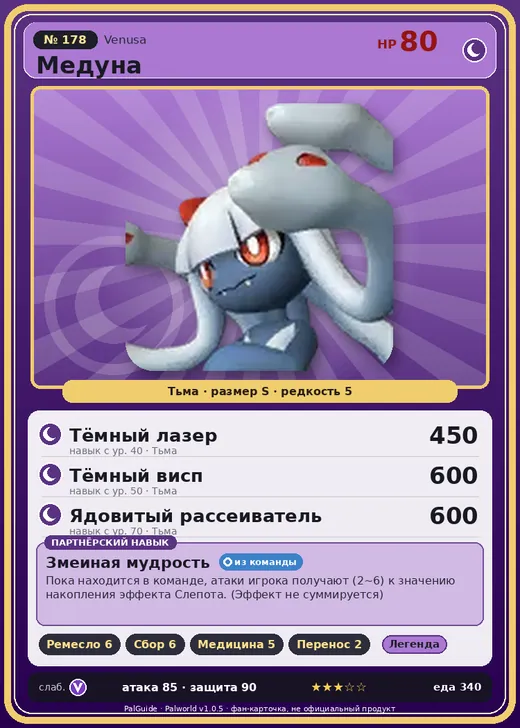

# #178 Медуна (Venusa)

#178 · Venusa

Тьма

Слабость: Дракон

🖐️ Ручная работа <b>6</b>🌾 Сбор <b>6</b>💊 Фармацевтика <b>5</b>📦 Транспортировка <b>2</b>

<b>Змеиная мудрость</b> 🎒 из команды

❤️ 80 · ⚔️ 85 · 🛡 90

| Поле | Значение |
|---|---|
| Стихия | Тьма |
| Слабость (кто бьёт сильнее) | Дракон |
| Редкость | 5 |
| Размер | S |
| HP / Атака / Защита (база вида) | 80 / 85 / 90 |
| Сколько ест | 340 |
| Цена продажи | 2680 |
| Множитель поимки | ×1 |
| Скорость рывка верхом | 600 |

## Работа на базе
- Ручная работа — ур. 6
- Сбор — ур. 6
- Фармацевтика — ур. 5
- Транспортировка — ур. 2

## Партнёрский навык: Змеиная мудрость
Пока находится в команде, атаки игрока получают (2~6) к значению накопления эффекта Слепота . (Эффект не суммируется) level value 1 AdditionalEffect_Darkness_PartnerSkill_SnakeGirl 2 2 AdditionalEffect_Darkness_PartnerSkill_SnakeGirl 3 3 AdditionalEffect_Darkness_PartnerSkill_SnakeGirl 4 4 AdditionalEffect_Darkness_PartnerSkill_SnakeGirl 5 5 AdditionalEffect_Darkness_PartnerSkill_SnakeGirl 6

## Атаки по уровням
- ур. 1: Ядовитый туман (Тьма, сила 0)
- ур. 7: Ядовитый выстрел (Тьма, сила 30)
- ур. 15: Теневой взрыв (Тьма, сила 80)
- ур. 22: Духовное пламя (Тьма, сила 200)
- ур. 30: Ядовитый душ (Тьма, сила 160)
- ур. 40: Тёмный лазер (Тьма, сила 450)
- ур. 50: Тёмный висп (Тьма, сила 600)
- ур. 70: Ядовитый рассеиватель (Тьма, сила 600)

## Где водится
- В дикой природе: нет/особый способ; точек появления днём: 0, ночью: 0
- Яйцо: Большое яйцо тьмы

## Дроп
- Жидкость водного Пала — 2–3 шт., 100%
- Ядовитая железа — 2–3 шт., 100%

**Дроп альфы:**
- Деталь древней цивилизации — 2–3 шт., 100%
- Ценные внутренности — 2–3 шт., 100%

## Разведение
- Ранг разведения (CombiRank): 970

## Лучшие пассивки по роли
- боец: Легенда, Демон-бог, Хладнокровный, Бессмертие, Король тьмы (вместо Бессмертия, если нет мутации)
- рабочий: Дьявольские руки, Виртуоз, Мастеровитый, Небожитель/Трудоголик
- ездовой: Божественная скорость, Легенда, Вечный двигатель, Небесное скольжение

## Чем хорош / чем плох
- ✅ отличный рабочий (пригодность 6); можно оседлать
- ❌ явных минусов нет

> Когда возникает что-то непонятное, начинается обсуждение со змеями на голове. Но поскольку в итоге все — одно и то же сознание, становится ясно, что ничего не понятно.

См. также: [Стихии](../../2_mehaniki/stihii.md) · [Разведение](../../2_mehaniki/razvedenie.md) · [Все палы](README.md)
