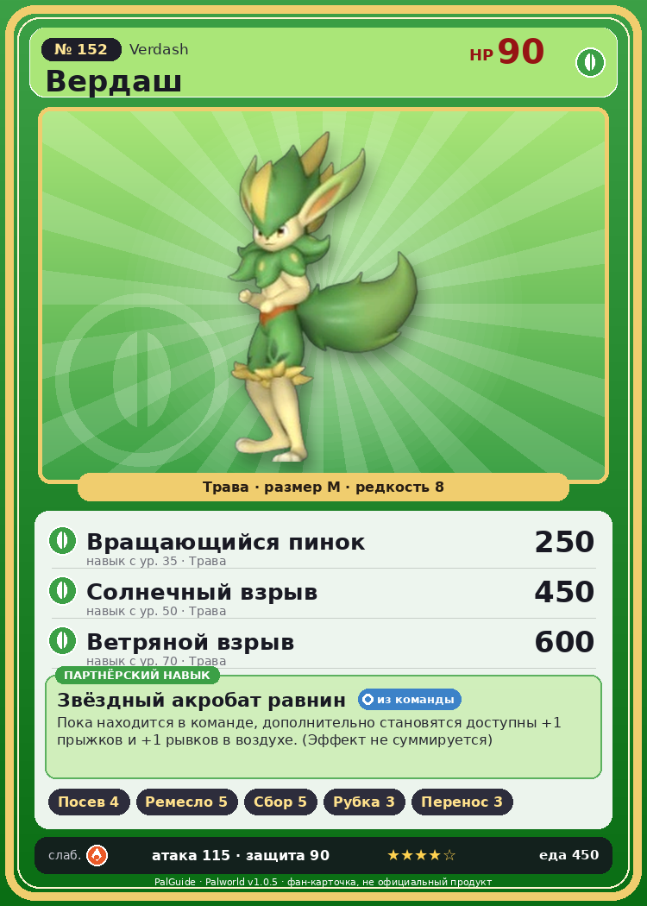

# #152 Вердаш (Verdash)

{ width=360 }

| Поле | Значение |
|---|---|
| Стихия | Трава |
| Слабость (кто бьёт сильнее) | Огонь |
| Редкость | 8 |
| Размер | M |
| HP / Атака / Защита (база вида) | 90 / 115 / 90 |
| Сколько ест | 450 |
| Цена продажи | 1947 |
| Множитель поимки | ×1 |
| Скорость рывка верхом | 700 |

## Работа на базе
- Посев семян — ур. 4
- Ручная работа — ур. 5
- Сбор — ур. 5
- Рубка деревьев — ур. 3
- Транспортировка — ур. 3

## Партнёрский навык: Звёздный акробат равнин
Пока находится в команде, дополнительно становятся доступны +1 прыжков и +1 рывков в воздухе . (Эффект не суммируется) level value 1 GrassRabbitMan_PartnerSkill 1, 1 2 GrassRabbitMan_PartnerSkill 1, 1 3 GrassRabbitMan_PartnerSkill 1, 1 4 GrassRabbitMan_PartnerSkill 1, 1 5 GrassRabbitMan_PartnerSkill 1, 1

## Атаки по уровням
- ур. 1: Ветряной клинок (Трава, сила 40)
- ур. 7: Камнемёт (Земля, сила 120)
- ур. 15: Семенной пулемёт (Трава, сила 80)
- ур. 22: Каменный залп (Земля, сила 80)
- ур. 30: Травяной торнадо (Трава, сила 200)
- ур. 35: Вращающийся пинок (Трава, сила 250)
- ур. 40: Терновые лозы (Трава, сила 250)
- ур. 50: Солнечный взрыв (Трава, сила 450)
- ур. 70: Ветряной взрыв (Трава, сила 600)

## Где водится
- В дикой природе: да; точек появления днём: 84, ночью: 84; уровни в первых точках: 52–53
- Яйцо: Огромное яйцо свежей листвы

## Дроп
- Кожа — 1–2 шт., 100%
- Кость — 1 шт., 100%

**Дроп альфы:**
- Деталь древней цивилизации — 4–6 шт., 100%
- Ценный мех — 4–6 шт., 100%

## Разведение
- Ранг разведения (CombiRank): 1160

## Лучшие пассивки по роли
- боец: Легенда, Демон-бог, Хладнокровный, Бессмертие, Король духов (вместо Бессмертия, если нет мутации)
- рабочий: Дьявольские руки, Виртуоз, Мастеровитый, Небожитель/Трудоголик
- ездовой: Божественная скорость, Легенда, Вечный двигатель, Небесное скольжение

## Чем хорош / чем плох
- ✅ хорошая атака (115); отличный рабочий (пригодность 5); можно оседлать
- ❌ явных минусов нет

> Почва, по которой пробегает Вердаш , становится очень плодородной, и там буйно разрастается зелень. Если обработать землю гербицидом — он туда больше не сунется.

См. также: [Стихии](../../2_mehaniki/stihii.md) · [Разведение](../../2_mehaniki/razvedenie.md) · [Все палы](README.md)
_Источник: paldb.cc v1.0.5_
