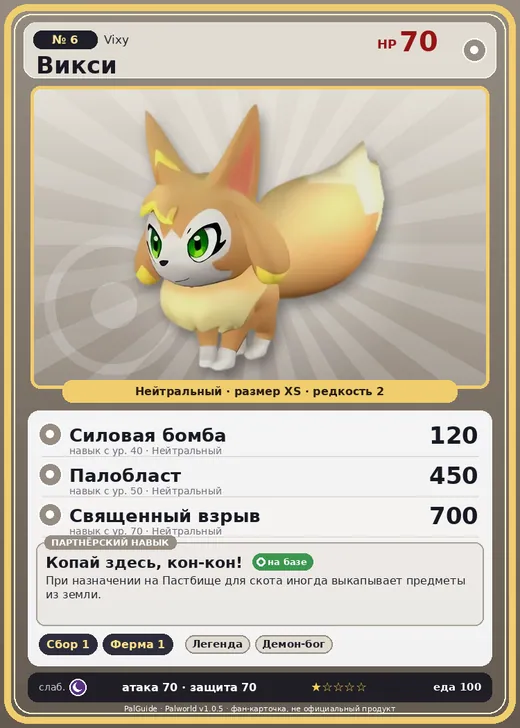

# #6 Викси (Vixy)

#6 · Vixy

Нейтральный

Слабость: Тьма

🌾 Сбор <b>1</b>🐑 Фермерство <b>1</b>

<b>Копай здесь, кон-кон!</b> 🏠 на базе

❤️ 70 · ⚔️ 70 · 🛡 70

| Поле | Значение |
|---|---|
| Стихия | Нейтральный |
| Слабость (кто бьёт сильнее) | Тьма |
| Редкость | 2 |
| Размер | XS |
| HP / Атака / Защита (база вида) | 70 / 70 / 70 |
| Сколько ест | 100 |
| Цена продажи | 407 |
| Множитель поимки | ×1.3 |
| Скорость рывка верхом | 450 |

## Работа на базе
- Сбор — ур. 1
- Фермерство — ур. 1

## Партнёрский навык: Копай здесь, кон-кон!
При назначении на Пастбище для скота иногда выкапывает предметы из земли.

## Атаки по уровням
- ур. 1: Воздушная пушка (Нейтральный, сила 40)
- ур. 7: Грязевой выстрел (Земля, сила 40)
- ур. 15: Силовой выстрел (Нейтральный, сила 80)
- ур. 22: Ветряной клинок (Трава, сила 40)
- ур. 30: Семенной пулемёт (Трава, сила 80)
- ур. 40: Силовая бомба (Нейтральный, сила 120)
- ур. 50: Палобласт (Нейтральный, сила 450)
- ур. 70: Священный взрыв (Нейтральный, сила 700)

## Где водится
- В дикой природе: да; точек появления днём: 69, ночью: 69; уровни в первых точках: 1–3
- Подземелья: Пещера Отдалённого Острова, Пещера Холмов
- Яйцо: Обычное яйцо

## Дроп
- Кожа — 1 шт., 100%
- Кость — 1 шт., 100%

**Дроп альфы:**
- Деталь древней цивилизации — 1–2 шт., 100%
- Ценный мех — 1–2 шт., 100%

## Разведение
- Ранг разведения (CombiRank): 3060

## Лучшие пассивки по роли
- по обзору: Удачливый
- боец: Легенда, Демон-бог, Хладнокровный, Бессмертие, Святое небо (вместо Бессмертия, если нет мутации)
- ездовой: Божественная скорость, Легенда, Вечный двигатель, Небесное скольжение

## Чем хорош / чем плох
- ✅ На пастбище копает сферы и предметы; можно оседлать
- ❌ Слабый боец; слабая атака (70)

> Звезда острова Палпагос. Тот, кто обидит Викси , наживёт себе врагов во всём мире.

См. также: [Стихии](../../2_mehaniki/stihii.md) · [Разведение](../../2_mehaniki/razvedenie.md) · [Все палы](README.md)
