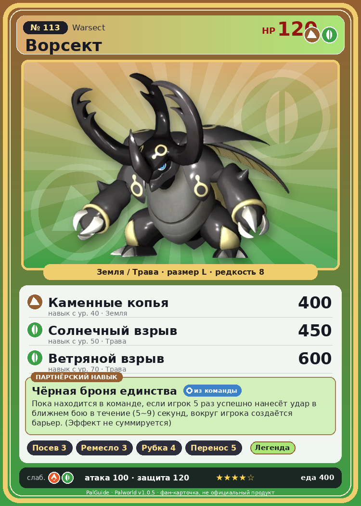

# #113 Ворсект (Warsect)

{ width=360 }

| Поле | Значение |
|---|---|
| Стихия | Земля, Трава |
| Слабость (кто бьёт сильнее) | Огонь, Трава |
| Редкость | 8 |
| Размер | L |
| HP / Атака / Защита (база вида) | 120 / 100 / 120 |
| Сколько ест | 400 |
| Цена продажи | 2913 |
| Множитель поимки | ×1 |
| Скорость рывка верхом | 600 |

## Работа на базе
- Посев семян — ур. 3
- Ручная работа — ур. 3
- Рубка деревьев — ур. 4
- Транспортировка — ур. 5

## Партнёрский навык: Чёрная броня единства
Пока находится в команде, если игрок 5 раз успешно нанесёт удар в ближнем бою в течение (5~9) секунд , вокруг игрока создаётся барьер . (Эффект не суммируется) level value 1 Baphomet_Dark_PartnerSkill 5 2 Baphomet_Dark_PartnerSkill 6 3 Baphomet_Dark_PartnerSkill 7 4 Baphomet_Dark_PartnerSkill 8 5 Baphomet_Dark_PartnerSkill 9

## Атаки по уровням
- ур. 1: Ветряной клинок (Трава, сила 40)
- ур. 7: Семенной пулемёт (Трава, сила 80)
- ур. 15: Каменный залп (Земля, сила 80)
- ур. 22: Камнемёт (Земля, сила 120)
- ур. 30: Гигарог (Земля, сила 250)
- ур. 40: Каменные копья (Земля, сила 400)
- ур. 50: Солнечный взрыв (Трава, сила 450)
- ур. 70: Ветряной взрыв (Трава, сила 600)

## Где водится
- В дикой природе: да; точек появления днём: 10, ночью: 10; уровни в первых точках: 34–38
- Может продаваться у торговца/рекрутера
- Яйцо: Огромное яйцо земли

## Дроп
- Мёд — 3–4 шт., 100%

**Дроп альфы:**
- Деталь древней цивилизации — 2–4 шт., 100%
- Ценное перо — 2–4 шт., 100%

## Разведение
- Ранг разведения (CombiRank): 1280
- Участвует в особых парах: Дигтос → Ворсект Терра

## Лучшие пассивки по роли
- по обзору: Мастеровитый, Легенда, Демон-бог, Император земли
- боец: Легенда, Демон-бог, Хладнокровный, Бессмертие, Император земли (вместо Бессмертия, если нет мутации)
- рабочий: Дьявольские руки, Виртуоз, Мастеровитый, Небожитель/Трудоголик
- ездовой: Божественная скорость, Легенда, Вечный двигатель, Небесное скольжение

## Чем хорош / чем плох
- ✅ Рубка, средний боец; хорошая атака (100); много здоровья (120); крепкая защита (120); отличный рабочий (пригодность 5); можно оседлать
- ❌ явных минусов нет

> Сверхпрочный панцирь, покрывающий всё тело, обладает колоссальной прочностью и жаростойкостью. Даже напалм едва ли оставляет на нём следы.

См. также: [Стихии](../../2_mehaniki/stihii.md) · [Разведение](../../2_mehaniki/razvedenie.md) · [Все палы](README.md)
_Источник: paldb.cc v1.0.5_
