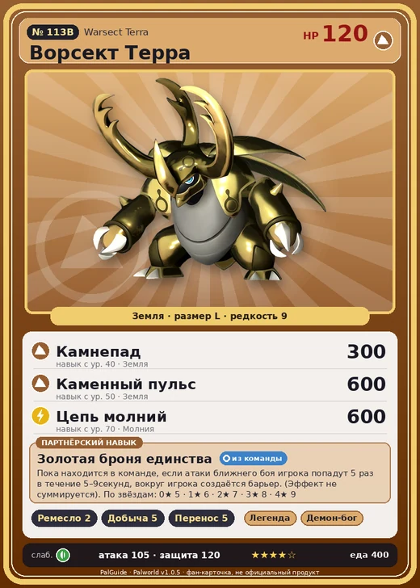

# #113B Ворсект Терра (Warsect Terra)

#113B · Warsect Terra

Земля

Слабость: Трава

🖐️ Ручная работа <b>2</b>⛏️ Добыча <b>5</b>📦 Транспортировка <b>5</b>

<b>Золотая броня единства</b> 🎒 из команды

❤️ 120 · ⚔️ 105 · 🛡 120

| Поле | Значение |
|---|---|
| Стихия | Земля |
| Слабость (кто бьёт сильнее) | Трава |
| Редкость | 9 |
| Размер | L |
| HP / Атака / Защита (база вида) | 120 / 105 / 120 |
| Сколько ест | 400 |
| Цена продажи | 10000 |
| Множитель поимки | ×1 |
| Скорость рывка верхом | 600 |

## Работа на базе
- Ручная работа — ур. 2
- Добыча — ур. 5
- Транспортировка — ур. 5

## Партнёрский навык: Золотая броня единства
Пока находится в команде, если атаки ближнего боя игрока попадут 5 раз в течение (5~9) секунд , вокруг игрока создаётся барьер . (Эффект не суммируется) level value 1 Baphomet_Dark_PartnerSkill 5 2 Baphomet_Dark_PartnerSkill 6 3 Baphomet_Dark_PartnerSkill 7 4 Baphomet_Dark_PartnerSkill 8 5 Baphomet_Dark_PartnerSkill 9

## Атаки по уровням
- ур. 1: Грязевой выстрел (Земля, сила 40)
- ур. 7: Семенной пулемёт (Трава, сила 80)
- ур. 15: Гигарог (Земля, сила 250)
- ур. 22: Камнемёт (Земля, сила 120)
- ур. 30: Веер клинков (Трава, сила 200)
- ур. 40: Камнепад (Земля, сила 300)
- ур. 50: Каменный пульс (Земля, сила 600)
- ур. 70: Цепь молний (Молния, сила 600)

## Где водится
- В дикой природе: да; точек появления днём: 59, ночью: 59; уровни в первых точках: 53–56
- Подземелья: Пещера Тэнраку
- Яйцо: Огромное яйцо земли

## Дроп
- Мёд — 3–4 шт., 100%

**Дроп альфы:**
- Деталь древней цивилизации — 7–8 шт., 100%
- Ценное перо — 2–3 шт., 100%

## Разведение
- Ранг разведения (CombiRank): 630
- **Особая пара:** [Ворсект](../../4_spravochniki/paly/warsect.md) + [Дигтос](../../4_spravochniki/paly/digtoise.md)

## Лучшие пассивки по роли
- боец: Легенда, Демон-бог, Хладнокровный, Бессмертие, Император земли (вместо Бессмертия, если нет мутации)
- рабочий: Дьявольские руки, Виртуоз, Мастеровитый, Небожитель/Трудоголик
- ездовой: Божественная скорость, Легенда, Вечный двигатель, Небесное скольжение

## Чем хорош / чем плох
- ✅ хорошая атака (105); много здоровья (120); крепкая защита (120); отличный рабочий (пригодность 5); можно оседлать
- ❌ разводится только особой парой

> Сверхпрочный панцирь, покрывающий всё тело, обладает колоссальной прочностью и жаростойкостью. Даже если по нему пройдёт Мамморест , панцирь останется невредимым.

См. также: [Стихии](../../2_mehaniki/stihii.md) · [Разведение](../../2_mehaniki/razvedenie.md) · [Все палы](README.md)
