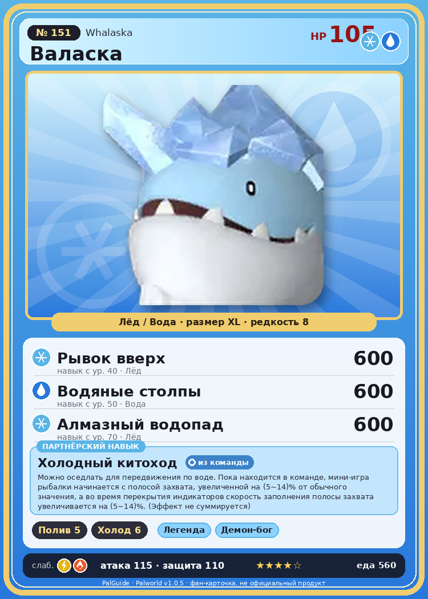

# #151 Валаска (Whalaska)

{ width=360 }

| Поле | Значение |
|---|---|
| Стихия | Лёд, Вода |
| Слабость (кто бьёт сильнее) | Молния, Огонь |
| Редкость | 8 |
| Размер | XL |
| HP / Атака / Защита (база вида) | 105 / 115 / 110 |
| Сколько ест | 560 |
| Цена продажи | 2685 |
| Множитель поимки | ×1 |
| Скорость рывка верхом | 750 |

## Работа на базе
- Полив — ур. 5
- Охлаждение — ур. 6

## Партнёрский навык: Холодный китоход
Можно оседлать для передвижения по воде. Пока находится в команде, мини-игра рыбалки начинается с полосой захвата, увеличенной на (5~14)% от обычного значения, а во время перекрытия индикаторов скорость заполнения полосы захвата увеличивается на (5~14)% . (Эффект не суммируется) Технологии 42 level value 1 Fishing_StartProgressAdd_IceNarWhal_PartnerSkill 5 Fishing_SuccessAmountUp_IceNarWhal_PartnerSkill 5 Пробуждение : 2 Fishing_StartProgressAdd_IceNarWhal_PartnerSkill 7 Fishing_SuccessAmountUp_IceNarWhal_PartnerSkill 7 SwimSpeed_up_PartnerSkill_1 10 Пробуждение : (Скорость передвижения по воде: +10% ) 3 Fishing_StartProgressAdd_IceNarWhal_PartnerSkill 9 Fishing_SuccessAmountUp_IceNarWhal_PartnerSkill 9 SwimSpeed_up_PartnerSkill_2 14 Пробуждение : (Скорость передвижения по воде: +14% ) 4 Fishing_StartProgressAdd_IceNarWhal_PartnerSkill 11 Fishing_SuccessAmountUp_IceNarWhal_PartnerSkill 11 SwimSpeed_up_PartnerSkill_3 18 Пробуждение : (Скорость передвижения по воде: +18% ) 5 Fishing_StartProgressAdd_IceNarWhal_PartnerSkill 14 Fishing_SuccessAmountUp_IceNarWhal_PartnerSkill 14 SwimSpeed_up_PartnerSkill_4 25 Пробуждение : (Скорость передвижения по воде: +25% )

## Атаки по уровням
- ур. 1: Ледяная ракета (Лёд, сила 40)
- ур. 7: Ледяной резак (Лёд, сила 80)
- ур. 15: Айсберг (Лёд, сила 120)
- ур. 22: Полоса брызг (Вода, сила 160)
- ур. 30: Ледяная стена (Лёд, сила 200)
- ур. 40: Рывок вверх (Лёд, сила 600)
- ур. 50: Водяные столпы (Вода, сила 600)
- ур. 70: Алмазный водопад (Лёд, сила 600)

## Где водится
- В дикой природе: да; точек появления днём: 188, ночью: 8
- Яйцо: Огромное яйцо льда

## Дроп
- Жидкость водного Пала — 1–2 шт., 100%
- Кораллиновая руда — 2–3 шт., 100%
- Ледяной орган — 1–3 шт., 100%
- Большая душа Пала — 1 шт., 1%

**Дроп альфы:**
- Деталь древней цивилизации — 6–7 шт., 100%
- Ценный коготь — 2–3 шт., 100%

## Разведение
- Ранг разведения (CombiRank): 710
- Участвует в особых парах: Чиллет Игнис → Валаска Игнис

## Лучшие пассивки по роли
- боец: Легенда, Демон-бог, Хладнокровный, Бессмертие, Император льда (вместо Бессмертия, если нет мутации)
- рабочий: Дьявольские руки, Виртуоз, Мастеровитый, Небожитель/Трудоголик
- ездовой: Божественная скорость, Легенда, Вечный двигатель, Небесное скольжение

## Чем хорош / чем плох
- ✅ хорошая атака (115); отличный рабочий (пригодность 6); можно оседлать
- ❌ много ест (560)

> Когда он спит, некоторые Палы принимают его за льдину и приходят на неё отдохнуть. Он не сбрасывает их после пробуждения — добрый нрав не позволяет. Однако, несмотря на это, внутри он переживает стресс из-за нарушения своего личного пространства.

См. также: [Стихии](../../2_mehaniki/stihii.md) · [Разведение](../../2_mehaniki/razvedenie.md) · [Все палы](README.md)
_Источник: paldb.cc v1.0.5_
