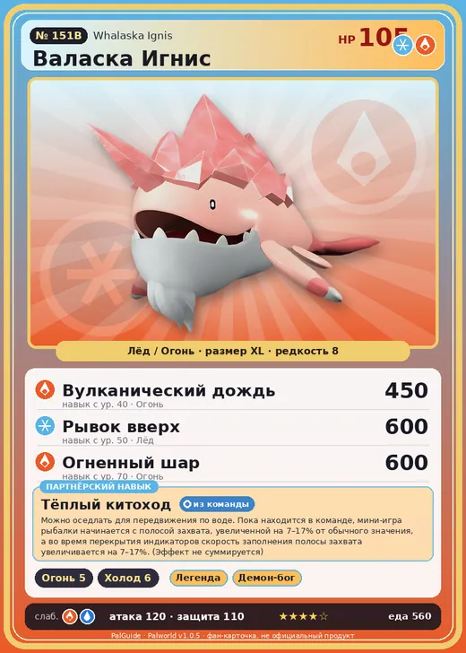

# #151B Валаска Игнис (Whalaska Ignis)

№ 151B

ЛёдОгонь

Слабость: ВодаОгонь

🔥 Разжигание огня <b>5</b>❄️ Охлаждение <b>6</b>

<b>Тёплый китоход</b> 🎒 из команды 🐎 верхом

❤️ 105 · ⚔️ 120 · 🛡 110

| Поле | Значение |
|---|---|
| Стихия | Лёд, Огонь |
| Слабость (кто бьёт сильнее) | Вода, Огонь |
| Редкость | 8 |
| Размер | XL |
| HP / Атака / Защита (база вида) | 105 / 120 / 110 |
| Сколько ест | 560 |
| Цена продажи | 3097 |
| Множитель поимки | ×1 |
| Скорость рывка верхом | 750 |

## Работа на базе
- Разжигание огня — ур. 5
- Охлаждение — ур. 6

## Партнёрский навык: Тёплый китоход
Можно оседлать для передвижения по воде. Пока находится в команде, мини-игра рыбалки начинается с полосой захвата, увеличенной на (7~17)% от обычного значения, а во время перекрытия индикаторов скорость заполнения полосы захвата увеличивается на (7~17)% . (Эффект не суммируется) Технологии 71 level value 1 Fishing_StartProgressAdd_IceNarWhal_Fire_PartnerSkill 7 Fishing_SuccessAmountUp_IceNarWhal_Fire_PartnerSkill 7 Пробуждение : 2 Fishing_StartProgressAdd_IceNarWhal_Fire_PartnerSkill 9 Fishing_SuccessAmountUp_IceNarWhal_Fire_PartnerSkill 9 SwimSpeed_up_PartnerSkill_1 10 Пробуждение : (Скорость передвижения по воде: +10% ) 3 Fishing_StartProgressAdd_IceNarWhal_Fire_PartnerSkill 11 Fishing_SuccessAmountUp_IceNarWhal_Fire_PartnerSkill 11 SwimSpeed_up_PartnerSkill_2 14 Пробуждение : (Скорость передвижения по воде: +14% ) 4 Fishing_StartProgressAdd_IceNarWhal_Fire_PartnerSkill 13 Fishing_SuccessAmountUp_IceNarWhal_Fire_PartnerSkill 13 SwimSpeed_up_PartnerSkill_3 18 Пробуждение : (Скорость передвижения по воде: +18% ) 5 Fishing_StartProgressAdd_IceNarWhal_Fire_PartnerSkill 17 Fishing_SuccessAmountUp_IceNarWhal_Fire_PartnerSkill 17 SwimSpeed_up_PartnerSkill_4 25 Пробуждение : (Скорость передвижения по воде: +25% )

## Атаки по уровням
- ур. 1: Огненный выстрел (Огонь, сила 40)
- ур. 7: Огненная стрела (Огонь, сила 120)
- ур. 15: Айсберг (Лёд, сила 120)
- ур. 22: Огненная стена (Огонь, сила 250)
- ур. 30: Ледяная стена (Лёд, сила 200)
- ур. 40: Вулканический дождь (Огонь, сила 450)
- ур. 50: Рывок вверх (Лёд, сила 600)
- ур. 70: Огненный шар (Огонь, сила 600)

## Где водится
- В дикой природе: нет/особый способ; точек появления днём: 0, ночью: 0
- Яйцо: Огромное яйцо льда

## Дроп
- Жидкость водного Пала — 1–2 шт., 100%
- Кораллиновая руда — 2–3 шт., 100%
- Огненный орган — 1–3 шт., 100%
- Большая душа Пала — 1 шт., 1%

**Дроп альфы:**
- Деталь древней цивилизации — 6–7 шт., 100%
- Ценный коготь — 2–3 шт., 100%

## Разведение
- Ранг разведения (CombiRank): 370
- **Особая пара:** [Валаска](../../4_spravochniki/paly/whalaska.md) + [Чиллет Игнис](../../4_spravochniki/paly/chillet_ignis.md)

## Лучшие пассивки по роли
- боец: Легенда, Демон-бог, Хладнокровный, Бессмертие, Император льда (вместо Бессмертия, если нет мутации)
- рабочий: Дьявольские руки, Виртуоз, Мастеровитый, Небожитель/Трудоголик
- ездовой: Божественная скорость, Легенда, Вечный двигатель, Небесное скольжение

## Чем хорош / чем плох
- ✅ очень высокая атака (120); отличный рабочий (пригодность 6); можно оседлать
- ❌ много ест (560); разводится только особой парой

> Чтобы его больше не путали со льдиной, он усилием воли покраснел. Но Палам, не различающим красный цвет, было всё равно — они продолжали нарушать его личное пространство. Все старания оказались тщетны.

См. также: [Стихии](../../guide/06_stihii.md) · [Разведение](../../guide/07_razvedenie.md) · [Все палы](README.md)
