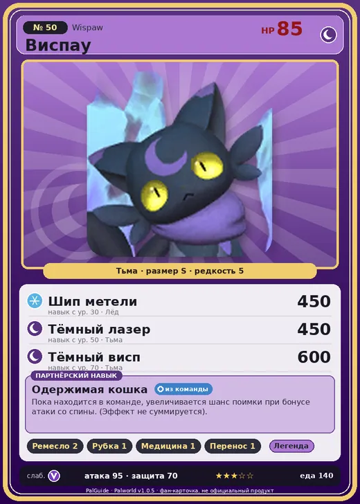

# Виспау

<canvas id="fx"></canvas>

№ 50 · Wispaw

Тьма

Слабость: Дракон

🖐️ Ручная работа <b>2</b>🪓 Рубка деревьев <b>1</b>💊 Фармацевтика <b>1</b>📦 Транспортировка <b>1</b>

<b>Одержимая кошка</b> 🎒 из команды

❤️ 85 · ⚔️ 95 · 🛡 70

| Поле | Значение |
|---|---|
| Стихия | Тьма |
| Слабость (кто бьёт сильнее) | Дракон |
| Редкость | 5 |
| Размер | S |
| HP / Атака / Защита (база вида) | 85 / 95 / 70 |
| Сколько ест | 140 |
| Цена продажи | 827 |
| Множитель поимки | ×1 |
| Скорость рывка верхом | 540 |

=== "Обзор"

    #### Работа на базе
    - Ручная работа — ур. 2
    - Рубка деревьев — ур. 1
    - Фармацевтика — ур. 1
    - Транспортировка — ур. 1

    #### Партнёрский навык: Одержимая кошка
    Пока находится в команде, увеличивается шанс поимки при бонусе атаки со спины. (Эффект не суммируется).

    #### Чем хорош / чем плох
    - ✅
    - ❌ явных минусов нет

    > Руки за спиной наполнены мыслями всех людей, которые воспитывали род до сих пор. В последнее время, похоже, все решили баловать Виспау .

    См. также: [Стихии](../../guide/06_stihii.md) · [Разведение](../../guide/07_razvedenie.md) · [Все палы](README.md)

=== "Атаки"

    #### Атаки по уровням
    - ур. 1: Тёмный шар (Тьма, сила 50)
    - ур. 7: Теневой взрыв (Тьма, сила 80)
    - ур. 15: Духовное пламя (Тьма, сила 200)
    - ур. 22: Кошмарная сфера (Тьма, сила 300)
    - ур. 30: Шип метели (Лёд, сила 450)
    - ур. 40: Апокалипсис (Тьма, сила 400)
    - ур. 50: Тёмный лазер (Тьма, сила 450)
    - ур. 70: Тёмный висп (Тьма, сила 600)

=== "Где живёт"

    #### Где водится
    - В дикой природе: нет/особый способ; точек появления днём: 0, ночью: 159
    - Яйцо: Большое яйцо тьмы

=== "Дроп"

    #### Дроп
    - Маленькая душа Пала — 2 шт., 100%
    - Кожа — 1–2 шт., 100%

    **Дроп альфы:**
    - Деталь древней цивилизации — 2–3 шт., 100%
    - Ценные внутренности — 2–3 шт., 100%

=== "Разведение"

    #### Разведение
    - Ранг разведения (CombiRank): 2250

=== "Пассивки"

    #### Лучшие пассивки по роли

    

⚔️ Боец

максимум урона и живучести в бою

<a class="psv r-4" data-psv="Легенда" href="../../../passivki/legend/">Легенда</a><a class="psv r-4" data-psv="Демон-бог" href="../../../passivki/demon_god/">Демон-бог</a><a class="psv r-3" data-psv="Король тьмы" href="../../../passivki/lord_of_the_underworld/">Король тьмы</a><a class="psv r-3" data-psv="Хладнокровный" href="../../../passivki/serenity/">Хладнокровный</a>

    <small>Нажми на пассивку, чтобы узнать, что она даёт и где её взять.</small>

<a class="card-link" href="../galeclaw/">← Эрмург</a><a class="card-link" href="../nitewing/">Найтвинг →</a>

