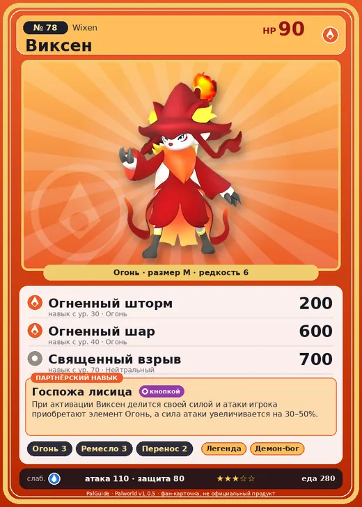

# Виксен

<canvas id="fx"></canvas>

№ 78

Огонь

Слабость: Вода <b class="mx">×1,5</b> <button class="hlp" data-tip="Множители перемножаются по обеим стихиям: ×1,5 за стихию, которую атака бьёт, ×0,65 за ту, что её держит.">?</button>

Устойчив: Трава <b class="mx">×0,65</b>Лёд <b class="mx">×0,65</b>

🔥 Разжигание огня <b>3</b>🖐️ Ручная работа <b>3</b>📦 Транспортировка <b>2</b>

<b>Госпожа лисица</b> 🔘 Включается кнопкой

❤️ 90 · ⚔️ 110 · 🛡 80

Основное

💎Редкость <button class="hlp" data-tip="Чем выше число, тем реже встречается пал. 1–4 — обычные, 5–7 — редкие, 8+ — легендарные.">?</button><b>6</b>

📏Размер<b>M</b>

💰Цена продажи <button class="hlp" data-tip="Сколько золота даст торговец за пала.">?</button><b>1284</b>

Бой

🎯Множитель поимки <button class="hlp" data-tip="Насколько легче или труднее поймать: ×1 — обычно, меньше — сложнее.">?</button><b>×1</b>

🐎Скорость рывка верхом <button class="hlp" data-tip="Скорость, если сесть на пала и бежать рывком.">?</button><b>620</b>

Ферма и еда

🍖Сколько ест <button class="hlp" data-tip="Сколько сытости пал тратит — чем больше, тем больше еды нужно на базе.">?</button><b>280</b>

Разведение

🧬Сила разведения <button class="hlp" data-tip="Скрытое число игры: у детёныша оно примерно среднее от родителей. Чем меньше — тем «сильнее» пал.">?</button><b>2080</b>

=== "Обзор"

    #### Работа на базе

    
🔥 Разжигание огня<i style="--v:30%"></i><b>3</b>✋ Ручная работа<i style="--v:30%"></i><b>3</b>📦 Транспортировка<i style="--v:20%"></i><b>2</b>

    #### Партнёрский навык: Госпожа лисица
    При активации Виксен делится своей силой и атаки игрока приобретают элемент Огонь, а сила атаки увеличивается на 30–50%.

    #### Чем хорош / чем плох
    - ✅ хорошая атака (110)
    - ❌ явных минусов нет

    > Управляет светлой силой и творит странные заклинания. Любую еду предпочитает в румяно-прожаренном виде. Плохо ладит с палом «Катресс».

    См. также: [Стихии](../../guide/06_stihii.md) · [Разведение](../../guide/07_razvedenie.md) · [Все палы](README.md)

=== "Атаки"

    #### Атаки по уровням
    - ур. 1: Огненный выстрел (Огонь, сила 40)
    - ур. 7: Расщеплённый огонь (Огонь, сила 80)
    - ур. 15: Огненная стрела (Огонь, сила 120)
    - ур. 22: Духовное пламя (Тьма, сила 200)
    - ур. 30: Огненный шторм (Огонь, сила 200)
    - ур. 40: Огненный шар (Огонь, сила 600)
    - ур. 50: Драконий метеор (Дракон, сила 600)
    - ур. 70: Священный взрыв (Нейтральный, сила 700)

=== "Где живёт"

    #### Где водится

    

<button data-k="d" class="on">☀️ День</button><button data-k="n">🌙 Ночь</button>

ур. 23–55<a class="btn hm-full" href="../../../map/?pal=FoxMage">Показать на большой карте</a>

Разрушенный город-крепостьШрамы войныОбсидиановый вулканЗелёный ручей

🕳 Подземелье<b>Пещера Вулкана</b>

🥚 Яйцо<b>Большое раскалённое яйцо</b>

🛒 Торговец<b>Продаётся у торговца палами</b>

=== "Дроп"

    #### Дроп
    - Огненный орган — 1–2 шт., 100%
    - Книга высоких технологий — 1 шт., 1%

    **Дроп альфы:**

    - Деталь древней цивилизации — 4–5 шт., 100%
    - Книга высоких технологий — 1 шт., 1%
    - Ценный мех — 4–5 шт., 100%

=== "Разведение"

    #### Разведение
    - Ранг разведения: 2080
    - Участвует в особых парах: [Катресс](katress.md) → [Виксен Нокт](wixen_noct.md); [Катресс](katress.md) → [Катресс Игнис](katress_ignis.md)

=== "Пассивки"

    #### Лучшие пассивки по роли

    

⚔️ Боец

максимум урона и живучести в бою

<a class="psv r-4" data-psv="Легенда" href="../../../passivki/legend/">Легенда</a><a class="psv r-4" data-psv="Демон-бог" href="../../../passivki/demon_god/">Демон-бог</a><a class="psv r-3" data-psv="Император огня" href="../../../passivki/flame_emperor/">Император огня</a><a class="psv r-3" data-psv="Хладнокровный" href="../../../passivki/serenity/">Хладнокровный</a>

🛠 Рабочий

работает быстрее и меньше устаёт на базе

<a class="psv r-5" data-psv="Дьявольские руки" href="../../../passivki/demons_hand/">Дьявольские руки</a><a class="psv r-4" data-psv="Виртуоз" href="../../../passivki/remarkable_craftsmanship/">Виртуоз</a><a class="psv r-3" data-psv="Мастеровитый" href="../../../passivki/artisan/">Мастеровитый</a><a class="psv r-3" data-psv="Трудоголик" href="../../../passivki/workaholic/">Трудоголик</a>

    <small>Нажми на пассивку, чтобы узнать, что она даёт и где её взять.</small>

<a class="card-link" href="../flopie/">← Флопи</a><a class="card-link" href="../wixen_noct/">Виксен Нокт →</a>

