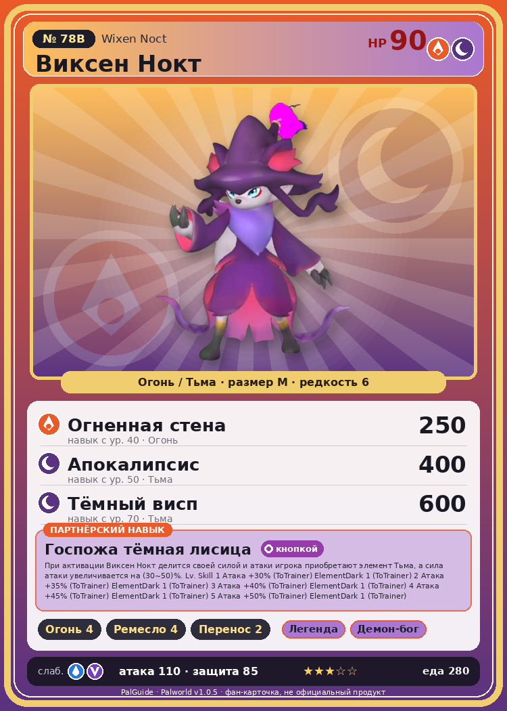

# #78B Виксен Нокт (Wixen Noct)

{ width=360 }

| Поле | Значение |
|---|---|
| Стихия | Огонь, Тьма |
| Слабость (кто бьёт сильнее) | Вода, Дракон |
| Редкость | 6 |
| Размер | M |
| HP / Атака / Защита (база вида) | 90 / 110 / 85 |
| Сколько ест | 280 |
| Цена продажи | 1509 |
| Множитель поимки | ×1 |
| Скорость рывка верхом | 620 |

## Работа на базе
- Разжигание огня — ур. 4
- Ручная работа — ур. 4
- Транспортировка — ур. 2

## Партнёрский навык: Госпожа тёмная лисица
При активации Виксен Нокт делится своей силой и атаки игрока приобретают элемент Тьма , а сила атаки увеличивается на (30~50)% . Lv. Skill 1 Атака +30% (ToTrainer) ElementDark 1 (ToTrainer) 2 Атака +35% (ToTrainer) ElementDark 1 (ToTrainer) 3 Атака +40% (ToTrainer) ElementDark 1 (ToTrainer) 4 Атака +45% (ToTrainer) ElementDark 1 (ToTrainer) 5 Атака +50% (ToTrainer) ElementDark 1 (ToTrainer)

## Атаки по уровням
- ур. 1: Распространение тьмы (Тьма, сила 60)
- ур. 7: Тёмная пушка (Тьма, сила 70)
- ур. 15: Стрелы тьмы (Тьма, сила 120)
- ур. 22: Огненный шторм (Огонь, сила 200)
- ур. 30: Духовное пламя (Тьма, сила 200)
- ур. 40: Огненная стена (Огонь, сила 250)
- ур. 50: Апокалипсис (Тьма, сила 400)
- ур. 70: Тёмный висп (Тьма, сила 600)

## Где водится
- В дикой природе: нет/особый способ; точек появления днём: 0, ночью: 184; уровни в первых точках: 46–49
- Подземелья: Пещера Цветущей Сакуры
- Яйцо: Большое раскалённое яйцо

## Дроп
- Средняя душа Пала — 1–2 шт., 100%
- Книга высоких технологий — 1 шт., 1%

**Дроп альфы:**
- Деталь древней цивилизации — 4–5 шт., 100%
- Книга высоких технологий — 1 шт., 1%
- Ценный мех — 2–3 шт., 100%

## Разведение
- Ранг разведения (CombiRank): 1490
- **Особая пара:** [Катресс](../../4_spravochniki/paly/katress.md) + [Виксен](../../4_spravochniki/paly/wixen.md)

## Лучшие пассивки по роли
- боец: Легенда, Демон-бог, Хладнокровный, Бессмертие, Император огня (вместо Бессмертия, если нет мутации)
- рабочий: Дьявольские руки, Виртуоз, Мастеровитый, Небожитель/Трудоголик
- ездовой: Божественная скорость, Легенда, Вечный двигатель, Небесное скольжение

## Чем хорош / чем плох
- ✅ хорошая атака (110); можно оседлать
- ❌ разводится только особой парой

> Благодаря воспитанию родителей он перестал обращать внимание на такие мелочи, как прожарена ли еда. Предпочитает сладкое. Плохо ладит с Катресс Игнис .

См. также: [Стихии](../../2_mehaniki/stihii.md) · [Разведение](../../2_mehaniki/razvedenie.md) · [Все палы](README.md)
_Источник: paldb.cc v1.0.5_
