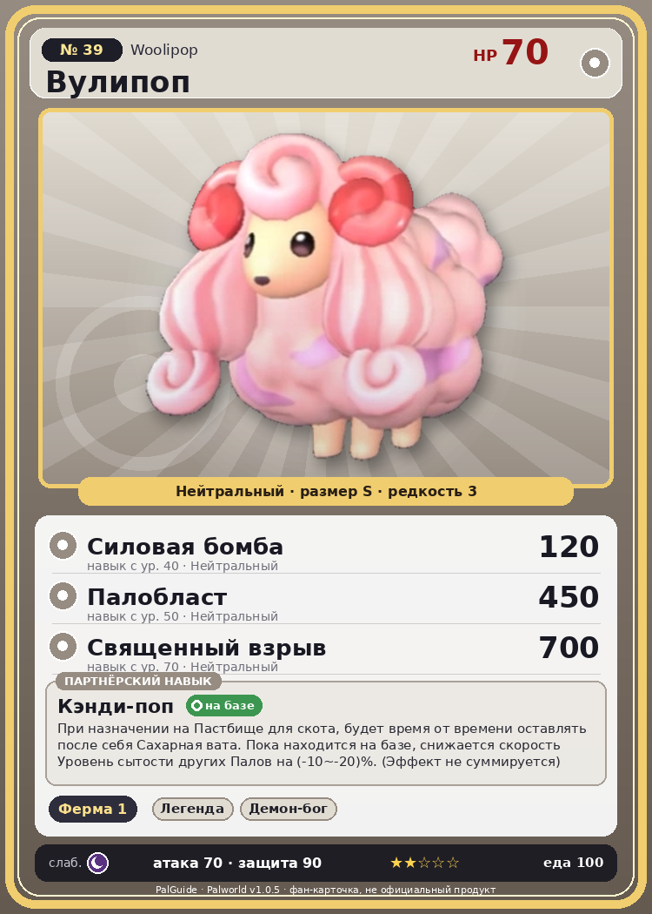

# #39 Вулипоп (Woolipop)

{ width=360 }

| Поле | Значение |
|---|---|
| Стихия | Нейтральный |
| Слабость (кто бьёт сильнее) | Тьма |
| Редкость | 3 |
| Размер | S |
| HP / Атака / Защита (база вида) | 70 / 70 / 90 |
| Сколько ест | 100 |
| Цена продажи | 502 |
| Множитель поимки | ×1 |
| Скорость рывка верхом | 400 |

## Работа на базе
- Фермерство — ур. 1

## Партнёрский навык: Кэнди-поп
При назначении на Пастбище для скота , будет время от времени оставлять после себя Сахарная вата . Пока находится на базе, снижается скорость Уровень сытости других Палов на (-10~-20)% . (Эффект не суммируется) level value 1 FullStomatch_Decrease_BaseCamp -10 2 FullStomatch_Decrease_BaseCamp -12 3 FullStomatch_Decrease_BaseCamp -14 4 FullStomatch_Decrease_BaseCamp -16 5 FullStomatch_Decrease_BaseCamp -20

## Атаки по уровням
- ур. 1: Воздушная пушка (Нейтральный, сила 40)
- ур. 7: Грязевой выстрел (Земля, сила 40)
- ур. 15: Силовой выстрел (Нейтральный, сила 80)
- ур. 22: Ветряной клинок (Трава, сила 40)
- ур. 30: Пузырьковый выстрел (Вода, сила 80)
- ур. 40: Силовая бомба (Нейтральный, сила 120)
- ур. 50: Палобласт (Нейтральный, сила 450)
- ур. 70: Священный взрыв (Нейтральный, сила 700)

## Где водится
- В дикой природе: да; точек появления днём: 89, ночью: 89; уровни в первых точках: 9–10
- Подземелья: Пещера Ущелья
- Яйцо: Обычное яйцо

## Дроп
- Сахарная вата — 1–2 шт., 100%
- Качественное масло Пала — 1 шт., 100%

**Дроп альфы:**
- Деталь древней цивилизации — 1–2 шт., 100%
- Ценный мех — 1–2 шт., 100%

## Разведение
- Ранг разведения (CombiRank): 2820
- Участвует в особых парах: Бронебол → Вулипоп Терра

## Лучшие пассивки по роли
- боец: Легенда, Демон-бог, Хладнокровный, Бессмертие, Святое небо (вместо Бессмертия, если нет мутации)
- ездовой: Божественная скорость, Легенда, Вечный двигатель, Небесное скольжение

## Чем хорош / чем плох
- ✅ можно оседлать
- ❌ слабая атака (70)

> Тело этого Пала в 18 000 раз слаще сахара. Плотоядные Палы, привлеченные его запахом, с первым же укусом падают в обморок от такой сладости.

См. также: [Стихии](../../2_mehaniki/stihii.md) · [Разведение](../../2_mehaniki/razvedenie.md) · [Все палы](README.md)
_Источник: paldb.cc v1.0.5_
