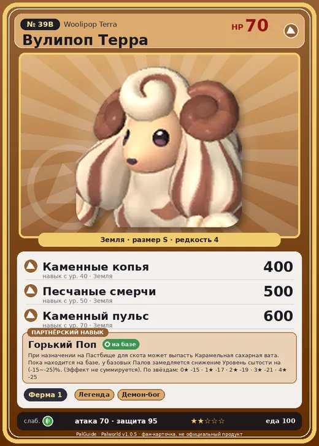

# #39B Вулипоп Терра (Woolipop Terra)

#39B · Woolipop Terra

Земля

Слабость: Трава

🐑 Фермерство <b>1</b>

<b>Горький Поп</b> 🏠 на базе

❤️ 70 · ⚔️ 70 · 🛡 95

| Поле | Значение |
|---|---|
| Стихия | Земля |
| Слабость (кто бьёт сильнее) | Трава |
| Редкость | 4 |
| Размер | S |
| HP / Атака / Защита (база вида) | 70 / 70 / 95 |
| Сколько ест | 100 |
| Цена продажи | 836 |
| Множитель поимки | ×1 |
| Скорость рывка верхом | 400 |

## Работа на базе
- Фермерство — ур. 1

## Партнёрский навык: Горький Поп
При назначении на Пастбище для скота может выпасть Карамельная сахарная вата . Пока находится на базе, у базовых Палов замедляется снижение Уровень сытости на (-15~-25)% . (Эффект не суммируется) level value 1 FullStomatch_Decrease_BaseCamp_SweetsSheep_Ground -15 2 FullStomatch_Decrease_BaseCamp_SweetsSheep_Ground -17 3 FullStomatch_Decrease_BaseCamp_SweetsSheep_Ground -19 4 FullStomatch_Decrease_BaseCamp_SweetsSheep_Ground -21 5 FullStomatch_Decrease_BaseCamp_SweetsSheep_Ground -25

## Атаки по уровням
- ур. 1: Грязевой выстрел (Земля, сила 40)
- ур. 7: Каменный залп (Земля, сила 80)
- ур. 15: Камнемёт (Земля, сила 120)
- ур. 22: Песчаный вихрь (Земля, сила 200)
- ур. 30: Камнепад (Земля, сила 300)
- ур. 40: Каменные копья (Земля, сила 400)
- ур. 50: Песчаные смерчи (Земля, сила 500)
- ур. 70: Каменный пульс (Земля, сила 600)

## Где водится
- В дикой природе: да; точек появления днём: 26, ночью: 26
- Яйцо: Яйцо земли

## Дроп
- Карамельная сахарная вата — 1–2 шт., 100%
- Шерсть — 1 шт., 100%

**Дроп альфы:**
- Деталь древней цивилизации — 1–2 шт., 100%
- Ценный мех — 2–3 шт., 100%

## Разведение
- Ранг разведения (CombiRank): 2030
- **Особая пара:** [Вулипоп](../../4_spravochniki/paly/woolipop.md) + [Бронебол](../../4_spravochniki/paly/kikit.md)

## Лучшие пассивки по роли
- боец: Легенда, Демон-бог, Хладнокровный, Бессмертие, Император земли (вместо Бессмертия, если нет мутации)
- ездовой: Божественная скорость, Легенда, Вечный двигатель, Небесное скольжение

## Чем хорош / чем плох
- ✅ можно оседлать
- ❌ слабая атака (70); разводится только особой парой

> Шерсть источает приторно-сладкий аромат, но мясо отвратительно горькое. Плотоядные Палы, привлечённые запахом, от горечи закатывают глаза и падают без сознания.

См. также: [Стихии](../../guide/06_stihii.md) · [Разведение](../../guide/07_razvedenie.md) · [Все палы](README.md)
