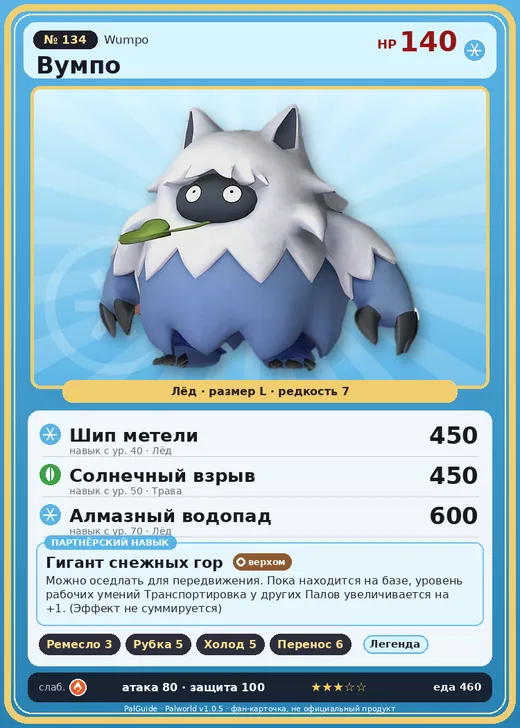

# #134 Вумпо (Wumpo)

№ 134

Лёд

Слабость: Огонь

🖐️ Ручная работа <b>3</b>🪓 Рубка деревьев <b>5</b>❄️ Охлаждение <b>5</b>📦 Транспортировка <b>6</b>

<b>Гигант снежных гор</b> 🐎 верхом 🏠 на базе

❤️ 140 · ⚔️ 80 · 🛡 100

| Поле | Значение |
|---|---|
| Стихия | Лёд |
| Слабость (кто бьёт сильнее) | Огонь |
| Редкость | 7 |
| Размер | L |
| HP / Атака / Защита (база вида) | 140 / 80 / 100 |
| Сколько ест | 460 |
| Цена продажи | 2591 |
| Множитель поимки | ×1 |
| Скорость рывка верхом | 1050 |

=== "Обзор"

    #### Работа на базе
    - Ручная работа — ур. 3
    - Рубка деревьев — ур. 5
    - Охлаждение — ур. 5
    - Транспортировка — ур. 6

    #### Партнёрский навык: Гигант снежных гор
    Можно оседлать для передвижения. Пока находится на базе, уровень рабочих умений Транспортировка у других Палов увеличивается на +1. (Эффект не суммируется) Технологии 45. По звёздам: 0★ 1 · 1★ 1 · 2★ 1 · 3★ 1 · 4★ 1

    #### Чем хорош / чем плох
    - ✅ Транспорт 6, рубка; много здоровья (140); отличный рабочий (пригодность 6); можно оседлать
    - ❌ Не боец

    > Учёные пытались раскрыть тайну этого Пала и срезали с него всю шерсть. Но осталась лишь кучка шерсти — словно изначально внутри никого и не было.

    См. также: [Стихии](../../guide/06_stihii.md) · [Разведение](../../guide/07_razvedenie.md) · [Все палы](README.md)

=== "Атаки"

    #### Атаки по уровням
    - ур. 1: Ледяная ракета (Лёд, сила 40)
    - ур. 7: Ветряной клинок (Трава, сила 40)
    - ур. 15: Ледяной резак (Лёд, сила 80)
    - ур. 22: Айсберг (Лёд, сила 120)
    - ур. 30: Ледяное дыхание (Лёд, сила 160)
    - ур. 35: Снежный боулинг (Лёд, сила 400)
    - ур. 40: Шип метели (Лёд, сила 450)
    - ур. 50: Солнечный взрыв (Трава, сила 450)
    - ур. 70: Алмазный водопад (Лёд, сила 600)

=== "Где живёт"

    #### Где водится
    - В дикой природе: да; точек появления днём: 53, ночью: 53; уровни в первых точках: 45–48
    - Подземелья: Пещера Священной Горы
    - Может продаваться у торговца/рекрутера
    - Яйцо: Большое яйцо льда

=== "Дроп"

    #### Дроп
    - Ледяной орган — 2–3 шт., 100%
    - Красивый цветок — 1 шт., 20%

    **Дроп альфы:**
    - Деталь древней цивилизации — 6–8 шт., 100%
    - Ценный мех — 6–8 шт., 100%

=== "Разведение"

    #### Разведение
    - Ранг разведения (CombiRank): 830
    - Участвует в особых парах: Мамморест → Мамморест Крист; Пиродон → Пиродон Крист

=== "Пассивки"

    #### Лучшие пассивки по роли

    

⚔️ Боец

максимум урона и живучести в бою

<a class="psv r-4" data-psv="Легенда" href="../../../passivki/legend/">Легенда</a><a class="psv r-4" data-psv="Демон-бог" href="../../../passivki/demon_god/">Демон-бог</a><a class="psv r-3" data-psv="Император льда" href="../../../passivki/ice_emperor/">Император льда</a><a class="psv r-3" data-psv="Хладнокровный" href="../../../passivki/serenity/">Хладнокровный</a>

🛠 Рабочий

работает быстрее и меньше устаёт на базе

<a class="psv r-5" data-psv="Дьявольские руки" href="../../../passivki/demons_hand/">Дьявольские руки</a><a class="psv r-4" data-psv="Виртуоз" href="../../../passivki/remarkable_craftsmanship/">Виртуоз</a><a class="psv r-3" data-psv="Мастеровитый" href="../../../passivki/artisan/">Мастеровитый</a><a class="psv r-3" data-psv="Трудоголик" href="../../../passivki/workaholic/">Трудоголик</a>

🐎 Ездовой

быстрее бегает или летает с тобой верхом

<a class="psv r-4" data-psv="Божественная скорость" href="../../../passivki/swift/">Божественная скорость</a><a class="psv r-4" data-psv="Легенда" href="../../../passivki/legend/">Легенда</a><a class="psv r-4" data-psv="Вечный двигатель" href="../../../passivki/eternal_engine/">Вечный двигатель</a><a class="psv r-4" data-psv="Небесное скольжение" href="../../../passivki/sky_strider/">Небесное скольжение</a>

    <small>Нажми на пассивку, чтобы узнать, что она даёт и где её взять.</small>

<a class="card-link" href="../snugloo/">← Снаглоу</a><a class="card-link" href="../wumpo_botan/">Вумпо Ботан →</a>

