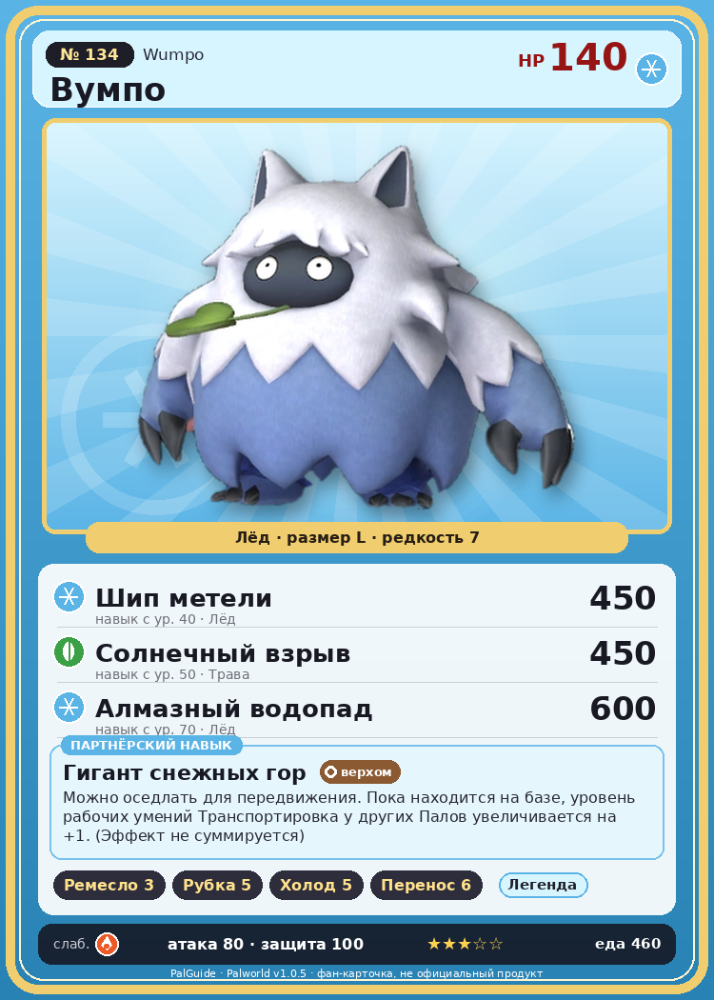

# #134 Вумпо (Wumpo)

{ width=360 }

| Поле | Значение |
|---|---|
| Стихия | Лёд |
| Слабость (кто бьёт сильнее) | Огонь |
| Редкость | 7 |
| Размер | L |
| HP / Атака / Защита (база вида) | 140 / 80 / 100 |
| Сколько ест | 460 |
| Цена продажи | 2591 |
| Множитель поимки | ×1 |
| Скорость рывка верхом | 1050 |

## Работа на базе
- Ручная работа — ур. 3
- Рубка деревьев — ур. 5
- Охлаждение — ур. 5
- Транспортировка — ур. 6

## Партнёрский навык: Гигант снежных гор
Можно оседлать для передвижения. Пока находится на базе, уровень рабочих умений Транспортировка у других Палов увеличивается на +1 . (Эффект не суммируется) Технологии 45 level value 1 WorkSuitabilityAddRank_Transport 1 2 WorkSuitabilityAddRank_Transport 1 3 WorkSuitabilityAddRank_Transport 1 4 WorkSuitabilityAddRank_Transport 1 5 WorkSuitabilityAddRank_Transport 1

## Атаки по уровням
- ур. 1: Ледяная ракета (Лёд, сила 40)
- ур. 7: Ветряной клинок (Трава, сила 40)
- ур. 15: Ледяной резак (Лёд, сила 80)
- ур. 22: Айсберг (Лёд, сила 120)
- ур. 30: Ледяное дыхание (Лёд, сила 160)
- ур. 35: Снежный боулинг (Лёд, сила 400)
- ур. 40: Шип метели (Лёд, сила 450)
- ур. 50: Солнечный взрыв (Трава, сила 450)
- ур. 70: Алмазный водопад (Лёд, сила 600)

## Где водится
- В дикой природе: да; точек появления днём: 53, ночью: 53; уровни в первых точках: 45–48
- Подземелья: Пещера Священной Горы
- Может продаваться у торговца/рекрутера
- Яйцо: Большое яйцо льда

## Дроп
- Ледяной орган — 2–3 шт., 100%
- Красивый цветок — 1 шт., 20%

**Дроп альфы:**
- Деталь древней цивилизации — 6–8 шт., 100%
- Ценный мех — 6–8 шт., 100%

## Разведение
- Ранг разведения (CombiRank): 830
- Участвует в особых парах: Мамморест → Мамморест Крист; Пиродон → Пиродон Крист

## Лучшие пассивки по роли
- по обзору: Мастеровитый, Виртуоз, Трудоголик, Аскет
- боец: Легенда, Демон-бог, Хладнокровный, Бессмертие, Император льда (вместо Бессмертия, если нет мутации)
- рабочий: Дьявольские руки, Виртуоз, Мастеровитый, Небожитель/Трудоголик
- ездовой: Божественная скорость, Легенда, Вечный двигатель, Небесное скольжение

## Чем хорош / чем плох
- ✅ Транспорт 6, рубка; много здоровья (140); отличный рабочий (пригодность 6); можно оседлать
- ❌ Не боец

> Учёные пытались раскрыть тайну этого Пала и срезали с него всю шерсть. Но осталась лишь кучка шерсти — словно изначально внутри никого и не было.

См. также: [Стихии](../../2_mehaniki/stihii.md) · [Разведение](../../2_mehaniki/razvedenie.md) · [Все палы](README.md)
_Источник: paldb.cc v1.0.5_
