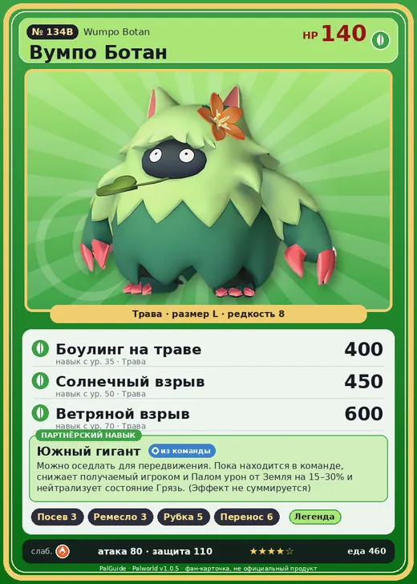

# Вумпо Ботан

<canvas id="fx"></canvas>

№ 134B

Трава

Слабость: Огонь <b class="mx">×1,5</b> <button class="hlp" data-tip="Множители перемножаются по обеим стихиям: ×1,5 за стихию, которую атака бьёт, ×0,65 за ту, что её держит.">?</button>

Устойчив: Земля <b class="mx">×0,65</b>

🌱 Посев семян <b>3</b>🖐️ Ручная работа <b>3</b>🪓 Рубка деревьев <b>5</b>📦 Транспортировка <b>6</b>

<b>Южный гигант</b> 🎒 Работает из команды🐎 Верхом

❤️ 140 · ⚔️ 80 · 🛡 110

Основное

💎Редкость <button class="hlp" data-tip="Чем выше число, тем реже встречается пал. 1–4 — обычные, 5–7 — редкие, 8+ — легендарные.">?</button><b>8</b>

📏Размер<b>L</b>

💰Цена продажи <button class="hlp" data-tip="Сколько золота даст торговец за пала.">?</button><b>2743</b>

Бой

🎯Множитель поимки <button class="hlp" data-tip="Насколько легче или труднее поймать: ×1 — обычно, меньше — сложнее.">?</button><b>×1</b>

🐎Скорость рывка верхом <button class="hlp" data-tip="Скорость, если сесть на пала и бежать рывком.">?</button><b>1050</b>

Ферма и еда

🍖Сколько ест <button class="hlp" data-tip="Сколько сытости пал тратит — чем больше, тем больше еды нужно на базе.">?</button><b>460</b>

Разведение

🧬Сила разведения <button class="hlp" data-tip="Скрытое число игры: у детёныша оно примерно среднее от родителей. Чем меньше — тем «сильнее» пал.">?</button><b>610</b>

=== "Обзор"

    #### Работа на базе

    
<a class="wbar" href="../../../2_mehaniki/rabota/?w=planting&lv=3">🌱 Посев семян<i style="--v:30%"></i><b>3</b></a><a class="wbar" href="../../../2_mehaniki/rabota/?w=handiwork&lv=3">✋ Ручная работа<i style="--v:30%"></i><b>3</b></a><a class="wbar" href="../../../2_mehaniki/rabota/?w=lumbering&lv=5">🪓 Рубка деревьев<i style="--v:50%"></i><b>5</b></a><a class="wbar" href="../../../2_mehaniki/rabota/?w=transporting&lv=6">📦 Транспортировка<i style="--v:60%"></i><b>6</b></a><a class="wb-more" href="../../../2_mehaniki/rabota/">Что значат уровни работы →</a>

    #### Партнёрский навык: Южный гигант
    Можно оседлать для передвижения. Пока находится в команде, снижает получаемый игроком и Палом урон от Земля на 15–30% и нейтрализует состояние Грязь. (Эффект не суммируется) Технологии 51.

    #### Чем хорош / чем плох
    - ✅ много здоровья (140); отличный рабочий (пригодность 6); можно оседлать
    - ❌ явных минусов нет

    > Учёные попытались раскрыть тайну этого Пала и срезали с него всю траву. Но осталась лишь кучка травы — словно изначально внутри никого и не было.

    См. также: [Стихии](../../guide/06_stihii.md) · [Разведение](../../guide/07_razvedenie.md) · [Все палы](README.md)

=== "Атаки"

    #### Атаки по уровням
    - ур. 1: Ветряной клинок (Трава, сила 40)
    - ур. 7: Водяной выстрел (Вода, сила 50)
    - ур. 15: Семенная мина (Трава, сила 120)
    - ур. 22: Травяной торнадо (Трава, сила 200)
    - ур. 30: Терновые лозы (Трава, сила 250)
    - ур. 35: Боулинг на траве (Трава, сила 400)
    - ур. 40: Водяная бомба (Вода, сила 200)
    - ур. 50: Солнечный взрыв (Трава, сила 450)
    - ур. 70: Ветряной взрыв (Трава, сила 600)

=== "Где живёт"

    #### Где водится

    

<button data-k="d" class="on">☀️ День</button><button data-k="n">🌙 Ночь</button>

<button data-w=p class=on>Палпагос</button><button data-w=t>Мировое древо</button>

ур. 53–80<a class="btn hm-full" href="../../../map/?pal=Yeti_Grass">Показать на большой карте</a>

Сакурадзима

🥚 Яйцо<b>Огромное яйцо свежей листвы</b>

=== "Дроп"

    #### Дроп
    - Твёрдая древесина — 2–5 шт., 100%
    - Красивый цветок — 1 шт., 20%
    - Семена моркови — 1 шт., 50%

    **Дроп альфы:**

    - Деталь древней цивилизации — 5–6 шт., 100%
    - Ценный мех — 5–6 шт., 100%

=== "Разведение"

    #### Разведение
    - Ранг разведения: 610

=== "Пассивки"

    #### Лучшие пассивки по роли

    

⚔️ Боец

максимум урона и живучести в бою

<a class="psv r-4" data-psv="Легенда" href="../../../passivki/legend/">Легенда</a><a class="psv r-4" data-psv="Демон-бог" href="../../../passivki/demon_god/">Демон-бог</a><a class="psv r-3" data-psv="Король духов" href="../../../passivki/spirit_emperor/">Король духов</a><a class="psv r-3" data-psv="Хладнокровный" href="../../../passivki/serenity/">Хладнокровный</a>

🛠 Рабочий

работает быстрее и меньше устаёт на базе

<a class="psv r-5" data-psv="Дьявольские руки" href="../../../passivki/demons_hand/">Дьявольские руки</a><a class="psv r-4" data-psv="Виртуоз" href="../../../passivki/remarkable_craftsmanship/">Виртуоз</a><a class="psv r-3" data-psv="Мастеровитый" href="../../../passivki/artisan/">Мастеровитый</a><a class="psv r-3" data-psv="Трудоголик" href="../../../passivki/workaholic/">Трудоголик</a>

🐎 Ездовой

быстрее бегает или летает с тобой верхом

<a class="psv r-4" data-psv="Божественная скорость" href="../../../passivki/swift/">Божественная скорость</a><a class="psv r-4" data-psv="Легенда" href="../../../passivki/legend/">Легенда</a><a class="psv r-4" data-psv="Вечный двигатель" href="../../../passivki/eternal_engine/">Вечный двигатель</a><a class="psv r-4" data-psv="Небесное скольжение" href="../../../passivki/sky_strider/">Небесное скольжение</a>

    <small>Нажми на пассивку, чтобы узнать, что она даёт и где её взять.</small>

<a class="card-link" href="../wumpo/">← Вумпо</a><a class="card-link" href="../sootseer/">Гостлайт →</a>

