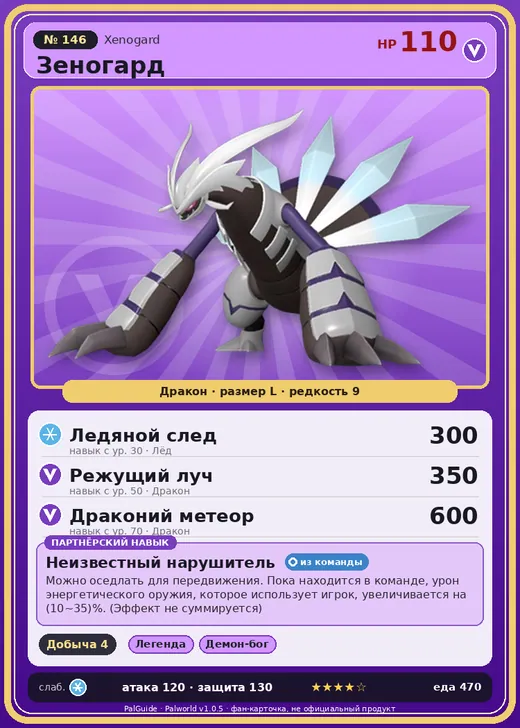

# #146 Зеногард (Xenogard)

#146 · Xenogard

Дракон

Слабость: Лёд

⛏️ Добыча <b>4</b>

<b>Неизвестный нарушитель</b> 🎒 из команды 🐎 верхом

❤️ 110 · ⚔️ 120 · 🛡 130

| Поле | Значение |
|---|---|
| Стихия | Дракон |
| Слабость (кто бьёт сильнее) | Лёд |
| Редкость | 9 |
| Размер | L |
| HP / Атака / Защита (база вида) | 110 / 120 / 130 |
| Сколько ест | 470 |
| Цена продажи | 2845 |
| Множитель поимки | ×1 |
| Скорость рывка верхом | 1200 |

## Работа на базе
- Добыча — ур. 4

## Партнёрский навык: Неизвестный нарушитель
Можно оседлать для передвижения. Пока находится в команде, урон энергетического оружия , которое использует игрок, увеличивается на (10~35)% . (Эффект не суммируется) Технологии 41 level value 1 DamageUpWeapon_Otomo 10 2 DamageUpWeapon_Otomo 15 3 DamageUpWeapon_Otomo 20 4 DamageUpWeapon_Otomo 25 5 DamageUpWeapon_Otomo 35

## Атаки по уровням
- ур. 1: Драконья пушка (Дракон, сила 40)
- ур. 7: Драконий взрыв (Дракон, сила 80)
- ур. 15: Воздушные клинки (Нейтральный, сила 160)
- ур. 22: Дыхание дракона (Дракон, сила 160)
- ур. 30: Ледяной след (Лёд, сила 300)
- ур. 40: Комета (Дракон, сила 180)
- ур. 50: Режущий луч (Дракон, сила 350)
- ур. 70: Драконий метеор (Дракон, сила 600)

## Где водится
- В дикой природе: нет/особый способ; точек появления днём: 0, ночью: 0
- Яйцо: Огромное яйцо дракона

## Дроп
- Обломок метеорита — 5–12 шт., 100%
- Качественное масло Пала — 3–5 шт., 100%

**Дроп альфы:**
- Деталь древней цивилизации — 4–6 шт., 100%
- Ценные внутренности — 2–3 шт., 100%

## Разведение
- Ранг разведения (CombiRank): 990
- **Особая пара:** [Зеногард](../../4_spravochniki/paly/xenogard.md) + [Зеногард](../../4_spravochniki/paly/xenogard.md)
- Участвует в особых парах: Зеногард → Зеногард; Зеногард → Зеногард

## Лучшие пассивки по роли
- боец: Легенда, Демон-бог, Хладнокровный, Бессмертие, Божественный дракон (вместо Бессмертия, если нет мутации)
- рабочий: Дьявольские руки, Виртуоз, Мастеровитый, Небожитель/Трудоголик
- ездовой: Божественная скорость, Легенда, Вечный двигатель, Небесное скольжение

## Чем хорош / чем плох
- ✅ очень высокая атака (120); крепкая защита (130); можно оседлать
- ❌ разводится только особой парой

> Генерирует энергию, поедая информацию. Похоже, он регулярно передаёт данные кому-то. - Приём? Я съел прошлое сообщение, не прочитав. Что там было?

См. также: [Стихии](../../2_mehaniki/stihii.md) · [Разведение](../../2_mehaniki/razvedenie.md) · [Все палы](README.md)
