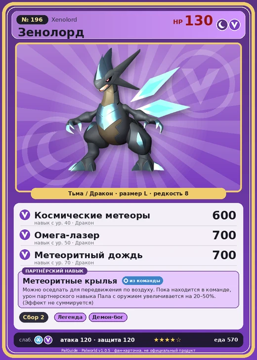

# #196 Зенолорд (Xenolord)

№ 196

ТьмаДракон

Слабость: ДраконЛёд

🌾 Сбор <b>2</b>

<b>Метеоритные крылья</b> 🎒 из команды 🐎 верхом

❤️ 130 · ⚔️ 120 · 🛡 120

| Поле | Значение |
|---|---|
| Стихия | Тьма, Дракон |
| Слабость (кто бьёт сильнее) | Дракон, Лёд |
| Редкость | 8 |
| Размер | L |
| HP / Атака / Защита (база вида) | 130 / 120 / 120 |
| Сколько ест | 570 |
| Цена продажи | 3622 |
| Множитель поимки | ×1 |
| Скорость рывка верхом | 2700 |

=== "Обзор"

    #### Работа на базе
    - Сбор — ур. 2

    #### Партнёрский навык: Метеоритные крылья
    Можно оседлать для передвижения по воздуху. Пока находится в команде, урон партнерского навыка Пала с оружием увеличивается на (20~50)% . (Эффект не суммируется) Технологии 66 level value 1 DamageUpPartnerSkillAttack_DarkMechaDragon 20 Пробуждение : 2 DamageUpPartnerSkillAttack_DarkMechaDragon 26 MoveSpeed_up_PartnerSkill_Ride_1 10 Пробуждение : (Скорость передвижения верхом: +10% ) 3 DamageUpPartnerSkillAttack_DarkMechaDragon 32 MoveSpeed_up_PartnerSkill_Ride_2 12 Пробуждение : (Скорость передвижения верхом: +12% ) 4 DamageUpPartnerSkillAttack_DarkMechaDragon 38 MoveSpeed_up_PartnerSkill_Ride_3 15 Пробуждение : (Скорость передвижения верхом: +15% ) 5 DamageUpPartnerSkillAttack_DarkMechaDragon 50 MoveSpeed_up_PartnerSkill_Ride_4 20 Пробуждение : (Скорость передвижения верхом: +20% )

    #### Чем хорош / чем плох
    - ✅ Тьма+дракон; партнёрский навык усиливает палов с оружием; очень высокая атака (120); много здоровья (130); крепкая защита (120); можно оседлать; летает (ездовой)
    - ❌ Рейд ур. 65 — трудно получить; много ест (570); разводится только особой парой

    > - Прибытие на место подтверждено. Приоритет: поиск объекта |Метеоритный дракон|. - Примечание: крайний срок подавления истёк лет назад. - Добавлено: следов подавления не обнаружено. Натурализация подтверждена. Начать ликвидацию. - Служебное сообщение: не забывайте и не поедайте важную информацию!

    См. также: [Стихии](../../guide/06_stihii.md) · [Разведение](../../guide/07_razvedenie.md) · [Все палы](README.md)

=== "Атаки"

    #### Атаки по уровням
    - ур. 1: Драконья пушка (Дракон, сила 40)
    - ур. 7: Распространение тьмы (Тьма, сила 60)
    - ур. 15: Спутниковый бит (Дракон, сила 400)
    - ур. 22: Энергетическое рассечение (Дракон, сила 450)
    - ур. 30: Астральный луч (Тьма, сила 500)
    - ур. 40: Космические метеоры (Дракон, сила 600)
    - ур. 50: Омега-лазер (Дракон, сила 700)
    - ур. 70: Метеоритный дождь (Дракон, сила 700)

=== "Где живёт"

    #### Где водится
    - В дикой природе: нет/особый способ; точек появления днём: 0, ночью: 0
    - Яйцо: Огромное яйцо тьмы

=== "Дроп"

    #### Дроп
    - Обломок метеорита — 7–15 шт., 100%

    **Дроп альфы:**
    - Деталь древней цивилизации — 4–6 шт., 100%
    - Ценный драконий самоцвет — 2–3 шт., 100%

=== "Разведение"

    #### Разведение
    - Ранг разведения (CombiRank): 400
    - **Особая пара:** [Зенолорд](../../4_spravochniki/paly/xenolord.md) + [Зенолорд](../../4_spravochniki/paly/xenolord.md)
    - Участвует в особых парах: Зенолорд → Зенолорд; Зенолорд → Зенолорд

=== "Пассивки"

    #### Лучшие пассивки по роли
    - по обзору: Легенда, Демон-бог, Хладнокровный, Захватчик
    - боец: Легенда, Демон-бог, Хладнокровный, Бессмертие, Король тьмы (вместо Бессмертия, если нет мутации)
    - ездовой: Божественная скорость, Легенда, Вечный двигатель, Небесное скольжение

<a class="card-link" href="../bellanoir_libero/">← Бэллануар Либеро</a><a class="card-link" href="../hartalis/">Харталис →</a>

