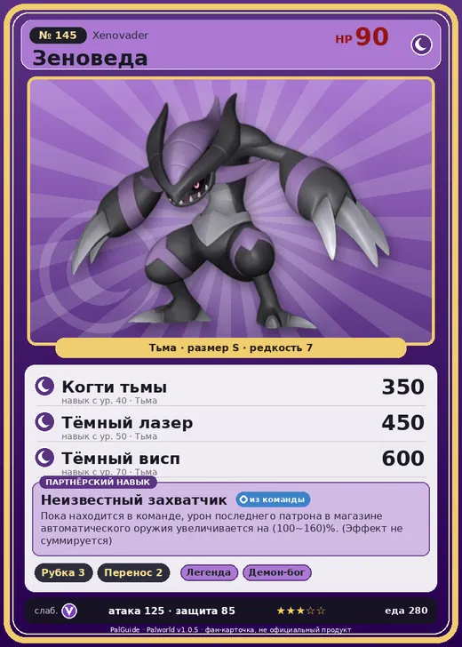

# #145 Зеноведа (Xenovader)

№ 145

Тьма

Слабость: Дракон

🪓 Рубка деревьев <b>3</b>📦 Транспортировка <b>2</b>

<b>Неизвестный захватчик</b> 🎒 из команды

❤️ 90 · ⚔️ 125 · 🛡 85

| Поле | Значение |
|---|---|
| Стихия | Тьма |
| Слабость (кто бьёт сильнее) | Дракон |
| Редкость | 7 |
| Размер | S |
| HP / Атака / Защита (база вида) | 90 / 125 / 85 |
| Сколько ест | 280 |
| Цена продажи | 1543 |
| Множитель поимки | ×1 |
| Скорость рывка верхом | 700 |

=== "Обзор"

    #### Работа на базе
    - Рубка деревьев — ур. 3
    - Транспортировка — ур. 2

    #### Партнёрский навык: Неизвестный захватчик
    Пока находится в команде, урон последнего патрона в магазине автоматического оружия увеличивается на (100~160)% . (Эффект не суммируется) level value 1 DamageUp_LastBullet_PartnerSkill 100 2 DamageUp_LastBullet_PartnerSkill 110 3 DamageUp_LastBullet_PartnerSkill 120 4 DamageUp_LastBullet_PartnerSkill 135 5 DamageUp_LastBullet_PartnerSkill 160

    #### Чем хорош / чем плох
    - ✅ очень высокая атака (125); можно оседлать
    - ❌ разводится только особой парой

    > Преобразует информацию в энергию, отправляя её и затем забывая. Похоже, он регулярно передаёт данные кому-то… - Ответьте. Цель обнаружена. Срочно приступить к уничтожению.

    См. также: [Стихии](../../guide/06_stihii.md) · [Разведение](../../guide/07_razvedenie.md) · [Все палы](README.md)

=== "Атаки"

    #### Атаки по уровням
    - ур. 1: Силовой выстрел (Нейтральный, сила 80)
    - ур. 7: Ядовитый выстрел (Тьма, сила 30)
    - ур. 15: Распространение тьмы (Тьма, сила 60)
    - ур. 22: Стрелы тьмы (Тьма, сила 120)
    - ур. 30: Кошмарная сфера (Тьма, сила 300)
    - ур. 40: Когти тьмы (Тьма, сила 350)
    - ур. 50: Тёмный лазер (Тьма, сила 450)
    - ур. 70: Тёмный висп (Тьма, сила 600)

=== "Где живёт"

    #### Где водится
    - В дикой природе: да; точек появления днём: 13, ночью: 13
    - Яйцо: Большое яйцо тьмы

=== "Дроп"

    #### Дроп
    - Обломок метеорита — 3–10 шт., 100%

    **Дроп альфы:**
    - Деталь древней цивилизации — 2–3 шт., 100%
    - Ценный коготь — 5–6 шт., 100%

=== "Разведение"

    #### Разведение
    - Ранг разведения (CombiRank): 1820
    - **Особая пара:** [Зеноведа](../../4_spravochniki/paly/xenovader.md) + [Зеноведа](../../4_spravochniki/paly/xenovader.md)
    - Участвует в особых парах: Зеноведа → Зеноведа; Зеноведа → Зеноведа

=== "Пассивки"

    #### Лучшие пассивки по роли
    - боец: Легенда, Демон-бог, Хладнокровный, Бессмертие, Король тьмы (вместо Бессмертия, если нет мутации)
    - рабочий: Дьявольские руки, Виртуоз, Мастеровитый, Небожитель/Трудоголик
    - ездовой: Божественная скорость, Легенда, Вечный двигатель, Небесное скольжение

<a class="card-link" href="../mimog/">← Мимидог</a><a class="card-link" href="../xenogard/">Зеногард →</a>

