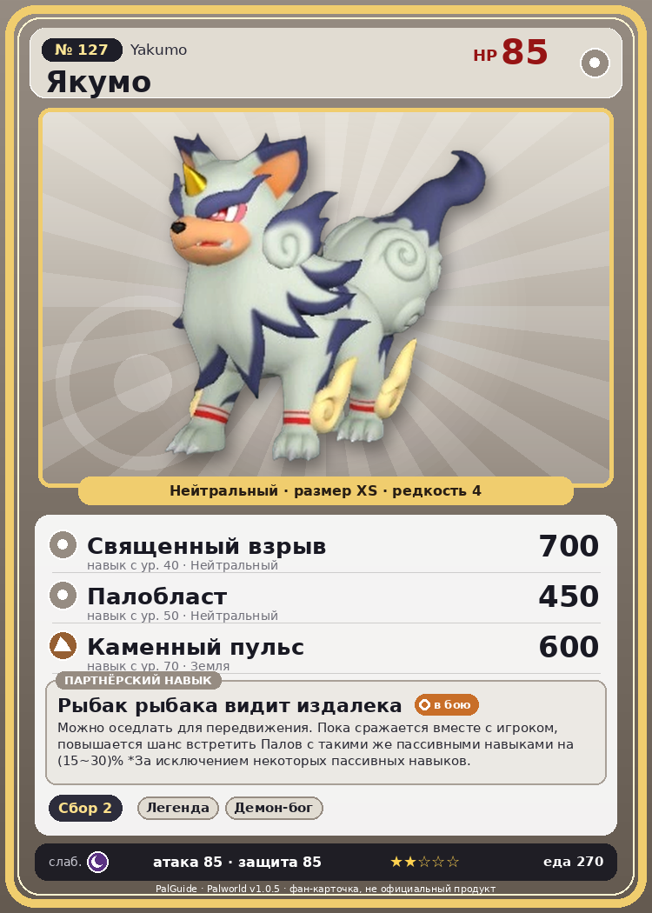

# #127 Якумо (Yakumo)

{ width=360 }

| Поле | Значение |
|---|---|
| Стихия | Нейтральный |
| Слабость (кто бьёт сильнее) | Тьма |
| Редкость | 4 |
| Размер | XS |
| HP / Атака / Защита (база вида) | 85 / 85 / 85 |
| Сколько ест | 270 |
| Цена продажи | 1238 |
| Множитель поимки | ×1 |
| Скорость рывка верхом | 1080 |

## Работа на базе
- Сбор — ур. 2

## Партнёрский навык: Рыбак рыбака видит издалека
Можно оседлать для передвижения. Пока сражается вместе с игроком, повышается шанс встретить Палов с такими же пассивными навыками на (15~30)% *За исключением некоторых пассивных навыков. Технологии 41 level value 1 SyncroPassiveWhenCapture_PartnerSkill 15 2 SyncroPassiveWhenCapture_PartnerSkill 18 3 SyncroPassiveWhenCapture_PartnerSkill 21 4 SyncroPassiveWhenCapture_PartnerSkill 24 5 SyncroPassiveWhenCapture_PartnerSkill 30

## Атаки по уровням
- ур. 1: Двойные клыки (Нейтральный, сила 40)
- ур. 2: Дикие клыки (Нейтральный, сила 50)
- ур. 3: Грязевой выстрел (Земля, сила 40)
- ур. 7: Силовой выстрел (Нейтральный, сила 80)
- ур. 15: Каменный залп (Земля, сила 80)
- ур. 22: Силовая бомба (Нейтральный, сила 120)
- ур. 30: Воздушные клинки (Нейтральный, сила 160)
- ур. 40: Священный взрыв (Нейтральный, сила 700)
- ур. 50: Палобласт (Нейтральный, сила 450)
- ур. 70: Каменный пульс (Земля, сила 600)

## Где водится
- В дикой природе: да; точек появления днём: 53, ночью: 53; уровни в первых точках: 53–56
- Подземелья: Пещера Цветущей Сакуры
- Яйцо: Обычное яйцо

## Дроп
- Кожа — 1–2 шт., 100%

**Дроп альфы:**
- Деталь древней цивилизации — 2–4 шт., 100%
- Ценный мех — 2–4 шт., 100%

## Разведение
- Ранг разведения (CombiRank): 2230

## Лучшие пассивки по роли
- боец: Легенда, Демон-бог, Хладнокровный, Бессмертие, Святое небо (вместо Бессмертия, если нет мутации)
- ездовой: Божественная скорость, Легенда, Вечный двигатель, Небесное скольжение

## Чем хорош / чем плох
- ✅ можно оседлать
- ❌ явных минусов нет

> Обладая природной способностью отвергать зло, он должен был стать надёжным спутником островитян и построить с ними прочные, долгие отношения. Теперь же Якумо возводят между собой и людьми стену зла.

См. также: [Стихии](../../2_mehaniki/stihii.md) · [Разведение](../../2_mehaniki/razvedenie.md) · [Все палы](README.md)
_Источник: paldb.cc v1.0.5_
