# 💍 Аксессуары

<input type="search" class="pfq" name="pp-items-q" placeholder="Найти: аксессуары" autocomplete="off" autocorrect="off" autocapitalize="off" spellcheck="false" enterkeyhint="search">найдено 81

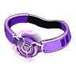Антигравитационный пояс<small>⚖️ 2</small>

<h3>Антигравитационный пояс</h3>Необычный
Аксессуар, увеличивающий высоту прыжка игрока. Надень, чтобы получить бонус: увеличение силы прыжка.

✨ Увеличение силы прыжка

⚖️<small>Вес</small><b>2</b>

💰<small>Цена</small><b>23160</b>

📘<small>Технология</small><b>ур. 28</b>

<h4>🔨 Крафт</h4>
<a class="ich" href="../../../4_spravochniki/predmety/материалы/#металлический-слиток">Металлический слиток<b>×30</b></a><a class="ich" href="../../../4_spravochniki/predmety/материалы/#осколок-палдиума">Осколок палдиума<b>×30</b></a><a class="ich" href="../../../4_spravochniki/predmety/материалы/#ночная-звёздная-пыль">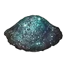Ночная звёздная пыль<b>×10</b></a>
<h5>Где сделать</h5>
<a class="ich" href="../../../4_spravochniki/predmety/постройки/#качественный-верстак">Качественный верстак</a><a class="ich" href="../../../4_spravochniki/predmety/постройки/#конвейерная-фабрика">Конвейерная фабрика</a><a class="ich" href="../../../4_spravochniki/predmety/постройки/#мастерская-развитой-цивилизации">Мастерская развитой цивилизации</a><a class="ich" href="../../../4_spravochniki/predmety/постройки/#древний-верстак">Древний верстак</a>

Из игры

Аксессуар, увеличивающий высоту прыжка игрока.

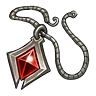Амулет атаки<small>⚖️ 2</small>

<h3>Амулет атаки</h3>Редкий
Аксессуар, увеличивающий силу атаки. Надень, чтобы получить бонус: увеличение атаки ур.3.

✨ Увеличение атаки ур.3

⚖️<small>Вес</small><b>2</b>

💰<small>Цена</small><b>16500</b>

<h4>🔨 Крафт</h4>
<a class="ich" href="../../../4_spravochniki/predmety/материалы/#металлический-слиток">Металлический слиток<b>×25</b></a><a class="ich" href="../../../4_spravochniki/predmety/материалы/#рог">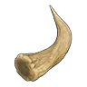Рог<b>×20</b></a><a class="ich" href="../../../4_spravochniki/predmety/материалы/#осколок-палдиума">Осколок палдиума<b>×25</b></a><a class="ich" href="../../../4_spravochniki/predmety/материалы/#деталь-древней-цивилизации">Деталь древней цивилизации<b>×2</b></a>
<h5>Где сделать</h5>
<a class="ich" href="../../../4_spravochniki/predmety/постройки/#качественный-верстак">Качественный верстак</a><a class="ich" href="../../../4_spravochniki/predmety/постройки/#конвейерная-фабрика">Конвейерная фабрика</a><a class="ich" href="../../../4_spravochniki/predmety/постройки/#мастерская-развитой-цивилизации">Мастерская развитой цивилизации</a><a class="ich" href="../../../4_spravochniki/predmety/постройки/#древний-верстак">Древний верстак</a>

Из игры

Аксессуар, увеличивающий силу атаки.

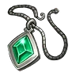Амулет жизни<small>⚖️ 2</small>

<h3>Амулет жизни</h3>Редкий
Аксессуар, увеличивающий здоровье. Надень, чтобы получить бонус: увеличение здоровье ур.3.

✨ Увеличение здоровье ур.3

⚖️<small>Вес</small><b>2</b>

💰<small>Цена</small><b>16500</b>

<h4>🔨 Крафт</h4>
<a class="ich" href="../../../4_spravochniki/predmety/материалы/#металлический-слиток">Металлический слиток<b>×25</b></a><a class="ich" href="../../../4_spravochniki/predmety/материалы/#кость">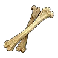Кость<b>×20</b></a><a class="ich" href="../../../4_spravochniki/predmety/материалы/#осколок-палдиума">Осколок палдиума<b>×25</b></a><a class="ich" href="../../../4_spravochniki/predmety/материалы/#деталь-древней-цивилизации">Деталь древней цивилизации<b>×2</b></a>
<h5>Где сделать</h5>
<a class="ich" href="../../../4_spravochniki/predmety/постройки/#качественный-верстак">Качественный верстак</a><a class="ich" href="../../../4_spravochniki/predmety/постройки/#конвейерная-фабрика">Конвейерная фабрика</a><a class="ich" href="../../../4_spravochniki/predmety/постройки/#мастерская-развитой-цивилизации">Мастерская развитой цивилизации</a><a class="ich" href="../../../4_spravochniki/predmety/постройки/#древний-верстак">Древний верстак</a>

Из игры

Аксессуар, увеличивающий здоровье.

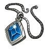Амулет защиты<small>⚖️ 2</small>

<h3>Амулет защиты</h3>Редкий
Аксессуар, увеличивающий защиту. Надень, чтобы получить бонус: увеличение защиты ур.3.

✨ Увеличение защиты ур.3

⚖️<small>Вес</small><b>2</b>

💰<small>Цена</small><b>15540</b>

<h4>🔨 Крафт</h4>
<a class="ich" href="../../../4_spravochniki/predmety/материалы/#металлический-слиток">Металлический слиток<b>×30</b></a><a class="ich" href="../../../4_spravochniki/predmety/материалы/#металлическая-руда">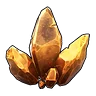Металлическая руда<b>×20</b></a><a class="ich" href="../../../4_spravochniki/predmety/материалы/#осколок-палдиума">Осколок палдиума<b>×25</b></a><a class="ich" href="../../../4_spravochniki/predmety/материалы/#деталь-древней-цивилизации">Деталь древней цивилизации<b>×2</b></a>
<h5>Где сделать</h5>
<a class="ich" href="../../../4_spravochniki/predmety/постройки/#качественный-верстак">Качественный верстак</a><a class="ich" href="../../../4_spravochniki/predmety/постройки/#конвейерная-фабрика">Конвейерная фабрика</a><a class="ich" href="../../../4_spravochniki/predmety/постройки/#мастерская-развитой-цивилизации">Мастерская развитой цивилизации</a><a class="ich" href="../../../4_spravochniki/predmety/постройки/#древний-верстак">Древний верстак</a>

Из игры

Аксессуар, увеличивающий защиту.

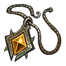Амулет усердия<small>⚖️ 2</small>

<h3>Амулет усердия</h3>Редкий
Аксессуар, увеличивающий скорость работы. Надень, чтобы получить бонус.

⚖️<small>Вес</small><b>2</b>

💰<small>Цена</small><b>16500</b>

<h4>🔨 Крафт</h4>
<a class="ich" href="../../../4_spravochniki/predmety/материалы/#металлический-слиток">Металлический слиток<b>×25</b></a><a class="ich" href="../../../4_spravochniki/predmety/материалы/#кожа">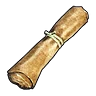Кожа<b>×20</b></a><a class="ich" href="../../../4_spravochniki/predmety/материалы/#осколок-палдиума">Осколок палдиума<b>×25</b></a><a class="ich" href="../../../4_spravochniki/predmety/материалы/#деталь-древней-цивилизации">Деталь древней цивилизации<b>×2</b></a>
<h5>Где сделать</h5>
<a class="ich" href="../../../4_spravochniki/predmety/постройки/#качественный-верстак">Качественный верстак</a><a class="ich" href="../../../4_spravochniki/predmety/постройки/#конвейерная-фабрика">Конвейерная фабрика</a><a class="ich" href="../../../4_spravochniki/predmety/постройки/#мастерская-развитой-цивилизации">Мастерская развитой цивилизации</a><a class="ich" href="../../../4_spravochniki/predmety/постройки/#древний-верстак">Древний верстак</a>

Из игры

Аксессуар, увеличивающий скорость работы. Ускоренная работа ур.3

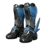Ботинки воздушного рывка<small>⚖️ 2</small>

<h3>Ботинки воздушного рывка</h3>Редкий
Аксессуар, позволяющий игроку совершать рывок в воздухе. Надень, чтобы получить бонус.

⚖️<small>Вес</small><b>2</b>

💰<small>Цена</small><b>54120</b>

📘<small>Технология</small><b>ур. 35</b>

<h4>🔨 Крафт</h4>
<a class="ich" href="../../../4_spravochniki/predmety/материалы/#слиток-рафинированного-металла">Слиток рафинированного металла<b>×30</b></a><a class="ich" href="../../../4_spravochniki/predmety/материалы/#осколок-палдиума">Осколок палдиума<b>×50</b></a><a class="ich" href="../../../4_spravochniki/predmety/материалы/#ночная-звёздная-пыль">Ночная звёздная пыль<b>×20</b></a>
<h5>Где сделать</h5>
<a class="ich" href="../../../4_spravochniki/predmety/постройки/#качественный-верстак">Качественный верстак</a><a class="ich" href="../../../4_spravochniki/predmety/постройки/#конвейерная-фабрика">Конвейерная фабрика</a><a class="ich" href="../../../4_spravochniki/predmety/постройки/#мастерская-развитой-цивилизации">Мастерская развитой цивилизации</a><a class="ich" href="../../../4_spravochniki/predmety/постройки/#древний-верстак">Древний верстак</a>

Из игры

Аксессуар, позволяющий игроку совершать рывок в воздухе. Рывок в воздухе +1

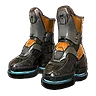Ботинки двойного прыжка<small>⚖️ 2</small>

<h3>Ботинки двойного прыжка</h3>Редкий
Аксессуар, позволяющий игроку прыгать в воздухе. Надень, чтобы получить бонус: дополнительный прыжок +1.

✨ Дополнительный прыжок +1

⚖️<small>Вес</small><b>2</b>

💰<small>Цена</small><b>54120</b>

📘<small>Технология</small><b>ур. 40</b>

<h4>🔨 Крафт</h4>
<a class="ich" href="../../../4_spravochniki/predmety/материалы/#слиток-рафинированного-металла">Слиток рафинированного металла<b>×30</b></a><a class="ich" href="../../../4_spravochniki/predmety/материалы/#осколок-палдиума">Осколок палдиума<b>×50</b></a><a class="ich" href="../../../4_spravochniki/predmety/материалы/#ночная-звёздная-пыль">Ночная звёздная пыль<b>×20</b></a>
<h5>Где сделать</h5>
<a class="ich" href="../../../4_spravochniki/predmety/постройки/#качественный-верстак">Качественный верстак</a><a class="ich" href="../../../4_spravochniki/predmety/постройки/#конвейерная-фабрика">Конвейерная фабрика</a><a class="ich" href="../../../4_spravochniki/predmety/постройки/#мастерская-развитой-цивилизации">Мастерская развитой цивилизации</a><a class="ich" href="../../../4_spravochniki/predmety/постройки/#древний-верстак">Древний верстак</a>

Из игры

Аксессуар, позволяющий игроку прыгать в воздухе.

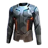Жаро- и морозостойкое термобельё<small>⚖️ 2</small>

<h3>Жаро- и морозостойкое термобельё</h3>Редкий
Аксессуар, повышающий жаростойкость и морозостойкость. Надень, чтобы получить бонус: жаростойкость ур.3.

✨ Жаростойкость ур.3✨ ✨ Морозостойкость ур.3

⚖️<small>Вес</small><b>2</b>

💰<small>Цена</small><b>167040</b>

<h4>🔨 Крафт</h4>
<a class="ich" href="../../../4_spravochniki/predmety/материалы/#качественная-ткань">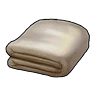Качественная ткань<b>×40</b></a><a class="ich" href="../../../4_spravochniki/predmety/материалы/#огненный-орган">Огненный орган<b>×20</b></a><a class="ich" href="../../../4_spravochniki/predmety/материалы/#ледяной-орган">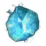Ледяной орган<b>×20</b></a><a class="ich" href="../../../4_spravochniki/predmety/материалы/#полимер">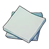Полимер<b>×20</b></a>
<h5>Где сделать</h5>
<a class="ich" href="../../../4_spravochniki/predmety/постройки/#качественный-верстак">Качественный верстак</a><a class="ich" href="../../../4_spravochniki/predmety/постройки/#конвейерная-фабрика">Конвейерная фабрика</a><a class="ich" href="../../../4_spravochniki/predmety/постройки/#мастерская-развитой-цивилизации">Мастерская развитой цивилизации</a><a class="ich" href="../../../4_spravochniki/predmety/постройки/#древний-верстак">Древний верстак</a>

Из игры

Аксессуар, повышающий жаростойкость и морозостойкость.

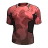Жаростойкое термобельё<small>⚖️ 2</small>

<h3>Жаростойкое термобельё</h3>Редкий
Аксессуар, повышающий жаростойкость. Надень, чтобы получить бонус: жаростойкость ур.3.

✨ Жаростойкость ур.3

⚖️<small>Вес</small><b>2</b>

💰<small>Цена</small><b>16540</b>

<h4>🔨 Крафт</h4>
<a class="ich" href="../../../4_spravochniki/predmety/материалы/#шерсть">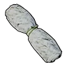Шерсть<b>×20</b></a><a class="ich" href="../../../4_spravochniki/predmety/материалы/#огненный-орган">Огненный орган<b>×15</b></a><a class="ich" href="../../../4_spravochniki/predmety/материалы/#кожа">Кожа<b>×25</b></a><a class="ich" href="../../../4_spravochniki/predmety/материалы/#волокно">Волокно<b>×35</b></a>
<h5>Где сделать</h5>
<a class="ich" href="../../../4_spravochniki/predmety/постройки/#качественный-верстак">Качественный верстак</a><a class="ich" href="../../../4_spravochniki/predmety/постройки/#конвейерная-фабрика">Конвейерная фабрика</a><a class="ich" href="../../../4_spravochniki/predmety/постройки/#мастерская-развитой-цивилизации">Мастерская развитой цивилизации</a><a class="ich" href="../../../4_spravochniki/predmety/постройки/#древний-верстак">Древний верстак</a>

Из игры

Аксессуар, повышающий жаростойкость.

Колокольчик ускорения роста<small>⚖️ 2</small>

<h3>Колокольчик ускорения роста</h3>Редкий
Аксессуар, увеличивающий опыт, получаемый сражающимися вместе с вами Палами. Надень, чтобы получить бонус: увеличение опыта Пала ур.3.

✨ Увеличение опыта Пала ур.3

⚖️<small>Вес</small><b>2</b>

💰<small>Цена</small><b>22920</b>

<h4>🔨 Крафт</h4>
<a class="ich" href="../../../4_spravochniki/predmety/материалы/#металлический-слиток">Металлический слиток<b>×25</b></a><a class="ich" href="../../../4_spravochniki/predmety/материалы/#осколок-палдиума">Осколок палдиума<b>×30</b></a><a class="ich" href="../../../4_spravochniki/predmety/ингредиент/#загадочный-гриб">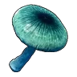Загадочный гриб<b>×10</b></a><a class="ich" href="../../../4_spravochniki/predmety/материалы/#деталь-древней-цивилизации">Деталь древней цивилизации<b>×3</b></a>
<h5>Где сделать</h5>
<a class="ich" href="../../../4_spravochniki/predmety/постройки/#качественный-верстак">Качественный верстак</a><a class="ich" href="../../../4_spravochniki/predmety/постройки/#конвейерная-фабрика">Конвейерная фабрика</a><a class="ich" href="../../../4_spravochniki/predmety/постройки/#мастерская-развитой-цивилизации">Мастерская развитой цивилизации</a><a class="ich" href="../../../4_spravochniki/predmety/постройки/#древний-верстак">Древний верстак</a>

Из игры

Аксессуар, увеличивающий опыт, получаемый сражающимися вместе с вами Палами.

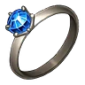Кольцо защиты от воды<small>⚖️ 2</small>

<h3>Кольцо защиты от воды</h3>Редкий
Аксессуар, сокращающий получаемый водный урон. Надень, чтобы получить бонус: сокращение водного урона ур.3.

✨ Сокращение водного урона ур.3

⚖️<small>Вес</small><b>2</b>

💰<small>Цена</small><b>23880</b>

<h4>🔨 Крафт</h4>
<a class="ich" href="../../../4_spravochniki/predmety/материалы/#металлический-слиток">Металлический слиток<b>×20</b></a><a class="ich" href="../../../4_spravochniki/predmety/материалы/#кость">Кость<b>×20</b></a><a class="ich" href="../../../4_spravochniki/predmety/материалы/#жидкость-водного-пала">Жидкость водного Пала<b>×30</b></a><a class="ich" href="../../../4_spravochniki/predmety/материалы/#осколок-палдиума">Осколок палдиума<b>×30</b></a>
<h5>Где сделать</h5>
<a class="ich" href="../../../4_spravochniki/predmety/постройки/#качественный-верстак">Качественный верстак</a><a class="ich" href="../../../4_spravochniki/predmety/постройки/#конвейерная-фабрика">Конвейерная фабрика</a><a class="ich" href="../../../4_spravochniki/predmety/постройки/#мастерская-развитой-цивилизации">Мастерская развитой цивилизации</a><a class="ich" href="../../../4_spravochniki/predmety/постройки/#древний-верстак">Древний верстак</a>

Из игры

Аксессуар, сокращающий получаемый водный урон.

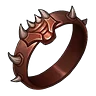Кольцо защиты от драконов<small>⚖️ 2</small>

<h3>Кольцо защиты от драконов</h3>Редкий
Аксессуар, сокращающий получаемый урон от драконов. Надень, чтобы получить бонус: сокращение драконьего урона ур.3.

✨ Сокращение драконьего урона ур.3

⚖️<small>Вес</small><b>2</b>

💰<small>Цена</small><b>25080</b>

<h4>🔨 Крафт</h4>
<a class="ich" href="../../../4_spravochniki/predmety/материалы/#металлический-слиток">Металлический слиток<b>×20</b></a><a class="ich" href="../../../4_spravochniki/predmety/материалы/#кость">Кость<b>×20</b></a><a class="ich" href="../../../4_spravochniki/predmety/материалы/#чистый-кварц">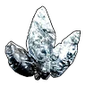Чистый кварц<b>×20</b></a><a class="ich" href="../../../4_spravochniki/predmety/материалы/#осколок-палдиума">Осколок палдиума<b>×30</b></a>
<h5>Где сделать</h5>
<a class="ich" href="../../../4_spravochniki/predmety/постройки/#качественный-верстак">Качественный верстак</a><a class="ich" href="../../../4_spravochniki/predmety/постройки/#конвейерная-фабрика">Конвейерная фабрика</a><a class="ich" href="../../../4_spravochniki/predmety/постройки/#мастерская-развитой-цивилизации">Мастерская развитой цивилизации</a><a class="ich" href="../../../4_spravochniki/predmety/постройки/#древний-верстак">Древний верстак</a>

Из игры

Аксессуар, сокращающий получаемый урон от драконов.

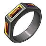Кольцо защиты от земли<small>⚖️ 2</small>

<h3>Кольцо защиты от земли</h3>Редкий
Аксессуар, сокращающий получаемый земляной урон. Надень, чтобы получить бонус: сокращение земного урона ур.3.

✨ Сокращение земного урона ур.3

⚖️<small>Вес</small><b>2</b>

💰<small>Цена</small><b>25080</b>

<h4>🔨 Крафт</h4>
<a class="ich" href="../../../4_spravochniki/predmety/материалы/#металлический-слиток">Металлический слиток<b>×20</b></a><a class="ich" href="../../../4_spravochniki/predmety/материалы/#кость">Кость<b>×20</b></a><a class="ich" href="../../../4_spravochniki/predmety/материалы/#обломок-метеорита">Обломок метеорита<b>×10</b></a><a class="ich" href="../../../4_spravochniki/predmety/материалы/#осколок-палдиума">Осколок палдиума<b>×30</b></a>
<h5>Где сделать</h5>
<a class="ich" href="../../../4_spravochniki/predmety/постройки/#качественный-верстак">Качественный верстак</a><a class="ich" href="../../../4_spravochniki/predmety/постройки/#конвейерная-фабрика">Конвейерная фабрика</a><a class="ich" href="../../../4_spravochniki/predmety/постройки/#мастерская-развитой-цивилизации">Мастерская развитой цивилизации</a><a class="ich" href="../../../4_spravochniki/predmety/постройки/#древний-верстак">Древний верстак</a>

Из игры

Аксессуар, сокращающий получаемый земляной урон.

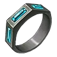Кольцо защиты от льда<small>⚖️ 2</small>

<h3>Кольцо защиты от льда</h3>Редкий
Аксессуар, сокращающий получаемый ледяной урон. Надень, чтобы получить бонус: сокращение ледяного урона ур.3.

✨ Сокращение ледяного урона ур.3

⚖️<small>Вес</small><b>2</b>

💰<small>Цена</small><b>18480</b>

<h4>🔨 Крафт</h4>
<a class="ich" href="../../../4_spravochniki/predmety/материалы/#металлический-слиток">Металлический слиток<b>×20</b></a><a class="ich" href="../../../4_spravochniki/predmety/материалы/#кость">Кость<b>×20</b></a><a class="ich" href="../../../4_spravochniki/predmety/материалы/#ледяной-орган">Ледяной орган<b>×15</b></a><a class="ich" href="../../../4_spravochniki/predmety/материалы/#осколок-палдиума">Осколок палдиума<b>×30</b></a>
<h5>Где сделать</h5>
<a class="ich" href="../../../4_spravochniki/predmety/постройки/#качественный-верстак">Качественный верстак</a><a class="ich" href="../../../4_spravochniki/predmety/постройки/#конвейерная-фабрика">Конвейерная фабрика</a><a class="ich" href="../../../4_spravochniki/predmety/постройки/#мастерская-развитой-цивилизации">Мастерская развитой цивилизации</a><a class="ich" href="../../../4_spravochniki/predmety/постройки/#древний-верстак">Древний верстак</a>

Из игры

Аксессуар, сокращающий получаемый ледяной урон.

Кольцо защиты от молнии<small>⚖️ 2</small>

<h3>Кольцо защиты от молнии</h3>Редкий
Аксессуар, сокращающий получаемый электрический урон. Надень, чтобы получить бонус: сокращение урона молнии ур.3.

✨ Сокращение урона молнии ур.3

⚖️<small>Вес</small><b>2</b>

💰<small>Цена</small><b>16680</b>

<h4>🔨 Крафт</h4>
<a class="ich" href="../../../4_spravochniki/predmety/материалы/#металлический-слиток">Металлический слиток<b>×20</b></a><a class="ich" href="../../../4_spravochniki/predmety/материалы/#кость">Кость<b>×20</b></a><a class="ich" href="../../../4_spravochniki/predmety/материалы/#электрический-орган">Электрический орган<b>×10</b></a><a class="ich" href="../../../4_spravochniki/predmety/материалы/#осколок-палдиума">Осколок палдиума<b>×30</b></a>
<h5>Где сделать</h5>
<a class="ich" href="../../../4_spravochniki/predmety/постройки/#качественный-верстак">Качественный верстак</a><a class="ich" href="../../../4_spravochniki/predmety/постройки/#конвейерная-фабрика">Конвейерная фабрика</a><a class="ich" href="../../../4_spravochniki/predmety/постройки/#мастерская-развитой-цивилизации">Мастерская развитой цивилизации</a><a class="ich" href="../../../4_spravochniki/predmety/постройки/#древний-верстак">Древний верстак</a>

Из игры

Аксессуар, сокращающий получаемый электрический урон.

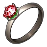Кольцо защиты от огня<small>⚖️ 2</small>

<h3>Кольцо защиты от огня</h3>Редкий
Аксессуар, сокращающий получаемый огненный урон. Надень, чтобы получить бонус: сокращение огненного урона ур.3.

✨ Сокращение огненного урона ур.3

⚖️<small>Вес</small><b>2</b>

💰<small>Цена</small><b>18480</b>

<h4>🔨 Крафт</h4>
<a class="ich" href="../../../4_spravochniki/predmety/материалы/#металлический-слиток">Металлический слиток<b>×20</b></a><a class="ich" href="../../../4_spravochniki/predmety/материалы/#кость">Кость<b>×20</b></a><a class="ich" href="../../../4_spravochniki/predmety/материалы/#огненный-орган">Огненный орган<b>×15</b></a><a class="ich" href="../../../4_spravochniki/predmety/материалы/#осколок-палдиума">Осколок палдиума<b>×30</b></a>
<h5>Где сделать</h5>
<a class="ich" href="../../../4_spravochniki/predmety/постройки/#качественный-верстак">Качественный верстак</a><a class="ich" href="../../../4_spravochniki/predmety/постройки/#конвейерная-фабрика">Конвейерная фабрика</a><a class="ich" href="../../../4_spravochniki/predmety/постройки/#мастерская-развитой-цивилизации">Мастерская развитой цивилизации</a><a class="ich" href="../../../4_spravochniki/predmety/постройки/#древний-верстак">Древний верстак</a>

Из игры

Аксессуар, сокращающий получаемый огненный урон.

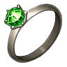Кольцо защиты от травы<small>⚖️ 2</small>

<h3>Кольцо защиты от травы</h3>Редкий
Аксессуар, сокращающий получаемый травяной урон. Надень, чтобы получить бонус: сокращение травяного урона ур.3.

✨ Сокращение травяного урона ур.3

⚖️<small>Вес</small><b>2</b>

💰<small>Цена</small><b>16080</b>

<h4>🔨 Крафт</h4>
<a class="ich" href="../../../4_spravochniki/predmety/материалы/#металлический-слиток">Металлический слиток<b>×20</b></a><a class="ich" href="../../../4_spravochniki/predmety/материалы/#кость">Кость<b>×20</b></a><a class="ich" href="../../../4_spravochniki/predmety/материалы/#лист-гумосса">Лист Гумосса<b>×5</b></a><a class="ich" href="../../../4_spravochniki/predmety/материалы/#осколок-палдиума">Осколок палдиума<b>×30</b></a>
<h5>Где сделать</h5>
<a class="ich" href="../../../4_spravochniki/predmety/постройки/#качественный-верстак">Качественный верстак</a><a class="ich" href="../../../4_spravochniki/predmety/постройки/#конвейерная-фабрика">Конвейерная фабрика</a><a class="ich" href="../../../4_spravochniki/predmety/постройки/#мастерская-развитой-цивилизации">Мастерская развитой цивилизации</a><a class="ich" href="../../../4_spravochniki/predmety/постройки/#древний-верстак">Древний верстак</a>

Из игры

Аксессуар, сокращающий получаемый травяной урон.

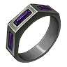Кольцо защиты от тьмы<small>⚖️ 2</small>

<h3>Кольцо защиты от тьмы</h3>Редкий
Аксессуар, сокращающий получаемый урон от тьмы. Надень, чтобы получить бонус: сокращение тёмного урона ур.3.

✨ Сокращение тёмного урона ур.3

⚖️<small>Вес</small><b>2</b>

💰<small>Цена</small><b>16680</b>

<h4>🔨 Крафт</h4>
<a class="ich" href="../../../4_spravochniki/predmety/материалы/#металлический-слиток">Металлический слиток<b>×20</b></a><a class="ich" href="../../../4_spravochniki/predmety/материалы/#кость">Кость<b>×20</b></a><a class="ich" href="../../../4_spravochniki/predmety/материалы/#ядовитая-железа">Ядовитая железа<b>×10</b></a><a class="ich" href="../../../4_spravochniki/predmety/материалы/#осколок-палдиума">Осколок палдиума<b>×30</b></a>
<h5>Где сделать</h5>
<a class="ich" href="../../../4_spravochniki/predmety/постройки/#качественный-верстак">Качественный верстак</a><a class="ich" href="../../../4_spravochniki/predmety/постройки/#конвейерная-фабрика">Конвейерная фабрика</a><a class="ich" href="../../../4_spravochniki/predmety/постройки/#мастерская-развитой-цивилизации">Мастерская развитой цивилизации</a><a class="ich" href="../../../4_spravochniki/predmety/постройки/#древний-верстак">Древний верстак</a>

Из игры

Аксессуар, сокращающий получаемый урон от тьмы.

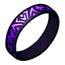Кольцо носильщика<small>⚖️ 2</small>

<h3>Кольцо носильщика</h3>Редкий
Увеличивает лимит переносимого веса. Надень, чтобы получить бонус: увеличение макс. переносимого веса ур.3.

✨ Увеличение макс. переносимого веса ур.3

⚖️<small>Вес</small><b>2</b>

💰<small>Цена</small><b>20400</b>

<h4>🔨 Крафт</h4>
<a class="ich" href="../../../4_spravochniki/predmety/материалы/#металлический-слиток">Металлический слиток<b>×25</b></a><a class="ich" href="../../../4_spravochniki/predmety/материалы/#кожа">Кожа<b>×20</b></a><a class="ich" href="../../../4_spravochniki/predmety/материалы/#рог">Рог<b>×20</b></a><a class="ich" href="../../../4_spravochniki/predmety/материалы/#деталь-древней-цивилизации">Деталь древней цивилизации<b>×3</b></a>
<h5>Где сделать</h5>
<a class="ich" href="../../../4_spravochniki/predmety/постройки/#качественный-верстак">Качественный верстак</a><a class="ich" href="../../../4_spravochniki/predmety/постройки/#конвейерная-фабрика">Конвейерная фабрика</a><a class="ich" href="../../../4_spravochniki/predmety/постройки/#мастерская-развитой-цивилизации">Мастерская развитой цивилизации</a><a class="ich" href="../../../4_spravochniki/predmety/постройки/#древний-верстак">Древний верстак</a>

Из игры

Увеличивает лимит переносимого веса.

Кольцо сдерживания<small>⚖️ 2</small>

<h3>Кольцо сдерживания</h3>Редкий
Кольцо пацифиста. Надень, чтобы получить бонус.

⚖️<small>Вес</small><b>2</b>

💰<small>Цена</small><b>16320</b>

📘<small>Технология</small><b>ур. 18</b>

<h4>🔨 Крафт</h4>
<a class="ich" href="../../../4_spravochniki/predmety/материалы/#металлический-слиток">Металлический слиток<b>×30</b></a><a class="ich" href="../../../4_spravochniki/predmety/материалы/#осколок-палдиума">Осколок палдиума<b>×20</b></a><a class="ich" href="../../../4_spravochniki/predmety/материалы/#деталь-древней-цивилизации">Деталь древней цивилизации<b>×5</b></a>
<h5>Где сделать</h5>
<a class="ich" href="../../../4_spravochniki/predmety/постройки/#качественный-верстак">Качественный верстак</a><a class="ich" href="../../../4_spravochniki/predmety/постройки/#конвейерная-фабрика">Конвейерная фабрика</a><a class="ich" href="../../../4_spravochniki/predmety/постройки/#мастерская-развитой-цивилизации">Мастерская развитой цивилизации</a><a class="ich" href="../../../4_spravochniki/predmety/постройки/#древний-верстак">Древний верстак</a>

Из игры

Кольцо пацифиста. Носитель не может снизить здоровье цели ниже 1.Сдерживание силы

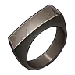Кольцо сопротивления<small>⚖️ 2</small>

<h3>Кольцо сопротивления</h3>Редкий
Аксессуар, сокращающий получаемый нейтральный урон. Надень, чтобы получить бонус: сокращение нейтрального урона ур.3.

✨ Сокращение нейтрального урона ур.3

⚖️<small>Вес</small><b>2</b>

💰<small>Цена</small><b>14700</b>

<h4>🔨 Крафт</h4>
<a class="ich" href="../../../4_spravochniki/predmety/материалы/#металлический-слиток">Металлический слиток<b>×20</b></a><a class="ich" href="../../../4_spravochniki/predmety/материалы/#кость">Кость<b>×20</b></a><a class="ich" href="../../../4_spravochniki/predmety/материалы/#цемент">Цемент<b>×15</b></a><a class="ich" href="../../../4_spravochniki/predmety/материалы/#осколок-палдиума">Осколок палдиума<b>×30</b></a>
<h5>Где сделать</h5>
<a class="ich" href="../../../4_spravochniki/predmety/постройки/#качественный-верстак">Качественный верстак</a><a class="ich" href="../../../4_spravochniki/predmety/постройки/#конвейерная-фабрика">Конвейерная фабрика</a><a class="ich" href="../../../4_spravochniki/predmety/постройки/#мастерская-развитой-цивилизации">Мастерская развитой цивилизации</a><a class="ich" href="../../../4_spravochniki/predmety/постройки/#древний-верстак">Древний верстак</a>

Из игры

Аксессуар, сокращающий получаемый нейтральный урон.

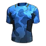Морозостойкое термобельё<small>⚖️ 2</small>

<h3>Морозостойкое термобельё</h3>Редкий
Аксессуар, повышающий морозостойкость. Надень, чтобы получить бонус: морозостойкость ур.3.

✨ Морозостойкость ур.3

⚖️<small>Вес</small><b>2</b>

💰<small>Цена</small><b>21960</b>

<h4>🔨 Крафт</h4>
<a class="ich" href="../../../4_spravochniki/predmety/материалы/#шерсть">Шерсть<b>×20</b></a><a class="ich" href="../../../4_spravochniki/predmety/материалы/#ледяной-орган">Ледяной орган<b>×15</b></a><a class="ich" href="../../../4_spravochniki/predmety/материалы/#кожа">Кожа<b>×25</b></a><a class="ich" href="../../../4_spravochniki/predmety/материалы/#ткань">Ткань<b>×10</b></a>
<h5>Где сделать</h5>
<a class="ich" href="../../../4_spravochniki/predmety/постройки/#качественный-верстак">Качественный верстак</a><a class="ich" href="../../../4_spravochniki/predmety/постройки/#конвейерная-фабрика">Конвейерная фабрика</a><a class="ich" href="../../../4_spravochniki/predmety/постройки/#мастерская-развитой-цивилизации">Мастерская развитой цивилизации</a><a class="ich" href="../../../4_spravochniki/predmety/постройки/#древний-верстак">Древний верстак</a>

Из игры

Аксессуар, повышающий морозостойкость.

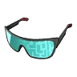Очки таланта<small>⚖️ 1</small>

<h3>Очки таланта</h3>Редкий
Очки, позволяющие увидеть скрытые таланты Пала. Надень, чтобы получить бонус.

⚖️<small>Вес</small><b>1</b>

💰<small>Цена</small><b>51600</b>

📘<small>Технология</small><b>ур. 34</b>

<h4>🔨 Крафт</h4>
<a class="ich" href="../../../4_spravochniki/predmety/материалы/#слиток-рафинированного-металла">Слиток рафинированного металла<b>×30</b></a><a class="ich" href="../../../4_spravochniki/predmety/материалы/#осколок-палдиума">Осколок палдиума<b>×20</b></a><a class="ich" href="../../../4_spravochniki/predmety/материалы/#деталь-древней-цивилизации">Деталь древней цивилизации<b>×10</b></a><a class="ich" href="../../../4_spravochniki/predmety/материалы/#ядро-древней-цивилизации">Ядро древней цивилизации<b>×5</b></a>
<h5>Где сделать</h5>
<a class="ich" href="../../../4_spravochniki/predmety/постройки/#качественный-верстак">Качественный верстак</a><a class="ich" href="../../../4_spravochniki/predmety/постройки/#конвейерная-фабрика">Конвейерная фабрика</a><a class="ich" href="../../../4_spravochniki/predmety/постройки/#мастерская-развитой-цивилизации">Мастерская развитой цивилизации</a><a class="ich" href="../../../4_spravochniki/predmety/постройки/#древний-верстак">Древний верстак</a>

Из игры

Очки, позволяющие увидеть скрытые таланты Пала. Отображают значения здоровье, атаки и защиты по 100-балльной шкале.

Свисток водной поддержки<small>⚖️ 2</small>

<h3>Свисток водной поддержки</h3>Редкий
Аксессуар, усиливающий водный урон Палов, сражающихся вместе с вами. Надень, чтобы получить бонус: увеличение водного урона Палов ур. 3.

✨ Увеличение водного урона Палов ур. 3

⚖️<small>Вес</small><b>2</b>

💰<small>Цена</small><b>23760</b>

<h4>🔨 Крафт</h4>
<a class="ich" href="../../../4_spravochniki/predmety/материалы/#металлический-слиток">Металлический слиток<b>×20</b></a><a class="ich" href="../../../4_spravochniki/predmety/материалы/#рог">Рог<b>×20</b></a><a class="ich" href="../../../4_spravochniki/predmety/материалы/#жидкость-водного-пала">Жидкость водного Пала<b>×30</b></a><a class="ich" href="../../../4_spravochniki/predmety/материалы/#деталь-древней-цивилизации">Деталь древней цивилизации<b>×2</b></a>
<h5>Где сделать</h5>
<a class="ich" href="../../../4_spravochniki/predmety/постройки/#качественный-верстак">Качественный верстак</a><a class="ich" href="../../../4_spravochniki/predmety/постройки/#конвейерная-фабрика">Конвейерная фабрика</a><a class="ich" href="../../../4_spravochniki/predmety/постройки/#мастерская-развитой-цивилизации">Мастерская развитой цивилизации</a><a class="ich" href="../../../4_spravochniki/predmety/постройки/#древний-верстак">Древний верстак</a>

Из игры

Аксессуар, усиливающий водный урон Палов, сражающихся вместе с вами.

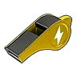Свисток грозовой поддержки<small>⚖️ 2</small>

<h3>Свисток грозовой поддержки</h3>Редкий
Аксессуар, усиливающий грозовой урон Палов, сражающихся вместе с вами. Надень, чтобы получить бонус: увеличение грозового урона Палов ур.3.

✨ Увеличение грозового урона Палов ур.3

⚖️<small>Вес</small><b>2</b>

💰<small>Цена</small><b>16560</b>

<h4>🔨 Крафт</h4>
<a class="ich" href="../../../4_spravochniki/predmety/материалы/#металлический-слиток">Металлический слиток<b>×20</b></a><a class="ich" href="../../../4_spravochniki/predmety/материалы/#рог">Рог<b>×20</b></a><a class="ich" href="../../../4_spravochniki/predmety/материалы/#электрический-орган">Электрический орган<b>×10</b></a><a class="ich" href="../../../4_spravochniki/predmety/материалы/#деталь-древней-цивилизации">Деталь древней цивилизации<b>×2</b></a>
<h5>Где сделать</h5>
<a class="ich" href="../../../4_spravochniki/predmety/постройки/#качественный-верстак">Качественный верстак</a><a class="ich" href="../../../4_spravochniki/predmety/постройки/#конвейерная-фабрика">Конвейерная фабрика</a><a class="ich" href="../../../4_spravochniki/predmety/постройки/#мастерская-развитой-цивилизации">Мастерская развитой цивилизации</a><a class="ich" href="../../../4_spravochniki/predmety/постройки/#древний-верстак">Древний верстак</a>

Из игры

Аксессуар, усиливающий грозовой урон Палов, сражающихся вместе с вами.

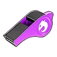Свисток драконической поддержки<small>⚖️ 2</small>

<h3>Свисток драконической поддержки</h3>Редкий
Аксессуар, усиливающий драконический урон Палов, сражающихся вместе с вами. Надень, чтобы получить бонус: увеличение драконьего урона Палов ур.3.

✨ Увеличение драконьего урона Палов ур.3

⚖️<small>Вес</small><b>2</b>

💰<small>Цена</small><b>24960</b>

<h4>🔨 Крафт</h4>
<a class="ich" href="../../../4_spravochniki/predmety/материалы/#металлический-слиток">Металлический слиток<b>×20</b></a><a class="ich" href="../../../4_spravochniki/predmety/материалы/#рог">Рог<b>×20</b></a><a class="ich" href="../../../4_spravochniki/predmety/материалы/#чистый-кварц">Чистый кварц<b>×20</b></a><a class="ich" href="../../../4_spravochniki/predmety/материалы/#деталь-древней-цивилизации">Деталь древней цивилизации<b>×2</b></a>
<h5>Где сделать</h5>
<a class="ich" href="../../../4_spravochniki/predmety/постройки/#качественный-верстак">Качественный верстак</a><a class="ich" href="../../../4_spravochniki/predmety/постройки/#конвейерная-фабрика">Конвейерная фабрика</a><a class="ich" href="../../../4_spravochniki/predmety/постройки/#мастерская-развитой-цивилизации">Мастерская развитой цивилизации</a><a class="ich" href="../../../4_spravochniki/predmety/постройки/#древний-верстак">Древний верстак</a>

Из игры

Аксессуар, усиливающий драконический урон Палов, сражающихся вместе с вами.

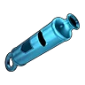Свисток защитной поддержки<small>⚖️ 2</small>

<h3>Свисток защитной поддержки</h3>Редкий
Аксессуар, усиливающий защиту Палов, сражающихся вместе с вами. Надень, чтобы получить бонус: увеличение защиты Пала ур.3.

✨ Увеличение защиты Пала ур.3

⚖️<small>Вес</small><b>2</b>

💰<small>Цена</small><b>32400</b>

<h4>🔨 Крафт</h4>
<a class="ich" href="../../../4_spravochniki/predmety/материалы/#металлический-слиток">Металлический слиток<b>×20</b></a><a class="ich" href="../../../4_spravochniki/predmety/материалы/#рог">Рог<b>×20</b></a><a class="ich" href="../../../4_spravochniki/predmety/материалы/#полимер">Полимер<b>×15</b></a><a class="ich" href="../../../4_spravochniki/predmety/материалы/#деталь-древней-цивилизации">Деталь древней цивилизации<b>×2</b></a>
<h5>Где сделать</h5>
<a class="ich" href="../../../4_spravochniki/predmety/постройки/#качественный-верстак">Качественный верстак</a><a class="ich" href="../../../4_spravochniki/predmety/постройки/#конвейерная-фабрика">Конвейерная фабрика</a><a class="ich" href="../../../4_spravochniki/predmety/постройки/#мастерская-развитой-цивилизации">Мастерская развитой цивилизации</a><a class="ich" href="../../../4_spravochniki/predmety/постройки/#древний-верстак">Древний верстак</a>

Из игры

Аксессуар, усиливающий защиту Палов, сражающихся вместе с вами.

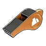Свисток земной поддержки<small>⚖️ 2</small>

<h3>Свисток земной поддержки</h3>Редкий
Аксессуар, усиливающий земной урон Палов, сражающихся вместе с вами. Надень, чтобы получить бонус: увеличение земного урона Палов ур.3.

✨ Увеличение земного урона Палов ур.3

⚖️<small>Вес</small><b>2</b>

💰<small>Цена</small><b>24960</b>

<h4>🔨 Крафт</h4>
<a class="ich" href="../../../4_spravochniki/predmety/материалы/#металлический-слиток">Металлический слиток<b>×20</b></a><a class="ich" href="../../../4_spravochniki/predmety/материалы/#рог">Рог<b>×20</b></a><a class="ich" href="../../../4_spravochniki/predmety/материалы/#обломок-метеорита">Обломок метеорита<b>×10</b></a><a class="ich" href="../../../4_spravochniki/predmety/материалы/#деталь-древней-цивилизации">Деталь древней цивилизации<b>×2</b></a>
<h5>Где сделать</h5>
<a class="ich" href="../../../4_spravochniki/predmety/постройки/#качественный-верстак">Качественный верстак</a><a class="ich" href="../../../4_spravochniki/predmety/постройки/#конвейерная-фабрика">Конвейерная фабрика</a><a class="ich" href="../../../4_spravochniki/predmety/постройки/#мастерская-развитой-цивилизации">Мастерская развитой цивилизации</a><a class="ich" href="../../../4_spravochniki/predmety/постройки/#древний-верстак">Древний верстак</a>

Из игры

Аксессуар, усиливающий земной урон Палов, сражающихся вместе с вами.

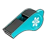Свисток ледяной поддержки<small>⚖️ 2</small>

<h3>Свисток ледяной поддержки</h3>Редкий
Аксессуар, усиливающий ледяной урон Палов, сражающихся вместе с вами. Надень, чтобы получить бонус: увеличение ледяного урона Палов ур.3.

✨ Увеличение ледяного урона Палов ур.3

⚖️<small>Вес</small><b>2</b>

💰<small>Цена</small><b>18360</b>

<h4>🔨 Крафт</h4>
<a class="ich" href="../../../4_spravochniki/predmety/материалы/#металлический-слиток">Металлический слиток<b>×20</b></a><a class="ich" href="../../../4_spravochniki/predmety/материалы/#рог">Рог<b>×20</b></a><a class="ich" href="../../../4_spravochniki/predmety/материалы/#ледяной-орган">Ледяной орган<b>×15</b></a><a class="ich" href="../../../4_spravochniki/predmety/материалы/#деталь-древней-цивилизации">Деталь древней цивилизации<b>×2</b></a>
<h5>Где сделать</h5>
<a class="ich" href="../../../4_spravochniki/predmety/постройки/#качественный-верстак">Качественный верстак</a><a class="ich" href="../../../4_spravochniki/predmety/постройки/#конвейерная-фабрика">Конвейерная фабрика</a><a class="ich" href="../../../4_spravochniki/predmety/постройки/#мастерская-развитой-цивилизации">Мастерская развитой цивилизации</a><a class="ich" href="../../../4_spravochniki/predmety/постройки/#древний-верстак">Древний верстак</a>

Из игры

Аксессуар, усиливающий ледяной урон Палов, сражающихся вместе с вами.

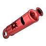Свисток наступательной поддержки<small>⚖️ 2</small>

<h3>Свисток наступательной поддержки</h3>Редкий
Аксессуар, усиливающий силу атаки Палов, сражающихся вместе с вами. Надень, чтобы получить бонус: увеличение атаки Пала ур.3.

✨ Увеличение атаки Пала ур.3

⚖️<small>Вес</small><b>2</b>

💰<small>Цена</small><b>21960</b>

<h4>🔨 Крафт</h4>
<a class="ich" href="../../../4_spravochniki/predmety/материалы/#металлический-слиток">Металлический слиток<b>×20</b></a><a class="ich" href="../../../4_spravochniki/predmety/материалы/#рог">Рог<b>×20</b></a><a class="ich" href="../../../4_spravochniki/predmety/материалы/#сера">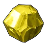Сера<b>×25</b></a><a class="ich" href="../../../4_spravochniki/predmety/материалы/#деталь-древней-цивилизации">Деталь древней цивилизации<b>×2</b></a>
<h5>Где сделать</h5>
<a class="ich" href="../../../4_spravochniki/predmety/постройки/#качественный-верстак">Качественный верстак</a><a class="ich" href="../../../4_spravochniki/predmety/постройки/#конвейерная-фабрика">Конвейерная фабрика</a><a class="ich" href="../../../4_spravochniki/predmety/постройки/#мастерская-развитой-цивилизации">Мастерская развитой цивилизации</a><a class="ich" href="../../../4_spravochniki/predmety/постройки/#древний-верстак">Древний верстак</a>

Из игры

Аксессуар, усиливающий силу атаки Палов, сражающихся вместе с вами.

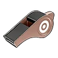Свисток нейтральной поддержки<small>⚖️ 2</small>

<h3>Свисток нейтральной поддержки</h3>Редкий
Аксессуар, усиливающий нейтральный урон Палов, сражающихся вместе с вами. Надень, чтобы получить бонус: увеличение нейтрального урона Палов ур.3.

✨ Увеличение нейтрального урона Палов ур.3

⚖️<small>Вес</small><b>2</b>

💰<small>Цена</small><b>14580</b>

<h4>🔨 Крафт</h4>
<a class="ich" href="../../../4_spravochniki/predmety/материалы/#металлический-слиток">Металлический слиток<b>×20</b></a><a class="ich" href="../../../4_spravochniki/predmety/материалы/#рог">Рог<b>×20</b></a><a class="ich" href="../../../4_spravochniki/predmety/материалы/#цемент">Цемент<b>×15</b></a><a class="ich" href="../../../4_spravochniki/predmety/материалы/#деталь-древней-цивилизации">Деталь древней цивилизации<b>×2</b></a>
<h5>Где сделать</h5>
<a class="ich" href="../../../4_spravochniki/predmety/постройки/#качественный-верстак">Качественный верстак</a><a class="ich" href="../../../4_spravochniki/predmety/постройки/#конвейерная-фабрика">Конвейерная фабрика</a><a class="ich" href="../../../4_spravochniki/predmety/постройки/#мастерская-развитой-цивилизации">Мастерская развитой цивилизации</a><a class="ich" href="../../../4_spravochniki/predmety/постройки/#древний-верстак">Древний верстак</a>

Из игры

Аксессуар, усиливающий нейтральный урон Палов, сражающихся вместе с вами.

Свисток огненной поддержки<small>⚖️ 2</small>

<h3>Свисток огненной поддержки</h3>Редкий
Аксессуар, усиливающий огненный урон Палов, сражающихся вместе с вами. Надень, чтобы получить бонус: увеличение огненного урона Палов ур.3.

✨ Увеличение огненного урона Палов ур.3

⚖️<small>Вес</small><b>2</b>

💰<small>Цена</small><b>18360</b>

<h4>🔨 Крафт</h4>
<a class="ich" href="../../../4_spravochniki/predmety/материалы/#металлический-слиток">Металлический слиток<b>×20</b></a><a class="ich" href="../../../4_spravochniki/predmety/материалы/#рог">Рог<b>×20</b></a><a class="ich" href="../../../4_spravochniki/predmety/материалы/#огненный-орган">Огненный орган<b>×15</b></a><a class="ich" href="../../../4_spravochniki/predmety/материалы/#деталь-древней-цивилизации">Деталь древней цивилизации<b>×2</b></a>
<h5>Где сделать</h5>
<a class="ich" href="../../../4_spravochniki/predmety/постройки/#качественный-верстак">Качественный верстак</a><a class="ich" href="../../../4_spravochniki/predmety/постройки/#конвейерная-фабрика">Конвейерная фабрика</a><a class="ich" href="../../../4_spravochniki/predmety/постройки/#мастерская-развитой-цивилизации">Мастерская развитой цивилизации</a><a class="ich" href="../../../4_spravochniki/predmety/постройки/#древний-верстак">Древний верстак</a>

Из игры

Аксессуар, усиливающий огненный урон Палов, сражающихся вместе с вами.

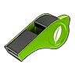Свисток травяной поддержки<small>⚖️ 2</small>

<h3>Свисток травяной поддержки</h3>Редкий
Аксессуар, усиливающий травяной урон Палов, сражающихся вместе с вами. Надень, чтобы получить бонус: увеличение травяного урона Палов ур.3.

✨ Увеличение травяного урона Палов ур.3

⚖️<small>Вес</small><b>2</b>

💰<small>Цена</small><b>15960</b>

<h4>🔨 Крафт</h4>
<a class="ich" href="../../../4_spravochniki/predmety/материалы/#металлический-слиток">Металлический слиток<b>×20</b></a><a class="ich" href="../../../4_spravochniki/predmety/материалы/#рог">Рог<b>×20</b></a><a class="ich" href="../../../4_spravochniki/predmety/материалы/#лист-гумосса">Лист Гумосса<b>×5</b></a><a class="ich" href="../../../4_spravochniki/predmety/материалы/#деталь-древней-цивилизации">Деталь древней цивилизации<b>×2</b></a>
<h5>Где сделать</h5>
<a class="ich" href="../../../4_spravochniki/predmety/постройки/#качественный-верстак">Качественный верстак</a><a class="ich" href="../../../4_spravochniki/predmety/постройки/#конвейерная-фабрика">Конвейерная фабрика</a><a class="ich" href="../../../4_spravochniki/predmety/постройки/#мастерская-развитой-цивилизации">Мастерская развитой цивилизации</a><a class="ich" href="../../../4_spravochniki/predmety/постройки/#древний-верстак">Древний верстак</a>

Из игры

Аксессуар, усиливающий травяной урон Палов, сражающихся вместе с вами.

Свисток тёмной поддержки<small>⚖️ 2</small>

<h3>Свисток тёмной поддержки</h3>Редкий
Аксессуар, усиливающий тёмный урон Палов, сражающихся вместе с вами. Надень, чтобы получить бонус: увеличение тёмного урона Палов ур.3.

✨ Увеличение тёмного урона Палов ур.3

⚖️<small>Вес</small><b>2</b>

💰<small>Цена</small><b>16560</b>

<h4>🔨 Крафт</h4>
<a class="ich" href="../../../4_spravochniki/predmety/материалы/#металлический-слиток">Металлический слиток<b>×20</b></a><a class="ich" href="../../../4_spravochniki/predmety/материалы/#рог">Рог<b>×20</b></a><a class="ich" href="../../../4_spravochniki/predmety/материалы/#ядовитая-железа">Ядовитая железа<b>×10</b></a><a class="ich" href="../../../4_spravochniki/predmety/материалы/#деталь-древней-цивилизации">Деталь древней цивилизации<b>×2</b></a>
<h5>Где сделать</h5>
<a class="ich" href="../../../4_spravochniki/predmety/постройки/#качественный-верстак">Качественный верстак</a><a class="ich" href="../../../4_spravochniki/predmety/постройки/#конвейерная-фабрика">Конвейерная фабрика</a><a class="ich" href="../../../4_spravochniki/predmety/постройки/#мастерская-развитой-цивилизации">Мастерская развитой цивилизации</a><a class="ich" href="../../../4_spravochniki/predmety/постройки/#древний-верстак">Древний верстак</a>

Из игры

Аксессуар, усиливающий тёмный урон Палов, сражающихся вместе с вами.

Амулет Вумпо<small>⚖️ 2</small>

<h3>Амулет Вумпо</h3>Эпический
Аксессуар с высокой морозостойкостью. Надень, чтобы получить бонус: морозостойкость ур.3.

✨ Морозостойкость ур.3✨ Сокращение ледяного урона ур.4

⚖️<small>Вес</small><b>2</b>

💰<small>Цена</small><b>158040</b>

<h4>🔨 Крафт</h4>
<a class="ich" href="../../../4_spravochniki/predmety/материалы/#слиток-рафинированного-металла">Слиток рафинированного металла<b>×20</b></a><a class="ich" href="../../../4_spravochniki/predmety/материалы/#ледяной-орган">Ледяной орган<b>×20</b></a><a class="ich" href="../../../4_spravochniki/predmety/материалы/#осколок-палдиума">Осколок палдиума<b>×30</b></a><a class="ich" href="../../../4_spravochniki/predmety/материалы/#качественная-ткань">Качественная ткань<b>×30</b></a><a class="ich" href="../../../4_spravochniki/predmety/материалы/#древний-кусок-лавы">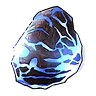Древний кусок лавы<b>×30</b></a>
<h5>Где сделать</h5>
<a class="ich" href="../../../4_spravochniki/predmety/постройки/#конвейерная-фабрика">Конвейерная фабрика</a><a class="ich" href="../../../4_spravochniki/predmety/постройки/#мастерская-развитой-цивилизации">Мастерская развитой цивилизации</a><a class="ich" href="../../../4_spravochniki/predmety/постройки/#древний-верстак">Древний верстак</a>

Из игры

Аксессуар с высокой морозостойкостью. Также значительно уменьшает ледяной урон.

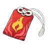Амулет Рептиро<small>⚖️ 2</small>

<h3>Амулет Рептиро</h3>Эпический
Аксессуар с высокой термостойкостью. Надень, чтобы получить бонус: жаростойкость ур.3.

✨ Жаростойкость ур.3✨ Сокращение огненного урона ур.4

⚖️<small>Вес</small><b>2</b>

💰<small>Цена</small><b>86040</b>

<h4>🔨 Крафт</h4>
<a class="ich" href="../../../4_spravochniki/predmety/материалы/#слиток-рафинированного-металла">Слиток рафинированного металла<b>×20</b></a><a class="ich" href="../../../4_spravochniki/predmety/материалы/#огненный-орган">Огненный орган<b>×20</b></a><a class="ich" href="../../../4_spravochniki/predmety/материалы/#осколок-палдиума">Осколок палдиума<b>×30</b></a><a class="ich" href="../../../4_spravochniki/predmety/материалы/#углеродное-волокно">Углеродное волокно<b>×30</b></a><a class="ich" href="../../../4_spravochniki/predmety/материалы/#древняя-кора">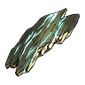Древняя кора<b>×30</b></a>
<h5>Где сделать</h5>
<a class="ich" href="../../../4_spravochniki/predmety/постройки/#конвейерная-фабрика">Конвейерная фабрика</a><a class="ich" href="../../../4_spravochniki/predmety/постройки/#мастерская-развитой-цивилизации">Мастерская развитой цивилизации</a><a class="ich" href="../../../4_spravochniki/predmety/постройки/#древний-верстак">Древний верстак</a>

Из игры

Аксессуар с высокой термостойкостью. Также значительно уменьшает огненный урон.

Амулет бродячего торговца<small>⚖️ 2</small>

<h3>Амулет бродячего торговца</h3>Эпический
Аксессуар с очень высокой устойчивостью к жаре и холоду. Надень, чтобы получить бонус: жаростойкость ур.3.

✨ Жаростойкость ур.3✨ ✨ Морозостойкость ур.3✨ Увеличение макс. переносимого веса ур.4

⚖️<small>Вес</small><b>2</b>

💰<small>Цена</small><b>103680</b>

<h4>🔨 Крафт</h4>
<a class="ich" href="../../../4_spravochniki/predmety/материалы/#полимер">Полимер<b>×30</b></a><a class="ich" href="../../../4_spravochniki/predmety/материалы/#кожа">Кожа<b>×30</b></a><a class="ich" href="../../../4_spravochniki/predmety/материалы/#огненный-орган">Огненный орган<b>×20</b></a><a class="ich" href="../../../4_spravochniki/predmety/материалы/#ледяной-орган">Ледяной орган<b>×20</b></a><a class="ich" href="../../../4_spravochniki/predmety/материалы/#древняя-кость">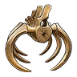Древняя кость<b>×30</b></a>
<h5>Где сделать</h5>
<a class="ich" href="../../../4_spravochniki/predmety/постройки/#конвейерная-фабрика">Конвейерная фабрика</a><a class="ich" href="../../../4_spravochniki/predmety/постройки/#мастерская-развитой-цивилизации">Мастерская развитой цивилизации</a><a class="ich" href="../../../4_spravochniki/predmety/постройки/#древний-верстак">Древний верстак</a>

Из игры

Аксессуар с очень высокой устойчивостью к жаре и холоду. Также значительно увеличивает макс. переносимый вес игрока.

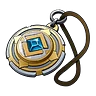Амулет передового отряда<small>⚖️ 2</small>

<h3>Амулет передового отряда</h3>Эпический
Аксессуар с очень высокой устойчивостью к жаре и холоду. Надень, чтобы получить бонус: жаростойкость ур.3.

✨ Жаростойкость ур.3✨ ✨ Морозостойкость ур.3✨ Увеличение здоровье ур.4

⚖️<small>Вес</small><b>2</b>

💰<small>Цена</small><b>103680</b>

<h4>🔨 Крафт</h4>
<a class="ich" href="../../../4_spravochniki/predmety/материалы/#полимер">Полимер<b>×30</b></a><a class="ich" href="../../../4_spravochniki/predmety/материалы/#кость">Кость<b>×30</b></a><a class="ich" href="../../../4_spravochniki/predmety/материалы/#огненный-орган">Огненный орган<b>×20</b></a><a class="ich" href="../../../4_spravochniki/predmety/материалы/#ледяной-орган">Ледяной орган<b>×20</b></a><a class="ich" href="../../../4_spravochniki/predmety/материалы/#древняя-кость">Древняя кость<b>×30</b></a>
<h5>Где сделать</h5>
<a class="ich" href="../../../4_spravochniki/predmety/постройки/#конвейерная-фабрика">Конвейерная фабрика</a><a class="ich" href="../../../4_spravochniki/predmety/постройки/#мастерская-развитой-цивилизации">Мастерская развитой цивилизации</a><a class="ich" href="../../../4_spravochniki/predmety/постройки/#древний-верстак">Древний верстак</a>

Из игры

Аксессуар с очень высокой устойчивостью к жаре и холоду. Также значительно увеличивает здоровье.

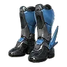Ботинки двойного рывка в воздухе<small>⚖️ 2</small>

<h3>Ботинки двойного рывка в воздухе</h3>Эпический
Аксессуар, позволяющий игроку совершать двойной рывок в воздухе. Надень, чтобы получить бонус.

⚖️<small>Вес</small><b>2</b>

💰<small>Цена</small><b>153120</b>

📘<small>Технология</small><b>ур. 61</b>

<h4>🔨 Крафт</h4>
<a class="ich" href="../../../4_spravochniki/predmety/материалы/#сталепластик">Сталепластик<b>×30</b></a><a class="ich" href="../../../4_spravochniki/predmety/материалы/#осколок-палдиума">Осколок палдиума<b>×100</b></a><a class="ich" href="../../../4_spravochniki/predmety/материалы/#ночная-звёздная-пыль">Ночная звёздная пыль<b>×30</b></a><a class="ich" href="../../../4_spravochniki/predmety/материалы/#осколок-тьмы">Осколок тьмы<b>×30</b></a>
<h5>Где сделать</h5>
<a class="ich" href="../../../4_spravochniki/predmety/постройки/#конвейерная-фабрика">Конвейерная фабрика</a><a class="ich" href="../../../4_spravochniki/predmety/постройки/#мастерская-развитой-цивилизации">Мастерская развитой цивилизации</a><a class="ich" href="../../../4_spravochniki/predmety/постройки/#древний-верстак">Древний верстак</a>

Из игры

Аксессуар, позволяющий игроку совершать двойной рывок в воздухе. Рывок в воздухе +2

Ботинки тройного прыжка<small>⚖️ 2</small>

<h3>Ботинки тройного прыжка</h3>Эпический
Аксессуар, позволяющий игроку совершать двойной прыжок в воздухе. Надень, чтобы получить бонус: дополнительный прыжок +2.

✨ Дополнительный прыжок +2

⚖️<small>Вес</small><b>2</b>

💰<small>Цена</small><b>210600</b>

📘<small>Технология</small><b>ур. 70</b>

<h4>🔨 Крафт</h4>
<a class="ich" href="../../../4_spravochniki/predmety/материалы/#гексолит">Гексолит<b>×30</b></a><a class="ich" href="../../../4_spravochniki/predmety/материалы/#осколок-палдиума">Осколок палдиума<b>×150</b></a><a class="ich" href="../../../4_spravochniki/predmety/материалы/#ночная-звёздная-пыль">Ночная звёздная пыль<b>×50</b></a><a class="ich" href="../../../4_spravochniki/predmety/материалы/#осколок-тьмы">Осколок тьмы<b>×50</b></a>
<h5>Где сделать</h5>
<a class="ich" href="../../../4_spravochniki/predmety/постройки/#древний-верстак">Древний верстак</a>

Из игры

Аксессуар, позволяющий игроку совершать двойной прыжок в воздухе.

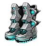Воздухоход Mk-EX<small>⚖️ 2</small>

<h3>Воздухоход Mk-EX</h3>Эпический
Аксессуар, позволяющий совершать двойной прыжок в воздухе. Надень, чтобы получить бонус: дополнительный прыжок +2.

✨ Дополнительный прыжок +2✨ Рывок в воздухе +2

⚖️<small>Вес</small><b>2</b>

💰<small>Цена</small><b>406440</b>

<h4>🔨 Крафт</h4>
<a class="ich" href="../../../4_spravochniki/predmety/материалы/#кораллиновый-слиток">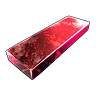Кораллиновый слиток<b>×30</b></a><a class="ich" href="../../../4_spravochniki/predmety/материалы/#осколок-палдиума">Осколок палдиума<b>×60</b></a><a class="ich" href="../../../4_spravochniki/predmety/материалы/#осколок-тьмы">Осколок тьмы<b>×45</b></a><a class="ich" href="../../../4_spravochniki/predmety/материалы/#ночная-звёздная-пыль">Ночная звёздная пыль<b>×60</b></a><a class="ich" href="../../../4_spravochniki/predmety/материалы/#древняя-кость">Древняя кость<b>×60</b></a>
<h5>Где сделать</h5>
<a class="ich" href="../../../4_spravochniki/predmety/постройки/#конвейерная-фабрика">Конвейерная фабрика</a><a class="ich" href="../../../4_spravochniki/predmety/постройки/#мастерская-развитой-цивилизации">Мастерская развитой цивилизации</a><a class="ich" href="../../../4_spravochniki/predmety/постройки/#древний-верстак">Древний верстак</a>

Из игры

Аксессуар, позволяющий совершать двойной прыжок в воздухе. Также позволяет выполнить два воздушных рывка.

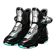Воздухоход Mk-Ⅰ<small>⚖️ 2</small>

<h3>Воздухоход Mk-Ⅰ</h3>Эпический
Аксессуар, позволяющий совершать прыжок в воздухе. Надень, чтобы получить бонус: дополнительный прыжок +1.

✨ Дополнительный прыжок +1✨ Рывок в воздухе +1

⚖️<small>Вес</small><b>2</b>

💰<small>Цена</small><b>133920</b>

<h4>🔨 Крафт</h4>
<a class="ich" href="../../../4_spravochniki/predmety/материалы/#гексолит">Гексолит<b>×20</b></a><a class="ich" href="../../../4_spravochniki/predmety/материалы/#осколок-палдиума">Осколок палдиума<b>×30</b></a><a class="ich" href="../../../4_spravochniki/predmety/материалы/#осколок-тьмы">Осколок тьмы<b>×15</b></a><a class="ich" href="../../../4_spravochniki/predmety/материалы/#ночная-звёздная-пыль">Ночная звёздная пыль<b>×30</b></a><a class="ich" href="../../../4_spravochniki/predmety/материалы/#древняя-кора">Древняя кора<b>×15</b></a>
<h5>Где сделать</h5>
<a class="ich" href="../../../4_spravochniki/predmety/постройки/#конвейерная-фабрика">Конвейерная фабрика</a><a class="ich" href="../../../4_spravochniki/predmety/постройки/#мастерская-развитой-цивилизации">Мастерская развитой цивилизации</a><a class="ich" href="../../../4_spravochniki/predmety/постройки/#древний-верстак">Древний верстак</a>

Из игры

Аксессуар, позволяющий совершать прыжок в воздухе. Также позволяет выполнить один воздушный рывок.

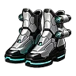Воздухоход Mk-Ⅱ<small>⚖️ 2</small>

<h3>Воздухоход Mk-Ⅱ</h3>Эпический
Аксессуар, позволяющий совершать прыжок в воздухе. Надень, чтобы получить бонус: дополнительный прыжок +1.

✨ Дополнительный прыжок +1✨ Рывок в воздухе +2

⚖️<small>Вес</small><b>2</b>

💰<small>Цена</small><b>210360</b>

<h4>🔨 Крафт</h4>
<a class="ich" href="../../../4_spravochniki/predmety/материалы/#гексолит">Гексолит<b>×30</b></a><a class="ich" href="../../../4_spravochniki/predmety/материалы/#осколок-палдиума">Осколок палдиума<b>×40</b></a><a class="ich" href="../../../4_spravochniki/predmety/материалы/#осколок-тьмы">Осколок тьмы<b>×25</b></a><a class="ich" href="../../../4_spravochniki/predmety/материалы/#ночная-звёздная-пыль">Ночная звёздная пыль<b>×40</b></a><a class="ich" href="../../../4_spravochniki/predmety/материалы/#древний-кусок-лавы">Древний кусок лавы<b>×30</b></a>
<h5>Где сделать</h5>
<a class="ich" href="../../../4_spravochniki/predmety/постройки/#конвейерная-фабрика">Конвейерная фабрика</a><a class="ich" href="../../../4_spravochniki/predmety/постройки/#мастерская-развитой-цивилизации">Мастерская развитой цивилизации</a><a class="ich" href="../../../4_spravochniki/predmety/постройки/#древний-верстак">Древний верстак</a>

Из игры

Аксессуар, позволяющий совершать прыжок в воздухе. Также позволяет выполнить два воздушных рывка.

Воздухоход Mk-Ⅲ<small>⚖️ 2</small>

<h3>Воздухоход Mk-Ⅲ</h3>Эпический
Аксессуар, позволяющий совершать двойной прыжок в воздухе. Надень, чтобы получить бонус: дополнительный прыжок +2.

✨ Дополнительный прыжок +2✨ Рывок в воздухе +1

⚖️<small>Вес</small><b>2</b>

💰<small>Цена</small><b>272400</b>

<h4>🔨 Крафт</h4>
<a class="ich" href="../../../4_spravochniki/predmety/материалы/#кораллиновый-слиток">Кораллиновый слиток<b>×20</b></a><a class="ich" href="../../../4_spravochniki/predmety/материалы/#осколок-палдиума">Осколок палдиума<b>×50</b></a><a class="ich" href="../../../4_spravochniki/predmety/материалы/#осколок-тьмы">Осколок тьмы<b>×35</b></a><a class="ich" href="../../../4_spravochniki/predmety/материалы/#ночная-звёздная-пыль">Ночная звёздная пыль<b>×50</b></a><a class="ich" href="../../../4_spravochniki/predmety/материалы/#древняя-кость">Древняя кость<b>×30</b></a>
<h5>Где сделать</h5>
<a class="ich" href="../../../4_spravochniki/predmety/постройки/#конвейерная-фабрика">Конвейерная фабрика</a><a class="ich" href="../../../4_spravochniki/predmety/постройки/#мастерская-развитой-цивилизации">Мастерская развитой цивилизации</a><a class="ich" href="../../../4_spravochniki/predmety/постройки/#древний-верстак">Древний верстак</a>

Из игры

Аксессуар, позволяющий совершать двойной прыжок в воздухе. Также позволяет выполнить один воздушный рывок.

Кольцо Блейзхаула<small>⚖️ 2</small>

<h3>Кольцо Блейзхаула</h3>Эпический
Аксессуар, значительно снижающий травяной урон. Надень, чтобы получить бонус: сокращение травяного урона ур.4.

✨ Сокращение травяного урона ур.4✨ Увеличение огненного урона Палов ур.4

⚖️<small>Вес</small><b>2</b>

💰<small>Цена</small><b>31200</b>

<h4>🔨 Крафт</h4>
<a class="ich" href="../../../4_spravochniki/predmety/материалы/#слиток-рафинированного-металла">Слиток рафинированного металла<b>×20</b></a><a class="ich" href="../../../4_spravochniki/predmety/материалы/#осколок-палдиума">Осколок палдиума<b>×30</b></a><a class="ich" href="../../../4_spravochniki/predmety/материалы/#огненный-орган">Огненный орган<b>×15</b></a><a class="ich" href="../../../4_spravochniki/predmety/материалы/#деталь-древней-цивилизации">Деталь древней цивилизации<b>×5</b></a>
<h5>Где сделать</h5>
<a class="ich" href="../../../4_spravochniki/predmety/постройки/#конвейерная-фабрика">Конвейерная фабрика</a><a class="ich" href="../../../4_spravochniki/predmety/постройки/#мастерская-развитой-цивилизации">Мастерская развитой цивилизации</a><a class="ich" href="../../../4_spravochniki/predmety/постройки/#древний-верстак">Древний верстак</a>

Из игры

Аксессуар, значительно снижающий травяной урон. Также значительно усиливает огненный урон сражающихся рядом Палов.

Кольцо Ваэлета<small>⚖️ 2</small>

<h3>Кольцо Ваэлета</h3>Эпический
Аксессуар, значительно снижающий земляной урон. Надень, чтобы получить бонус: сокращение земного урона ур.4.

✨ Сокращение земного урона ур.4✨ Увеличение травяного урона Палов ур.4

⚖️<small>Вес</small><b>2</b>

💰<small>Цена</small><b>24480</b>

<h4>🔨 Крафт</h4>
<a class="ich" href="../../../4_spravochniki/predmety/материалы/#слиток-рафинированного-металла">Слиток рафинированного металла<b>×20</b></a><a class="ich" href="../../../4_spravochniki/predmety/материалы/#семена-помидоров">Семена помидоров<b>×10</b></a><a class="ich" href="../../../4_spravochniki/predmety/материалы/#семена-лука">Семена лука<b>×10</b></a><a class="ich" href="../../../4_spravochniki/predmety/материалы/#деталь-древней-цивилизации">Деталь древней цивилизации<b>×5</b></a>
<h5>Где сделать</h5>
<a class="ich" href="../../../4_spravochniki/predmety/постройки/#конвейерная-фабрика">Конвейерная фабрика</a><a class="ich" href="../../../4_spravochniki/predmety/постройки/#мастерская-развитой-цивилизации">Мастерская развитой цивилизации</a><a class="ich" href="../../../4_spravochniki/predmety/постройки/#древний-верстак">Древний верстак</a>

Из игры

Аксессуар, значительно снижающий земляной урон. Также значительно усиливает травяной урон сражающихся рядом Палов.

Кольцо Катресса<small>⚖️ 2</small>

<h3>Кольцо Катресса</h3>Эпический
Аксессуар, значительно снижающий нейтральный урон. Надень, чтобы получить бонус: сокращение нейтрального урона ур.4.

✨ Сокращение нейтрального урона ур.4✨ Увеличение тёмного урона Палов ур.4

⚖️<small>Вес</small><b>2</b>

💰<small>Цена</small><b>34080</b>

<h4>🔨 Крафт</h4>
<a class="ich" href="../../../4_spravochniki/predmety/материалы/#слиток-рафинированного-металла">Слиток рафинированного металла<b>×20</b></a><a class="ich" href="../../../4_spravochniki/predmety/материалы/#кожа">Кожа<b>×20</b></a><a class="ich" href="../../../4_spravochniki/predmety/материалы/#волосы-катресса">Волосы Катресса<b>×10</b></a><a class="ich" href="../../../4_spravochniki/predmety/материалы/#деталь-древней-цивилизации">Деталь древней цивилизации<b>×5</b></a>
<h5>Где сделать</h5>
<a class="ich" href="../../../4_spravochniki/predmety/постройки/#конвейерная-фабрика">Конвейерная фабрика</a><a class="ich" href="../../../4_spravochniki/predmety/постройки/#мастерская-развитой-цивилизации">Мастерская развитой цивилизации</a><a class="ich" href="../../../4_spravochniki/predmety/постройки/#древний-верстак">Древний верстак</a>

Из игры

Аксессуар, значительно снижающий нейтральный урон. Также значительно усиливает тёмный урон сражающихся рядом Палов.

Кольцо Криолинкса<small>⚖️ 2</small>

<h3>Кольцо Криолинкса</h3>Эпический
Аксессуар, значительно снижающий драконический урон. Надень, чтобы получить бонус: сокращение драконьего урона ур.4.

✨ Сокращение драконьего урона ур.4✨ Увеличение ледяного урона Палов ур.4

⚖️<small>Вес</small><b>2</b>

💰<small>Цена</small><b>40680</b>

<h4>🔨 Крафт</h4>
<a class="ich" href="../../../4_spravochniki/predmety/материалы/#слиток-рафинированного-металла">Слиток рафинированного металла<b>×20</b></a><a class="ich" href="../../../4_spravochniki/predmety/материалы/#чистый-кварц">Чистый кварц<b>×20</b></a><a class="ich" href="../../../4_spravochniki/predmety/материалы/#ледяной-орган">Ледяной орган<b>×15</b></a><a class="ich" href="../../../4_spravochniki/predmety/материалы/#деталь-древней-цивилизации">Деталь древней цивилизации<b>×5</b></a>
<h5>Где сделать</h5>
<a class="ich" href="../../../4_spravochniki/predmety/постройки/#конвейерная-фабрика">Конвейерная фабрика</a><a class="ich" href="../../../4_spravochniki/predmety/постройки/#мастерская-развитой-цивилизации">Мастерская развитой цивилизации</a><a class="ich" href="../../../4_spravochniki/predmety/постройки/#древний-верстак">Древний верстак</a>

Из игры

Аксессуар, значительно снижающий драконический урон. Также значительно усиливает ледяной урон сражающихся рядом Палов.

Кольцо Менастинг Терра<small>⚖️ 2</small>

<h3>Кольцо Менастинг Терра</h3>Эпический
Аксессуар, значительно снижающий грозовой урон. Надень, чтобы получить бонус: сокращение урона молнии ур.4.

✨ Сокращение урона молнии ур.4✨ Увеличение земного урона Палов ур.4

⚖️<small>Вес</small><b>2</b>

💰<small>Цена</small><b>41280</b>

<h4>🔨 Крафт</h4>
<a class="ich" href="../../../4_spravochniki/predmety/материалы/#слиток-рафинированного-металла">Слиток рафинированного металла<b>×20</b></a><a class="ich" href="../../../4_spravochniki/predmety/материалы/#сырая-нефть">Сырая нефть<b>×15</b></a><a class="ich" href="../../../4_spravochniki/predmety/материалы/#огненный-орган">Огненный орган<b>×10</b></a><a class="ich" href="../../../4_spravochniki/predmety/материалы/#деталь-древней-цивилизации">Деталь древней цивилизации<b>×5</b></a>
<h5>Где сделать</h5>
<a class="ich" href="../../../4_spravochniki/predmety/постройки/#конвейерная-фабрика">Конвейерная фабрика</a><a class="ich" href="../../../4_spravochniki/predmety/постройки/#мастерская-развитой-цивилизации">Мастерская развитой цивилизации</a><a class="ich" href="../../../4_spravochniki/predmety/постройки/#древний-верстак">Древний верстак</a>

Из игры

Аксессуар, значительно снижающий грозовой урон. Также значительно усиливает земляной урон сражающихся рядом Палов.

Кольцо Фалерис Аква<small>⚖️ 2</small>

<h3>Кольцо Фалерис Аква</h3>Эпический
Аксессуар, значительно снижающий огненный урон. Надень, чтобы получить бонус: сокращение огненного урона ур.4.

✨ Сокращение огненного урона ур.4✨ Увеличение водного урона Палов ур.4

⚖️<small>Вес</small><b>2</b>

💰<small>Цена</small><b>36600</b>

<h4>🔨 Крафт</h4>
<a class="ich" href="../../../4_spravochniki/predmety/материалы/#слиток-рафинированного-металла">Слиток рафинированного металла<b>×20</b></a><a class="ich" href="../../../4_spravochniki/predmety/материалы/#осколок-палдиума">Осколок палдиума<b>×30</b></a><a class="ich" href="../../../4_spravochniki/predmety/материалы/#жидкость-водного-пала">Жидкость водного Пала<b>×30</b></a><a class="ich" href="../../../4_spravochniki/predmety/материалы/#деталь-древней-цивилизации">Деталь древней цивилизации<b>×5</b></a>
<h5>Где сделать</h5>
<a class="ich" href="../../../4_spravochniki/predmety/постройки/#конвейерная-фабрика">Конвейерная фабрика</a><a class="ich" href="../../../4_spravochniki/predmety/постройки/#мастерская-развитой-цивилизации">Мастерская развитой цивилизации</a><a class="ich" href="../../../4_spravochniki/predmety/постройки/#древний-верстак">Древний верстак</a>

Из игры

Аксессуар, значительно снижающий огненный урон. Также значительно усиливает водный урон сражающихся рядом Палов.

Кольцо Фалериса<small>⚖️ 2</small>

<h3>Кольцо Фалериса</h3>Эпический
Аксессуар, значительно снижающий ледяной урон. Надень, чтобы получить бонус: сокращение ледяного урона ур.4.

✨ Сокращение ледяного урона ур.4✨ Увеличение огненного урона Палов ур.4

⚖️<small>Вес</small><b>2</b>

💰<small>Цена</small><b>34080</b>

<h4>🔨 Крафт</h4>
<a class="ich" href="../../../4_spravochniki/predmety/материалы/#слиток-рафинированного-металла">Слиток рафинированного металла<b>×20</b></a><a class="ich" href="../../../4_spravochniki/predmety/материалы/#ледяной-орган">Ледяной орган<b>×15</b></a><a class="ich" href="../../../4_spravochniki/predmety/материалы/#огненный-орган">Огненный орган<b>×15</b></a><a class="ich" href="../../../4_spravochniki/predmety/материалы/#деталь-древней-цивилизации">Деталь древней цивилизации<b>×5</b></a>
<h5>Где сделать</h5>
<a class="ich" href="../../../4_spravochniki/predmety/постройки/#конвейерная-фабрика">Конвейерная фабрика</a><a class="ich" href="../../../4_spravochniki/predmety/постройки/#мастерская-развитой-цивилизации">Мастерская развитой цивилизации</a><a class="ich" href="../../../4_spravochniki/predmety/постройки/#древний-верстак">Древний верстак</a>

Из игры

Аксессуар, значительно снижающий ледяной урон. Также значительно усиливает огненный урон сражающихся рядом Палов.

Кольцо Фенглоп Лакса<small>⚖️ 2</small>

<h3>Кольцо Фенглоп Лакса</h3>Эпический
Аксессуар, значительно снижающий водный урон. Надень, чтобы получить бонус: сокращение водного урона ур.4.

✨ Сокращение водного урона ур.4✨ Увеличение грозового урона Палов ур.4

⚖️<small>Вес</small><b>2</b>

💰<small>Цена</small><b>38280</b>

<h4>🔨 Крафт</h4>
<a class="ich" href="../../../4_spravochniki/predmety/материалы/#слиток-рафинированного-металла">Слиток рафинированного металла<b>×20</b></a><a class="ich" href="../../../4_spravochniki/predmety/материалы/#кожа">Кожа<b>×40</b></a><a class="ich" href="../../../4_spravochniki/predmety/материалы/#электрический-орган">Электрический орган<b>×15</b></a><a class="ich" href="../../../4_spravochniki/predmety/материалы/#деталь-древней-цивилизации">Деталь древней цивилизации<b>×5</b></a>
<h5>Где сделать</h5>
<a class="ich" href="../../../4_spravochniki/predmety/постройки/#конвейерная-фабрика">Конвейерная фабрика</a><a class="ich" href="../../../4_spravochniki/predmety/постройки/#мастерская-развитой-цивилизации">Мастерская развитой цивилизации</a><a class="ich" href="../../../4_spravochniki/predmety/постройки/#древний-верстак">Древний верстак</a>

Из игры

Аксессуар, значительно снижающий водный урон. Также значительно усиливает грозовой урон сражающихся рядом Палов.

Кольцо Элфидрана<small>⚖️ 2</small>

<h3>Кольцо Элфидрана</h3>Эпический
Аксессуар, значительно снижающий тёмный урон. Надень, чтобы получить бонус: сокращение тёмного урона ур.4.

✨ Сокращение тёмного урона ур.4✨ Увеличение драконьего урона Палов ур.4

⚖️<small>Вес</small><b>2</b>

💰<small>Цена</small><b>35280</b>

<h4>🔨 Крафт</h4>
<a class="ich" href="../../../4_spravochniki/predmety/материалы/#слиток-рафинированного-металла">Слиток рафинированного металла<b>×20</b></a><a class="ich" href="../../../4_spravochniki/predmety/материалы/#кость">Кость<b>×20</b></a><a class="ich" href="../../../4_spravochniki/predmety/материалы/#качественное-масло-пала">Качественное масло Пала<b>×20</b></a><a class="ich" href="../../../4_spravochniki/predmety/материалы/#деталь-древней-цивилизации">Деталь древней цивилизации<b>×5</b></a>
<h5>Где сделать</h5>
<a class="ich" href="../../../4_spravochniki/predmety/постройки/#конвейерная-фабрика">Конвейерная фабрика</a><a class="ich" href="../../../4_spravochniki/predmety/постройки/#мастерская-развитой-цивилизации">Мастерская развитой цивилизации</a><a class="ich" href="../../../4_spravochniki/predmety/постройки/#древний-верстак">Древний верстак</a>

Из игры

Аксессуар, значительно снижающий тёмный урон. Также значительно усиливает драконический урон сражающихся рядом Палов.

Кольцо доверия<small>⚖️ 2</small>

<h3>Кольцо доверия</h3>Эпический
Повышает доверие Палов к владельцу, пока аксессуар экипирован. Надень, чтобы получить бонус.

⚖️<small>Вес</small><b>2</b>

💰<small>Цена</small><b>66120</b>

<h4>🔨 Крафт</h4>
<a class="ich" href="../../../4_spravochniki/predmety/материалы/#слиток-рафинированного-металла">Слиток рафинированного металла<b>×25</b></a><a class="ich" href="../../../4_spravochniki/predmety/материалы/#осколок-палдиума">Осколок палдиума<b>×30</b></a><a class="ich" href="../../../4_spravochniki/predmety/материалы/#красивый-цветок">Красивый цветок<b>×10</b></a><a class="ich" href="../../../4_spravochniki/predmety/материалы/#древний-кусок-лавы">Древний кусок лавы<b>×30</b></a>
<h5>Где сделать</h5>
<a class="ich" href="../../../4_spravochniki/predmety/постройки/#конвейерная-фабрика">Конвейерная фабрика</a><a class="ich" href="../../../4_spravochniki/predmety/постройки/#мастерская-развитой-цивилизации">Мастерская развитой цивилизации</a><a class="ich" href="../../../4_spravochniki/predmety/постройки/#древний-верстак">Древний верстак</a>

Из игры

Повышает доверие Палов к владельцу, пока аксессуар экипирован. Ускорение роста доверия у Палов в команде

Кольцо иллюзий<small>⚖️ 2</small>

<h3>Кольцо иллюзий</h3>Эпический
Аксессуар, увеличивающий время неуязвимости при перекатах и уклонениях. Надень, чтобы получить бонус: увеличение времени неуязвимости при уклонении.

✨ Увеличение времени неуязвимости при уклонении

⚖️<small>Вес</small><b>2</b>

💰<small>Цена</small><b>121860</b>

<h4>🔨 Крафт</h4>
<a class="ich" href="../../../4_spravochniki/predmety/материалы/#слиток-рафинированного-металла">Слиток рафинированного металла<b>×30</b></a><a class="ich" href="../../../4_spravochniki/predmety/материалы/#сталепластик">Сталепластик<b>×10</b></a><a class="ich" href="../../../4_spravochniki/predmety/материалы/#слиток-пал-металла">Слиток Пал-Металла<b>×15</b></a><a class="ich" href="../../../4_spravochniki/predmety/материалы/#древняя-кость">Древняя кость<b>×30</b></a>
<h5>Где сделать</h5>
<a class="ich" href="../../../4_spravochniki/predmety/постройки/#конвейерная-фабрика">Конвейерная фабрика</a><a class="ich" href="../../../4_spravochniki/predmety/постройки/#мастерская-развитой-цивилизации">Мастерская развитой цивилизации</a><a class="ich" href="../../../4_spravochniki/predmety/постройки/#древний-верстак">Древний верстак</a>

Из игры

Аксессуар, увеличивающий время неуязвимости при перекатах и уклонениях.

Оберег Анубиса<small>⚖️ 2</small>

<h3>Оберег Анубиса</h3>Эпический
Аксессуар, повышающий защиту сражающихся рядом Палов. Надень, чтобы получить бонус: увеличение защиты Пала ур.4.

✨ Увеличение защиты Пала ур.4✨ Увеличение земного урона Палов ур.4

⚖️<small>Вес</small><b>2</b>

💰<small>Цена</small><b>48480</b>

<h4>🔨 Крафт</h4>
<a class="ich" href="../../../4_spravochniki/predmety/материалы/#слиток-рафинированного-металла">Слиток рафинированного металла<b>×20</b></a><a class="ich" href="../../../4_spravochniki/predmety/материалы/#кость">Кость<b>×30</b></a><a class="ich" href="../../../4_spravochniki/predmety/материалы/#обломок-метеорита">Обломок метеорита<b>×10</b></a><a class="ich" href="../../../4_spravochniki/predmety/материалы/#деталь-древней-цивилизации">Деталь древней цивилизации<b>×10</b></a>
<h5>Где сделать</h5>
<a class="ich" href="../../../4_spravochniki/predmety/постройки/#конвейерная-фабрика">Конвейерная фабрика</a><a class="ich" href="../../../4_spravochniki/predmety/постройки/#мастерская-развитой-цивилизации">Мастерская развитой цивилизации</a><a class="ich" href="../../../4_spravochniki/predmety/постройки/#древний-верстак">Древний верстак</a>

Из игры

Аксессуар, повышающий защиту сражающихся рядом Палов. Также значительно усиливает их земляной урон.

Оберег Блазамута<small>⚖️ 2</small>

<h3>Оберег Блазамута</h3>Эпический
Аксессуар, повышающий защиту сражающихся рядом Палов. Надень, чтобы получить бонус: увеличение защиты Пала ур.4.

✨ Увеличение защиты Пала ур.4✨ Увеличение огненного урона Палов ур.4

⚖️<small>Вес</small><b>2</b>

💰<small>Цена</small><b>38280</b>

<h4>🔨 Крафт</h4>
<a class="ich" href="../../../4_spravochniki/predmety/материалы/#слиток-рафинированного-металла">Слиток рафинированного металла<b>×20</b></a><a class="ich" href="../../../4_spravochniki/predmety/материалы/#уголь">Уголь<b>×15</b></a><a class="ich" href="../../../4_spravochniki/predmety/материалы/#огненный-орган">Огненный орган<b>×15</b></a><a class="ich" href="../../../4_spravochniki/predmety/материалы/#деталь-древней-цивилизации">Деталь древней цивилизации<b>×10</b></a>
<h5>Где сделать</h5>
<a class="ich" href="../../../4_spravochniki/predmety/постройки/#конвейерная-фабрика">Конвейерная фабрика</a><a class="ich" href="../../../4_spravochniki/predmety/постройки/#мастерская-развитой-цивилизации">Мастерская развитой цивилизации</a><a class="ich" href="../../../4_spravochniki/predmety/постройки/#древний-верстак">Древний верстак</a>

Из игры

Аксессуар, повышающий защиту сражающихся рядом Палов. Также значительно усиливает их огненный урон.

Оберег Джетрагона<small>⚖️ 2</small>

<h3>Оберег Джетрагона</h3>Эпический
Аксессуар, повышающий защиту Палов, сражающихся вместе с тобой. Надень, чтобы получить бонус: увеличение защиты Пала ур.4.

✨ Увеличение защиты Пала ур.4✨ Увеличение драконьего урона Палов ур.4

⚖️<small>Вес</small><b>2</b>

💰<small>Цена</small><b>47280</b>

<h4>🔨 Крафт</h4>
<a class="ich" href="../../../4_spravochniki/predmety/материалы/#слиток-рафинированного-металла">Слиток рафинированного металла<b>×20</b></a><a class="ich" href="../../../4_spravochniki/predmety/материалы/#кожа">Кожа<b>×30</b></a><a class="ich" href="../../../4_spravochniki/predmety/материалы/#качественное-масло-пала">Качественное масло Пала<b>×30</b></a><a class="ich" href="../../../4_spravochniki/predmety/материалы/#деталь-древней-цивилизации">Деталь древней цивилизации<b>×10</b></a>
<h5>Где сделать</h5>
<a class="ich" href="../../../4_spravochniki/predmety/постройки/#конвейерная-фабрика">Конвейерная фабрика</a><a class="ich" href="../../../4_spravochniki/predmety/постройки/#мастерская-развитой-цивилизации">Мастерская развитой цивилизации</a><a class="ich" href="../../../4_spravochniki/predmety/постройки/#древний-верстак">Древний верстак</a>

Из игры

Аксессуар, повышающий защиту Палов, сражающихся вместе с тобой. Также значительно усиливает их Драконический урон.

Оберег Лилин<small>⚖️ 2</small>

<h3>Оберег Лилин</h3>Эпический
Аксессуар, повышающий защиту сражающихся рядом Палов. Надень, чтобы получить бонус: увеличение защиты Пала ур.4.

✨ Увеличение защиты Пала ур.4✨ Увеличение травяного урона Палов ур.4

⚖️<small>Вес</small><b>2</b>

💰<small>Цена</small><b>39480</b>

<h4>🔨 Крафт</h4>
<a class="ich" href="../../../4_spravochniki/predmety/материалы/#слиток-рафинированного-металла">Слиток рафинированного металла<b>×20</b></a><a class="ich" href="../../../4_spravochniki/predmety/материалы/#кость">Кость<b>×30</b></a><a class="ich" href="../../../4_spravochniki/predmety/материалы/#красивый-цветок">Красивый цветок<b>×5</b></a><a class="ich" href="../../../4_spravochniki/predmety/материалы/#деталь-древней-цивилизации">Деталь древней цивилизации<b>×10</b></a>
<h5>Где сделать</h5>
<a class="ich" href="../../../4_spravochniki/predmety/постройки/#конвейерная-фабрика">Конвейерная фабрика</a><a class="ich" href="../../../4_spravochniki/predmety/постройки/#мастерская-развитой-цивилизации">Мастерская развитой цивилизации</a><a class="ich" href="../../../4_spravochniki/predmety/постройки/#древний-верстак">Древний верстак</a>

Из игры

Аксессуар, повышающий защиту сражающихся рядом Палов. Также значительно усиливает их травяной урон.

Оберег Лилин Нокта<small>⚖️ 2</small>

<h3>Оберег Лилин Нокта</h3>Эпический
Аксессуар, повышающий защиту сражающихся рядом Палов. Надень, чтобы получить бонус: увеличение защиты Пала ур.4.

✨ Увеличение защиты Пала ур.4✨ Увеличение тёмного урона Палов ур.4

⚖️<small>Вес</small><b>2</b>

💰<small>Цена</small><b>35880</b>

<h4>🔨 Крафт</h4>
<a class="ich" href="../../../4_spravochniki/predmety/материалы/#слиток-рафинированного-металла">Слиток рафинированного металла<b>×20</b></a><a class="ich" href="../../../4_spravochniki/predmety/материалы/#красивый-цветок">Красивый цветок<b>×5</b></a><a class="ich" href="../../../4_spravochniki/predmety/материалы/#ядовитая-железа">Ядовитая железа<b>×10</b></a><a class="ich" href="../../../4_spravochniki/predmety/материалы/#деталь-древней-цивилизации">Деталь древней цивилизации<b>×10</b></a>
<h5>Где сделать</h5>
<a class="ich" href="../../../4_spravochniki/predmety/постройки/#конвейерная-фабрика">Конвейерная фабрика</a><a class="ich" href="../../../4_spravochniki/predmety/постройки/#мастерская-развитой-цивилизации">Мастерская развитой цивилизации</a><a class="ich" href="../../../4_spravochniki/predmety/постройки/#древний-верстак">Древний верстак</a>

Из игры

Аксессуар, повышающий защиту сражающихся рядом Палов. Также значительно усиливает их тёмный урон.

Оберег Нептилиуса<small>⚖️ 2</small>

<h3>Оберег Нептилиуса</h3>Эпический
Аксессуар, повышающий защиту сражающихся рядом Палов. Надень, чтобы получить бонус: увеличение защиты Пала ур.4.

✨ Увеличение защиты Пала ур.4✨ Увеличение водного урона Палов ур.4

⚖️<small>Вес</small><b>2</b>

💰<small>Цена</small><b>55200</b>

<h4>🔨 Крафт</h4>
<a class="ich" href="../../../4_spravochniki/predmety/материалы/#слиток-рафинированного-металла">Слиток рафинированного металла<b>×20</b></a><a class="ich" href="../../../4_spravochniki/predmety/материалы/#углеродное-волокно">Углеродное волокно<b>×15</b></a><a class="ich" href="../../../4_spravochniki/predmety/материалы/#жидкость-водного-пала">Жидкость водного Пала<b>×30</b></a><a class="ich" href="../../../4_spravochniki/predmety/материалы/#деталь-древней-цивилизации">Деталь древней цивилизации<b>×10</b></a>
<h5>Где сделать</h5>
<a class="ich" href="../../../4_spravochniki/predmety/постройки/#конвейерная-фабрика">Конвейерная фабрика</a><a class="ich" href="../../../4_spravochniki/predmety/постройки/#мастерская-развитой-цивилизации">Мастерская развитой цивилизации</a><a class="ich" href="../../../4_spravochniki/predmety/постройки/#древний-верстак">Древний верстак</a>

Из игры

Аксессуар, повышающий защиту сражающихся рядом Палов. Также значительно усиливает их водный урон.

Оберег Орсерка<small>⚖️ 2</small>

<h3>Оберег Орсерка</h3>Эпический
Аксессуар, повышающий защиту сражающихся рядом Палов. Надень, чтобы получить бонус: увеличение защиты Пала ур.4.

✨ Увеличение защиты Пала ур.4✨ Увеличение грозового урона Палов ур.4

⚖️<small>Вес</small><b>2</b>

💰<small>Цена</small><b>40080</b>

<h4>🔨 Крафт</h4>
<a class="ich" href="../../../4_spravochniki/predmety/материалы/#слиток-рафинированного-металла">Слиток рафинированного металла<b>×20</b></a><a class="ich" href="../../../4_spravochniki/predmety/материалы/#кость">Кость<b>×30</b></a><a class="ich" href="../../../4_spravochniki/predmety/материалы/#электрический-орган">Электрический орган<b>×10</b></a><a class="ich" href="../../../4_spravochniki/predmety/материалы/#деталь-древней-цивилизации">Деталь древней цивилизации<b>×10</b></a>
<h5>Где сделать</h5>
<a class="ich" href="../../../4_spravochniki/predmety/постройки/#конвейерная-фабрика">Конвейерная фабрика</a><a class="ich" href="../../../4_spravochniki/predmety/постройки/#мастерская-развитой-цивилизации">Мастерская развитой цивилизации</a><a class="ich" href="../../../4_spravochniki/predmety/постройки/#древний-верстак">Древний верстак</a>

Из игры

Аксессуар, повышающий защиту сражающихся рядом Палов. Также значительно усиливает их грозовой урон.

Оберег Фросталлиона<small>⚖️ 2</small>

<h3>Оберег Фросталлиона</h3>Эпический
Аксессуар, повышающий защиту сражающихся рядом Палов. Надень, чтобы получить бонус: увеличение защиты Пала ур.4.

✨ Увеличение защиты Пала ур.4✨ Увеличение ледяного урона Палов ур.4

⚖️<small>Вес</small><b>2</b>

💰<small>Цена</small><b>41880</b>

<h4>🔨 Крафт</h4>
<a class="ich" href="../../../4_spravochniki/predmety/материалы/#слиток-рафинированного-металла">Слиток рафинированного металла<b>×20</b></a><a class="ich" href="../../../4_spravochniki/predmety/материалы/#кость">Кость<b>×30</b></a><a class="ich" href="../../../4_spravochniki/predmety/материалы/#ледяной-орган">Ледяной орган<b>×15</b></a><a class="ich" href="../../../4_spravochniki/predmety/материалы/#деталь-древней-цивилизации">Деталь древней цивилизации<b>×10</b></a>
<h5>Где сделать</h5>
<a class="ich" href="../../../4_spravochniki/predmety/постройки/#конвейерная-фабрика">Конвейерная фабрика</a><a class="ich" href="../../../4_spravochniki/predmety/постройки/#мастерская-развитой-цивилизации">Мастерская развитой цивилизации</a><a class="ich" href="../../../4_spravochniki/predmety/постройки/#древний-верстак">Древний верстак</a>

Из игры

Аксессуар, повышающий защиту сражающихся рядом Палов. Также значительно усиливает их ледяной урон.

Оберег Харталиса<small>⚖️ 2</small>

<h3>Оберег Харталиса</h3>Эпический
Аксессуар, повышающий защиту сражающихся рядом Палов. Надень, чтобы получить бонус: увеличение защиты Пала ур.4.

✨ Увеличение защиты Пала ур.4✨ Увеличение нейтрального урона Палов ур.4

⚖️<small>Вес</small><b>2</b>

💰<small>Цена</small><b>43680</b>

<h4>🔨 Крафт</h4>
<a class="ich" href="../../../4_spravochniki/predmety/материалы/#слиток-рафинированного-металла">Слиток рафинированного металла<b>×20</b></a><a class="ich" href="../../../4_spravochniki/predmety/материалы/#кожа">Кожа<b>×30</b></a><a class="ich" href="../../../4_spravochniki/predmety/материалы/#рог">Рог<b>×30</b></a><a class="ich" href="../../../4_spravochniki/predmety/материалы/#деталь-древней-цивилизации">Деталь древней цивилизации<b>×10</b></a>
<h5>Где сделать</h5>
<a class="ich" href="../../../4_spravochniki/predmety/постройки/#конвейерная-фабрика">Конвейерная фабрика</a><a class="ich" href="../../../4_spravochniki/predmety/постройки/#мастерская-развитой-цивилизации">Мастерская развитой цивилизации</a><a class="ich" href="../../../4_spravochniki/predmety/постройки/#древний-верстак">Древний верстак</a>

Из игры

Аксессуар, повышающий защиту сражающихся рядом Палов. Также значительно усиливает их нейтральный урон.

Очки укротителя Палов<small>⚖️ 2</small>

<h3>Очки укротителя Палов</h3>Эпический
Носитель не может снизить здоровье цели ниже 1. Надень, чтобы получить бонус.

⚖️<small>Вес</small><b>2</b>

💰<small>Цена</small><b>46200</b>

<h4>🔨 Крафт</h4>
<a class="ich" href="../../../4_spravochniki/predmety/материалы/#слиток-рафинированного-металла">Слиток рафинированного металла<b>×20</b></a><a class="ich" href="../../../4_spravochniki/predmety/материалы/#осколок-палдиума">Осколок палдиума<b>×30</b></a><a class="ich" href="../../../4_spravochniki/predmety/материалы/#деталь-древней-цивилизации">Деталь древней цивилизации<b>×10</b></a><a class="ich" href="../../../4_spravochniki/predmety/материалы/#древняя-кора">Древняя кора<b>×15</b></a>
<h5>Где сделать</h5>
<a class="ich" href="../../../4_spravochniki/predmety/постройки/#конвейерная-фабрика">Конвейерная фабрика</a><a class="ich" href="../../../4_spravochniki/predmety/постройки/#мастерская-развитой-цивилизации">Мастерская развитой цивилизации</a><a class="ich" href="../../../4_spravochniki/predmety/постройки/#древний-верстак">Древний верстак</a>

Из игры

Очки укротителя Палов. Носитель не может снизить здоровье цели ниже 1. Позволяют видеть скрытый потенциал Палов. Сдерживание силы

Пояс Ворсект Терры<small>⚖️ 2</small>

<h3>Пояс Ворсект Терры</h3>Эпический
Аксессуар, значительно повышающий защиту и здоровье. Надень, чтобы получить бонус: увеличение защиты ур.4.

✨ Увеличение защиты ур.4✨ Увеличение здоровье ур.4

⚖️<small>Вес</small><b>2</b>

💰<small>Цена</small><b>80700</b>

<h4>🔨 Крафт</h4>
<a class="ich" href="../../../4_spravochniki/predmety/материалы/#слиток-рафинированного-металла">Слиток рафинированного металла<b>×40</b></a><a class="ich" href="../../../4_spravochniki/predmety/ингредиент/#мёд">Мёд<b>×20</b></a><a class="ich" href="../../../4_spravochniki/predmety/материалы/#осколок-палдиума">Осколок палдиума<b>×35</b></a><a class="ich" href="../../../4_spravochniki/predmety/материалы/#древний-кусок-лавы">Древний кусок лавы<b>×30</b></a>
<h5>Где сделать</h5>
<a class="ich" href="../../../4_spravochniki/predmety/постройки/#конвейерная-фабрика">Конвейерная фабрика</a><a class="ich" href="../../../4_spravochniki/predmety/постройки/#мастерская-развитой-цивилизации">Мастерская развитой цивилизации</a><a class="ich" href="../../../4_spravochniki/predmety/постройки/#древний-верстак">Древний верстак</a>

Из игры

Аксессуар, значительно повышающий защиту и здоровье.

Пояс для инструментов жителя острова<small>⚖️ 2</small>

<h3>Пояс для инструментов жителя острова</h3>Эпический
Аксессуар, значительно увеличивающий макс. переносимый вес игрока. Надень, чтобы получить бонус: увеличение макс. переносимого веса ур.4.

✨ Увеличение макс. переносимого веса ур.4✨ Ускоренная работа ур.4

⚖️<small>Вес</small><b>2</b>

💰<small>Цена</small><b>58620</b>

<h4>🔨 Крафт</h4>
<a class="ich" href="../../../4_spravochniki/predmety/материалы/#слиток-рафинированного-металла">Слиток рафинированного металла<b>×20</b></a><a class="ich" href="../../../4_spravochniki/predmety/материалы/#кожа">Кожа<b>×40</b></a><a class="ich" href="../../../4_spravochniki/predmety/материалы/#осколок-палдиума">Осколок палдиума<b>×35</b></a><a class="ich" href="../../../4_spravochniki/predmety/материалы/#древняя-кора">Древняя кора<b>×30</b></a>
<h5>Где сделать</h5>
<a class="ich" href="../../../4_spravochniki/predmety/постройки/#конвейерная-фабрика">Конвейерная фабрика</a><a class="ich" href="../../../4_spravochniki/predmety/постройки/#мастерская-развитой-цивилизации">Мастерская развитой цивилизации</a><a class="ich" href="../../../4_spravochniki/predmety/постройки/#древний-верстак">Древний верстак</a>

Из игры

Аксессуар, значительно увеличивающий макс. переносимый вес игрока. Также значительно повышает скорость работы.

Скипетр Божественного Дракона<small>⚖️ 2</small>

<h3>Скипетр Божественного Дракона</h3>Эпический
Аксессуар, увеличивающий атаку сражающихся рядом Палов. Надень, чтобы получить бонус: увеличение атаки Пала ур.4.

✨ Увеличение атаки Пала ур.4✨ Увеличение драконьего урона Палов ур.4

⚖️<small>Вес</small><b>2</b>

💰<small>Цена</small><b>67200</b>

<h4>🔨 Крафт</h4>
<a class="ich" href="../../../4_spravochniki/predmety/материалы/#слиток-рафинированного-металла">Слиток рафинированного металла<b>×20</b></a><a class="ich" href="../../../4_spravochniki/predmety/материалы/#полимер">Полимер<b>×20</b></a><a class="ich" href="../../../4_spravochniki/predmety/материалы/#чистый-кварц">Чистый кварц<b>×20</b></a><a class="ich" href="../../../4_spravochniki/predmety/материалы/#ядро-древней-цивилизации">Ядро древней цивилизации<b>×5</b></a>
<h5>Где сделать</h5>
<a class="ich" href="../../../4_spravochniki/predmety/постройки/#конвейерная-фабрика">Конвейерная фабрика</a><a class="ich" href="../../../4_spravochniki/predmety/постройки/#мастерская-развитой-цивилизации">Мастерская развитой цивилизации</a><a class="ich" href="../../../4_spravochniki/predmety/постройки/#древний-верстак">Древний верстак</a>

Из игры

Аксессуар, увеличивающий атаку сражающихся рядом Палов. Также заметно усиливает наносимый ими драконический урон.

Скипетр Земного Императора<small>⚖️ 2</small>

<h3>Скипетр Земного Императора</h3>Эпический
Аксессуар, увеличивающий атаку сражающихся рядом Палов. Надень, чтобы получить бонус: увеличение атаки Пала ур.4.

✨ Увеличение атаки Пала ур.4✨ Увеличение земного урона Палов ур.4

⚖️<small>Вес</small><b>2</b>

💰<small>Цена</small><b>43680</b>

<h4>🔨 Крафт</h4>
<a class="ich" href="../../../4_spravochniki/predmety/материалы/#слиток-рафинированного-металла">Слиток рафинированного металла<b>×20</b></a><a class="ich" href="../../../4_spravochniki/predmety/материалы/#рог">Рог<b>×30</b></a><a class="ich" href="../../../4_spravochniki/predmety/материалы/#кость">Кость<b>×30</b></a><a class="ich" href="../../../4_spravochniki/predmety/материалы/#ядро-древней-цивилизации">Ядро древней цивилизации<b>×5</b></a>
<h5>Где сделать</h5>
<a class="ich" href="../../../4_spravochniki/predmety/постройки/#конвейерная-фабрика">Конвейерная фабрика</a><a class="ich" href="../../../4_spravochniki/predmety/постройки/#мастерская-развитой-цивилизации">Мастерская развитой цивилизации</a><a class="ich" href="../../../4_spravochniki/predmety/постройки/#древний-верстак">Древний верстак</a>

Из игры

Аксессуар, увеличивающий атаку сражающихся рядом Палов. Также заметно усиливает наносимый ими земляной урон.

Скипетр Императора Молнии<small>⚖️ 2</small>

<h3>Скипетр Императора Молнии</h3>Эпический
Аксессуар, увеличивающий атаку сражающихся рядом Палов. Надень, чтобы получить бонус: увеличение атаки Пала ур.4.

✨ Увеличение атаки Пала ур.4✨ Увеличение грозового урона Палов ур.4

⚖️<small>Вес</small><b>2</b>

💰<small>Цена</small><b>40080</b>

<h4>🔨 Крафт</h4>
<a class="ich" href="../../../4_spravochniki/predmety/материалы/#слиток-рафинированного-металла">Слиток рафинированного металла<b>×20</b></a><a class="ich" href="../../../4_spravochniki/predmety/материалы/#рог">Рог<b>×30</b></a><a class="ich" href="../../../4_spravochniki/predmety/материалы/#электрический-орган">Электрический орган<b>×10</b></a><a class="ich" href="../../../4_spravochniki/predmety/материалы/#ядро-древней-цивилизации">Ядро древней цивилизации<b>×5</b></a>
<h5>Где сделать</h5>
<a class="ich" href="../../../4_spravochniki/predmety/постройки/#конвейерная-фабрика">Конвейерная фабрика</a><a class="ich" href="../../../4_spravochniki/predmety/постройки/#мастерская-развитой-цивилизации">Мастерская развитой цивилизации</a><a class="ich" href="../../../4_spravochniki/predmety/постройки/#древний-верстак">Древний верстак</a>

Из игры

Аксессуар, увеличивающий атаку сражающихся рядом Палов. Также заметно усиливает наносимый ими грозовой урон.

Скипетр Короля Духов<small>⚖️ 2</small>

<h3>Скипетр Короля Духов</h3>Эпический
Аксессуар, увеличивающий атаку сражающихся рядом Палов. Надень, чтобы получить бонус: увеличение атаки Пала ур.4.

✨ Увеличение атаки Пала ур.4✨ Увеличение травяного урона Палов ур.4

⚖️<small>Вес</small><b>2</b>

💰<small>Цена</small><b>39480</b>

<h4>🔨 Крафт</h4>
<a class="ich" href="../../../4_spravochniki/predmety/материалы/#слиток-рафинированного-металла">Слиток рафинированного металла<b>×20</b></a><a class="ich" href="../../../4_spravochniki/predmety/материалы/#рог">Рог<b>×30</b></a><a class="ich" href="../../../4_spravochniki/predmety/материалы/#красивый-цветок">Красивый цветок<b>×5</b></a><a class="ich" href="../../../4_spravochniki/predmety/материалы/#ядро-древней-цивилизации">Ядро древней цивилизации<b>×5</b></a>
<h5>Где сделать</h5>
<a class="ich" href="../../../4_spravochniki/predmety/постройки/#конвейерная-фабрика">Конвейерная фабрика</a><a class="ich" href="../../../4_spravochniki/predmety/постройки/#мастерская-развитой-цивилизации">Мастерская развитой цивилизации</a><a class="ich" href="../../../4_spravochniki/predmety/постройки/#древний-верстак">Древний верстак</a>

Из игры

Аксессуар, увеличивающий атаку сражающихся рядом Палов. Также заметно усиливает наносимый ими травяной урон.

Скипетр Ледяного Императора<small>⚖️ 2</small>

<h3>Скипетр Ледяного Императора</h3>Эпический
Аксессуар, увеличивающий атаку сражающихся рядом Палов. Надень, чтобы получить бонус: увеличение атаки Пала ур.4.

✨ Увеличение атаки Пала ур.4✨ Увеличение ледяного урона Палов ур.4

⚖️<small>Вес</small><b>2</b>

💰<small>Цена</small><b>41880</b>

<h4>🔨 Крафт</h4>
<a class="ich" href="../../../4_spravochniki/predmety/материалы/#слиток-рафинированного-металла">Слиток рафинированного металла<b>×20</b></a><a class="ich" href="../../../4_spravochniki/predmety/материалы/#рог">Рог<b>×30</b></a><a class="ich" href="../../../4_spravochniki/predmety/материалы/#ледяной-орган">Ледяной орган<b>×15</b></a><a class="ich" href="../../../4_spravochniki/predmety/материалы/#ядро-древней-цивилизации">Ядро древней цивилизации<b>×5</b></a>
<h5>Где сделать</h5>
<a class="ich" href="../../../4_spravochniki/predmety/постройки/#конвейерная-фабрика">Конвейерная фабрика</a><a class="ich" href="../../../4_spravochniki/predmety/постройки/#мастерская-развитой-цивилизации">Мастерская развитой цивилизации</a><a class="ich" href="../../../4_spravochniki/predmety/постройки/#древний-верстак">Древний верстак</a>

Из игры

Аксессуар, увеличивающий атаку сражающихся рядом Палов. Также заметно усиливает наносимый ими ледяной урон.

Скипетр Морского Императора<small>⚖️ 2</small>

<h3>Скипетр Морского Императора</h3>Эпический
Аксессуар, увеличивающий атаку сражающихся рядом Палов. Надень, чтобы получить бонус: увеличение атаки Пала ур.4.

✨ Увеличение атаки Пала ур.4✨ Увеличение водного урона Палов ур.4

⚖️<small>Вес</small><b>2</b>

💰<small>Цена</small><b>47280</b>

<h4>🔨 Крафт</h4>
<a class="ich" href="../../../4_spravochniki/predmety/материалы/#слиток-рафинированного-металла">Слиток рафинированного металла<b>×20</b></a><a class="ich" href="../../../4_spravochniki/predmety/материалы/#рог">Рог<b>×30</b></a><a class="ich" href="../../../4_spravochniki/predmety/материалы/#жидкость-водного-пала">Жидкость водного Пала<b>×30</b></a><a class="ich" href="../../../4_spravochniki/predmety/материалы/#ядро-древней-цивилизации">Ядро древней цивилизации<b>×5</b></a>
<h5>Где сделать</h5>
<a class="ich" href="../../../4_spravochniki/predmety/постройки/#конвейерная-фабрика">Конвейерная фабрика</a><a class="ich" href="../../../4_spravochniki/predmety/постройки/#мастерская-развитой-цивилизации">Мастерская развитой цивилизации</a><a class="ich" href="../../../4_spravochniki/predmety/постройки/#древний-верстак">Древний верстак</a>

Из игры

Аксессуар, увеличивающий атаку сражающихся рядом Палов. Также заметно усиливает наносимый ими водный урон.

Скипетр Огненного Императора<small>⚖️ 2</small>

<h3>Скипетр Огненного Императора</h3>Эпический
Аксессуар, увеличивающий атаку сражающихся рядом Палов. Надень, чтобы получить бонус: увеличение атаки Пала ур.4.

✨ Увеличение атаки Пала ур.4✨ Увеличение огненного урона Палов ур.4

⚖️<small>Вес</small><b>2</b>

💰<small>Цена</small><b>41880</b>

<h4>🔨 Крафт</h4>
<a class="ich" href="../../../4_spravochniki/predmety/материалы/#слиток-рафинированного-металла">Слиток рафинированного металла<b>×20</b></a><a class="ich" href="../../../4_spravochniki/predmety/материалы/#рог">Рог<b>×30</b></a><a class="ich" href="../../../4_spravochniki/predmety/материалы/#огненный-орган">Огненный орган<b>×15</b></a><a class="ich" href="../../../4_spravochniki/predmety/материалы/#ядро-древней-цивилизации">Ядро древней цивилизации<b>×5</b></a>
<h5>Где сделать</h5>
<a class="ich" href="../../../4_spravochniki/predmety/постройки/#конвейерная-фабрика">Конвейерная фабрика</a><a class="ich" href="../../../4_spravochniki/predmety/постройки/#мастерская-развитой-цивилизации">Мастерская развитой цивилизации</a><a class="ich" href="../../../4_spravochniki/predmety/постройки/#древний-верстак">Древний верстак</a>

Из игры

Аксессуар, увеличивающий атаку сражающихся рядом Палов. Также заметно усиливает наносимый ими огненный урон.

Скипетр Повелителя Преисподней<small>⚖️ 2</small>

<h3>Скипетр Повелителя Преисподней</h3>Эпический
Аксессуар, увеличивающий атаку сражающихся рядом Палов. Надень, чтобы получить бонус: увеличение атаки Пала ур.4.

✨ Увеличение атаки Пала ур.4✨ Увеличение тёмного урона Палов ур.4

⚖️<small>Вес</small><b>2</b>

💰<small>Цена</small><b>45480</b>

<h4>🔨 Крафт</h4>
<a class="ich" href="../../../4_spravochniki/predmety/материалы/#слиток-рафинированного-металла">Слиток рафинированного металла<b>×20</b></a><a class="ich" href="../../../4_spravochniki/predmety/материалы/#рог">Рог<b>×30</b></a><a class="ich" href="../../../4_spravochniki/predmety/материалы/#чистый-кварц">Чистый кварц<b>×15</b></a><a class="ich" href="../../../4_spravochniki/predmety/материалы/#ядро-древней-цивилизации">Ядро древней цивилизации<b>×5</b></a>
<h5>Где сделать</h5>
<a class="ich" href="../../../4_spravochniki/predmety/постройки/#конвейерная-фабрика">Конвейерная фабрика</a><a class="ich" href="../../../4_spravochniki/predmety/постройки/#мастерская-развитой-цивилизации">Мастерская развитой цивилизации</a><a class="ich" href="../../../4_spravochniki/predmety/постройки/#древний-верстак">Древний верстак</a>

Из игры

Аксессуар, увеличивающий атаку сражающихся рядом Палов. Также заметно усиливает наносимый ими тёмный урон.

Скипетр Святого Неба<small>⚖️ 2</small>

<h3>Скипетр Святого Неба</h3>Эпический
Аксессуар, увеличивающий атаку сражающихся рядом Палов. Надень, чтобы получить бонус: увеличение атаки Пала ур.4.

✨ Увеличение атаки Пала ур.4✨ Увеличение нейтрального урона Палов ур.4

⚖️<small>Вес</small><b>2</b>

💰<small>Цена</small><b>51480</b>

<h4>🔨 Крафт</h4>
<a class="ich" href="../../../4_spravochniki/predmety/материалы/#слиток-рафинированного-металла">Слиток рафинированного металла<b>×20</b></a><a class="ich" href="../../../4_spravochniki/predmety/материалы/#рог">Рог<b>×30</b></a><a class="ich" href="../../../4_spravochniki/predmety/материалы/#слиток-пал-металла">Слиток Пал-Металла<b>×10</b></a><a class="ich" href="../../../4_spravochniki/predmety/материалы/#ядро-древней-цивилизации">Ядро древней цивилизации<b>×5</b></a>
<h5>Где сделать</h5>
<a class="ich" href="../../../4_spravochniki/predmety/постройки/#конвейерная-фабрика">Конвейерная фабрика</a><a class="ich" href="../../../4_spravochniki/predmety/постройки/#мастерская-развитой-цивилизации">Мастерская развитой цивилизации</a><a class="ich" href="../../../4_spravochniki/predmety/постройки/#древний-верстак">Древний верстак</a>

Из игры

Аксессуар, увеличивающий атаку сражающихся рядом Палов. Также заметно усиливает наносимый ими нейтральный урон.

Эмблема Ванфу<small>⚖️ 2</small>

<h3>Эмблема Ванфу</h3>Эпический
Аксессуар, значительно повышающий атаку игрока. Надень, чтобы получить бонус: увеличение атаки ур.4.

✨ Увеличение атаки ур.4✨ Увеличение атаки Пала ур.4

⚖️<small>Вес</small><b>2</b>

💰<small>Цена</small><b>70620</b>

<h4>🔨 Крафт</h4>
<a class="ich" href="../../../4_spravochniki/predmety/материалы/#слиток-рафинированного-металла">Слиток рафинированного металла<b>×20</b></a><a class="ich" href="../../../4_spravochniki/predmety/материалы/#кость">Кость<b>×30</b></a><a class="ich" href="../../../4_spravochniki/predmety/материалы/#осколок-палдиума">Осколок палдиума<b>×35</b></a><a class="ich" href="../../../4_spravochniki/predmety/материалы/#древняя-кость">Древняя кость<b>×30</b></a>
<h5>Где сделать</h5>
<a class="ich" href="../../../4_spravochniki/predmety/постройки/#конвейерная-фабрика">Конвейерная фабрика</a><a class="ich" href="../../../4_spravochniki/predmety/постройки/#мастерская-развитой-цивилизации">Мастерская развитой цивилизации</a><a class="ich" href="../../../4_spravochniki/predmety/постройки/#древний-верстак">Древний верстак</a>

Из игры

Аксессуар, значительно повышающий атаку игрока. Также увеличивает атаку Палов.

Эмблема Силвегиса<small>⚖️ 2</small>

<h3>Эмблема Силвегиса</h3>Эпический
Аксессуар, значительно повышающий защиту игрока. Надень, чтобы получить бонус: увеличение защиты ур.4.

✨ Увеличение защиты ур.4✨ Увеличение защиты Пала ур.4

⚖️<small>Вес</small><b>2</b>

💰<small>Цена</small><b>81420</b>

<h4>🔨 Крафт</h4>
<a class="ich" href="../../../4_spravochniki/predmety/материалы/#слиток-рафинированного-металла">Слиток рафинированного металла<b>×20</b></a><a class="ich" href="../../../4_spravochniki/predmety/материалы/#хромаит">Хромаит<b>×10</b></a><a class="ich" href="../../../4_spravochniki/predmety/материалы/#осколок-палдиума">Осколок палдиума<b>×35</b></a><a class="ich" href="../../../4_spravochniki/predmety/материалы/#древняя-кость">Древняя кость<b>×30</b></a>
<h5>Где сделать</h5>
<a class="ich" href="../../../4_spravochniki/predmety/постройки/#конвейерная-фабрика">Конвейерная фабрика</a><a class="ich" href="../../../4_spravochniki/predmety/постройки/#мастерская-развитой-цивилизации">Мастерская развитой цивилизации</a><a class="ich" href="../../../4_spravochniki/predmety/постройки/#древний-верстак">Древний верстак</a>

Из игры

Аксессуар, значительно повышающий защиту игрока. Также увеличивает защиту Палов.

Ботинки тройного воздушного рывка<small>⚖️ 2</small>

<h3>Ботинки тройного воздушного рывка</h3>Легендарный
Аксессуар, позволяющий игроку совершать тройной рывок в воздухе. Надень, чтобы получить бонус.

⚖️<small>Вес</small><b>2</b>

💰<small>Цена</small><b>306600</b>

📘<small>Технология</small><b>ур. 65</b>

<h4>🔨 Крафт</h4>
<a class="ich" href="../../../4_spravochniki/predmety/материалы/#кораллиновый-слиток">Кораллиновый слиток<b>×30</b></a><a class="ich" href="../../../4_spravochniki/predmety/материалы/#осколок-палдиума">Осколок палдиума<b>×150</b></a><a class="ich" href="../../../4_spravochniki/predmety/материалы/#ночная-звёздная-пыль">Ночная звёздная пыль<b>×40</b></a><a class="ich" href="../../../4_spravochniki/predmety/материалы/#осколок-тьмы">Осколок тьмы<b>×50</b></a>
<h5>Где сделать</h5>
<a class="ich" href="../../../4_spravochniki/predmety/постройки/#конвейерная-фабрика">Конвейерная фабрика</a><a class="ich" href="../../../4_spravochniki/predmety/постройки/#мастерская-развитой-цивилизации">Мастерская развитой цивилизации</a><a class="ich" href="../../../4_spravochniki/predmety/постройки/#древний-верстак">Древний верстак</a>

Из игры

Аксессуар, позволяющий игроку совершать тройной рывок в воздухе. Рывок в воздухе +3

Взрывоустойчивое бельё<small>⚖️ 2</small>

<h3>Взрывоустойчивое бельё</h3>Легендарный
Легкое и прочное нижнее белье из особого волокна. Надень, чтобы получить бонус: иммунитет к урону от взрывов.

✨ Иммунитет к урону от взрывов

⚖️<small>Вес</small><b>2</b>

💰<small>Цена</small><b>120000</b>

📘<small>Технология</small><b>ур. 76</b>

<h4>🔨 Крафт</h4>
<a class="ich" href="../../../4_spravochniki/predmety/материалы/#взрывоустойчивое-волокно">Взрывоустойчивое волокно<b>×10</b></a><a class="ich" href="../../../4_spravochniki/predmety/материалы/#таинственная-древесина">Таинственная древесина<b>×50</b></a>
<h5>Где сделать</h5>
<a class="ich" href="../../../4_spravochniki/predmety/постройки/#древний-верстак">Древний верстак</a>

Из игры

Легкое и прочное нижнее белье из особого волокна. Нейтрализует урон от взрывов.

Маска от едкого тумана<small>⚖️ 2</small>

<h3>Маска от едкого тумана</h3>Легендарный
Маска со специальной системой фильтрации. Надень, чтобы получить бонус: иммунитет к урону от ядовитого газа.

✨ Иммунитет к урону от ядовитого газа

⚖️<small>Вес</small><b>2</b>

💰<small>Цена</small><b>168000</b>

📘<small>Технология</small><b>ур. 76</b>

<h4>🔨 Крафт</h4>
<a class="ich" href="../../../4_spravochniki/predmety/материалы/#мембрана-нейтрализации-яда">Мембрана нейтрализации яда<b>×10</b></a><a class="ich" href="../../../4_spravochniki/predmety/материалы/#палкзит">Палкзит<b>×30</b></a>
<h5>Где сделать</h5>
<a class="ich" href="../../../4_spravochniki/predmety/постройки/#древний-верстак">Древний верстак</a>

Из игры

Маска со специальной системой фильтрации. Нейтрализует урон от разъедающего тумана.

