# 🎯 Боеприпасы

<input type="search" class="pfq" name="pp-items-q" placeholder="Найти: боеприпасы" autocomplete="off" autocorrect="off" autocapitalize="off" spellcheck="false" enterkeyhint="search">найдено 31

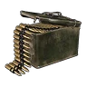Гатлинговые патроны<small>⚖️ 0,025</small>

<h3>Гатлинговые патроны</h3>Обычный
Боеприпасы для оружия: «Пулемёт Гатлинга». Без них оружие не выстрелит, поэтому держи запас в сумке.

⚖️<small>Вес</small><b>0,025</b>

💰<small>Цена</small><b>60</b>

📘<small>Технология</small><b>ур. 54</b>

<h4>Подходит к оружию</h4>
<a class="ich" href="../../../4_spravochniki/predmety/оружие/#пулемёт-гатлинга">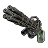Пулемёт Гатлинга</a>

<h4>🔨 Крафт <small>×50 за раз</small></h4>
<a class="ich" href="../../../4_spravochniki/predmety/материалы/#слиток-пал-металла">Слиток Пал-Металла<b>×1</b></a><a class="ich" href="../../../4_spravochniki/predmety/материалы/#порох">Порох<b>×3</b></a>
<h5>Где сделать</h5>
<a class="ich" href="../../../4_spravochniki/predmety/постройки/#мастерская-развитой-цивилизации">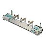Мастерская развитой цивилизации</a><a class="ich" href="../../../4_spravochniki/predmety/постройки/#сборочная-линия-оружия-разв-цив">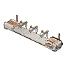Сборочная линия оружия разв. цив.</a><a class="ich" href="../../../4_spravochniki/predmety/постройки/#древний-верстак">Древний верстак</a>

<h4>📍 Где взять</h4>

🛒Продаётся у торговцев<small>💰 60</small>

📍Награда Заносчивого критика Палов<small>×12</small><small>100 %</small>

📍Сундук в поселении: Фейбрейк<small>×5–8</small><small>27 %</small>

📍Пещера Тэнраку<small>×1–3</small><small>25 %</small>

📍Мусорный сундук: Фейбрейк<small>×5–10</small><small>25 %</small>

📍Лагерь врагов: Сакурадзима<small>×1–3</small><small>25 %</small>

🎁Нефтяная вышка ур. 55: редкий сундук<small>×100–200</small><small>14 %</small>

📍Рыбный пруд на базе: Фейбрейк<small>×1–2</small><small>9,1 %</small>

📍Рыбалка: Фейбрейк<small>×1–3</small><small>7,3 %</small>

Из игры

Патрон для оружия: Пулемёт Гатлинга — и похожего.

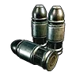Гранатомётный патрон<small>⚖️ 0,1</small>

<h3>Гранатомётный патрон</h3>Обычный
Боеприпасы для оружия: «Гранатомёт». Без них оружие не выстрелит, поэтому держи запас в сумке.

⚖️<small>Вес</small><b>0,1</b>

💰<small>Цена</small><b>470</b>

📘<small>Технология</small><b>ур. 53</b>

<h4>Подходит к оружию</h4>
<a class="ich" href="../../../4_spravochniki/predmety/оружие/#гранатомёт">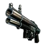Гранатомёт</a>

<h4>🔨 Крафт <small>×10 за раз</small></h4>
<a class="ich" href="../../../4_spravochniki/predmety/материалы/#слиток-пал-металла">Слиток Пал-Металла<b>×2</b></a><a class="ich" href="../../../4_spravochniki/predmety/материалы/#волокно">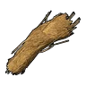Волокно<b>×20</b></a><a class="ich" href="../../../4_spravochniki/predmety/материалы/#порох">Порох<b>×3</b></a>
<h5>Где сделать</h5>
<a class="ich" href="../../../4_spravochniki/predmety/постройки/#мастерская-развитой-цивилизации">Мастерская развитой цивилизации</a><a class="ich" href="../../../4_spravochniki/predmety/постройки/#сборочная-линия-оружия-разв-цив">Сборочная линия оружия разв. цив.</a><a class="ich" href="../../../4_spravochniki/predmety/постройки/#древний-верстак">Древний верстак</a>

<h4>📍 Где взять</h4>

🛒Продаётся у торговцев<small>💰 470</small>

👤Мученик Братства Вечного Пламени<small>×1</small><small>100 %</small>

👤Лаборант отряда Генетических Исследований<small>×1–2</small><small>100 %</small>

👤Воин Тэнраку<small>×1</small><small>100 %</small>

👤Ветеран Вигилантов<small>×1</small><small>100 %</small>

📍Награда Заносчивого критика Палов<small>×6</small><small>100 %</small>

📍Мусорный сундук: Сакурадзима<small>×5–10</small><small>25 %</small>

🎁Нефтяная вышка ур. 55: редкий сундук<small>×100–200</small><small>14 %</small>

Из игры

Патрон для оружия: Гранатомёт — и похожего.

Грубые патроны<small>⚖️ 0,025</small>

<h3>Грубые патроны</h3>Обычный
Боеприпасы для оружия: «Самодельный пистолет», «Мушкет», «Ветхая штурмовая винтовка» и ещё 2. Без них оружие не выстрелит, поэтому держи запас в сумке.

⚖️<small>Вес</small><b>0,025</b>

💰<small>Цена</small><b>40</b>

📘<small>Технология</small><b>ур. 21</b>

<h4>Подходит к оружию</h4>
<a class="ich" href="../../../4_spravochniki/predmety/оружие/#самодельный-пистолет">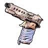Самодельный пистолет</a><a class="ich" href="../../../4_spravochniki/predmety/оружие/#мушкет">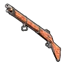Мушкет</a><a class="ich" href="../../../4_spravochniki/predmety/оружие/#ветхая-штурмовая-винтовка">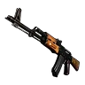Ветхая штурмовая винтовка</a><a class="ich" href="../../../4_spravochniki/predmety/оружие/#ветхий-пистолетпулемёт">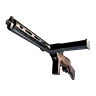Ветхий пистолет‑пулемёт</a><a class="ich" href="../../../4_spravochniki/predmety/оружие/#ветхий-дробовик">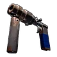Ветхий дробовик</a>

<h4>🔨 Крафт <small>×20 за раз</small></h4>
<a class="ich" href="../../../4_spravochniki/predmety/материалы/#металлический-слиток">Металлический слиток<b>×1</b></a><a class="ich" href="../../../4_spravochniki/predmety/материалы/#порох">Порох<b>×1</b></a>
<h5>Где сделать</h5>
<a class="ich" href="../../../4_spravochniki/predmety/постройки/#качественный-верстак">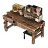Качественный верстак</a><a class="ich" href="../../../4_spravochniki/predmety/постройки/#конвейерная-фабрика">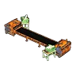Конвейерная фабрика</a><a class="ich" href="../../../4_spravochniki/predmety/постройки/#мастерская-развитой-цивилизации">Мастерская развитой цивилизации</a><a class="ich" href="../../../4_spravochniki/predmety/постройки/#оружейная-мастерская">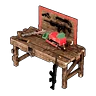Оружейная мастерская</a><a class="ich" href="../../../4_spravochniki/predmety/постройки/#конвейерная-фабрика-оружия">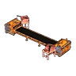Конвейерная фабрика оружия</a><a class="ich" href="../../../4_spravochniki/predmety/постройки/#сборочная-линия-оружия-разв-цив">Сборочная линия оружия разв. цив.</a><a class="ich" href="../../../4_spravochniki/predmety/постройки/#древний-верстак">Древний верстак</a>

<h4>📍 Где взять</h4>

🛒Продаётся у торговцев<small>💰 40</small>

👤Браконьер-новичок<small>×1–2</small><small>100 %</small>

👤Браконьер-громила<small>×2–3</small><small>100 %</small>

👤Напористый интервьюер Гриль<small>×2–3</small><small>100 %</small>

👤Стрелок Вигилантов<small>×1–2</small><small>100 %</small>

👤Эльдер<small>×2–3</small><small>100 %</small>

📍Награда Заносчивого критика Палов<small>×11</small><small>100 %</small>

📍Сундук<small>×5–10</small><small>35 %</small>

📍Сундук в поселении: Пустыня<small>×5–8</small><small>33 %</small>

📍Пещера Вулкана<small>×5–10</small><small>28 %</small>

📍Мусорный сундук: Холмы (старт)<small>×5–10</small><small>25 %</small>

📍Лагерь врагов: Лес<small>×1–3</small><small>23 %</small>

🎁Нефтяная вышка ур. 30: редкий сундук<small>×25–50</small><small>14 %</small>

📍Рыбный пруд на базе: Вулкан<small>×5–10</small><small>9,1 %</small>

📍Рыбалка: Вулкан<small>×5–10</small><small>8,2 %</small>

Из игры

Патрон для оружия: Мушкет, Самодельный пистолет — и похожего.

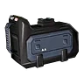Кассета для лазерной картечницы Гатлинга<small>⚖️ 0,025</small>

<h3>Кассета для лазерной картечницы Гатлинга</h3>Обычный
Боеприпасы для оружия: «Лазерный пулемёт Гатлинга». Без них оружие не выстрелит, поэтому держи запас в сумке.

⚖️<small>Вес</small><b>0,025</b>

💰<small>Цена</small><b>110</b>

📘<small>Технология</small><b>ур. 59</b>

<h4>Подходит к оружию</h4>
<a class="ich" href="../../../4_spravochniki/predmety/оружие/#лазерный-пулемёт-гатлинга">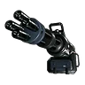Лазерный пулемёт Гатлинга</a>

<h4>🔨 Крафт <small>×50 за раз</small></h4>
<a class="ich" href="../../../4_spravochniki/predmety/материалы/#биобатарея">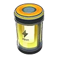Биобатарея<b>×1</b></a><a class="ich" href="../../../4_spravochniki/predmety/материалы/#сталепластик">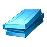Сталепластик<b>×1</b></a>
<h5>Где сделать</h5>
<a class="ich" href="../../../4_spravochniki/predmety/постройки/#мастерская-развитой-цивилизации">Мастерская развитой цивилизации</a><a class="ich" href="../../../4_spravochniki/predmety/постройки/#сборочная-линия-оружия-разв-цив">Сборочная линия оружия разв. цив.</a><a class="ich" href="../../../4_spravochniki/predmety/постройки/#древний-верстак">Древний верстак</a>

<h4>📍 Где взять</h4>

🛒Продаётся у торговцев<small>💰 110</small>

🎁Нефтяная вышка ур. 60: редкий сундук<small>×100–200</small><small>20 %</small>

📍Лагерь врагов: Сакурадзима<small>×10–15</small><small>14 %</small>

Из игры

Патрон для оружия: Лазерный пулемёт Гатлинга — и похожего.

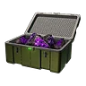Метеоритный снаряд<small>⚖️ 1</small>

<h3>Метеоритный снаряд</h3>Обычный
Боеприпасы для оружия: «Метеоромёт». Без них оружие не выстрелит, поэтому держи запас в сумке.

⚖️<small>Вес</small><b>1</b>

💰<small>Цена</small><b>360</b>

📘<small>Технология</small><b>ур. 38</b>

<h4>Подходит к оружию</h4>
<a class="ich" href="../../../4_spravochniki/predmety/оружие/#метеоромёт">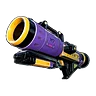Метеоромёт</a>

<h4>🔨 Крафт <small>×10 за раз</small></h4>
<a class="ich" href="../../../4_spravochniki/predmety/материалы/#обломок-метеорита">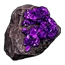Обломок метеорита<b>×3</b></a>
<h5>Где сделать</h5>
<a class="ich" href="../../../4_spravochniki/predmety/постройки/#конвейерная-фабрика">Конвейерная фабрика</a><a class="ich" href="../../../4_spravochniki/predmety/постройки/#мастерская-развитой-цивилизации">Мастерская развитой цивилизации</a><a class="ich" href="../../../4_spravochniki/predmety/постройки/#конвейерная-фабрика-оружия">Конвейерная фабрика оружия</a><a class="ich" href="../../../4_spravochniki/predmety/постройки/#сборочная-линия-оружия-разв-цив">Сборочная линия оружия разв. цив.</a><a class="ich" href="../../../4_spravochniki/predmety/постройки/#древний-верстак">Древний верстак</a>

<h4>📍 Где взять</h4>

🛒Продаётся у торговцев<small>💰 360</small>

Из игры

Патрон для оружия: Метеоромёт — и похожего.

Огненная стрела<small>⚖️ 0,025</small>

<h3>Огненная стрела</h3>Обычный
Стрелы для оружия: «Арбалет», «Старый лук», «Огненный арбалет» и ещё 1. При попадании наносит урон стихии «Огонь».

⚖️<small>Вес</small><b>0,025</b>

💰<small>Цена</small><b>40</b>

📘<small>Технология</small><b>ур. 6</b>

<h4>Подходит к оружию</h4>
<a class="ich" href="../../../4_spravochniki/predmety/оружие/#арбалет">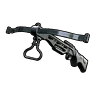Арбалет</a><a class="ich" href="../../../4_spravochniki/predmety/оружие/#старый-лук">Старый лук</a><a class="ich" href="../../../4_spravochniki/predmety/оружие/#огненный-арбалет">Огненный арбалет</a><a class="ich" href="../../../4_spravochniki/predmety/оружие/#трехзарядный-лук">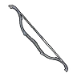Трехзарядный лук</a>

<h4>🔨 Крафт <small>×10 за раз</small></h4>
<a class="ich" href="../../../4_spravochniki/predmety/материалы/#древесина">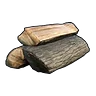Древесина<b>×2</b></a><a class="ich" href="../../../4_spravochniki/predmety/материалы/#камень">Камень<b>×2</b></a><a class="ich" href="../../../4_spravochniki/predmety/материалы/#огненный-орган">Огненный орган<b>×1</b></a>
<h5>Где сделать</h5>
<a class="ich" href="../../../4_spravochniki/predmety/постройки/#качественный-верстак">Качественный верстак</a><a class="ich" href="../../../4_spravochniki/predmety/постройки/#конвейерная-фабрика">Конвейерная фабрика</a><a class="ich" href="../../../4_spravochniki/predmety/постройки/#мастерская-развитой-цивилизации">Мастерская развитой цивилизации</a><a class="ich" href="../../../4_spravochniki/predmety/постройки/#оружейная-мастерская">Оружейная мастерская</a><a class="ich" href="../../../4_spravochniki/predmety/постройки/#конвейерная-фабрика-оружия">Конвейерная фабрика оружия</a><a class="ich" href="../../../4_spravochniki/predmety/постройки/#сборочная-линия-оружия-разв-цив">Сборочная линия оружия разв. цив.</a><a class="ich" href="../../../4_spravochniki/predmety/постройки/#примитивный-верстак">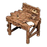Примитивный верстак</a><a class="ich" href="../../../4_spravochniki/predmety/постройки/#древний-верстак">Древний верстак</a>

<h4>📍 Где взять</h4>

🛒Продаётся у торговцев<small>💰 40</small>

🎁Нефтяная вышка ур. 30: редкий сундук<small>×25–50</small><small>14 %</small>

Из игры

Огненная стрела для стрельбы из лука. При попадании наносит урон стихии «Огонь».

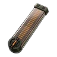Патрон для боевого пистолет-пулемёта<small>⚖️ 0,025</small>

<h3>Патрон для боевого пистолет-пулемёта</h3>Обычный
Боеприпасы для оружия: «Боевой пистолет-пулемёт». Без них оружие не выстрелит, поэтому держи запас в сумке.

⚖️<small>Вес</small><b>0,025</b>

💰<small>Цена</small><b>1020</b>

📘<small>Технология</small><b>ур. 68</b>

<h4>Подходит к оружию</h4>
<a class="ich" href="../../../4_spravochniki/predmety/оружие/#боевой-пистолет-пулемёт">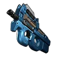Боевой пистолет-пулемёт</a>

<h4>🔨 Крафт <small>×20 за раз</small></h4>
<a class="ich" href="../../../4_spravochniki/predmety/материалы/#соллайтовый-слиток">Соллайтовый слиток<b>×2</b></a><a class="ich" href="../../../4_spravochniki/predmety/материалы/#порох">Порох<b>×6</b></a>
<h5>Где сделать</h5>
<a class="ich" href="../../../4_spravochniki/predmety/постройки/#древний-верстак">Древний верстак</a>

<h4>📍 Где взять</h4>

🛒Продаётся у торговцев<small>💰 1020</small>

📍Мусорный сундук: Санрич<small>×5–10</small><small>25 %</small>

📍Лагерь врагов<small>×10–15</small><small>12 %</small>

Из игры

Патрон для оружия: Боевой пистолет-пулемёт — и похожего.

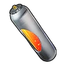Патрон для бустерной пушки<small>⚖️ 0,025</small>

<h3>Патрон для бустерной пушки</h3>Обычный
Боеприпасы для оружия: «Бустерная пушка». Без них оружие не выстрелит, поэтому держи запас в сумке.

⚖️<small>Вес</small><b>0,025</b>

💰<small>Цена</small><b>90</b>

📘<small>Технология</small><b>ур. 25</b>

<h4>Подходит к оружию</h4>
<a class="ich" href="../../../4_spravochniki/predmety/оружие/#бустерная-пушка">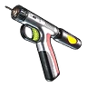Бустерная пушка</a>

<h4>🔨 Крафт <small>×10 за раз</small></h4>
<a class="ich" href="../../../4_spravochniki/predmety/материалы/#металлический-слиток">Металлический слиток<b>×2</b></a><a class="ich" href="../../../4_spravochniki/predmety/материалы/#электрический-орган">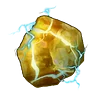Электрический орган<b>×1</b></a>
<h5>Где сделать</h5>
<a class="ich" href="../../../4_spravochniki/predmety/постройки/#качественный-верстак">Качественный верстак</a><a class="ich" href="../../../4_spravochniki/predmety/постройки/#конвейерная-фабрика">Конвейерная фабрика</a><a class="ich" href="../../../4_spravochniki/predmety/постройки/#мастерская-развитой-цивилизации">Мастерская развитой цивилизации</a><a class="ich" href="../../../4_spravochniki/predmety/постройки/#оружейная-мастерская">Оружейная мастерская</a><a class="ich" href="../../../4_spravochniki/predmety/постройки/#конвейерная-фабрика-оружия">Конвейерная фабрика оружия</a><a class="ich" href="../../../4_spravochniki/predmety/постройки/#сборочная-линия-оружия-разв-цив">Сборочная линия оружия разв. цив.</a><a class="ich" href="../../../4_spravochniki/predmety/постройки/#древний-верстак">Древний верстак</a>

<h4>📍 Где взять</h4>

🛒Продаётся у торговцев<small>💰 90</small>

Из игры

Патрон для оружия: Бустерная пушка — и похожего.

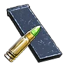Патрон для винтовки<small>⚖️ 0,025</small>

<h3>Патрон для винтовки</h3>Обычный
Боеприпасы для оружия: «Однозарядная винтовка» и «Полуавтоматическая винтовка». Без них оружие не выстрелит, поэтому держи запас в сумке.

⚖️<small>Вес</small><b>0,025</b>

💰<small>Цена</small><b>280</b>

📘<small>Технология</small><b>ур. 36</b>

<h4>Подходит к оружию</h4>
<a class="ich" href="../../../4_spravochniki/predmety/оружие/#однозарядная-винтовка">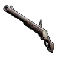Однозарядная винтовка</a><a class="ich" href="../../../4_spravochniki/predmety/оружие/#полуавтоматическая-винтовка">Полуавтоматическая винтовка</a>

<h4>🔨 Крафт <small>×10 за раз</small></h4>
<a class="ich" href="../../../4_spravochniki/predmety/материалы/#слиток-рафинированного-металла">Слиток рафинированного металла<b>×2</b></a><a class="ich" href="../../../4_spravochniki/predmety/материалы/#порох">Порох<b>×2</b></a>
<h5>Где сделать</h5>
<a class="ich" href="../../../4_spravochniki/predmety/постройки/#качественный-верстак">Качественный верстак</a><a class="ich" href="../../../4_spravochniki/predmety/постройки/#конвейерная-фабрика">Конвейерная фабрика</a><a class="ich" href="../../../4_spravochniki/predmety/постройки/#мастерская-развитой-цивилизации">Мастерская развитой цивилизации</a><a class="ich" href="../../../4_spravochniki/predmety/постройки/#оружейная-мастерская">Оружейная мастерская</a><a class="ich" href="../../../4_spravochniki/predmety/постройки/#конвейерная-фабрика-оружия">Конвейерная фабрика оружия</a><a class="ich" href="../../../4_spravochniki/predmety/постройки/#сборочная-линия-оружия-разв-цив">Сборочная линия оружия разв. цив.</a><a class="ich" href="../../../4_spravochniki/predmety/постройки/#древний-верстак">Древний верстак</a>

<h4>📍 Где взять</h4>

🛒Продаётся у торговцев<small>💰 280</small>

👤Стрелок Вигилантов<small>×1</small><small>100 %</small>

📍Мусорный сундук: Лес<small>×5–10</small><small>25 %</small>

Из игры

Патрон для винтовок и аналогичного оружия.

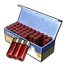Патрон для дробовика<small>⚖️ 0,025</small>

<h3>Патрон для дробовика</h3>Обычный
Боеприпасы для оружия: «Двухствольный дробовик», «Полуавтоматический дробовик» и «Дробовик с выбросом ядра». Без них оружие не выстрелит, поэтому держи запас в сумке.

⚖️<small>Вес</small><b>0,025</b>

💰<small>Цена</small><b>330</b>

📘<small>Технология</small><b>ур. 39</b>

<h4>Подходит к оружию</h4>
<a class="ich" href="../../../4_spravochniki/predmety/оружие/#двухствольный-дробовик">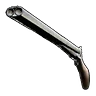Двухствольный дробовик</a><a class="ich" href="../../../4_spravochniki/predmety/оружие/#полуавтоматический-дробовик">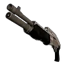Полуавтоматический дробовик</a><a class="ich" href="../../../4_spravochniki/predmety/оружие/#дробовик-с-выбросом-ядра">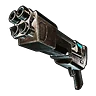Дробовик с выбросом ядра</a>

<h4>🔨 Крафт <small>×10 за раз</small></h4>
<a class="ich" href="../../../4_spravochniki/predmety/материалы/#слиток-рафинированного-металла">Слиток рафинированного металла<b>×2</b></a><a class="ich" href="../../../4_spravochniki/predmety/материалы/#порох">Порох<b>×3</b></a>
<h5>Где сделать</h5>
<a class="ich" href="../../../4_spravochniki/predmety/постройки/#качественный-верстак">Качественный верстак</a><a class="ich" href="../../../4_spravochniki/predmety/постройки/#конвейерная-фабрика">Конвейерная фабрика</a><a class="ich" href="../../../4_spravochniki/predmety/постройки/#мастерская-развитой-цивилизации">Мастерская развитой цивилизации</a><a class="ich" href="../../../4_spravochniki/predmety/постройки/#оружейная-мастерская">Оружейная мастерская</a><a class="ich" href="../../../4_spravochniki/predmety/постройки/#конвейерная-фабрика-оружия">Конвейерная фабрика оружия</a><a class="ich" href="../../../4_spravochniki/predmety/постройки/#сборочная-линия-оружия-разв-цив">Сборочная линия оружия разв. цив.</a><a class="ich" href="../../../4_spravochniki/predmety/постройки/#древний-верстак">Древний верстак</a>

<h4>📍 Где взять</h4>

🛒Продаётся у торговцев<small>💰 330</small>

👤Стражник<small>×1</small><small>100 %</small>

👤Браконьер-охотник<small>×1</small><small>100 %</small>

👤Элитный Вигилант<small>×1</small><small>100 %</small>

📍Мусорный сундук: Снега<small>×5–10</small><small>25 %</small>

📍Лагерь врагов: Пустыня<small>×10–20</small><small>24 %</small>

Из игры

Патрон для дробовиков и аналогичного оружия.

Патрон для зарядной винтовки<small>⚖️ 0,01</small>

<h3>Патрон для зарядной винтовки</h3>Обычный
Боеприпасы для оружия: «Зарядная винтовка». Без них оружие не выстрелит, поэтому держи запас в сумке.

⚖️<small>Вес</small><b>0,01</b>

💰<small>Цена</small><b>1740</b>

📘<small>Технология</small><b>ур. 65</b>

<h4>Подходит к оружию</h4>
<a class="ich" href="../../../4_spravochniki/predmety/оружие/#зарядная-винтовка">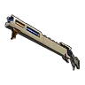Зарядная винтовка</a>

<h4>🔨 Крафт <small>×10 за раз</small></h4>
<a class="ich" href="../../../4_spravochniki/predmety/материалы/#биобатарея">Биобатарея<b>×1</b></a><a class="ich" href="../../../4_spravochniki/predmety/материалы/#термоядро">Термоядро<b>×1</b></a>
<h5>Где сделать</h5>
<a class="ich" href="../../../4_spravochniki/predmety/постройки/#мастерская-развитой-цивилизации">Мастерская развитой цивилизации</a><a class="ich" href="../../../4_spravochniki/predmety/постройки/#сборочная-линия-оружия-разв-цив">Сборочная линия оружия разв. цив.</a><a class="ich" href="../../../4_spravochniki/predmety/постройки/#древний-верстак">Древний верстак</a>

<h4>📍 Где взять</h4>

🛒Продаётся у торговцев<small>💰 1740</small>

Из игры

Патрон для оружия: Зарядная винтовка — и похожего.

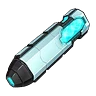Патрон для лучемёта<small>⚖️ 0,025</small>

<h3>Патрон для лучемёта</h3>Обычный
Боеприпасы для оружия: «Лучемёт». Без них оружие не выстрелит, поэтому держи запас в сумке.

⚖️<small>Вес</small><b>0,025</b>

💰<small>Цена</small><b>13660</b>

📘<small>Технология</small><b>ур. 80</b>

<h4>Подходит к оружию</h4>
<a class="ich" href="../../../4_spravochniki/predmety/оружие/#лучемёт">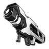Лучемёт</a>

<h4>🔨 Крафт <small>×10 за раз</small></h4>
<a class="ich" href="../../../4_spravochniki/predmety/материалы/#биобатарея">Биобатарея<b>×1</b></a><a class="ich" href="../../../4_spravochniki/predmety/материалы/#палкизитовый-слиток">Палкизитовый слиток<b>×6</b></a><a class="ich" href="../../../4_spravochniki/predmety/материалы/#соллайтовый-слиток">Соллайтовый слиток<b>×2</b></a>
<h5>Где сделать</h5>
<a class="ich" href="../../../4_spravochniki/predmety/постройки/#древний-верстак">Древний верстак</a>

<h4>📍 Где взять</h4>

🛒Продаётся у торговцев<small>💰 13660</small>

📍Сундук: Мировое Древо<small>×1–3</small><small>13 %</small>

📍Рыбалка: Мировое Древо<small>×1–3</small><small>2,2 %</small>

Из игры

Патрон для оружия: Лучемёт — и похожего.

Патрон для лучерассеивателя<small>⚖️ 0,025</small>

<h3>Патрон для лучерассеивателя</h3>Обычный
Боеприпасы для оружия: «Лучерассеиватель». Без них оружие не выстрелит, поэтому держи запас в сумке.

⚖️<small>Вес</small><b>0,025</b>

💰<small>Цена</small><b>7830</b>

📘<small>Технология</small><b>ур. 75</b>

<h4>Подходит к оружию</h4>
<a class="ich" href="../../../4_spravochniki/predmety/оружие/#лучерассеиватель">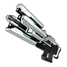Лучерассеиватель</a>

<h4>🔨 Крафт <small>×10 за раз</small></h4>
<a class="ich" href="../../../4_spravochniki/predmety/материалы/#биобатарея">Биобатарея<b>×1</b></a><a class="ich" href="../../../4_spravochniki/predmety/материалы/#палкизитовый-слиток">Палкизитовый слиток<b>×3</b></a><a class="ich" href="../../../4_spravochniki/predmety/материалы/#соллайтовый-слиток">Соллайтовый слиток<b>×2</b></a>
<h5>Где сделать</h5>
<a class="ich" href="../../../4_spravochniki/predmety/постройки/#древний-верстак">Древний верстак</a>

<h4>📍 Где взять</h4>

🛒Продаётся у торговцев<small>💰 7830</small>

📍Мусорный сундук: Мировое Древо<small>×5–10</small><small>20 %</small>

📍Сундук: Мировое Древо<small>×1–3</small><small>13 %</small>

📍Рыбалка: Мировое Древо<small>×1–3</small><small>2,2 %</small>

Из игры

Патрон для оружия: Лучерассеиватель — и похожего.

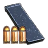Патрон для пистолета<small>⚖️ 0,025</small>

<h3>Патрон для пистолета</h3>Обычный
Боеприпасы для оружия: «Пистолет», «Старый револьвер», «Пистолет‑пулемёт» и ещё 1. Без них оружие не выстрелит, поэтому держи запас в сумке.

⚖️<small>Вес</small><b>0,025</b>

💰<small>Цена</small><b>40</b>

📘<small>Технология</small><b>ур. 28</b>

<h4>Подходит к оружию</h4>
<a class="ich" href="../../../4_spravochniki/predmety/оружие/#пистолет">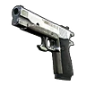Пистолет</a><a class="ich" href="../../../4_spravochniki/predmety/оружие/#старый-револьвер">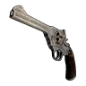Старый револьвер</a><a class="ich" href="../../../4_spravochniki/predmety/оружие/#пистолетпулемёт">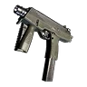Пистолет‑пулемёт</a><a class="ich" href="../../../4_spravochniki/predmety/оружие/#револьвер-меткого-стрелка">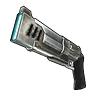Револьвер меткого стрелка</a>

<h4>🔨 Крафт <small>×20 за раз</small></h4>
<a class="ich" href="../../../4_spravochniki/predmety/материалы/#металлический-слиток">Металлический слиток<b>×1</b></a><a class="ich" href="../../../4_spravochniki/predmety/материалы/#порох">Порох<b>×1</b></a>
<h5>Где сделать</h5>
<a class="ich" href="../../../4_spravochniki/predmety/постройки/#качественный-верстак">Качественный верстак</a><a class="ich" href="../../../4_spravochniki/predmety/постройки/#конвейерная-фабрика">Конвейерная фабрика</a><a class="ich" href="../../../4_spravochniki/predmety/постройки/#мастерская-развитой-цивилизации">Мастерская развитой цивилизации</a><a class="ich" href="../../../4_spravochniki/predmety/постройки/#оружейная-мастерская">Оружейная мастерская</a><a class="ich" href="../../../4_spravochniki/predmety/постройки/#конвейерная-фабрика-оружия">Конвейерная фабрика оружия</a><a class="ich" href="../../../4_spravochniki/predmety/постройки/#сборочная-линия-оружия-разв-цив">Сборочная линия оружия разв. цив.</a><a class="ich" href="../../../4_spravochniki/predmety/постройки/#древний-верстак">Древний верстак</a>

<h4>📍 Где взять</h4>

🛒Продаётся у торговцев<small>💰 40</small>

👤Охранник Вигилантов<small>×1–2</small><small>100 %</small>

📍Сундук в поселении: Снега<small>×5–8</small><small>27 %</small>

📍Мусорный сундук: Холмы (старт)<small>×5–10</small><small>25 %</small>

📍Лагерь врагов: Вулкан<small>×10–20</small><small>23 %</small>

Из игры

Патрон для оружия: Пистолет — и похожего.

Патрон для плазменной винтовки<small>⚖️ 0,025</small>

<h3>Патрон для плазменной винтовки</h3>Обычный
Боеприпасы для оружия: «Плазменная винтовка». Без них оружие не выстрелит, поэтому держи запас в сумке.

⚖️<small>Вес</small><b>0,025</b>

💰<small>Цена</small><b>3910</b>

📘<small>Технология</small><b>ур. 78</b>

<h4>Подходит к оружию</h4>
<a class="ich" href="../../../4_spravochniki/predmety/оружие/#плазменная-винтовка">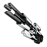Плазменная винтовка</a>

<h4>🔨 Крафт <small>×20 за раз</small></h4>
<a class="ich" href="../../../4_spravochniki/predmety/материалы/#биобатарея">Биобатарея<b>×1</b></a><a class="ich" href="../../../4_spravochniki/predmety/материалы/#палкизитовый-слиток">Палкизитовый слиток<b>×3</b></a><a class="ich" href="../../../4_spravochniki/predmety/материалы/#соллайтовый-слиток">Соллайтовый слиток<b>×2</b></a>
<h5>Где сделать</h5>
<a class="ich" href="../../../4_spravochniki/predmety/постройки/#древний-верстак">Древний верстак</a>

<h4>📍 Где взять</h4>

🛒Продаётся у торговцев<small>💰 3910</small>

📍Мусорный сундук: Мировое Древо<small>×6–12</small><small>20 %</small>

📍Сундук: Мировое Древо<small>×1–3</small><small>13 %</small>

📍Рыбалка: Мировое Древо<small>×1–3</small><small>2,2 %</small>

Из игры

Патрон для оружия: Плазменная винтовка — и похожего.

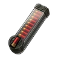Патрон для прототипного дробовика<small>⚖️ 0,025</small>

<h3>Патрон для прототипного дробовика</h3>Обычный
Боеприпасы для оружия: «Прототипный дробовик». Без них оружие не выстрелит, поэтому держи запас в сумке.

⚖️<small>Вес</small><b>0,025</b>

💰<small>Цена</small><b>3870</b>

📘<small>Технология</small><b>ур. 69</b>

<h4>Подходит к оружию</h4>
<a class="ich" href="../../../4_spravochniki/predmety/оружие/#прототипный-дробовик">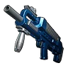Прототипный дробовик</a>

<h4>🔨 Крафт <small>×10 за раз</small></h4>
<a class="ich" href="../../../4_spravochniki/predmety/материалы/#соллайтовый-слиток">Соллайтовый слиток<b>×4</b></a><a class="ich" href="../../../4_spravochniki/predmety/материалы/#порох">Порох<b>×8</b></a>
<h5>Где сделать</h5>
<a class="ich" href="../../../4_spravochniki/predmety/постройки/#древний-верстак">Древний верстак</a>

<h4>📍 Где взять</h4>

🛒Продаётся у торговцев<small>💰 3870</small>

📍Небесный свод Санрича<small>×5–10</small><small>17 %</small>

📍Лагерь врагов<small>×5–10</small><small>12 %</small>

Из игры

Патрон для оружия: Прототипный дробовик — и похожего.

Патрон для тактического гранатомёта<small>⚖️ 0,025</small>

<h3>Патрон для тактического гранатомёта</h3>Обычный
Боеприпасы для оружия: «Тактический гранатомёт». Без них оружие не выстрелит, поэтому держи запас в сумке.

⚖️<small>Вес</small><b>0,025</b>

💰<small>Цена</small><b>3970</b>

📘<small>Технология</small><b>ур. 72</b>

<h4>Подходит к оружию</h4>
<a class="ich" href="../../../4_spravochniki/predmety/оружие/#тактический-гранатомёт">Тактический гранатомёт</a>

<h4>🔨 Крафт <small>×10 за раз</small></h4>
<a class="ich" href="../../../4_spravochniki/predmety/материалы/#соллайтовый-слиток">Соллайтовый слиток<b>×4</b></a><a class="ich" href="../../../4_spravochniki/predmety/материалы/#порох">Порох<b>×10</b></a>
<h5>Где сделать</h5>
<a class="ich" href="../../../4_spravochniki/predmety/постройки/#древний-верстак">Древний верстак</a>

<h4>📍 Где взять</h4>

🛒Продаётся у торговцев<small>💰 3970</small>

📍Небесный свод Санрича<small>×5–10</small><small>17 %</small>

Из игры

Патрон для оружия: Тактический гранатомёт — и похожего.

Патрон для тяжёлой штурмовой винтовки<small>⚖️ 0,025</small>

<h3>Патрон для тяжёлой штурмовой винтовки</h3>Обычный
Боеприпасы для оружия: «Тяжёлая штурмовая винтовка». Без них оружие не выстрелит, поэтому держи запас в сумке.

⚖️<small>Вес</small><b>0,025</b>

💰<small>Цена</small><b>1120</b>

📘<small>Технология</small><b>ур. 70</b>

<h4>Подходит к оружию</h4>
<a class="ich" href="../../../4_spravochniki/predmety/оружие/#тяжёлая-штурмовая-винтовка">Тяжёлая штурмовая винтовка</a>

<h4>🔨 Крафт <small>×20 за раз</small></h4>
<a class="ich" href="../../../4_spravochniki/predmety/материалы/#соллайтовый-слиток">Соллайтовый слиток<b>×2</b></a><a class="ich" href="../../../4_spravochniki/predmety/материалы/#порох">Порох<b>×10</b></a>
<h5>Где сделать</h5>
<a class="ich" href="../../../4_spravochniki/predmety/постройки/#древний-верстак">Древний верстак</a>

<h4>📍 Где взять</h4>

🛒Продаётся у торговцев<small>💰 1120</small>

📍Небесный свод Санрича<small>×5–15</small><small>17 %</small>

Из игры

Патрон для оружия: Тяжёлая штурмовая винтовка — и похожего.

Патрон для штурмовой винтовки<small>⚖️ 0,01</small>

<h3>Патрон для штурмовой винтовки</h3>Обычный
Боеприпасы для оружия: «Штурмовая винтовка» и «Пушка вихря». Без них оружие не выстрелит, поэтому держи запас в сумке.

⚖️<small>Вес</small><b>0,01</b>

💰<small>Цена</small><b>90</b>

📘<small>Технология</small><b>ур. 45</b>

<h4>Подходит к оружию</h4>
<a class="ich" href="../../../4_spravochniki/predmety/оружие/#штурмовая-винтовка">Штурмовая винтовка</a><a class="ich" href="../../../4_spravochniki/predmety/оружие/#пушка-вихря">Пушка вихря</a>

<h4>🔨 Крафт <small>×20 за раз</small></h4>
<a class="ich" href="../../../4_spravochniki/predmety/материалы/#слиток-рафинированного-металла">Слиток рафинированного металла<b>×1</b></a><a class="ich" href="../../../4_spravochniki/predmety/материалы/#порох">Порох<b>×2</b></a>
<h5>Где сделать</h5>
<a class="ich" href="../../../4_spravochniki/predmety/постройки/#конвейерная-фабрика">Конвейерная фабрика</a><a class="ich" href="../../../4_spravochniki/predmety/постройки/#мастерская-развитой-цивилизации">Мастерская развитой цивилизации</a><a class="ich" href="../../../4_spravochniki/predmety/постройки/#конвейерная-фабрика-оружия">Конвейерная фабрика оружия</a><a class="ich" href="../../../4_spravochniki/predmety/постройки/#сборочная-линия-оружия-разв-цив">Сборочная линия оружия разв. цив.</a><a class="ich" href="../../../4_spravochniki/predmety/постройки/#древний-верстак">Древний верстак</a>

<h4>📍 Где взять</h4>

🛒Продаётся у торговцев<small>💰 90</small>

👤Мученик Братства Вечного Пламени<small>×1–2</small><small>100 %</small>

👤Стражник<small>×1</small><small>100 %</small>

👤Браконьер-стрелок<small>×1</small><small>100 %</small>

👤Стрелок Вигилантов<small>×1</small><small>100 %</small>

👤Охотник на новичков Ястреб<small>×1</small><small>100 %</small>

👤Закоренелый тиран Кнут<small>×1</small><small>100 %</small>

👤Безумный стрелок Клинт<small>×1–10</small><small>100 %</small>

👤Ленивый шеф<small>×1–2</small><small>100 %</small>

📍Сундук в поселении: Сакурадзима<small>×5–8</small><small>27 %</small>

📍Лагерь врагов: Снега<small>×10–20</small><small>27 %</small>

📍Пещера Цветущей Сакуры<small>×1–3</small><small>26 %</small>

📍Мусорный сундук: Снега<small>×5–10</small><small>25 %</small>

🎁Нефтяная вышка ур. 55: редкий сундук<small>×100–200</small><small>14 %</small>

📍Рыбный пруд на базе: Сакурадзима<small>×1–2</small><small>9,1 %</small>

📍Рыбалка: Сакурадзима<small>×1–3</small><small>7,7 %</small>

Из игры

Патрон для оружия: Штурмовая винтовка — и похожего.

Патрон для энергетического ружья<small>⚖️ 0,025</small>

<h3>Патрон для энергетического ружья</h3>Обычный
Боеприпасы для оружия: «Энергетическое ружье». Без них оружие не выстрелит, поэтому держи запас в сумке.

⚖️<small>Вес</small><b>0,025</b>

💰<small>Цена</small><b>990</b>

📘<small>Технология</small><b>ур. 63</b>

<h4>Подходит к оружию</h4>
<a class="ich" href="../../../4_spravochniki/predmety/оружие/#энергетическое-ружье">Энергетическое ружье</a>

<h4>🔨 Крафт <small>×10 за раз</small></h4>
<a class="ich" href="../../../4_spravochniki/predmety/материалы/#биобатарея">Биобатарея<b>×1</b></a><a class="ich" href="../../../4_spravochniki/predmety/материалы/#гексолит">Гексолит<b>×2</b></a>
<h5>Где сделать</h5>
<a class="ich" href="../../../4_spravochniki/predmety/постройки/#мастерская-развитой-цивилизации">Мастерская развитой цивилизации</a><a class="ich" href="../../../4_spravochniki/predmety/постройки/#сборочная-линия-оружия-разв-цив">Сборочная линия оружия разв. цив.</a><a class="ich" href="../../../4_spravochniki/predmety/постройки/#древний-верстак">Древний верстак</a>

<h4>📍 Где взять</h4>

🛒Продаётся у торговцев<small>💰 990</small>

Из игры

Патрон для оружия: Энергетическое ружье — и похожего.

Плазматическая кассета<small>⚖️ 0,5</small>

<h3>Плазматическая кассета</h3>Обычный
Боеприпасы для оружия: «Плазменная пушка». Без них оружие не выстрелит, поэтому держи запас в сумке.

⚖️<small>Вес</small><b>0,5</b>

💰<small>Цена</small><b>2190</b>

📘<small>Технология</small><b>ур. 61</b>

<h4>Подходит к оружию</h4>
<a class="ich" href="../../../4_spravochniki/predmety/оружие/#плазменная-пушка">Плазменная пушка</a>

<h4>🔨 Крафт <small>×10 за раз</small></h4>
<a class="ich" href="../../../4_spravochniki/predmety/материалы/#термоядро">Термоядро<b>×1</b></a><a class="ich" href="../../../4_spravochniki/predmety/материалы/#гексолит">Гексолит<b>×2</b></a>
<h5>Где сделать</h5>
<a class="ich" href="../../../4_spravochniki/predmety/постройки/#мастерская-развитой-цивилизации">Мастерская развитой цивилизации</a><a class="ich" href="../../../4_spravochniki/predmety/постройки/#сборочная-линия-оружия-разв-цив">Сборочная линия оружия разв. цив.</a><a class="ich" href="../../../4_spravochniki/predmety/постройки/#древний-верстак">Древний верстак</a>

<h4>📍 Где взять</h4>

🛒Продаётся у торговцев<small>💰 2190</small>

🎁Нефтяная вышка ур. 60: редкий сундук<small>×40–100</small><small>20 %</small>

Из игры

Патрон для оружия: Плазменная пушка — и похожего.

Ракета с наведением<small>⚖️ 1</small>

<h3>Ракета с наведением</h3>Обычный
Боеприпасы для оружия: «Ракетная установка» и «Многозарядная ракетная установка». Без них оружие не выстрелит, поэтому держи запас в сумке.

⚖️<small>Вес</small><b>1</b>

💰<small>Цена</small><b>3240</b>

📘<small>Технология</small><b>ур. 56</b>

<h4>Подходит к оружию</h4>
<a class="ich" href="../../../4_spravochniki/predmety/оружие/#ракетная-установка">Ракетная установка</a><a class="ich" href="../../../4_spravochniki/predmety/оружие/#многозарядная-ракетная-установка">Многозарядная ракетная установка</a>

<h4>🔨 Крафт <small>×10 за раз</small></h4>
<a class="ich" href="../../../4_spravochniki/predmety/материалы/#слиток-пал-металла">Слиток Пал-Металла<b>×3</b></a><a class="ich" href="../../../4_spravochniki/predmety/материалы/#сырая-нефть">Сырая нефть<b>×1</b></a><a class="ich" href="../../../4_spravochniki/predmety/материалы/#компьютер">Компьютер<b>×1</b></a>
<h5>Где сделать</h5>
<a class="ich" href="../../../4_spravochniki/predmety/постройки/#мастерская-развитой-цивилизации">Мастерская развитой цивилизации</a><a class="ich" href="../../../4_spravochniki/predmety/постройки/#сборочная-линия-оружия-разв-цив">Сборочная линия оружия разв. цив.</a><a class="ich" href="../../../4_spravochniki/predmety/постройки/#древний-верстак">Древний верстак</a>

<h4>📍 Где взять</h4>

🛒Продаётся у торговцев<small>💰 3240</small>

👤Мученик Братства Вечного Пламени<small>×1</small><small>100 %</small>

👤Лаборант отряда Генетических Исследований<small>×1</small><small>100 %</small>

👤Элитный Тэнраку<small>×1</small><small>100 %</small>

👤Перехватчик Вигилантов<small>×1</small><small>100 %</small>

🎁Нефтяная вышка ур. 60: редкий сундук<small>×20–100</small><small>20 %</small>

Из игры

Патрон для оружия: Ракетная установка — и похожего.

Ракетный снаряд<small>⚖️ 0,5</small>

<h3>Ракетный снаряд</h3>Обычный
Боеприпасы для оружия: «Ракетомёт». Без них оружие не выстрелит, поэтому держи запас в сумке.

⚖️<small>Вес</small><b>0,5</b>

💰<small>Цена</small><b>2550</b>

📘<small>Технология</small><b>ур. 65</b>

<h4>Подходит к оружию</h4>
<a class="ich" href="../../../4_spravochniki/predmety/оружие/#ракетомёт">Ракетомёт</a>

<h4>🔨 Крафт <small>×10 за раз</small></h4>
<a class="ich" href="../../../4_spravochniki/predmety/материалы/#гексолит">Гексолит<b>×3</b></a><a class="ich" href="../../../4_spravochniki/predmety/материалы/#термоядро">Термоядро<b>×1</b></a>
<h5>Где сделать</h5>
<a class="ich" href="../../../4_spravochniki/predmety/постройки/#мастерская-развитой-цивилизации">Мастерская развитой цивилизации</a><a class="ich" href="../../../4_spravochniki/predmety/постройки/#сборочная-линия-оружия-разв-цив">Сборочная линия оружия разв. цив.</a><a class="ich" href="../../../4_spravochniki/predmety/постройки/#древний-верстак">Древний верстак</a>

<h4>📍 Где взять</h4>

🛒Продаётся у торговцев<small>💰 2550</small>

👤Элитный браконьер<small>×1</small><small>50 %</small>

👤Мученик Братства Вечного Пламени<small>×1</small><small>100 %</small>

👤Ракетчик Вигилантов<small>×1</small><small>100 %</small>

🎁Нефтяная вышка ур. 60: редкий сундук<small>×20–100</small><small>20 %</small>

Из игры

Боеприпас для оружия: Ракетомёт — и похожего.

Стрела<small>⚖️ 0,025</small>

<h3>Стрела</h3>Обычный
Стрелы для оружия: «Арбалет», «Старый лук» и «Трехзарядный лук». Без них оружие не выстрелит, поэтому держи запас в сумке.

⚖️<small>Вес</small><b>0,025</b>

💰<small>Цена</small><b>10</b>

📘<small>Технология</small><b>ур. 3</b>

<h4>Подходит к оружию</h4>
<a class="ich" href="../../../4_spravochniki/predmety/оружие/#арбалет">Арбалет</a><a class="ich" href="../../../4_spravochniki/predmety/оружие/#старый-лук">Старый лук</a><a class="ich" href="../../../4_spravochniki/predmety/оружие/#трехзарядный-лук">Трехзарядный лук</a>

<h4>🔨 Крафт <small>×10 за раз</small></h4>
<a class="ich" href="../../../4_spravochniki/predmety/материалы/#древесина">Древесина<b>×2</b></a><a class="ich" href="../../../4_spravochniki/predmety/материалы/#камень">Камень<b>×2</b></a>
<h5>Где сделать</h5>
<a class="ich" href="../../../4_spravochniki/predmety/постройки/#качественный-верстак">Качественный верстак</a><a class="ich" href="../../../4_spravochniki/predmety/постройки/#конвейерная-фабрика">Конвейерная фабрика</a><a class="ich" href="../../../4_spravochniki/predmety/постройки/#мастерская-развитой-цивилизации">Мастерская развитой цивилизации</a><a class="ich" href="../../../4_spravochniki/predmety/постройки/#оружейная-мастерская">Оружейная мастерская</a><a class="ich" href="../../../4_spravochniki/predmety/постройки/#конвейерная-фабрика-оружия">Конвейерная фабрика оружия</a><a class="ich" href="../../../4_spravochniki/predmety/постройки/#сборочная-линия-оружия-разв-цив">Сборочная линия оружия разв. цив.</a><a class="ich" href="../../../4_spravochniki/predmety/постройки/#примитивный-верстак">Примитивный верстак</a><a class="ich" href="../../../4_spravochniki/predmety/постройки/#древний-верстак">Древний верстак</a>

<h4>📍 Где взять</h4>

🛒Продаётся у торговцев<small>💰 10</small>
<a class="igt" href="../../../4_spravochniki/paly/robinquill/">🐾Робинквилл<small>×2–4</small><small>100 %</small></a><a class="igt" href="../../../4_spravochniki/paly/robinquill_terra/">🐾Робинквилл Терра<small>×2–4</small><small>100 %</small></a>
👤Адепт Организации по Защите Палов<small>×1–2</small><small>100 %</small>

👤Самовлюбленный болтун Эго<small>×1–2</small><small>100 %</small>

👤Стрелок Вигилантов<small>×1–2</small><small>100 %</small>

👤Браконьер-арбалетчик<small>×1–2</small><small>100 %</small>

👤Генин из Общества Лунных Цветов<small>×1–2</small><small>100 %</small>

👤Дзёнин из Общества Лунных Цветов<small>×1–2</small><small>100 %</small>

📍Сундук в поселении: Лес<small>×5–8</small><small>30 %</small>

📍Сундук: Лес<small>×10–15</small><small>28 %</small>

📍Пещера Горного Потока<small>×3–5</small><small>28 %</small>

📍Мусорный сундук: Холмы (старт)<small>×5–10</small><small>25 %</small>

🐑Пастбище: Викси сам даёт<small>×1–2</small><small>24 %</small>

📍Лагерь врагов: Холмы (старт)<small>×3–5</small><small>23 %</small>

📍Пещера Отдалённого Острова<small>×10–20</small><small>22 %</small>

🎁Нефтяная вышка ур. 30: редкий сундук<small>×25–50</small><small>14 %</small>

🎁Сундуки и ящики: Холмы (старт)<small>×5–10</small><small>9,5 %</small>

📍Рыбный пруд на базе: Лес<small>×3–5</small><small>9,3 %</small>

📍Рыбалка: Лес<small>×3–5</small><small>8,2 %</small>

📍Стрела<small>×3–5</small><small>100 %</small>

Из игры

Стрела для стрельбы из лука.

Стрела механического лука<small>⚖️ 0,025</small>

<h3>Стрела механического лука</h3>Обычный
Стрелы для оружия: «Механический лук». Без них оружие не выстрелит, поэтому держи запас в сумке.

⚖️<small>Вес</small><b>0,025</b>

💰<small>Цена</small><b>1730</b>

📘<small>Технология</small><b>ур. 67</b>

<h4>Подходит к оружию</h4>
<a class="ich" href="../../../4_spravochniki/predmety/оружие/#механический-лук">Механический лук</a>

<h4>🔨 Крафт <small>×10 за раз</small></h4>
<a class="ich" href="../../../4_spravochniki/predmety/материалы/#соллайтовый-слиток">Соллайтовый слиток<b>×2</b></a>
<h5>Где сделать</h5>
<a class="ich" href="../../../4_spravochniki/predmety/постройки/#древний-верстак">Древний верстак</a>

<h4>📍 Где взять</h4>

🛒Продаётся у торговцев<small>💰 1730</small>

📍Мусорный сундук: Санрич<small>×5–10</small><small>25 %</small>

📍Лагерь врагов<small>×5–10</small><small>12 %</small>

Из игры

Усиленная стрела, предназначенная для стрельбы из оружия «Механический лук».

Топливо для огнемёта<small>⚖️ 0,01</small>

<h3>Топливо для огнемёта</h3>Обычный
Боеприпасы для оружия: «Огнемёт». Без них оружие не выстрелит, поэтому держи запас в сумке.

⚖️<small>Вес</small><b>0,01</b>

💰<small>Цена</small><b>280</b>

📘<small>Технология</small><b>ур. 52</b>

<h4>Подходит к оружию</h4>
<a class="ich" href="../../../4_spravochniki/predmety/оружие/#огнемёт">Огнемёт</a>

<h4>🔨 Крафт <small>×10 за раз</small></h4>
<a class="ich" href="../../../4_spravochniki/predmety/материалы/#сырая-нефть">Сырая нефть<b>×2</b></a><a class="ich" href="../../../4_spravochniki/predmety/материалы/#слиток-рафинированного-металла">Слиток рафинированного металла<b>×1</b></a>
<h5>Где сделать</h5>
<a class="ich" href="../../../4_spravochniki/predmety/постройки/#мастерская-развитой-цивилизации">Мастерская развитой цивилизации</a><a class="ich" href="../../../4_spravochniki/predmety/постройки/#сборочная-линия-оружия-разв-цив">Сборочная линия оружия разв. цив.</a><a class="ich" href="../../../4_spravochniki/predmety/постройки/#древний-верстак">Древний верстак</a>

<h4>📍 Где взять</h4>

🛒Продаётся у торговцев<small>💰 280</small>

👤Клинер Вигилантов<small>×1</small><small>100 %</small>

📍Мусорный сундук: Сакурадзима<small>×5–10</small><small>25 %</small>

🎁Нефтяная вышка ур. 55: редкий сундук<small>×100–200</small><small>14 %</small>

Из игры

Топливо для огнемёта. Патрон для оружия: Огнемёт — и похожего.

Улучшенная стрела<small>⚖️ 0,025</small>

<h3>Улучшенная стрела</h3>Обычный
Стрелы для оружия: «Улучшенный лук». Без них оружие не выстрелит, поэтому держи запас в сумке.

⚖️<small>Вес</small><b>0,025</b>

💰<small>Цена</small><b>1110</b>

📘<small>Технология</small><b>ур. 57</b>

<h4>Подходит к оружию</h4>
<a class="ich" href="../../../4_spravochniki/predmety/оружие/#улучшенный-лук">Улучшенный лук</a>

<h4>🔨 Крафт <small>×10 за раз</small></h4>
<a class="ich" href="../../../4_spravochniki/predmety/материалы/#сталепластик">Сталепластик<b>×2</b></a><a class="ich" href="../../../4_spravochniki/predmety/материалы/#углеродное-волокно">Углеродное волокно<b>×5</b></a>
<h5>Где сделать</h5>
<a class="ich" href="../../../4_spravochniki/predmety/постройки/#качественный-верстак">Качественный верстак</a><a class="ich" href="../../../4_spravochniki/predmety/постройки/#конвейерная-фабрика">Конвейерная фабрика</a><a class="ich" href="../../../4_spravochniki/predmety/постройки/#мастерская-развитой-цивилизации">Мастерская развитой цивилизации</a><a class="ich" href="../../../4_spravochniki/predmety/постройки/#оружейная-мастерская">Оружейная мастерская</a><a class="ich" href="../../../4_spravochniki/predmety/постройки/#конвейерная-фабрика-оружия">Конвейерная фабрика оружия</a><a class="ich" href="../../../4_spravochniki/predmety/постройки/#сборочная-линия-оружия-разв-цив">Сборочная линия оружия разв. цив.</a><a class="ich" href="../../../4_spravochniki/predmety/постройки/#примитивный-верстак">Примитивный верстак</a><a class="ich" href="../../../4_spravochniki/predmety/постройки/#древний-верстак">Древний верстак</a>

<h4>📍 Где взять</h4>

🛒Продаётся у торговцев<small>💰 1110</small>

🎁Нефтяная вышка ур. 60: редкий сундук<small>×100–200</small><small>20 %</small>

📍Лагерь врагов: Сакурадзима<small>×5–10</small><small>14 %</small>

Из игры

Усиленная стрела, предназначенная для стрельбы из оружия «Улучшенный лук».

Усиленная стрела<small>⚖️ 0,025</small>

<h3>Усиленная стрела</h3>Обычный
Стрелы для оружия: «Блочный лук». Без них оружие не выстрелит, поэтому держи запас в сумке.

⚖️<small>Вес</small><b>0,025</b>

💰<small>Цена</small><b>370</b>

📘<small>Технология</small><b>ур. 42</b>

<h4>Подходит к оружию</h4>
<a class="ich" href="../../../4_spravochniki/predmety/оружие/#блочный-лук">Блочный лук</a>

<h4>🔨 Крафт <small>×10 за раз</small></h4>
<a class="ich" href="../../../4_spravochniki/predmety/материалы/#слиток-рафинированного-металла">Слиток рафинированного металла<b>×2</b></a><a class="ich" href="../../../4_spravochniki/predmety/материалы/#углеродное-волокно">Углеродное волокно<b>×2</b></a>
<h5>Где сделать</h5>
<a class="ich" href="../../../4_spravochniki/predmety/постройки/#качественный-верстак">Качественный верстак</a><a class="ich" href="../../../4_spravochniki/predmety/постройки/#конвейерная-фабрика">Конвейерная фабрика</a><a class="ich" href="../../../4_spravochniki/predmety/постройки/#мастерская-развитой-цивилизации">Мастерская развитой цивилизации</a><a class="ich" href="../../../4_spravochniki/predmety/постройки/#оружейная-мастерская">Оружейная мастерская</a><a class="ich" href="../../../4_spravochniki/predmety/постройки/#конвейерная-фабрика-оружия">Конвейерная фабрика оружия</a><a class="ich" href="../../../4_spravochniki/predmety/постройки/#сборочная-линия-оружия-разв-цив">Сборочная линия оружия разв. цив.</a><a class="ich" href="../../../4_spravochniki/predmety/постройки/#примитивный-верстак">Примитивный верстак</a><a class="ich" href="../../../4_spravochniki/predmety/постройки/#древний-верстак">Древний верстак</a>

<h4>📍 Где взять</h4>

🛒Продаётся у торговцев<small>💰 370</small>

📍Пещера Песчаных Дюн<small>×5–10</small><small>27 %</small>

📍Пещера Священной Горы<small>×5–10</small><small>26 %</small>

📍Рыбный пруд на базе: Пустыня<small>×5–10</small><small>8,8 %</small>

📍Рыбалка: Пустыня<small>×5–10</small><small>7,8 %</small>

Из игры

Усиленная стрела, предназначенная для стрельбы из оружия «Блочный лук».

Чернила для граффити<small>⚖️ 0,05</small>

<h3>Чернила для граффити</h3>Обычный
Патроны для граффити-ружья. Без них оружие не выстрелит, поэтому держи запас в сумке.

⚖️<small>Вес</small><b>0,05</b>

💰<small>Цена</small><b>70</b>

📘<small>Технология</small><b>ур. 45</b>

<h4>🔨 Крафт <small>×10 за раз</small></h4>
<a class="ich" href="../../../4_spravochniki/predmety/материалы/#жидкость-водного-пала">Жидкость водного Пала<b>×1</b></a><a class="ich" href="../../../4_spravochniki/predmety/материалы/#качественное-масло-пала">Качественное масло Пала<b>×1</b></a>
<h5>Где сделать</h5>
<a class="ich" href="../../../4_spravochniki/predmety/постройки/#качественный-верстак">Качественный верстак</a><a class="ich" href="../../../4_spravochniki/predmety/постройки/#конвейерная-фабрика">Конвейерная фабрика</a><a class="ich" href="../../../4_spravochniki/predmety/постройки/#мастерская-развитой-цивилизации">Мастерская развитой цивилизации</a><a class="ich" href="../../../4_spravochniki/predmety/постройки/#оружейная-мастерская">Оружейная мастерская</a><a class="ich" href="../../../4_spravochniki/predmety/постройки/#конвейерная-фабрика-оружия">Конвейерная фабрика оружия</a><a class="ich" href="../../../4_spravochniki/predmety/постройки/#сборочная-линия-оружия-разв-цив">Сборочная линия оружия разв. цив.</a><a class="ich" href="../../../4_spravochniki/predmety/постройки/#древний-верстак">Древний верстак</a>

Из игры

Патроны для граффити-ружья. Позволяют рисовать изображения Палов с помощью чернил.

Энергетический картридж<small>⚖️ 0,01</small>

<h3>Энергетический картридж</h3>Обычный
Боеприпасы для оружия: «Лазерная винтовка». Без них оружие не выстрелит, поэтому держи запас в сумке.

⚖️<small>Вес</small><b>0,01</b>

💰<small>Цена</small><b>280</b>

📘<small>Технология</small><b>ур. 51</b>

<h4>Подходит к оружию</h4>
<a class="ich" href="../../../4_spravochniki/predmety/оружие/#лазерная-винтовка">Лазерная винтовка</a>

<h4>🔨 Крафт <small>×20 за раз</small></h4>
<a class="ich" href="../../../4_spravochniki/predmety/материалы/#биобатарея">Биобатарея<b>×1</b></a><a class="ich" href="../../../4_spravochniki/predmety/материалы/#слиток-пал-металла">Слиток Пал-Металла<b>×2</b></a>
<h5>Где сделать</h5>
<a class="ich" href="../../../4_spravochniki/predmety/постройки/#мастерская-развитой-цивилизации">Мастерская развитой цивилизации</a><a class="ich" href="../../../4_spravochniki/predmety/постройки/#сборочная-линия-оружия-разв-цив">Сборочная линия оружия разв. цив.</a><a class="ich" href="../../../4_spravochniki/predmety/постройки/#древний-верстак">Древний верстак</a>

<h4>📍 Где взять</h4>

🛒Продаётся у торговцев<small>💰 280</small>

👤Браконьер-технарь<small>×1</small><small>100 %</small>

👤Хайтеккер Вигилантов<small>×1</small><small>100 %</small>

📍Награда Заносчивого критика Палов<small>×6</small><small>100 %</small>

📍Мусорный сундук: Фейбрейк<small>×5–10</small><small>25 %</small>

📍Лагерь врагов: Сакурадзима<small>×10–20</small><small>23 %</small>

🎁Нефтяная вышка ур. 55: редкий сундук<small>×100–200</small><small>14 %</small>

Из игры

Патрон для оружия: Лазерная винтовка — и похожего.

Ядовитая стрела<small>⚖️ 0,025</small>

<h3>Ядовитая стрела</h3>Обычный
Стрелы для оружия: «Арбалет», «Старый лук», «Ядовитый лук» и ещё 2. При попадании накладывает на цель Яд.

⚖️<small>Вес</small><b>0,025</b>

💰<small>Цена</small><b>40</b>

📘<small>Технология</small><b>ур. 8</b>

<h4>Подходит к оружию</h4>
<a class="ich" href="../../../4_spravochniki/predmety/оружие/#арбалет">Арбалет</a><a class="ich" href="../../../4_spravochniki/predmety/оружие/#старый-лук">Старый лук</a><a class="ich" href="../../../4_spravochniki/predmety/оружие/#ядовитый-лук">Ядовитый лук</a><a class="ich" href="../../../4_spravochniki/predmety/оружие/#ядовитый-арбалет">Ядовитый арбалет</a><a class="ich" href="../../../4_spravochniki/predmety/оружие/#трехзарядный-лук">Трехзарядный лук</a>

<h4>🔨 Крафт <small>×10 за раз</small></h4>
<a class="ich" href="../../../4_spravochniki/predmety/материалы/#древесина">Древесина<b>×2</b></a><a class="ich" href="../../../4_spravochniki/predmety/материалы/#камень">Камень<b>×2</b></a><a class="ich" href="../../../4_spravochniki/predmety/материалы/#ядовитая-железа">Ядовитая железа<b>×1</b></a>
<h5>Где сделать</h5>
<a class="ich" href="../../../4_spravochniki/predmety/постройки/#качественный-верстак">Качественный верстак</a><a class="ich" href="../../../4_spravochniki/predmety/постройки/#конвейерная-фабрика">Конвейерная фабрика</a><a class="ich" href="../../../4_spravochniki/predmety/постройки/#мастерская-развитой-цивилизации">Мастерская развитой цивилизации</a><a class="ich" href="../../../4_spravochniki/predmety/постройки/#оружейная-мастерская">Оружейная мастерская</a><a class="ich" href="../../../4_spravochniki/predmety/постройки/#конвейерная-фабрика-оружия">Конвейерная фабрика оружия</a><a class="ich" href="../../../4_spravochniki/predmety/постройки/#сборочная-линия-оружия-разв-цив">Сборочная линия оружия разв. цив.</a><a class="ich" href="../../../4_spravochniki/predmety/постройки/#примитивный-верстак">Примитивный верстак</a><a class="ich" href="../../../4_spravochniki/predmety/постройки/#древний-верстак">Древний верстак</a>

<h4>📍 Где взять</h4>

🛒Продаётся у торговцев<small>💰 40</small>

🎁Нефтяная вышка ур. 30: редкий сундук<small>×25–50</small><small>14 %</small>

Из игры

Ядовитая стрела для стрельбы из лука. При попадании накладывает на цель Яд.

